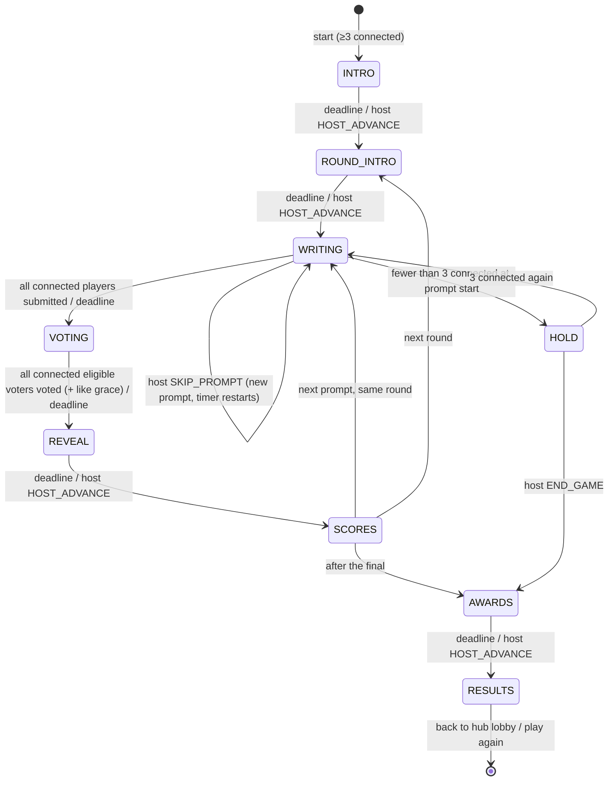

# GAME-BLUFF — "Bluff the answer" (JAMAA game #2)

Status: **binding design spec**, draft 1, 2026-11-08. Game id: `bluff`. Display names: EN **Bluff!**, FR **Bluff !**, AR **«بلوف!»** (the word is used as-is in Lebanese; `[native review]`: alternative «كذّبها!»).

This file defines the rules, state machine, timers, scoring, edge cases, screens, settings, copy, content schema and first content for Bluff. Things the JAMAA hub owns are only referenced here: the lobby, game picker, player characters, the ⓘ rules button, entitlements (JAMAA Pass), sound mute, room lifetime and reconnect. **The platform contract is [JAMAA-PLATFORM.md](JAMAA-PLATFORM.md) (§2.10 for Bluff); where it names a shared concept differently, the platform name wins and this file maps to it.** In particular: i18n keys written `bluff.*` here live under `game.bluff.*`; intents travel as `GAME {gameId:"bluff", i}`; `HOST_ADVANCE` is the platform's host-advance intent; late joiners are the room's *benched* members. Everything that is specific to Bluff is fixed here.

Conventions are those of [SPEC.md](SPEC.md): pure engine (`reduce(state, action, ctx:{now, catalog})`, RNG `rngState` in state, one idempotent `TICK`), server-authoritative Durable Object, per-client projections, every server→client key always present (`null` when empty), times in epoch ms, durations `*Ms`. `[VERIFY]` = check before shipping. `[native review]` = a native speaker must approve the text.

---

## 1. The game in one paragraph

The TV shows a strange prompt: the end of a Lebanese proverb, the meaning of a rare English word, a French expression nobody uses any more. Everyone secretly types a **fake** answer on their phone, good enough to fool the others. The TV then shows all the fakes mixed with the **real** answer (plus a few "house lies" when there are not enough players). Everyone votes for what they think is the truth. You score for finding the truth, and you score more for every friend who falls for **your** lie. Then the reveal: one answer at a time, voters' characters jump onto it, it is stamped LIE or TRUTH, the liar pops out grinning and coins fly from the fooled players into the liar's pile.

Players: **3–12** (platform bounds). Best at 4–8. Duration: about 15–20 minutes (Normal length).

---

## 2. Platform hooks used (what Bluff asks of the JAMAA hub)

| Hook | Bluff's value |
|---|---|
| `gameId` | `"bluff"` |
| Players | min 3, max 12. Start is blocked under 3 **connected** players (platform `NOT_ENOUGH_PLAYERS`) |
| Settings | 3 settings, §9 (`packIds`, `length`, `pace`) |
| How to play | 4 steps, §10.1; shown once per room the first time Bluff starts (platform "first-time intro"), always reachable through ⓘ |
| ⓘ rules sheet | §10.2, keys `bluff.rules.*` |
| Characters | One character per player (platform). Expressions Bluff uses: `idle`, `think`, `done`, `smug`, `shock`, `facepalm`, `cheer`, `laugh`, `sad`, `away` (§12.4). If the platform set differs, map to the closest |
| Content language | The room's content language (platform setting; Mish Ana! calls it `wordLocale`). Packs list `playableIn` locales (§11) |
| Entitlement | Free room: items with `tier:"free"` only. JAMAA Pass room: all items. **Pass items never reach a free room's clients** (same rule as Mish Ana! premium words) |
| Host powers | TV remote (always) and the VIP phone (platform host player) |
| Sounds | New cues in §12.6, synthesised by `tools/gen-sounds` like the existing ones |

---

## 3. Structure

| Length setting | Round 1 (×1) | Round 2 (×2) | Final (×3) | Prompts |
|---|---|---|---|---|
| Short | 2 | 2 | 1 | 5 |
| **Normal** (default) | 3 | 3 | 1 | 7 |
| Long | 4 | 4 | 1 | 9 |

Each **prompt** runs the loop WRITING → VOTING → REVEAL → SCORES. A round starts with a ROUND_INTRO card. After the final prompt: AWARDS → RESULTS.

The final is called **"The Big Bluff"** (FR «Le Grand Bluff», AR «البلوف الكبير»). Same mechanics, ×3 points, slower reveal and its own music sting. The final prompt is drawn with `difficulty >= 2` when the pool allows it.

---

## 4. State machine



`INTRO` is the platform's first-time "How to play" (skipped if this room already saw it, or immediately skippable). `HOLD` exists only at the **start** of a prompt; a prompt already running always finishes.

### 4.1 Phases, deadlines, who acts

Durations below are for `pace: "normal"`. `relaxed` multiplies WRITING and VOTING by 1.5, `fast` by 0.75 (rounded to the second). Reveal-type phases are not scaled by pace. Reduced motion does **not** change server deadlines (the TV simply finishes its animation early and waits).

| Phase | Deadline kind | Duration | Ends early when | Who can act |
|---|---|---|---|---|
| `INTRO` | `INTRO` | 20 000 ms | host `HOST_ADVANCE` | host |
| `ROUND_INTRO` | `ROUND_INTRO` | 4 000 ms (final: 6 000) | host `HOST_ADVANCE` | host |
| `WRITING` | `WRITING` | 60 000 ms | every connected, non-`left` player has a submitted lie | players: `SUBMIT_LIE`, `REQUEST_HELP`; host: `SKIP_PROMPT` |
| `VOTING` | `VOTING` | `clamp(20 000 + 2 000 × optionCount, 26 000, 45 000)` | every connected eligible voter has voted → deadline moves to `now + LIKE_GRACE_MS` (3 000) if that is earlier | players: `VOTE`, `LIKE`; host: `HIDE_OPTION` |
| `REVEAL` | `REVEAL` | `revealDurationMs(reveal)` (§12.2) | host `HOST_ADVANCE` | host |
| `SCORES` | `SCORES` | 6 000 ms | host `HOST_ADVANCE` | host |
| `HOLD` | none | — | 3 players connected | host: `END_GAME` |
| `AWARDS` | `AWARDS` | `2 500 + 3 500 × awardCount` | host `HOST_ADVANCE` | host |
| `RESULTS` | none | — | — | host: `PLAY_AGAIN`, `BACK_TO_HUB` (platform) |

`host HOST_ADVANCE` sets `deadline.at = now` and the next `TICK` (sent immediately by the DO) advances. It is ignored in WRITING and VOTING (players must not be cut off by a remote press; the host uses `SKIP_PROMPT`, or simply waits).

### 4.2 Transitions in detail

**Entering WRITING.**
1. If fewer than 3 players are connected → `HOLD`.
2. Draw the prompt (§11.4) with the state RNG. Store it in `state.prompt` (server only until REVEAL; see §8.1 for what is projected).
3. Clear `lies`, `votes`, `likes`, `help`, `options`. Set the deadline.

**WRITING → VOTING ("build options").**
1. Collect submitted lies of every player (connected or not, `left` excluded).
2. Merge duplicates (§5.3). A lie that matches a house lie replaces it (the player keeps the credit).
3. `houseCount = max(MIN_LIES − distinctPlayerLies, playersInGame ≤ 4 ? 1 : 0)`, `MIN_LIES = 3`. House lies are drawn with the RNG from `item.houseLies[locale]`, skipping any that collide (§5.3) with a player lie or the truth. If the item has too few, take from the pack's `fallbackHouseLies` for that type and locale; if still short, show fewer options (never fewer than 2 in total; at 2 the TV shows "Easy one!" and the prompt still scores normally).
4. Options = merged player lies + house lies + truth. **Shuffle with the RNG.** Give each option a fresh random id (8 hex chars from the RNG); ids carry no order or kind information.
5. If **no** player submitted and no house lie exists for the item, the prompt is discarded silently and a new one is drawn (WRITING restarts once; a second failure goes to VOTING with whatever exists).

**VOTING → REVEAL ("build reveal").** The engine computes the full reveal script (§12.2) and the score deltas in one step and stores them in `state.reveal`. Scores are applied to `players[].score` at this moment (so a crash/reconnect never loses points); the TV animates from `scoreBefore` to `scoreAfter`, both projected.

**SCORES → next.** `promptIndex++`. Next phase per §3. Prompt ids used are appended to `room.usedPromptIds` (platform room history, kept across games in the same room, capped at 500 ids FIFO).

---

## 5. Submitting a lie

### 5.1 Input rules

| Rule | Value |
|---|---|
| Sanitising | Same pipeline as `sanitizeName` (SPEC §7.9) without the uniqueness step: NFC, strip `Cc/Cf/Co/Cs`, collapse spaces, trim, max 2 combining marks per grapheme |
| Length | **1–60 graphemes** (`LIE_MAX_CHARS = 60`), ≤ 240 code points. Must contain at least 2 letters (`\p{L}`) — rejects "...", "??", "1" |
| Count | One lie per player per prompt. It can be **edited** (re-submitted) until WRITING ends |
| Case | Shown as typed, with the first letter upper-cased for Latin scripts (`toLocaleUpperCase(locale)` on the first grapheme) so a lowercase lie does not stand out against the content's style |
| Script | Any script is accepted in any room (an English lie in an Arabic room is the author's problem) |
| Rate | Platform rate limit applies; plus at most 10 `SUBMIT_LIE` per player per prompt (`LIE_EDITS_MAX`) → `TOO_MANY_EDITS` |

Error codes (new, namespaced; `messageKey` per SPEC §6.4 convention): `LIE_EMPTY`, `LIE_TOO_LONG`, `LIE_TOO_CLOSE`, `LIE_BLOCKED_WORD`, `TOO_MANY_EDITS`, `WRONG_PHASE` (platform).

### 5.2 "Too close to the truth"

A lie is **rejected** with `LIE_TOO_CLOSE` when it matches the truth or any `truthAlt` of the room locale **or** of the item's `sourceLocale` (so typing the original Arabic ending in an English room is also caught).

```ts
// shared/src/games/bluff/similar.ts
export function normalizeAnswer(s: string): string; // = normalizeGuess (SPEC §4.12) with STOP extended by
// ["of","to","and","is","it","et","d","qu","que","est","en","au","aux","il","elle","on"]
// and Arabic: strip a leading "و" or "ف" conjunction from tokens of ≥ 4 letters, after the "ال" rule.
export function tokens(s: string): string[];        // the same pipeline, stopping before the final join
export function isTooClose(lie: string, truths: string[]): boolean;
```

`isTooClose` returns true if, for any truth `t` (both normalised; `L`, `T` = normalised strings):
1. `L === T`; or
2. `min(len(L), len(T)) ≥ 5` and `levenshtein(L, T) / max(len(L), len(T)) ≤ 0.2`; or
3. `len(T) ≥ 4` and `L.includes(T)` and `len(T) / len(L) ≥ 0.6`; or
4. the truth has ≥ 3 tokens and the Jaccard index of the two token sets is ≥ 0.75.

Lengths are in code points of the normalised string. The phone shows: "Too close to the real answer! You know it, now invent a lie." (`bluff.err.tooClose`). Knowing the truth earns nothing extra; the player will simply find it in the vote.

Required test vectors (truth → lie → too close?):

| Truth | Lie | Result |
|---|---|---|
| `The smell of earth after rain` | `smell of the earth after the rain` | true (rule 1 after stop words) |
| `The smell of earth after rain` | `The smell of rain` | false |
| `Ne pas venir à un rendez-vous` | `ne pas venir a un rendez vous` | true |
| `Ne pas venir à un rendez-vous` | `Venir en retard à un rendez-vous` | false (Jaccard 0.6) |
| `مش متل اللي بيعدّها` | `مش مثل اللي بيعدها` | true (rule 2) |
| `مش متل اللي بيعدّها` | `بيوجعو أكتر` | false |
| `Gardyloo` style: `A warning shout before throwing water from a window` | `warning shout before throwing water out a window` | true (rule 4) |

### 5.3 Duplicates and collisions

Two lies **collide** when `normalizeAnswer` is equal, or rule 2 of §5.2 holds with threshold 0.1 instead of 0.2. Colliding player lies are **merged into one option**:
- the displayed text is the earliest submission's text (by server receive time);
- **every author is credited**; the "fooled" points of that option are split equally among them (§6), rounded down to a multiple of 10;
- none of the co-authors may vote for it.

Nobody is told at submission time that their lie duplicates another (that would leak someone else's answer). The reveal shows both characters popping out together ("Great minds lie alike!", `bluff.reveal.sameLie`).

### 5.4 Blocked words and the host skip

- **Filter.** A small per-locale list of slurs and strong sexual or hateful terms (`shared/src/games/bluff/blocklist/{en,fr,ar}.json`, maintained with the word packs, ≤ 300 entries each, matched on `normalizeAnswer` tokens and on the normalised whole string for multi-word entries). A hit → `LIE_BLOCKED_WORD`; the phone says "Keep it party-friendly. Try another one." (`bluff.err.blocked`). Mild swearing is **not** blocked (it's a party game; the filter is for slurs).
- **Host hide.** In VOTING, the TV remote (pause menu → "Hide an answer", then pick a card) or the VIP phone (long-press a card → "Hide this answer") sends `HIDE_OPTION{optionId}`. Truth and house lies cannot be hidden (`CANNOT_HIDE`; the UI does not offer it). Effects: the option disappears; its authors score 0 for being voted on this prompt (they keep any truth points); voters who had chosen it lose their vote and get a "Vote again" toast; if less than 10 s remain, the deadline becomes `now + 10 000`. Max 3 hides per prompt.
- **Skip prompt.** In WRITING the host can `SKIP_PROMPT` (e.g. everyone knows this proverb). A new prompt is drawn, all lies are discarded, the WRITING timer restarts. Max 2 skips per prompt slot (`SKIPS_PER_PROMPT_MAX`); then the option is greyed out.

### 5.5 "Help me lie" (stuck players)

A player who has not submitted can tap **"Help me"** once per prompt (`REQUEST_HELP`). The server picks one unused house lie for this item (RNG) and puts it in that player's `me.help` only. The player may submit it as-is or edit it. Rules:
- That house lie is then **removed** from the house pool for this prompt, so it cannot appear twice.
- If the submitted text still collides with the helped text, the lie is flagged `helped: true` and its "fooled" points are **halved** (rounded down to 10). The reveal shows a small lifebuoy badge next to the author ("with a little help", `bluff.reveal.helped`).
- If no house lie is available, the button shows "No ideas left, you're on your own!" (`bluff.help.none`).

### 5.6 Players who do not submit

They have no option this prompt and simply vote. A player who has not submitted when the timer ends sees "Time's up! Vote for the truth." There is no auto-lie (it would put words in someone's mouth).

---

## 6. Voting, likes and scoring

### 6.1 Vote

- Each eligible voter (every non-`left` player, connected or not; disconnected ones just abstain) casts **one vote** for one option. It can be changed until VOTING ends (there is no speed component, so changing costs nothing).
- You **cannot vote for an option you authored** (incl. merged ones): the phone shows it greyed with "Yours" and the server rejects `CANNOT_VOTE_OWN`.
- Not voting = abstain (no points, no penalty).

### 6.2 Like

- During VOTING, after voting (or not), a player can **like up to 2 options** (`LIKE{optionId, on}` toggles), never their own. Likes are hidden until REVEAL.
- Likes on the truth or on a house lie are allowed (the liker does not know which is which) and score nothing; the reveal shows "The house thanks you" (`bluff.reveal.houseLike`) — a small joke that keeps likes from leaking information.

### 6.3 Points (per prompt; `m` = round multiplier 1, 2, 3)

| Event | Points | Notes |
|---|---|---|
| You voted for the truth | **+1000 × m** | |
| Each player who voted for your lie | **+500 × m** | Split equally among co-authors (§5.3); halved if `helped` (§5.5); rounded down to 10 |
| Each like your lie received | **+100** | Not multiplied. Split among co-authors. Max one like per liker per option |
| You voted for a house lie | 0 | Your character gets the "hooked by the house" reaction |
| Abstain / no lie | 0 | |

Scores never go down (engine invariant `score >= 0`, as in SPEC §4.13).

**Why these numbers.**
- **Truth (1000) > one fooled player (500).** Voting for a friend's lie to "gift" them 500 costs you 1000 that you would get by voting the truth, so collusion is a bad trade.
- **Two fooled players = one truth.** A good liar in a group of 6 who fools 2–3 people beats a truth-finder, so lying well is the main skill, as in the genre.
- **Multipliers ×1/×2/×3** keep the game open until the end: the final alone is worth up to 3000 + 500 × 3 × (n−1). A player 3000 points behind can still win.
- **Big round numbers** make the counters fun to watch (odometer rolls of hundreds), and they read the same in every language.
- **Likes are small (+100)** so they reward the funniest answer without deciding the game.

Worked example (6 players, round 1): Rami's lie fools Maya and Karim and gets 1 like → Rami +500 +500 +100 = 1100. Maya and Karim found nothing. Lina, Sami and Joe voted the truth → +1000 each. In round 2 the same outcome gives Rami 2100 and the truth-finders 2000.

### 6.4 Awards (AWARDS phase, after the final)

Shown as up to 4 cards, in this order, each skipped if nobody qualifies:

| Award (EN · FR · AR) | Rule | Tie-break |
|---|---|---|
| **Bluff of the Night** · Bluff de la soirée · «بلوف السهرة» | The single lie (one prompt) that fooled the most players, ≥ 2. The card replays that lie and the prompt | More likes, then the later prompt (bigger multiplier); still tied → all authors share |
| **Lie Detector** · Détecteur de mensonges · «كاشف الكذب» | Most truths found, ≥ 2 | Shared |
| **Crowd Favourite** · Chouchou du public · «حبيب الجمهور» | Most likes received over the game, ≥ 2 | Shared |
| **Hook, Line and Sinker** · Tombé dans le panneau · «بلعها» | Fooled most often (voted for a player lie or house lie), ≥ 3 — said with love | Shared |

Then RESULTS: the podium. **Winner = highest score; equal scores share the place** (no hidden tie-break: it's a party).

---

## 7. Edge cases

| Case | Behaviour |
|---|---|
| **3 players** | Always ≥ 1 house lie (§4.2), so each voter sees ≥ 3 votable options (2 other lies or house lies + truth). The ⓘ sheet says Bluff is best with 4+ |
| **12 players** | Up to 12 player lies + truth = 13 options. TV switches to the dense 2-column layout (§8.2); text max 60 graphemes keeps cards to 2 lines at `type.tv.body`. VOTING timer caps at 45 s |
| **Nobody submits** | House lies fill to `MIN_LIES` (3). The TV says "The house did all the lying this time!" |
| **Everyone finds the truth** | Reveal skips straight to the truth with "Too easy!" (`bluff.reveal.tooEasy`); unpicked lies get the "Nobody bought it" montage |
| **Nobody finds the truth** | Truth reveal plays with "Nobody saw that coming!" and every character does `shock` |
| **A lie nobody picked** | Not revealed individually; shown in the 2.5 s "Nobody bought it" montage with its author's `sad` face (montage capped at 6 cards; the rest are listed in small text) |
| **Disconnect in WRITING** | The phase does not wait for disconnected players. A lie already submitted stays. On reconnect within the phase, the phone restores the draft from `sessionStorage` (`jamaa.bluff.draft.<promptId>`) and `me.myLie` |
| **Disconnect in VOTING** | Abstains. Their lie stays an option and can still score. Reconnect during VOTING → can vote |
| **Player leaves (`left`)** | Their lie stays for the current prompt (scores are kept for results, shown greyed); they get no new prompts. Merged co-author credit is unchanged |
| **Fewer than 3 connected at prompt start** | `HOLD`: TV "Waiting for players… {count}/3" with the room code and QR; host can `END_GAME` → AWARDS with the scores so far |
| **Late joiner** | Joining is allowed during a Bluff game (platform join flow). The new player is a spectator until the next WRITING starts, then plays with 0 points and a "New" ribbon on the scoreboard for one prompt. They are eligible for awards |
| **Host hides the only player lie** | Allowed; options shrink; if total options < 2, the hide is refused (`CANNOT_HIDE`) |
| **Prompt pool exhausted** | Draw prefers prompts not in `usedPromptIds`; if none left, re-use the least recently used and show a small "Rerun!" tag on the TV prompt card. `startBlocker = NO_PROMPTS_AVAILABLE` only when the selected packs have fewer items than the game length (free rooms: free items) |
| **Lie in RTL in an LTR room (or the reverse)** | Each option renders with its own direction (web `dir="auto"`, Compose `TextDirection.Content`) |
| **Lie identical to a house lie** | Merged into the player's option; the house lie is dropped; the player gets full credit |
| **Lie identical to the item's `note`** | No special case (the note is not the truth; it's shown after the reveal) |
| **VIP disconnects** | Platform host transfer; the TV remote always keeps host powers |
| **Final round ties** | Shared places (§6.4) |
| **Room language changed mid-game** | Not allowed: content language is locked while a game runs (platform rule); UI language can change per device |

---

## 8. Screens: what the TV and the phone show

### 8.1 Secrecy (enforced by tests, §13)

| Data | TV | Author's phone | Other phones |
|---|---|---|---|
| The truth (`item.truth`, `truthAlt`, `note`) | REVEAL onwards only | REVEAL onwards only | REVEAL onwards only |
| A player's lie text | VOTING onwards, **as an anonymous option** | Own lie from WRITING (`me.myLie`) | VOTING onwards, anonymous |
| Which option is the truth / a house lie / whose | REVEAL onwards | own options only (`me.myOptionIds`) | REVEAL onwards |
| Who submitted | `submittedIds` (no text) | same | same |
| Votes | `votedIds` only until REVEAL | own (`me.myVote`) | `votedIds` only |
| Likes | hidden until REVEAL | own (`me.myLikes`) | hidden |
| Help suggestion | never | own (`me.help`) | never |
| House lies not used | never | never | never |
| Pass-tier items in a free room | never exist in the room | | |

Option order and ids are random (RNG), so neither leaks the truth. The prompt (`display`, `original`, `translit`) is public from WRITING.

### 8.2 Per phase

| Phase | TV (stage) | Phone (controller) |
|---|---|---|
| INTRO | The 4 how-to steps as animated cards (§10.1), "Press OK to start" | "How to play" with the same 4 steps, compact; VIP sees "Start" |
| ROUND_INTRO | Full-screen round card: "Round 1", "Points ×1" (final: "The Big Bluff — points ×3", dramatic version) | "Round 1 — get your lies ready" + own character |
| WRITING | Prompt card centre (type label chip, e.g. "Proverb", the prompt text big; AR pack in EN/FR rooms: the Arabic original, then translit, then the translation in smaller type). Timer ring top-end. Bottom row: every character at a little café table, scribbling (`think`); on submit, the character drops an envelope in a box (`done`). In the last 10 s, unsubmitted characters get a gentle spotlight and "Waiting for…" | Prompt text (same as TV, compact). Text field (60-grapheme counter), "Lock my lie" button, "Help me" link. After submit: "Lie locked! You can still edit it." + Edit. Error toasts per §5.1 |
| VOTING | All options as cards on a corkboard: ≤ 6 options 1 column; 7–13 options 2 columns (RTL mirrored). No author, no counts. Bottom row: characters; a voted character holds up a ballot (`done`). Timer ring | Scrollable list of options as big tap targets. Own option(s) greyed with "Yours". Tap = vote (selected state + haptic 20). Each card has a heart-style "like" toggle (2 max, counter "Likes left: 1"). VIP: long-press → Hide (§5.4) |
| REVEAL | The reveal script (§12.2) | Mirrors the step in progress in compact form: "Is it… «text»?" then the stamp; own events are highlighted ("You fooled 2!" with points; "You fell for Rami's lie" with Rami's character). Ends with "+1 600 this round" |
| SCORES | Leaderboard race (§12.3) | Own rank and score, delta, next prompt in {count} |
| HOLD | "Waiting for players… {count}/3", code + QR | "Waiting for players…" |
| AWARDS | Award cards one by one (§12.5) | The award card if the player won one, else "And the award goes to…" with the winner's character |
| RESULTS | Podium (top 3 characters on steps, `cheer`), full scoreboard, host buttons "Play again" / "Choose another game" | Own place + stats ("You fooled 7 people tonight"), VIP buttons |

The ⓘ button is visible on the phone top bar in every phase and reachable on the TV through the pause menu (Back) → "Rules", per platform.

---

## 9. Settings (3)

| Setting | Values | Default | UI |
|---|---|---|---|
| `packIds` | Bluff packs playable in the content language | All free packs for that language (Pass rooms: all packs) | Chips with a lock badge on Pass packs in free rooms |
| `length` | `short` · `normal` · `long` (§3) | `normal` | 3-way selector |
| `pace` | `relaxed` · `normal` · `fast` (§4.1) | `normal` | 3-way selector, subtitle "Writing time: 90 s / 60 s / 45 s" |

Everything else is fixed (likes on, house lies automatic, filter on). No family toggle in Bluff v1: every launch pack is `ageRating: "all"`.

---

## 10. Copy

### 10.1 How to play (4 steps; keys `bluff.howto.1..4`)

| # | EN | FR (neutre, *vous* on TV) | AR (Lebanese, `[native review]`) |
|---|---|---|---|
| 1 | **A weird prompt appears.** A proverb, a rare word, a strange expression. | **Une question bizarre s'affiche.** Un proverbe, un mot rare, une expression étrange. | **بيطلع سؤال غريب.** مَتَل، كلمة نادرة، أو تعبير غريب. |
| 2 | **Write a fake answer** on your phone. Make it believable! | **Écrivez une fausse réponse** sur votre téléphone. Rendez-la crédible ! | **اكتبوا جواب كذب** عالتلفون. خلّوه يمشي عالكل! |
| 3 | **Find the real answer** among all the fakes. | **Trouvez la vraie réponse** parmi les fausses. | **لاقوا الجواب الصحيح** بين كل الكذبات. |
| 4 | **Score twice:** +1000 for the truth, +500 for every friend who falls for your lie. | **Marquez deux fois :** +1000 pour la vérité, +500 pour chaque personne piégée par votre bluff. | **سجّلوا مرّتين:** ‎+1000 إذا لقيتوا الصح، و‎+500 عن كل واحد بيصدّق كذبتكن. |

### 10.2 ⓘ Rules sheet (keys `bluff.rules.*`)

EN (authoritative; FR/AR drafted with the i18n pass):
- **Goal.** Fool your friends, and don't get fooled.
- **Writing.** You have {seconds} s to write a fake answer (max 60 characters). If your answer is too close to the real one, you'll be asked for another. Stuck? Tap "Help me" (your points for that lie are halved).
- **Voting.** Vote for the answer you think is true. You can't vote for your own. You can also like up to 2 answers you find funny.
- **Points.** Truth: +1000. Each player fooled by your lie: +500. Each like: +100. Round 2 doubles the points; the Big Bluff triples them.
- **House lies.** With few players, the game adds its own lies. Don't fall for them!
- **Same lie?** If two people write the same lie, it shows once and they share the points.

FR:
- **But.** Piéger les autres, sans vous faire piéger.
- **Écriture.** Vous avez {seconds} s pour écrire une fausse réponse (60 caractères max). Si elle ressemble trop à la vraie, il faudra en trouver une autre. En panne d'idée ? Touchez « Aide-moi » (les points de ce bluff sont divisés par deux).
- **Vote.** Votez pour la réponse qui vous semble vraie. Impossible de voter pour la sienne. Vous pouvez aussi aimer jusqu'à 2 réponses drôles.
- **Points.** Vérité : +1000. Chaque personne piégée : +500. Chaque « j'aime » : +100. Points doublés à la manche 2, triplés pour le Grand Bluff.
- **Mensonges de la maison.** À peu de joueurs, le jeu ajoute ses propres pièges.
- **Même bluff ?** S'il apparaît deux fois, il n'est affiché qu'une fois et les points sont partagés.

AR `[native review]`:
- **الهدف.** ضحّكوا عرفقاتكن بكذبكن… وما تنضحك عليكن.
- **الكتابة.** معكن {seconds} ثانية لتكتبوا جواب كذب (60 حرف بالكتير). إذا طلع قريب كتير من الصح، بدكن تكتبوا غيرو. علقتوا؟ اكبسوا «ساعدني» (بس نقاط هالكذبة بتنقسم عالنص).
- **التصويت.** صوّتوا للجواب يلّي بتفكروه صحيح. ما فيكن تصوّتوا لجوابكن. وفيكن تعملوا «لايك» لجوابين مهضومين.
- **النقاط.** الصح: ‎+1000. كل واحد بيصدّق كذبتك: ‎+500. كل لايك: ‎+100. بالجولة التانية النقاط دبل، وبالبلوف الكبير ×3.
- **كذبات البيت.** إذا كنتو قلال، اللعبة بتزيد كذباتها. انتبهوا منها!
- **نفس الكذبة؟** إذا تنين كتبوا نفس الشي، بتطلع مرّة وحدة وبيتقاسموا النقاط.

### 10.3 Key microcopy (EN · FR · AR)

| Key | EN | FR | AR `[native review]` |
|---|---|---|---|
| `bluff.write.cta` | Lock my lie | Valider mon bluff | ثبّت كذبتي |
| `bluff.write.help` | Help me | Aide-moi | ساعدني |
| `bluff.write.locked` | Lie locked! You can still edit it. | Bluff validé ! Tu peux encore le modifier. | كذبتك تثبّتت! بعد فيك تغيّرها. |
| `bluff.vote.title` | Which one is true? | Laquelle est vraie ? | أيّا الصحيحة؟ |
| `bluff.vote.yours` | Yours | Le tien | جوابك |
| `bluff.vote.likesLeft` | Likes left: {count} | J'aime restants : {count} | باقيلك {count} لايك |
| `bluff.reveal.lie` (stamp) | LIE! | BLUFF ! | كذب! |
| `bluff.reveal.truth` (stamp) | TRUTH | VRAI | صحّ |
| `bluff.reveal.house` (stamp) | HOUSE LIE | PIÈGE MAISON | كذبة البيت |
| `bluff.reveal.fooled` (P) | {name} fooled {count}! | {name} piège {count} personne(s) ! | {name} ضحك على {count}! |
| `bluff.reveal.sameLie` | Great minds lie alike! | Les grands esprits bluffent pareil ! | العقول الكبيرة بتكذب متل بعض! |
| `bluff.reveal.nobody` | Nobody bought it… | Personne n'y a cru… | ما حدا صدّق… |
| `bluff.reveal.tooEasy` | Too easy! | Trop facile ! | سهلة كتير! |
| `bluff.reveal.houseLike` | The house thanks you. | La maison vous remercie. | البيت بيشكرك. |
| `bluff.err.tooClose` | Too close to the real answer! You know it, now invent a lie. | Trop proche de la vraie réponse ! Tu la connais : invente un bluff. | قريبة كتير من الصح! منّك عارفها، هلّق اخترع كذبة. |
| `bluff.err.blocked` | Keep it party-friendly. Try another one. | On reste correct. Essaie autre chose. | خلّيها لطيفة. جرّب غيرها. |

(`fooled` uses the platform plural mechanism, SPEC §11.2 "P" keys; FR body copy avoids gendered participles about the player: "{name} piège {count} personne(s)".)

---

## 11. Content

### 11.1 Prompt types

| `type` | TV label (EN · FR · AR) | Prompt shows | Truth is | Example |
|---|---|---|---|---|
| `proverb_end` | Finish the proverb · Finis le proverbe · «كمّل المتل» | The first half, ending with "…" | The second half | «القرد بعين أمّو…» → «…غزال» |
| `word_meaning` | What does it mean? · Ça veut dire quoi ? · «شو يعني؟» | A rare word | A short definition in player voice | *Gongoozler* → "Someone who idly watches canal boats" |
| `expression_meaning` | What does it mean? · Ça veut dire quoi ? · «شو يعني؟» | An expression | Its meaning | « Peigner la girafe » → « Faire un travail inutile » |
| `fact_blank` | Fill the blank · Complète · «كمّل الفراغ» | A true fact with `___` | The missing words | "A group of flamingos is called a ___" → "flamboyance" |

### 11.2 Writing guide (binding for content authors)

1. **Truths and house lies are written in player voice**: short (≤ 50 graphemes, hard max 60), plain, no dictionary jargon, no final period, sentence case. A truth that "sounds like a dictionary" is spotted instantly.
2. **House lies must be plausible and funny, never offensive.** At least 3 per playable locale (lint warns under 3, errors under 2).
3. **Obscure but fair.** Prefer prompts most players at the table won't know. Ban prompts whose truth is guessable from the prompt's words alone.
4. **No politics, religion, sects, war, or real living private persons.** Proverbs mentioning God are skipped in v1 (`[native review]` checks this).
5. **Every item has a `note`**: one line shown after the reveal ("It means: …" or a fun origin). Notes may be longer (≤ 140).
6. **Facts are verified** (`review.status: "verified"` with a source URL in `review.source`) before an item can be `tier:"free"` or shipped.

### 11.3 Schema (`shared/src/games/bluff/schema.ts`, zod; packs in `content/bluff/<pack-id>.json`, read through the platform `ContentAdapter`, JAMAA-PLATFORM §5.2)

```ts
const Loc = z.enum(["en", "fr", "ar"]);
const LocText = z.partialRecord(Loc, z.string().min(1).max(60));          // zod 4.6.5 (shared/package.json): z.partialRecord [VERIFY at implementation]
const LocList = z.partialRecord(Loc, z.array(z.string().min(1).max(60)));

export const BluffItemSchema = z.strictObject({
  id: z.string().regex(/^[a-z0-9-]{3,40}$/),          // e.g. "lb-prov-007"
  type: z.enum(["proverb_end", "word_meaning", "expression_meaning", "fact_blank"]),
  tier: z.enum(["free", "pass"]),
  difficulty: z.union([z.literal(1), z.literal(2), z.literal(3)]),
  prompt: z.strictObject({
    original: z.string().min(1).max(120),               // in sourceLocale, as the TV shows it
    translit: z.string().max(160).nullable(),            // Latin transliteration (AR only), shown in EN/FR rooms
    display: z.partialRecord(Loc, z.string().max(160)),  // translation shown under the original in other rooms; for sourceLocale omit
  }),
  truth: LocText,                // required for every locale in pack.playableIn
  truthAlt: LocList,             // other accepted forms (for too-close detection only)
  houseLies: LocList,            // ≥ 2 (lint error) / ≥ 3 (lint warning) per playable locale
  note: z.partialRecord(Loc, z.string().max(140)),
  review: z.strictObject({
    status: z.enum(["draft", "native-reviewed", "verified"]),
    source: z.string().url().nullable(),
  }),
});

export const BluffPackSchema = z.strictObject({
  schemaVersion: z.literal(1),
  id: z.string().regex(/^[a-z0-9-]{1,40}$/),
  game: z.literal("bluff"),
  title: z.strictObject({ en: z.string(), fr: z.string(), ar: z.string() }),
  description: z.strictObject({ en: z.string(), fr: z.string(), ar: z.string() }),
  sourceLocale: Loc,
  playableIn: z.array(Loc).min(1),
  ageRating: z.enum(["all", "teen"]),
  fallbackHouseLies: z.partialRecord(z.enum(["proverb_end", "word_meaning", "expression_meaning", "fact_blank"]), LocList),
  items: z.array(BluffItemSchema).min(20),
});
```

Pack lint (`pnpm lint:packs`, extended): ids unique across all Bluff packs; every playable locale has `truth` and ≥ 2 `houseLies`; no house lie collides (§5.3) with the truth or another house lie; truth and house lies ≤ 60 graphemes and match the casing rule; `tier:"free"` items must be `review.status !== "draft"`; ≥ 30 % of a pack's items are free (so free rooms can play a Normal game from one pack: ≥ 7 items with margin); no blocklist hit in any text.

### 11.4 Prompt draw

`drawPrompt(catalog, settings, room, rng, roundIndex)`: candidates = items of the selected packs, playable in the content language, allowed by the entitlement, not in `usedPromptIds`, not drawn earlier in this game. Weighted by difficulty: round 1 prefers `difficulty 1–2` (weights 3:2:1), round 2 flat, final `difficulty ≥ 2` (0:1:2). Avoid two consecutive prompts of the same `type` when another type is available. Fallback per §7 "pool exhausted".

### 11.5 First content plan

| Pack id | Title (EN · FR · AR) | Source → playable | Items | Free | Status |
|---|---|---|---|---|---|
| `bluff-lb-proverbs` | Lebanese Proverbs · Proverbes libanais · «أمتال لبنانية» | ar → ar, en, fr | 37 drafted (§14.1) | 16 | draft, `[native review]` |
| `bluff-fr-expressions` | Strange French Expressions · Expressions bizarres · «تعابير فرنسية غريبة» | fr → fr | 40 drafted (§14.2) | 14 | draft, `[native review]` |
| `bluff-en-weird-words` | Weird English Words · Mots anglais étranges · «كلمات إنكليزية غريبة» | en → en | 40 drafted (§14.3) | 13 | draft, `[VERIFY]` definitions |
| `bluff-world-facts` | Weird but True · Bizarre mais vrai · «غريب بس صحيح» | en → en, fr, ar | 5 seeds (§14.4); 30 before launch | 10 | later (M+1) |

For the AR proverbs pack in EN/FR rooms, the truth is the translated ending and the TV also shows the Arabic original on reveal (diaspora delight: "so *that's* what Teta meant"). EN/FR house lies for this pack are written in the content pass (this draft has AR house lies only).

---

## 12. Signature moments (animation spec)

The TV is the stage. All timings are budgets inside the server deadlines; **the server never waits for animations**, the TV plays the script locally from the snapshot and **OK skips to the end state** (SPEC/DESIGN §6.1 skip rule). On the phone the same moments play in compact form. Reduced motion: per DESIGN §6.3 (no flight paths: things appear in place with 200 ms fades; counters jump to final values).

### 12.1 Entering the world: "The Liars' Café"

The Bluff world (platform world id `hakawati-cafe`) is a late-night Beirut café: dim warm light, a neon sign "BLUFF!" that flickers on letter by letter (one flicker only, no strobe), marble tables, a corkboard wall. Transition from the hub: the Bluff tile zooms to fill the screen (`motion.slow`), turns into the café door, the door swings open (800 ms) and the camera "walks in" (a 1.08→1.0 scale settle). Every player's character slides in to sit at a table, staggered 60 ms. Total ≤ 2.2 s, inside INTRO/ROUND_INTRO.

### 12.2 The reveal (centrepiece)

**Order.** Only options with ≥ 1 vote are revealed one by one. Player lies and house lies first, **fewest votes first** (ties: RNG order), the truth **last**. Then the "Nobody bought it" montage, then the like tally.

**Per lie (player or house), ≈ 3.5 s + 0.12 s × voters:**
1. *Spotlight (0–400 ms):* the card slides to centre and grows (`ease.decel`); others dim to 35 %.
2. *Jump-on (400 ms → +120 ms per voter):* each voter's character hops from the bottom row onto the card along a short arc (`spring.bouncy`), landing in a row on top of it. A wooden "tok" per landing, rising in pitch.
3. *Drumroll (600 ms).*
4. *Stamp (400 ms):* a red **LIE!** stamp lands at −8° (house lie: a violet **HOUSE LIE** stamp, and a cartoon house character with a moustache pops up and laughs). Voters switch to `facepalm` / `shock`.
5. *The liar pops out (500 ms):* the author's character bursts from behind the card with `smug`, name plate below. Co-authors pop out together with "Great minds lie alike!".
6. *Coins fly (600 ms + 80 ms per voter):* from each voter's character, a coin labelled "+500" (×m) flies along a Bézier arc into the author's score pill; the pill's odometer rolls up per coin with a coin "ding" stepping up a pentatonic scale. Split credit: the coin splits into two smaller coins mid-air. Helped lies: the coin halves with a little "poof" and the lifebuoy badge shows.

**Truth, ≈ 4.5 s:** the card turns gold, a light sweep crosses it, the **TRUTH** stamp lands, confetti from the card corners for the finders (paper white + amber, 1.2 s), finders `cheer` and receive "+1000" (×m) bursts into their own pills; non-finders `sad`. The `note` slides in under the card ("It means: …"; AR pack in EN/FR rooms also shows the Arabic original).

**Nobody bought it, 2.5 s:** unpicked lies fan out like cards in a hand, each with its author's tiny `sad` face; they fall off-screen together.

**Like tally, 1.5 s (skipped if no likes):** small hearts drift from likers to the liked options' authors, "+100" each.

```
revealDurationMs = 1500                                    // intro beat
  + Σ_lies_with_votes (3500 + 120 × voters)
  + 4500                                                   // truth
  + (unpicked > 0 ? 2500 : 0) + (likes > 0 ? 1500 : 0)
  (final prompt: × 1.25)
```

Typical: 6 players, 3 picked lies with 1–2 voters → ≈ 20 s. 12 players worst case (12 picked lies) ≈ 63 s; host `HOST_ADVANCE` or OK-skip is the release valve.

### 12.3 Scoreboard race (SCORES, 6 s)

Horizontal bars (or rows on narrow layouts) start at `scoreBefore`, grow to `scoreAfter` over 1.2 s with an odometer number; then rows **re-sort with a spring** so overtakes are visible (an overtaking character jumps over the other). A new leader gets a crown that hops onto their head ("New leader!"). Last place gets a supportive "Comeback time!" bubble if behind by > 2000.

### 12.4 Character reactions used

| Moment | Expression |
|---|---|
| Writing, not submitted | `think` (pencil wiggle) |
| Submitted / voted | `done` (drops envelope / holds ballot) |
| Away | `away` (platform) |
| Fooled by a lie | `facepalm`, then `shock` if fooled by a house lie |
| Author revealed | `smug` |
| Found the truth | `cheer` |
| Missed the truth | `sad` |
| Unpicked lie | `sad` (small) |
| Award winner | `cheer` + award prop |

### 12.5 Awards

Each card drops in like a trophy on a velvet stand (`ease.overshoot`), the winner's character runs in from the side and lifts it; **Bluff of the Night** replays the lie card with a "fooled ×N" counter ticking up. Podium at RESULTS: characters jump onto steps 3, 2, 1 in that order, confetti on 1.

### 12.6 Sounds (new cues; `tools/gen-sounds`, same format as DESIGN §6.4)

`bluff.envelope` (paper slide + thunk), `bluff.tok` (landing, pitch by order), `bluff.stampLie`, `bluff.stampHouse` (stamp + cartoon chuckle), `bluff.truth` (bright chord + shimmer), `bluff.coin` (pitch steps), `bluff.like` (soft pop), `sting.bluffIntro` (café jazz-darbuka loop head, ≤ 3 s), `sting.bigBluff` (final round), `sting.award`.

### 12.7 Implementation notes (both platforms)

- TV (Compose): reveal script = a list of timed steps driven by one `Animatable` timeline per step; arcs via `Path` + `PathMeasure`-like sampling on `Canvas`; ≤ 24 moving sprites at once; no blur or full-screen translucent layers (low-end TV SoCs); text never animates per letter in Arabic (DESIGN §6.2 F).
- Web (`/tv` mock and phone): the same step list; CSS transforms/WAAPI; the reveal module is lazy-loaded with the Bluff game chunk (not in the phone main bundle).
- Library choice is a platform decision (motion stack); this spec only fixes timings, order and content of each step.

---

## 13. Protocol, engine and tests

### 13.1 Intents (C→S; carried in the platform's per-game action envelope)

| Action | Payload | Who | Phase |
|---|---|---|---|
| `SUBMIT_LIE` | `{ text: string, promptId: string }` | player | WRITING |
| `REQUEST_HELP` | `{ promptId }` | player, once per prompt | WRITING |
| `VOTE` | `{ optionId }` | player | VOTING |
| `LIKE` | `{ optionId, on: boolean }` | player | VOTING |
| `SKIP_PROMPT` | `{ promptId }` | host | WRITING |
| `HIDE_OPTION` | `{ optionId }` | host | VOTING |
| `HOST_ADVANCE` | `{}` | host | INTRO, ROUND_INTRO, REVEAL, SCORES, AWARDS |
| `END_GAME` | `{}` | host | HOLD (and RESULTS-equivalent via platform) |

`promptId` guards against stale submissions after a skip (`STALE_PROMPT`, silent on the phone, it re-renders).

### 13.2 View (`BluffPublic`, every key always present)

`phase, round, roundCount, promptIndex, promptCount, multiplier, deadline, prompt {id, type, original, translit, display} | null, submittedIds[], options [{id, text}] | [] (VOTING+), votedIds[], reveal | null (REVEAL+), scores [{playerId, score, scoreBefore}], awards [] (AWARDS+), skipsLeft, hidesLeft`.

`reveal` = `{ steps: [{ optionId, kind: "lie"|"house"|"truth", text, authorIds[], helped, voterIds[], likerIds[], deltas: [{playerId, points, reason: "truth"|"fooled"|"like"}] }], unpicked: [{optionId, text, authorIds[]}], truth: {text, original | null, note | null} }`.

`me` (player view only) = `{ myLie | null, myLieStatus: "none"|"locked", help | null, myOptionIds[], myVote | null, myLikes[] }`.

### 13.3 Engine invariants (added to the platform invariants)

1. In WRITING, `options` is empty and `reveal` is null; no projection contains the truth (`prompt` projection has no `truth*`, `houseLies`, `note`).
2. In VOTING: options ≥ 2; exactly one option is the truth (server state); every vote target exists, and no voter votes an option they authored; each liker has ≤ 2 likes, none on own options.
3. In REVEAL: Σ deltas equals Σ `score − scoreBefore`; every score ≥ 0.
4. Option ids are unique within a prompt; option order is a permutation produced by `rngState`.
5. A free room's catalog view contains no `tier:"pass"` item.

### 13.4 Test plan (Vitest, `shared` and `server` projects; e2e Playwright; TV unit tests)

- **Similarity:** all §5.2 vectors; property test: `isTooClose(x, [x])` is always true for any non-empty string with ≥ 2 letters; Arabic diacritics/tatweel/hamza variants collide.
- **Options build:** house-lie count for n = 3..12 and 0..n submissions; merge credit; house-lie replacement; shuffle determinism per seed; ≥ 2 options always.
- **Scoring:** table tests for §6.3 incl. split credit, helped halving, likes on truth/house, multipliers; final scores across a seeded full game (golden snapshot).
- **Secrecy (property, fast-check):** for random games, `projectForTv` and `projectForPlayer(x)` never contain the truth or any house lie text before REVEAL; never contain another player's lie text before VOTING; never mark authorship before REVEAL.
- **Flow:** early end of WRITING/VOTING (incl. like grace); host HOST_ADVANCE ignored in WRITING/VOTING; SKIP_PROMPT limits; HIDE_OPTION effects and deadline extension; HOLD on < 3 connected; late joiner enters at next WRITING with 0; `left` player's lie still scores.
- **Sim:** `pnpm sim --game bluff --players 3..12 --games 200` terminates, invariants hold after every reduce.
- **Packs:** schema + lint for every Bluff pack; free share ≥ 30 %.
- **TV (Compose):** reveal script builder from a fixture `reveal` (order: fewest votes first, truth last); D-pad reachability of "Hide an answer" and ⓘ; RTL mirror of the 2-column layout.
- **Web e2e:** 4 phones + `/tv`: write, collide-merge, vote, like, reveal reaches SCORES; phone cannot vote own option (button disabled and server rejects).

---

## 14. Content drafts

All drafts: `review.status: "draft"`. `[native review]` for every AR and FR line, `[VERIFY]` for every EN definition and fact. ★ = difficulty. **F** = proposed free item.

### 14.1 `bluff-lb-proverbs` — Lebanese proverbs (type `proverb_end`; prompt = first half; truth = second half)

Format: AR prompt → **AR truth** · translit (prompt) · EN literal → **EN truth** · FR literal → **FR truth** · meaning (note) · AR house lies.

1. ★ F «اللي بياكل العصي…» → **«…مش متل اللي بيعدّها»** · *illi byekol el-3asé…* · "The one who takes the beating…" → **"…is not like the one counting the blows"** · « Celui qui reçoit les coups… » → **« …n'est pas comme celui qui les compte »** · Only the one who suffers knows how it feels. · HL: «…بينام بكّير» · «…بيصير أستاذ»
2. ★ F «القرد بعين إمّو…» → **«…غزال»** · *el-2ird b3ein emmo…* · "In his mother's eyes, the monkey…" → **"…is a gazelle"** · « Aux yeux de sa mère, le singe… » → **« …est une gazelle »** · Every parent finds their child beautiful. · HL: «…ملك» · «…أذكى واحد بالصف»
3. ★ F «اللي استحوا…» → **«…ماتوا»** · *illi stahu…* · "Those who had shame…" → **"…are all dead"** · « Ceux qui avaient honte… » → **« …sont morts »** · Nobody is embarrassed any more. · HL: «…هاجروا» · «…ضلّوا بالبيت»
4. ★★ F «يا رايح…» → **«…كتّر ملايح»** · *ya rayeh…* · "You who are leaving…" → **"…leave lots of kindness behind"** · « Toi qui t'en vas… » → **« …laisse beaucoup de gentillesse »** · Leave on good terms; people remember how you left. · HL: «…سكّر الباب وراك» · «…ما تنسى المفاتيح»
5. ★ F «الجار…» → **«…قبل الدار»** · *ej-jar…* · "The neighbour…" → **"…comes before the house"** · « Le voisin… » → **« …avant la maison »** · Choose your neighbours before your home. · HL: «…بيعرف كل الأخبار» · «…ما بينام»
6. ★★ «كل ديك…» → **«…على مزبلتو صيّاح»** · *kel dik…* · "Every rooster…" → **"…crows loudest on its own dunghill"** · « Chaque coq… » → **« …chante fort sur son tas de fumier »** · Everyone is brave on home turf. · HL: «…إلو يوم» · «…بيصحى قبل الفجر»
7. ★ F «إجا يكحّلها…» → **«…عماها»** · *eja ykahhela…* · "He came to put kohl on her eyes…" → **"…and blinded her"** · « Il est venu lui mettre du khôl… » → **« …et l'a rendue aveugle »** · Trying to fix something and making it worse. · HL: «…ونسي المراية» · «…زعّلها»
8. ★★ «اللي ما بيعرف الصقر…» → **«…بيشويه»** · *illi ma bya3ref es-sa2er…* · "Whoever doesn't recognise the falcon…" → **"…grills it"** · « Qui ne reconnaît pas le faucon… » → **« …le fait griller »** · People who don't know your worth will waste you. · HL: «…بيفكّرو حمامة» · «…بيخاف منّو»
9. ★★ F «بدّك عنب…» → **«…ولّا تقتل الناطور؟»** · *baddak 3enab…* · "Do you want the grapes…" → **"…or to kill the vineyard guard?"** · « Tu veux du raisin… » → **« …ou tuer le gardien ? »** · Focus on getting what you want, not on fighting. · HL: «…ولّا بدّك تين؟» · «…اطلع قطوف»
10. ★ F «على قدّ بساطك…» → **«…مدّ إجريك»** · *3a 2add bsatak…* · "As far as your rug goes…" → **"…stretch your legs"** · « Selon la taille de ton tapis… » → **« …étends tes jambes »** · Live within your means. · HL: «…حطّ صينيتك» · «…نام مرتاح»
11. ★ «عصفور باليد…» → **«…ولا عشرة عالشجرة»** · *3asfour bil-id…* · "A bird in the hand…" → **"…beats ten on the tree"** · « Un oiseau dans la main… » → **« …vaut mieux que dix sur l'arbre »** · Keep what you have rather than chase more. · HL: «…بيغنّيلك كل يوم» · «…بيعضّ»
12. ★ F «يللي فات…» → **«…مات»** · *yalli fet…* · "What has passed…" → **"…is dead"** · « Ce qui est passé… » → **« …est mort »** · Let bygones be bygones. · HL: «…ما بيرجع إلا بالحلم» · «…خلّيه يدفع الحساب»
13. ★★ F «بكرا بيدوب التلج…» → **«…وبيبان المرج»** · *bukra bidoub et-talj…* · "Tomorrow the snow melts…" → **"…and the meadow shows"** · « Demain la neige fondra… » → **« …et le pré apparaîtra »** · The truth always comes out. · HL: «…وبينزل الصيف عالبحر» · «…وبتطلع الطريق»
14. ★ «حبل الكذب…» → **«…قصير»** · *habl el-kezb…* · "The rope of lies…" → **"…is short"** · « La corde du mensonge… » → **« …est courte »** · Lies don't last. · HL: «…بيلتفّ عالرقبة» · «…ما بينقطع»
15. ★★ «اللي ما إلو كبير…» → **«…بيشتريلو كبير»** · *illi ma elo kbir…* · "Whoever has no elder…" → **"…should buy himself one"** · « Qui n'a pas d'aîné… » → **« …doit s'en acheter un »** · Everyone needs wise advice. · HL: «…بيضيع» · «…بيصير هوّي الكبير»
16. ★★ F «طعمي التمّ…» → **«…بتستحي العين»** · *ta3mi et-temm…* · "Feed the mouth…" → **"…and the eye grows shy"** · « Nourris la bouche… » → **« …et l'œil devient timide »** · Generosity buys goodwill (or silence). · HL: «…بيسكت القلب» · «…بينام الجوعان»
17. ★★ «لاقيني…» → **«…ولا تطعميني»** · *la2ini…* · "Greet me warmly…" → **"…rather than feed me"** · « Accueille-moi… » → **« …plutôt que de me nourrir »** · A warm welcome matters more than a feast. · HL: «…عند الباب» · «…وخدني مشوار»
18. ★★ F «الحكي…» → **«…ما عليه جمرك»** · *el-haki…* · "Talk…" → **"…pays no customs duty"** · « La parole… » → **« …ne paie pas de douane »** · Talk is cheap. · HL: «…ببلاش» · «…بيطير مع الهوا»
19. ★ «الإيد الوحدة…» → **«…ما بتصفّق»** · *el-id el-wahdé…* · "One hand…" → **"…can't clap"** · « Une seule main… » → **« …ne peut pas applaudir »** · Teamwork. · HL: «…ما بتشيل صينيّة» · «…بتتعب بسرعة»
20. ★ «قلّي مين رفيقك…» → **«…بقلّك مين إنت»** · *2elli min rfi2ak…* · "Tell me who your friend is…" → **"…and I'll tell you who you are"** · « Dis-moi qui est ton ami… » → **« …je te dirai qui tu es »** · You are your company. · HL: «…بقلّك وين سهرت» · «…بقلّك قدّيش عمرك»
21. ★ «اللي بيحفر حفرة لخيّو…» → **«…بيوقع فيها»** · *illi byehfor hefra la-khayyo…* · "Whoever digs a pit for his brother…" → **"…falls into it"** · « Qui creuse un trou pour son frère… » → **« …y tombe »** · Harm comes back to those who plan it. · HL: «…بيلاقي كنز» · «…بيوجعو ضهرو»
22. ★★ F «اللي بيجرّب المجرّب…» → **«…عقلو مخرّب»** · *illi byjarreb el-mjarrab…* · "Whoever tries what's already been tried…" → **"…has a broken brain"** · « Qui réessaie ce qui a déjà échoué… » → **« …a la tête cassée »** · Don't trust what already failed you. · HL: «…بيوفّر وقت» · «…بيندم مرّتين»
23. ★ «ابن البطّ…» → **«…عوّام»** · *ibn el-batt…* · "The duckling…" → **"…is a swimmer"** · « Le fils du canard… » → **« …sait nager »** · Like parent, like child. · HL: «…بيحب المي» · «…بيمشي متل أبوه»
24. ★★★ «اللي إلو ضهر…» → **«…ما بينضرب على بطنو»** · *illi elo dahr…* · "Whoever has a back…" → **"…never gets punched in the belly"** · « Qui a un dos… » → **« …ne se fait pas frapper au ventre »** · People with backing are protected. · HL: «…بيقعد مرتاح» · «…ما بيتعب»
25. ★★★ «شو جابرك عالمرّ؟…» → **«…الأمرّ منّو»** · *shu jabrak 3al-murr…* · "What drives you to the bitter?…" → **"…something even more bitter"** · « Qu'est-ce qui te pousse vers l'amer ?… » → **« …le plus amer encore »** · We choose the lesser evil. · HL: «…الطعمة الحلوة» · «…الجوع»
26. ★★ F «اللي بياخد إمّي…» → **«…بقلّو يا عمّي»** · *illi byekhod emmi…* · "Whoever marries my mother…" → **"…I call him 'uncle'"** · « Celui qui épouse ma mère… » → **« …je l'appelle "oncle" »** · Going along with whoever is in charge. · HL: «…بيصير رفيقي» · «…بيدفع العشا»
27. ★★★ «تحت السواهي…» → **«…دواهي»** · *taht es-sawahi…* · "Beneath the quiet ones…" → **"…lie disasters"** · « Sous les calmes… » → **« …se cachent les catastrophes »** · Still waters run deep. · HL: «…في كنز» · «…في نومة طويلة»
28. ★★ «مين شاف بلاوي غيرو…» → **«…هانت عليه بلوتو»** · *min shaf balawi gheiro…* · "Whoever sees other people's troubles…" → **"…finds his own lighter"** · « Qui voit les malheurs des autres… » → **« …trouve les siens plus légers »** · Perspective. · HL: «…بيسكّر الشبّاك» · «…بيضحك»
29. ★★★ «القلّة…» → **«…بتولّد النقار»** · *el-2illé…* · "Scarcity…" → **"…breeds bickering"** · « Le manque… » → **« …engendre les disputes »** · Money troubles cause fights. · HL: «…بتعلّم الصبر» · «…بتجيب الأفكار»
30. ★ F «الدهب…» → **«…ما بيصدّي»** · *ed-dahab…* · "Gold…" → **"…never rusts"** · « L'or… » → **« …ne rouille pas »** · Good people stay good. · HL: «…بيغلى بالعيد» · «…بيلمع بالعتمة»
31. ★ «كل شي بوقتو…» → **«…حلو»** · *kel shi b-wa2to…* · "Everything in its own time…" → **"…is sweet"** · « Chaque chose en son temps… » → **« …est douce »** · Don't rush. · HL: «…بيخلص» · «…بيتأخّر»
32. ★★ «ضربتين عالراس…» → **«…بيوجعوا»** · *darbtein 3ar-ras…* · "Two blows on the head…" → **"…hurt"** · « Deux coups sur la tête… » → **« …font mal »** · Two problems at once is too much. · HL: «…بيصحّوا» · «…بيعلّموا»
33. ★★ «كتر الطبّاخين…» → **«…بيحرق الطبخة»** · *ketr et-tabbakhin…* · "Too many cooks…" → **"…burn the dish"** · « Trop de cuisiniers… » → **« …brûlent le plat »** · `[native review]` exact Lebanese form. · HL: «…بيكبّر الطبخة» · «…بيوسّخ المطبخ»
34. ★ «ما في دخان…» → **«…بلا نار»** · *ma fi dukhkhan…* · "There's no smoke…" → **"…without fire"** · « Il n'y a pas de fumée… » → **« …sans feu »** · Rumours have a cause. · HL: «…بلا أركيلة» · «…بلا شوي»
35. ★★ «البيت الضيّق…» → **«…بيساع ألف صديق»** · *el-beit ed-dayye2…* · "A narrow house…" → **"…fits a thousand friends"** · « Une maison étroite… » → **« …accueille mille amis »** · `[native review]` form. · HL: «…بيدفّي بالشتي» · «…ما بيساع حدا»
36. ★★★ «اللي بدّو يعمل جمّال…» → **«…بدّو يعلّي باب دارو»** · *illi baddo ya3mel jammal…* · "Whoever wants to be a camel driver…" → **"…must raise his front door"** · « Qui veut être chamelier… » → **« …doit rehausser sa porte »** · If you take on something big, prepare for it. · HL: «…بدّو يشتري جمل» · «…بدّو يحبّ الرمل»
37. ★★ F «الصبر…» → **«…مفتاح الفرج»** · *es-sabr…* · "Patience…" → **"…is the key to relief"** · « La patience… » → **« …est la clé du soulagement »** · Good things come to those who wait. · HL: «…بيجيب الخير» · «…بيعصّب»

Fallback house lies (`proverb_end`, AR): «…ما بيرجع» · «…بيضحك آخر واحد» · «…بيبقى ببيتو» · «…بيوصل متأخر».

### 14.2 `bluff-fr-expressions` — expressions françaises étranges (type `expression_meaning`)

| # | ★ | F | Expression | Vrai sens (truth) | House lies |
|---|---|---|---|---|---|
| 1 | 1 | F | Peigner la girafe | Faire un travail inutile | Se coiffer avant une soirée · Flatter son patron |
| 2 | 2 | F | Sucrer les fraises | Trembler des mains (avec l'âge) | Exagérer une histoire · Faire des compliments gênants |
| 3 | 3 | | Se mettre la rate au court-bouillon | Se faire beaucoup de souci | Manger trop vite · Se mettre en colère pour rien |
| 4 | 1 | F | Tenir la jambe à quelqu'un | Retenir quelqu'un avec un bavardage | Aider quelqu'un à marcher · Danser un slow |
| 5 | 1 | F | Faire le pied de grue | Attendre longtemps debout | Marcher sur la pointe des pieds · Faire semblant de dormir |
| 6 | 1 | | Avoir une araignée au plafond | Être un peu fou | Avoir une maison mal entretenue · Avoir peur la nuit |
| 7 | 2 | F | Courir sur le haricot | Agacer quelqu'un | Faire un régime · Courir sans but |
| 8 | 2 | F | Tirer le diable par la queue | Avoir du mal à joindre les deux bouts | Prendre de gros risques · Raconter des histoires de fantômes |
| 9 | 3 | | Avoir maille à partir avec quelqu'un | Être en conflit avec quelqu'un | Tricoter ensemble · Partager une dette |
| 10 | 2 | F | Être chocolat | Être privé de ce qu'on espérait | Être très gourmand · Rougir de honte |
| 11 | 2 | | Faire chou blanc | Échouer, revenir bredouille | Cuisiner sans sel · S'habiller tout en blanc |
| 12 | 3 | | Se faire appeler Arthur | Se faire réprimander | Changer de prénom en vacances · Devenir célèbre |
| 13 | 2 | F | Mettre les bouts | S'en aller | Finir son assiette · Couper ses cheveux |
| 14 | 2 | | Prendre une veste | Subir un échec, un refus | Se préparer à sortir · Voler une idée |
| 15 | 1 | F | Avoir un cœur d'artichaut | Tomber amoureux très facilement | Être très généreux · Ne jamais pleurer |
| 16 | 2 | | Être dans les choux | Être en mauvaise posture, dernier | Être jardinier · Être très heureux |
| 17 | 1 | | Mettre du beurre dans les épinards | Améliorer ses revenus | Rendre un plat sain trop gras · Adoucir une mauvaise nouvelle |
| 18 | 3 | | Battre la campagne | Divaguer, dire n'importe quoi | Gagner une élection rurale · Faire le ménage à fond |
| 19 | 2 | F | Payer en monnaie de singe | Payer avec de belles paroles, ne pas payer | Payer en pièces étrangères · Payer très cher |
| 20 | 2 | | Être soupe au lait | S'emporter facilement | Être très doux · Ne rien savoir cuisiner |
| 21 | 2 | | Faire le zouave | Faire le pitre | Marcher au pas · Se déguiser en soldat |
| 22 | 3 | | Bayer aux corneilles | Rêvasser, regarder en l'air bêtement | Nourrir les oiseaux · Bâiller très fort |
| 23 | 1 | | Être fleur bleue | Être très sentimental | Être pâle de peur · Aimer le jardinage |
| 24 | 2 | F | Il drache (Belgique) | Il pleut à verse | Il fait très chaud · Il triche aux cartes |
| 25 | 2 | | Un kot (Belgique) | Un logement d'étudiant | Un petit café · Un manteau d'hiver |
| 26 | 3 | | Un dikkenek (Belgique) | Une grande gueule prétentieuse | Un gros chien · Un plat de pommes de terre |
| 27 | 3 | | « Je ne sais pas venir » (Belgique) | Je ne peux pas venir | Je ne connais pas le chemin · Je ne sais pas si je viens |
| 28 | 3 | | Avoir de la broue dans le toupet (Québec) | Être débordé | Avoir une coiffure ratée · Avoir trop bu de bière |
| 29 | 2 | F | Tiguidou (Québec) | Parfait, c'est d'accord | Un petit chien · Une danse traditionnelle |
| 30 | 3 | | Se tirer une bûche (Québec) | Prendre une chaise, s'asseoir | Se disputer · Allumer un feu de camp |
| 31 | 3 | | Attacher sa tuque avec de la broche (Québec) | Se préparer : ça va secouer | S'habiller très chaudement · Faire du bricolage |
| 32 | 2 | | Pantoute (Québec) | Pas du tout | Partout · Sans chaussures |
| 33 | 2 | F | Magasiner (Québec) | Faire du shopping | Ranger un entrepôt · Travailler dans une boutique |
| 34 | 2 | | Un dépanneur (Québec) | Une épicerie de quartier | Un garagiste · Un réparateur de télé |
| 35 | 3 | | Être déçu en bien (Suisse) | Être agréablement surpris | Être déçu mais poli · Être très exigeant |
| 36 | 3 | | Une panosse (Suisse) | Une serpillière | Une pâtisserie · Une personne lente |
| 37 | 3 | | Une essencerie (Sénégal) | Une station-service | Une parfumerie · Un cours de philosophie |
| 38 | 1 | F | Avoir la dalle | Avoir faim | Être fatigué · Avoir un carrelage neuf |
| 39 | 2 | | Avoir les chevilles qui enflent | Devenir prétentieux | Trop marcher · Manger trop salé |
| 40 | 1 | | La moutarde lui monte au nez | Il ou elle commence à s'énerver | Il ou elle va éternuer · Il ou elle a faim |

`[native review]` FR wording; `[VERIFY]` regional attributions (rows 24–37) against a dictionary (e.g. Usito for Québec, the Belgian *Dictionnaire des belgicismes*, the Swiss *Dictionnaire suisse romand*).

### 14.3 `bluff-en-weird-words` — weird English words (type `word_meaning`)

| # | ★ | F | Word | Truth | House lies |
|---|---|---|---|---|---|
| 1 | 1 | F | Petrichor | The smell of earth after rain | A rare green gemstone · Fear of rocks |
| 2 | 1 | F | Defenestration | Throwing someone out of a window | Removing a fence · Cancelling a festival |
| 3 | 2 | F | Borborygmus | A rumbling stomach | A medieval sea monster · A very boring speech |
| 4 | 2 | | Snollygoster | A shrewd, unprincipled person | A snowman that melted · A ghost in the snow |
| 5 | 2 | F | Cattywampus | Crooked, askew | A cat that won't come down · A loud party |
| 6 | 2 | | Flibbertigibbet | A flighty, chattering person | A broken umbrella · A small pancake |
| 7 | 3 | | Ultracrepidarian | Someone who gives opinions beyond their knowledge | A shoe that's too tight · A very old pancake recipe |
| 8 | 2 | F | Gongoozler | Someone who idly watches canal boats | A gong player · A goose that won't stop honking |
| 9 | 3 | | Absquatulate | To leave suddenly | To sit on someone's chair · To do squats badly |
| 10 | 2 | | Bumfuzzle | To confuse | A tiny fluffy dog · To sit down too hard |
| 11 | 1 | | Hornswoggle | To cheat or swindle | To play the trumpet badly · A goat fight |
| 12 | 2 | F | Collywobbles | Butterflies in the stomach | A wobbly jelly dessert · A sheepdog's bark |
| 13 | 2 | | Widdershins | Anticlockwise | Tiny leg muscles · A fishing net |
| 14 | 3 | | Taradiddle | A petty lie | A small drum · A nursery rhyme |
| 15 | 2 | F | Pandiculation | Stretching and yawning on waking | Collecting pandas · Sharing a pan of food |
| 16 | 2 | | Sternutation | Sneezing | Sailing backwards · Being very strict |
| 17 | 2 | F | Lethologica | Forgetting the word you want | Fear of lettuce · Studying old letters |
| 18 | 2 | | Apricity | The warmth of winter sunshine | Being obsessed with apricots · Early morning fog |
| 19 | 3 | | Agelast | Someone who never laughs | A very old person · A glass that never breaks |
| 20 | 3 | | Mumpsimus | Someone who sticks to a mistake out of habit | A disease in mice · A mumbling child |
| 21 | 2 | | Cachinnate | To laugh loudly | To hide treasure · To cook in a pot |
| 22 | 3 | | Erinaceous | Like a hedgehog | Easily angered · Made of iron |
| 23 | 3 | | Nudiustertian | Relating to the day before yesterday | A beach with no rules · A Roman bath |
| 24 | 1 | F | Overmorrow | The day after tomorrow | Too much breakfast · The edge of a forest |
| 25 | 2 | | Wabbit (Scottish) | Exhausted | A shy rabbit · Slightly drunk |
| 26 | 2 | | Sesquipedalian | Fond of using long words | Having six feet · A type of bicycle |
| 27 | 3 | | Gardyloo | A warning shout before tipping slops from a window | A Scottish garden party · A gardener's tool |
| 28 | 1 | F | Mondegreen | A misheard song lyric | A very green Monday · A mossy hill |
| 29 | 3 | | Tmesis | Splitting a word with another, like abso-bloody-lutely | A fear of time · A Greek cheese |
| 30 | 2 | F | Octothorpe | The # symbol | An eight-armed sea creature · A Viking village |
| 31 | 1 | F | Aglet | The plastic tip of a shoelace | A baby eagle · A small ankle bracelet |
| 32 | 1 | | Philtrum | The groove between your nose and upper lip | A love potion · A coffee filter |
| 33 | 2 | | Lunule | The pale half-moon at the base of a fingernail | A baby moon · A crazy person |
| 34 | 2 | F | Grawlix | Symbols that replace swearing, like @#$%! | A grumpy troll · A growling stomach |
| 35 | 2 | | Interrobang | The ?! punctuation mark | A police interview · A loud door slam |
| 36 | 3 | | Zugzwang | When every possible move makes things worse | A German train horn · A dance from the Alps |
| 37 | 3 | | Kakorrhaphiophobia | Fear of failure | Fear of khaki trousers · Fear of crows |
| 38 | 3 | | Fard | To put make-up on your face | To trip over nothing · An old coin |
| 39 | 3 | | Callithump | A noisy, rowdy parade | A sore thumb · A bad singer |
| 40 | 3 | | Quockerwodger | A wooden puppet on strings | A duck call · A broken clock |

`[VERIFY]` every definition against a major dictionary (Merriam-Webster, Collins, OED); drop any not found in at least one (candidates for dropping: 23, 38, 40).

### 14.4 `bluff-world-facts` — seeds (type `fact_blank`, later pack)

| # | Prompt | Truth | `[VERIFY]` |
|---|---|---|---|
| 1 | A group of flamingos is called a ___ | flamboyance | source needed |
| 2 | Scotland's national animal is the ___ | unicorn | source needed |
| 3 | Botanically, bananas are ___ | berries | source needed |
| 4 | The Eiffel Tower was first meant to stand for only ___ years | 20 | source needed |
| 5 | The dot over a lowercase "i" is called a ___ | tittle | source needed |

---

## 15. Open items

- `[native review]` all AR (proverb forms, translit spelling convention: Arabizi with 2/3/7 is proposed for EN/FR rooms) and FR copy.
- `[VERIFY]` zod's record-with-optional-keys helper name for the installed zod version (§11.3).
- Platform: confirm the late-join policy and host-power model match the hub spec; confirm character expression ids.
- Content: EN/FR house lies for `bluff-lb-proverbs`; 30 verified `fact_blank` items.
