# GAME-BLUFF — "Bluff the answer" (JAMAA game #2)

Status: **binding design spec**, draft 3 (owner decisions applied: three distinct rounds, own point values per BLUEPRINT D7, no-truth final per D1, ES locale), 2026-11-08. Game id: `bluff`. Display names: EN **Bluff!**, FR **Bluff !**, AR **«بلوف!»** (the word is used as-is in Lebanese; `[native review]`: alternative «كذّبها!»).

> **Owner decision (2026-11-08, after this draft): Spanish (es) is a full language everywhere**, including this game's UI copy and its content packs. Every EN/FR/AR list or copy table in this file is read as EN/FR/AR/ES; the game's lane D writes the ES copy and ES content, marked for native review in `shared/i18n/review.json` (copy) or with `status: "draft"` (packs). JAMAA-PLATFORM §3.12.

This file defines the rules, state machine, timers, scoring, edge cases, screens, settings, copy, content schema and first content for Bluff. Things the JAMAA hub owns are only referenced here: the lobby, game picker, player characters, the ⓘ rules button, entitlements (JAMAA Pass), sound mute, room lifetime and reconnect. **The platform contract is [JAMAA-PLATFORM.md](JAMAA-PLATFORM.md) (§2.10 for Bluff); where it names a shared concept differently, the platform name wins and this file maps to it.** In particular: i18n keys written `bluff.*` here live under `game.bluff.*`; intents travel as `GAME {gameId:"bluff", i}`; `HOST_ADVANCE` is the platform's host-advance intent; late joiners are the room's *benched* members, admitted through the `join` hook; "How to play" is the platform's per-device setup intro (there is **no in-game intro phase**); the no-repeat history is the platform `memory.usedKeys`. Everything that is specific to Bluff is fixed here.

Conventions are those of [SPEC.md](SPEC.md): pure engine (`reduce(state, action, ctx:{now, catalog})`, RNG `rngState` in state, one idempotent `TICK`), server-authoritative Durable Object, per-client projections, every server→client key always present (`null` when empty), times in epoch ms, durations `*Ms`. `[VERIFY]` = check before shipping. `[native review]` = a native speaker must approve the text.

---

## 1. The game in one paragraph

Three rounds, three ways to lie.

1. **"Finish the saying."** The TV shows the start of a real proverb or saying. Everyone types the ending. If you **know** the real ending, type it: you score on the spot ("Spot on!") and sit out the vote. Everyone else's endings are fakes; they go on the board next to the real one and the table votes.
2. **"Impossible but true."** A very hard, obscure, **real** fact with a blank. Everyone writes a fake that sounds truer than the truth; the vote hunts for the real one.
3. **Final: "No truth."** The TV says it out loud: **there is no right answer this time.** The question is absurd or impossible ("What did the first cat ever say to a human?"). Everyone writes the most convincing answer, the table votes for the one that *sounds* most true, and the most-voted answer wins big.

Answers stay anonymous until the vote is over. Then the reveal: one answer at a time, it is stamped LIE or TRUTH, the liar pops out grinning and coins fly from the fooled players into the liar's pile.

Players: **3–12** (platform bounds). Best at 4–8. Duration: about 15–20 minutes (Normal length).

---

## 2. Platform hooks used (what Bluff asks of the JAMAA hub)

| Hook | Bluff's value |
|---|---|
| `gameId` | `"bluff"` |
| Players | min 3, max 12. Start is blocked under 3 **connected** players (platform `NOT_ENOUGH_PLAYERS`); no playable prompt → platform `NO_CONTENT_AVAILABLE` |
| Settings | 3 settings, §9 (`packIds`, `length`, `pace`) |
| How to play | 4 steps, §10.1; shown **per device, the first time Bluff's setup opens** (platform §3.2 HUB-03 / PHH-03), never as a game phase; always reachable through ⓘ |
| Score carry | `carriesScore: false`: every Bluff game starts at 0 (platform §2.4); stars come from this game's points |
| Hooks | `join` (late joiners wait for the next WRITING, §7), `projectSetup` → `{available, bigGroup}` (`bigGroup` = ≥ 8 members, §7), `memory` → item ids, `projectStatus` (`doneIds` = submitted in WRITING / voted in VOTING; `awaitedIds` = the others; Spot-on players are never awaited in VOTING, §5.0), `leakCheck` |
| Reactions | The platform reactions bar (`REACT`, the 6 `REACTIONS`, each one a **character face** plus its icon burst, platform §3.7) is shown on phones in REVEAL, SCORES and AWARDS. No emoji anywhere in Bluff. Reactions never score |
| Pause menu items (TV) | in order: "Skip prompt" (WRITING, `SKIP_PROMPT`), "Hide an answer" (VOTING, `HIDE_OPTION`, then pick a card), "Next" (ROUND_INTRO, REVEAL, SCORES, AWARDS, `HOST_ADVANCE`), "End game" (HOLD, `END_GAME`, confirm) |
| ⓘ rules sheet | §10.2, keys `bluff.rules.*` |
| Characters | One character per player (platform). Expressions Bluff uses (all in the platform set): `idle`, `think`, `done`, `smug`, `shock`, `facepalm`, `cheer`, `laugh`, `sad`, `away` (§12.4) |
| Content language | The room's content language (platform setting; Mish Ana! calls it `wordLocale`). Packs list `playableIn` locales (§11) |
| Entitlement | Free room: items with `tier:"free"` only. JAMAA Pass room: all items. **Pass items never reach a free room's clients** (same rule as Mish Ana! premium words) |
| Host powers | TV remote (always, through the pause menu) and the VIP phone (platform host player, `ctx.isHost`) |
| Sounds | New cues in §12.6, synthesised by `tools/gen-sounds` like the existing ones |

---

## 3. Structure

| Length setting | Round 1 "Finish the saying" | Round 2 "Impossible but true" | Final "No truth" | Prompts |
|---|---|---|---|---|
| Short | 2 | 2 | 1 | 5 |
| **Normal** (default) | 3 | 3 | 1 | 7 |
| Long | 4 | 4 | 1 | 9 |

Each **prompt** runs the loop WRITING → VOTING → REVEAL → SCORES. A round starts with a ROUND_INTRO card. After the final prompt: AWARDS → RESULTS.

| Round | `roundKind` | Prompt types drawn (§11.1) | Truth? | Special rule | Points (§6.3) |
|---|---|---|---|---|---|
| 1 | `saying` | `proverb_end` | yes | **Spot on**: a player whose **first** submission matches the real ending scores at once and does not vote on that prompt (§5.0) | base values ×1 |
| 2 | `fact` | `fact_blank`, then `word_meaning` / `expression_meaning` (§11.4) | yes | Hidden truth; "too close" rejection (§5.2) | base values ×2 |
| 3 | `noTruth` | `no_truth` | **no** | No truth exists: the TV announces it; vote for the answer that sounds most true; ballots stay anonymous in the reveal (§6.5) | own table (§6.5) |

The final is called **"No truth"** (FR «Aucune vérité», AR «ما في صحّ», ES «Ninguna es verdad»; `[native review]`). Its ROUND_INTRO card says it in full, in the room language, for 6 s: "Final round. **There is no right answer.** Write the answer that sounds the most true. The most votes wins big." (`bluff.round.noTruth.intro`). Slower reveal and its own music sting.

**Why this structure is ours** (JACKBOX-STUDY §3.1 and the "stacked identical structure" row of the legal matrix): round 1 rewards *knowing* (the Spot-on rule has no Fibbage equivalent), round 2 is the genre's hidden-truth mechanic (Fictionary, Balderdash; free), and the final has no truth at all (the study notes Jackbox has no such final). Point values are our own (§6.3, BLUEPRINT D7).

---

## 4. State machine

```mermaid
stateDiagram-v2
  [*] --> ROUND_INTRO: start (≥3 connected; first deadline + ENTRANCE_GRACE_MS)
  ROUND_INTRO --> WRITING: deadline / host HOST_ADVANCE
  WRITING --> WRITING: host SKIP_PROMPT, or auto "Too famous!" swap in round 2 (new prompt, timer restarts)
  WRITING --> VOTING: all connected players submitted / deadline
  WRITING --> REVEAL: round 1, no connected eligible voter left (everyone was Spot on)
  VOTING --> REVEAL: all connected eligible voters voted (+ like grace) / deadline
  VOTING --> SCORES: host hid the truth (prompt voided, no points)
  REVEAL --> SCORES: deadline / host HOST_ADVANCE
  SCORES --> WRITING: next prompt, same round
  SCORES --> ROUND_INTRO: next round
  SCORES --> AWARDS: after the final
  AWARDS --> RESULTS: deadline / host HOST_ADVANCE
  RESULTS --> [*]: platform REPLAY / BACK_TO_SETUP / BACK_TO_HUB
  WRITING --> HOLD: fewer than 3 connected at prompt start
  HOLD --> WRITING: 3 connected again
  HOLD --> AWARDS: host END_GAME
```



There is **no INTRO phase**: How to play belongs to the platform (per device, in setup) and to ⓘ. The first phase is `ROUND_INTRO`, whose deadline is `4 000 + ENTRANCE_GRACE_MS` (2 500, platform §3.10 B) for the first round only, so the café entrance (≤ 2 s) never eats the round card. `HOLD` exists only at the **start** of a prompt; a prompt already running always finishes.

### 4.1 Phases, deadlines, who acts

Durations below are for `pace: "normal"`. `relaxed` multiplies WRITING and VOTING by 1.5, `fast` by 0.75 (rounded to the second). Reveal-type phases are not scaled by pace. Reduced motion does **not** change server deadlines (the TV simply finishes its animation early and waits).

| Phase | Deadline kind | Duration | Ends early when | Who can act |
|---|---|---|---|---|
| `ROUND_INTRO` | `ROUND_INTRO` | 4 000 ms (final "No truth": 6 000, so the "no right answer" sentence can be read); **first round of the game: + `ENTRANCE_GRACE_MS`** | host `HOST_ADVANCE` | host |
| `WRITING` | `WRITING` | 60 000 ms (final: 75 000) | every connected, non-`left` player has a submitted lie (a Spot-on counts as submitted) | players: `SUBMIT_LIE`, `REQUEST_HELP`; host: `SKIP_PROMPT` |
| `VOTING` | `VOTING` | `clamp(20 000 + 2 500 × optionCount, 26 000, 50 000)` | every connected **eligible** voter (§6.1: not Spot on) has voted → deadline moves to `now + LIKE_GRACE_MS` (3 000) if that is earlier | players: `VOTE`, `LIKE`; host: `HIDE_OPTION` |
| `REVEAL` | `REVEAL` | `revealDurationMs(reveal)` (§12.2) | host `HOST_ADVANCE` | host |
| `SCORES` | `SCORES` | 6 000 ms (voided prompt: 4 000) | host `HOST_ADVANCE` | host |
| `HOLD` | none | — | 3 players connected | host: `END_GAME` |
| `AWARDS` | `AWARDS` | `2 500 + 3 500 × awardCount` | host `HOST_ADVANCE` | host |
| `RESULTS` | none | — | — | host: platform `REPLAY`, `BACK_TO_SETUP`, `BACK_TO_HUB` |

`host HOST_ADVANCE` **expires the phase inline** in the same reduce (like Mish Ana!'s `expire(kind)`; the room also runs a TICK in the same turn when `nextWakeAt <= now`, platform §2.6), so no extra alarm, persist or broadcast is needed. It is ignored in WRITING and VOTING (players must not be cut off by a remote press; the host uses `SKIP_PROMPT`, or simply waits).

### 4.2 Transitions in detail

**Entering WRITING.**
1. If fewer than 3 players are connected → `HOLD`.
2. Draw the prompt (§11.4) with the state RNG. Store it in `state.prompt` (server only until REVEAL; see §8.1 for what is projected).
3. Clear `lies`, `votes`, `likes`, `help`, `options`, `tooCloseProbes`, `foundWhileWriting`, `spotOn`, `firstSubmitDone`. Set the deadline.
4. Compute the public **length hint** from the truth's word count in the content locale: 1–2 words → `short` ("Short answer (1–2 words)"), 3–5 → `few` ("A few words"), 6+ → `sentence` ("A full sentence"). It is shown under the prompt on the TV and phones so lies take the same shape as the truth. **Final (`no_truth`):** no truth exists, so the hint is always `free` ("Any length, max 60 characters").

**"Too famous!" auto-swap (safety net, round 2 only).** Round 1 does not need it (knowing pays there, §5.0) and the final has no truth. If, during round-2 WRITING, at least 50 % of connected players have received `LIE_TOO_CLOSE` on their **first** submission for this prompt (minimum 2 players), the server swaps the prompt itself: a new prompt is drawn, all lies, flags and probes are discarded, the WRITING timer restarts, and the TV shows "Too famous! New one". The swap does not use one of the host's skips and happens at most once per prompt slot. The famous item is recorded in `memory.usedKeys` like any drawn item.

**WRITING → VOTING ("build options").**
1. Collect submitted lies of every player (connected or not, `left` excluded). **Spot-on players (round 1) have no lie**: their entry is the truth and never becomes an option. Their Spot-on points are applied to `players[].score` now (§5.0), before VOTING starts. If no connected eligible voter remains, skip VOTING and go straight to REVEAL ("Everyone knew it!", `bluff.reveal.allKnew`).
2. Merge duplicates (§5.3). A lie that matches a house lie replaces it (the player keeps the credit).
3. `houseCount = max(MIN_LIES − distinctPlayerLies, playersInGame ≤ 4 ? 1 : 0)`, `MIN_LIES = 3`. **Final (`no_truth`):** there is no truth option, so `houseCount = max(0, 3 − distinctPlayerAnswers)` (every voter then sees ≥ 2 options that are not their own), drawn from the item's `houseLies` ("house answers"). House lies are drawn with the RNG from `item.houseLies[locale]`, skipping any that collide (§5.3) with a player lie or the truth. If the item has too few, take from the pack's `fallbackHouseLies` for that type and locale; if still short, show fewer options (never fewer than 2 in total; at 2 the TV shows "Easy one!" and the prompt still scores normally).
4. Options = merged player lies + house lies + truth (final: no truth). **Shuffle with the RNG.** Give each option a fresh random id (8 hex chars from the RNG); ids carry no order or kind information.
5. If **no** player submitted and no house lie exists for the item, the prompt is discarded silently and a new one is drawn (WRITING restarts once; a second failure goes to VOTING with whatever exists).

**VOTING → REVEAL ("build reveal").** The engine computes the full reveal script (§12.2) and the score deltas in one step and stores them in `state.reveal`. Scores are applied to `players[].score` at this moment (so a crash/reconnect never loses points); the TV animates from `scoreBefore` to `scoreAfter`, both projected.

**SCORES → next.** `promptIndex++`. Next phase per §3. Drawn item ids are recorded in the game's `memory.usedKeys` (platform history, kept across games in the same room, capped at 300 ids per game, oldest dropped; JAMAA-PLATFORM §2.2).

---

## 5. Submitting a lie

### 5.0 Round 1: "Spot on" (knowing the real ending)

In round 1 the phone says "Know the ending? Type it and score now. Don't know it? Make one up." (`bluff.write.sayingHint`). One function decides both "Spot on" and "too close": `matchesTruth(text, truths)` = `isTooClose` of §5.2 (normalised fuzzy match, aware of AR/FR/ES/EN stop words, Arabic letter variants, Spanish/French accents and Arabizi `truthAlt`).

| Submission | Matches the real ending? | Result |
|---|---|---|
| The player's **first** `SUBMIT_LIE` on this prompt | yes | **Spot on.** `spotOn[playerId] = true`; the entry is locked (a further `SUBMIT_LIE` or `REQUEST_HELP` → `WRONG_PHASE`, silent on the phone); phone: "Spot on! +150. You sit this vote out." (`bluff.write.spotOn`). The player has **no option** on the board and **does not vote** on this prompt (they may still like answers) |
| first | no | A normal lie (editable as in §5.1). Nothing tells the player it did not match (the phone shows the usual "Lie locked!") |
| any **later** submission (an edit) | yes | Rejected with `LIE_TOO_CLOSE` and `foundWhileWriting` is set (§5.2): their truth vote on this prompt scores 0 |
| later | no | A normal edit |

**Why only the first submission can be Spot on.** If every edit could match, a player could fire five guesses and learn the ending from the replies (an oracle). With one shot, guessing costs the player their only lie on that prompt; after that, a match is a "too close" warning and the truth stops paying, exactly as in round 2.

**Why Spot on is worth 150 and costs the vote** (§6.3): a player who knows the ending could instead write a fake and then vote for the truth (100 + 60 per player fooled). 150 sits at "truth + about one player fooled", so a knower is roughly indifferent, and typing the real ending is the fun, fast choice. It is paid at once and is certain.

**Secrecy.** During WRITING, a Spot-on player looks like any submitted player (`submittedIds`); the flag is in their own `me.spotOn` only, so nobody is pushed by "Rami already knows it". From VOTING onwards `spotOnIds` is public: the TV opens VOTING with a 1.5 s banner "Knew it! {names} +150" (`bluff.vote.knewIt`, inside the VOTING deadline) and those characters sit with a small gold "knew it" pin and are never awaited. Their text is never shown before REVEAL (it is the truth).

### 5.1 Input rules

| Rule | Value |
|---|---|
| Sanitising | Same pipeline as `sanitizeName` (SPEC §7.9) without the uniqueness step: NFC, strip `Cc/Cf/Co/Cs`, collapse spaces, trim, max 2 combining marks per grapheme |
| Length | **1–60 graphemes** (`LIE_MAX_CHARS = 60`), ≤ 240 code points. Must contain at least 2 letters (`\p{L}`) — rejects "...", "??", "1" |
| Count | One lie per player per prompt. It can be **edited** (re-submitted) until WRITING ends |
| Case | Shown as typed, with the first letter upper-cased for Latin scripts (`toLocaleUpperCase(locale)` on the first grapheme) so a lowercase lie does not stand out against the content's style |
| Script | **Content locale `ar`:** a lie with no Arabic letter (`\p{Script=Arabic}`) is rejected with `LIE_WRONG_SCRIPT` ("Write it in Arabic letters so it blends in!"): many players type Arabizi, and a Latin lie next to Arabic options is an instant tell. **Content locale `en`/`fr`/`es`:** a lie with no Latin letter is rejected the same way ("Write it in Latin letters so it blends in!") |
| Rate | Platform rate limit applies; plus at most **5** `SUBMIT_LIE` per player per prompt (`LIE_EDITS_MAX = 5`) → `TOO_MANY_EDITS`. Within those, at most **3** `LIE_TOO_CLOSE` results per player per prompt (`TOO_CLOSE_PROBES_MAX = 3`); a further too-close attempt is answered `TOO_MANY_EDITS` |

**Display normalisation (every option alike: truth, house lies and player lies).** Before options are built, each text is normalised for display so polish never betrays the authored truth: strip Arabic tashkeel including shadda (U+064B–U+065F, U+0670) and tatweel (U+0640); map typographic quotes and guillemets (`« » “ ” ‘ ’ „`) to plain `"` / `'`; drop trailing `.`, `!`, `…`; strip `Extended_Pictographic` (emoji: no truth ever has one); collapse spaces. Lint (§11.3) additionally forbids tashkeel in authored truths and house lies. Test vectors in §13.4.

Error codes (namespaced in `games/bluff/errors.ts`; `messageKey` per SPEC §6.4 convention): `LIE_EMPTY`, `LIE_TOO_LONG`, `LIE_TOO_CLOSE`, `LIE_WRONG_SCRIPT`, `LIE_BLOCKED_WORD`, `TOO_MANY_EDITS`, `CANNOT_VOTE_OWN`, `CANNOT_VOTE_SPOT_ON`, `CANNOT_HIDE`, `STALE_PROMPT`; plus the platform's `WRONG_PHASE`. (`CANNOT_VOTE_SPOT_ON` is new in draft 3: JAMAA-PLATFORM §2.2's per-game list must add it.)

### 5.2 "Too close to the truth"

A lie is **rejected** with `LIE_TOO_CLOSE` when it matches the truth or any `truthAlt` of the room locale **or** of the item's `sourceLocale` (so typing the original Arabic ending in an English room is also caught). **Per round:** round 2, every submission; round 1, every submission **except the first**, which is Spot on instead (§5.0); the final has no truth, so `LIE_TOO_CLOSE` never happens there.

**No truth oracle (owner rule: a shown warning means the truth scores 0 on that prompt).** A too-close reply tells the player they found the truth, so it must never pay. The first `LIE_TOO_CLOSE` a player receives on a prompt sets a server-side flag `foundWhileWriting` for that player and prompt: **their vote for the truth on that prompt scores 0** (they can still score for fooling others with a real lie, and for likes). The phone says so at once: "Close to the truth! Write something else. Finding the truth now won't score." (`bluff.err.tooClose`). Probes are capped at 3 per prompt (§5.1). The flag is projected only to that player (`me.foundWhileWriting`) and appears in the reveal (a small "found it early" tag on their truth landing, no coin).

```ts
// shared/src/games/bluff/similar.ts
export function normalizeAnswer(s: string): string; // = normalizeGuess (SPEC §4.12) with STOP extended by
// ["of","to","and","is","it","et","d","qu","que","est","en","au","aux","il","elle","on"]
// + Spanish ["el","la","los","las","un","una","y","de","del","al","que","se","es","lo","le","no"]
//   (accents are already folded by normalizeGuess: "más" = "mas", "ñ" kept as "n" [VERIFY normalizeGuess folds ñ])
// and Arabic: strip a leading "و" or "ف" conjunction from tokens of ≥ 4 letters, after the "ال" rule.
// Spanish/French elision and inverted punctuation: "¿", "¡", "l'", "d'", "qu'" are dropped before tokenising.
export function tokens(s: string): string[];        // the same pipeline, stopping before the final join
export function isTooClose(lie: string, truths: string[]): boolean;
```

`isTooClose` returns true if, for any truth `t` (both normalised; `L`, `T` = normalised strings):
1. `L === T`; or
2. `min(len(L), len(T)) ≥ 5` and `levenshtein(L, T) / max(len(L), len(T)) ≤ 0.2`; **for a truth shorter than 5 code points, `levenshtein(L, T) ≤ 1` instead**; or
3. `len(T) ≥ 4` and `L.includes(T)` and `len(T) / len(L) ≥ 0.6`; or
4. the truth has ≥ 3 tokens and the Jaccard index of the two token sets is ≥ 0.75; or
5. **the truth has ≤ 3 tokens and every truth token appears in the lie** (token match = equal after `normalizeAnswer`, or Levenshtein ≤ 1 for tokens of ≥ 4 code points). This catches lies that wrap a short truth ("…a beautiful gazelle", «غزال حلو», «ماتوا كلّن»).

Lengths are in code points of the normalised string. For AR-sourced items played in EN/FR rooms, `truthAlt` also lists common **Arabizi** forms of the original ending (e.g. `ghazal`, `matu`), so typing the transliteration is caught too.

Required test vectors (truth → lie → too close?):

| Truth | Lie | Result |
|---|---|---|
| `The smell of earth after rain` | `smell of the earth after the rain` | true (rule 1 after stop words) |
| `The smell of earth after rain` | `The smell of rain` | false |
| `Ne pas venir à un rendez-vous` | `ne pas venir a un rendez vous` | true |
| `Ne pas venir à un rendez-vous` | `Venir en retard à un rendez-vous` | false (Jaccard 0.6) |
| `مش متل اللي بيعدّها` | `مش مثل اللي بيعدها` | true (rule 2) |
| `مش متل اللي بيعدّها` | `بيوجعو أكتر` | false |
| `Gardyloo` style: `A warning shout before throwing water from a window` | `warning shout before throwing water out a window` | true (rule 4) |
| `is a gazelle` | `is a beautiful gazelle` | true (rule 5) |
| `غزال` | `غزال حلو` | true (rule 5) |
| `ماتوا` | `ماتو` | true (short truth, Levenshtein 1) |
| `ماتوا` | `ماتوا كلّن` | true (rule 5) |
| `مات` | `بات` | true (short truth, Levenshtein 1) — accepted cost: a 3-letter truth blocks its 1-letter neighbours |
| `is a gazelle` (EN room, AR source) | `ghazal` | true (Arabizi `truthAlt`) |
| `se lo lleva la corriente` | `se lo lleva la corriente!` | true (rule 1 after normalisation) |
| `se lo lleva la corriente` | `lo lleva la corriente` | true (rule 1 after Spanish stop words) |
| `se lo lleva la corriente` | `se lo come el pez` | false |
| `ménage sa monture` | `menage sa monture` | true (accents folded) |

### 5.3 Duplicates and collisions

Two lies **collide** when `normalizeAnswer` is equal, or rule 2 of §5.2 holds with threshold 0.1 instead of 0.2. Colliding player lies are **merged into one option**:
- the displayed text is the earliest submission's text (by server receive time);
- **every author is credited**; the "fooled" points of that option are split equally among them (§6), rounded down to a multiple of 10;
- none of the co-authors may vote for it.

Nobody is told at submission time that their lie duplicates another (that would leak someone else's answer). The reveal shows both characters popping out together ("Great minds lie alike!", `bluff.reveal.sameLie`).

### 5.4 Blocked words and the host skip

- **Filter.** A small per-locale list of slurs and strong sexual or hateful terms (`shared/src/games/bluff/blocklist/{en,fr,ar,es}.json`, maintained with the word packs, ≤ 300 entries each, matched on `normalizeAnswer` tokens and on the normalised whole string for multi-word entries). A hit → `LIE_BLOCKED_WORD`; the phone says "Keep it party-friendly. Try another one." (`bluff.err.blocked`). Mild swearing is **not** blocked (it's a party game; the filter is for slurs).
- **Host hide.** In VOTING, the TV remote (pause menu → "Hide an answer", then pick a card) or the VIP phone (long-press **any** card → "Hide this answer") sends `HIDE_OPTION{optionId}`. **Every option is hideable through the same UI with the same visible effect (the card disappears)**, so neither the menu, the long-press sheet nor the server reply tells the VIP (a competing player) or the remote holder which card is the truth. Checks, in this order, before the option's kind is ever looked at: max 3 hides per prompt and at least 2 options must remain → otherwise `CANNOT_HIDE`. Then, by kind (server only):
  - **player lie:** its authors score 0 for being voted on this prompt (they keep any truth points); voters who had chosen it lose their vote and get a "Vote again" toast; if less than 10 s remain, the deadline becomes `now + 10 000`;
  - **house lie:** removed; its voters lose their vote and re-vote, same toast and deadline rule;
  - (final "No truth": only the two kinds above exist)
  - **truth:** the prompt is **voided** (round 1: Spot-on points already paid at VOTING start are **kept**: they were earned before the vote, and scores never go down): no points for anyone on this prompt (votes, fooled points and likes all void), the TV shows a "Prompt skipped by the host" card and the game goes to SCORES (4 s, unchanged scores), then the next prompt. A voided prompt pays nothing, so probing by hiding gains nothing.
  - Property test: for the same option set, the hide UI state and the error code returned do not depend on option kind.
- **Skip prompt.** In WRITING the host can `SKIP_PROMPT` (e.g. everyone knows this proverb). A new prompt is drawn, all lies are discarded, the WRITING timer restarts. Max 2 skips per prompt slot (`SKIPS_PER_PROMPT_MAX`); then the option is greyed out.

### 5.5 "Help me lie" (stuck players)

A player who has not submitted can tap **"Help me"** once per prompt (`REQUEST_HELP`). The server picks one unused house lie for this item (RNG) and puts it in that player's `me.help` only. The player may submit it as-is or edit it. Rules:
- That house lie is then **removed** from the house pool for this prompt, so it cannot appear twice.
- If the submitted text still collides with the helped text, the lie is flagged `helped: true` and pays a **flat help fee**: `HELP_FEE = 40 × m` is taken once from that lie's total "fooled" points on this prompt, never below 0 (final: 60 from its vote points). A flat fee instead of halving (BLUEPRINT D7): a borrowed lie that fools one player still pays a little (60 − 40 = 20), and one that fools many is barely taxed, which is fair because the player still chose and placed it. Split credit: the fee is split like the points. The reveal shows a small lifebuoy badge next to the author ("with a little help", `bluff.reveal.helped`).
- Round 1: not available after a Spot on (the entry is locked). Final: the suggestion is one of the item's house answers.
- If no house lie is available, the button shows "No ideas left, you're on your own!" (`bluff.help.none`).

### 5.6 Players who do not submit

They have no option this prompt and simply vote. A player who has not submitted when the timer ends sees "Time's up! Vote for the truth." There is no auto-lie (it would put words in someone's mouth).

---

## 6. Voting, likes and scoring

### 6.1 Vote

- Each eligible voter (every non-`left` player, connected or not, **except round-1 Spot-on players on that prompt**; disconnected ones just abstain) casts **one vote** for one option. In the final the question on the phones is "Which one sounds the most true?" (`bluff.vote.titleNoTruth`), never "Which one is true?". It can be changed until VOTING ends (there is no speed component, so changing costs nothing).
- You **cannot vote for an option you authored** (incl. merged ones): the phone shows it greyed with "Yours" and the server rejects `CANNOT_VOTE_OWN`.
- Not voting = abstain (no points, no penalty).

### 6.2 Like

- During VOTING, after voting (or not), a player can **like up to 2 options** (`LIKE{optionId, on}` toggles), never their own. Likes are hidden until REVEAL.
- Likes on the truth or on a house lie are allowed (the liker does not know which is which) and score nothing; the reveal shows "The house thanks you" (`bluff.reveal.houseLike`) — a small joke that keeps likes from leaking information.

### 6.3 Points, rounds 1 and 2 (per prompt; `m` = 1 in round 1, 2 in round 2)

These values replace the earlier draft, which copied Fibbage's numbers (BLUEPRINT D7). Coins are shown as plain numbers.

| Event | Points | Notes |
|---|---|---|
| **Spot on** (round 1 only): your first entry matched the real ending | **+150** | Paid at the start of VOTING; you do not vote on that prompt (§5.0) |
| You voted for the truth | **+100 × m** | |
| You voted for the truth after a "too close" warning on this prompt (`foundWhileWriting`) | **0** | Owner rule: the warning already told you the truth (§5.2) |
| Each player who voted for your lie | **+60 × m** | Split equally among co-authors (§5.3), rounded down to 10; a helped lie pays the flat help fee once (§5.5) |
| Each like your lie received | **+10** | Not multiplied. Split among co-authors (rounded down, min 0). Max one like per liker per option |
| Voided prompt (host hid the truth) | 0 for everyone (Spot-on already paid is kept) | §5.4 |
| You voted for a house lie | 0 | Your character gets the "hooked by the house" reaction |
| Abstain / no lie | 0 | |

Scores never go down (engine invariant `score >= 0`, as in SPEC §4.13).

### 6.4 Why these numbers

- **Finding the truth (100) is worth more than fooling one player (60)** (owner rule). Voting for a friend's lie to "gift" them 60 costs you 100, so collusion is a bad trade.
- **Fooling two players (120) beats finding the truth (100)**, so writing a great lie stays the main skill. The 100 : 60 ratio is not the genre's 2 : 1: one fooled friend is worth more than half a truth here, which makes a decent lie pay even in a small group.
- **Spot on = 150** (round 1): about "truth + one fooled player" (160), paid for sure and at once. A knower gains nothing by pretending not to know, and nobody can farm it (only the first entry counts, §5.0).
- **×1 then ×2, then a final with its own scoring** instead of ×1/×2/×3: round 2's facts are harder, so doubling them rewards the round where finding the truth is a real feat. The final has no truth, so a multiplier on "truth" would mean nothing; it pays per vote with a big winner's bonus (§6.5).
- **Small, clean numbers** (10, 60, 100, 150): the odometer still rolls on every coin, totals stay readable from the couch (a Normal game ends around 1 000–2 000), and they read the same in all four languages.
- **Likes = +10** (+20 in the final): a nod to the funniest answer, never decisive. A player with 6 likes in a round gains less than one fooled player in round 2.

Worked example (6 players, round 1): Rami's lie fools Maya and Karim and gets 1 like → Rami +60 +60 +10 = 130. Nour typed the real ending first → Spot on +150 and sat out the vote. Lina, Sami and Joe voted the truth → +100 each; Sami had seen the "too close" warning on an edit → 0. In round 2 the same lie outcome gives Rami 250 and the truth-finders 200.

### 6.5 The final "No truth" (rules and points)

- **The TV says it clearly**, three times: on the ROUND_INTRO card (§3), as a permanent chip on the prompt card during WRITING and VOTING ("No right answer", `bluff.noTruth.chip`), and on the phones' writing screen ("There is no right answer. Write the one that sounds most true.", `bluff.write.noTruthHint`).
- **Write:** every player writes one answer (same input rules, §5.1; no "too close" check; duplicates merge, §5.3; "Help me" offers a house answer, §5.5).
- **Vote:** each player votes for the answer that **sounds most true**, never their own. Likes as usual.
- **Anonymous ballots.** In the final reveal, nobody's vote is shown: votes land on the cards as identical cream envelopes (no voter character jumps on), only counts and authors are revealed. Voters' points do not depend on their choice (they earn nothing for voting), so no score leaks a ballot. `reveal.steps[].voterIds` is `[]` for the final, and `leakCheck` asserts it.
- **Answers anonymous until after the vote** (as in every round, §8.1).

| Event (final) | Points |
|---|---|
| Each vote your answer received | **+150** (split among co-authors, rounded down to 10; helped answer pays a flat 60 once) |
| **Most convincing**: your answer has the most votes (≥ 1) | **+400** bonus; ties: every tied top answer's authors get the full +400 (split among co-authors) |
| Each like your answer received | **+20** |
| A vote for a house answer | 0 for everyone (the house cannot win; if a house answer has the most votes, the bonus goes to the best player answer only if it has ≥ 1 vote) |
| Voting itself | 0 |

**Why.** "Most votes wins big" (owner): with 6 players the top answer typically takes 2–3 votes → 300–450 + 400 = 700–850, about one strong round-2 prompt and a half, enough for a comeback but not a lottery (a leader who also lands 1–2 votes keeps a real chance). Paying per vote keeps every answer worth writing; the +400 makes the crown the moment of the night.

Worked example (6 players, final): "What did the first cat ever say to a human?" Maya's answer gets 3 votes → 450 + 400 = 850; Rami's gets 2 → 300; Joe's 1 → 150 and 2 likes → +40.

### 6.6 Awards (AWARDS phase, after the final)

Shown as up to 4 cards, in this order, each skipped if nobody qualifies:

| Award (EN · FR · AR) | Rule | Tie-break |
|---|---|---|
| **Bluff of the Night** · Bluff de la soirée · «بلوف السهرة» | The single answer (one prompt: a round-1/2 lie, or a final answer) that got the most votes, ≥ 2. The card replays that answer and the prompt | More likes, then the later prompt; still tied → all authors share |
| **Lie Detector** · Détecteur de mensonges · «كاشف الكذب» | Most truths found, Spot-ons included (round 1), ≥ 2 | Shared |
| **Crowd Favourite** · Chouchou du public · «حبيب الجمهور» | Most likes received over the game, ≥ 2 | Shared |
| **Hook, Line and Sinker** · Tombé dans le panneau · «بلعها» | Fooled most often in rounds 1–2 (voted for a player lie or house lie), ≥ 3, said with love | Shared |

Then RESULTS: the podium. **Winner = highest score; equal scores share the place** (no hidden tie-break: it's a party).

---

## 7. Edge cases

| Case | Behaviour |
|---|---|
| **3 players** | Always ≥ 1 house lie (§4.2), so each voter sees ≥ 3 votable options (2 other lies or house lies + truth). The ⓘ sheet says Bluff is best with 4+ |
| **12 players** | Up to 12 player lies + truth = 13 options. TV switches to the dense 2-column layout (§8.2); text max 60 graphemes keeps cards to 2 lines at `type.tv.body`. VOTING timer caps at 50 s. REVEAL groups 1-vote lies into a "quick hits" strip (§12.2). **With ≥ 8 members** the setup shows "Big group: we suggest a Short game" next to the Length row (`projectSetup.bigGroup`); the host decides, the default stays static (`normal`) |
| **Nobody submits** | House lies fill to `MIN_LIES` (3). The TV says "The house did all the lying this time!" |
| **Everyone finds the truth** | Reveal skips straight to the truth with "Too easy!" (`bluff.reveal.tooEasy`); unpicked lies get the "Nobody bought it" montage |
| **Nobody finds the truth** | Truth reveal plays with "Nobody saw that coming!" and every character does `shock` |
| **Round 1: everyone connected is Spot on** | No vote: straight to REVEAL with the truth card and "Everyone knew it!" (`bluff.reveal.allKnew`); house lies are not shown. Lies of disconnected players go to the "Nobody bought it" montage |
| **Round 1: only one eligible voter left** | Normal VOTING with that one voter (options: the lies + house lies + truth). The TV keeps the Spot-on pins visible so the table watches the lone voter |
| **Round 1: a player who is Spot on disconnects** | Points already paid; nothing changes |
| **Final: fewer than 2 player answers** | House answers fill to 3 options (§4.2 step 3). If nobody submits: "The house wrote everything. Nobody wins the crown." and no bonus |
| **Final: one answer gets every vote** | "Unanimous! Nobody doubted it." The author gets every vote's points + 400 |
| **Final: all answers tie** (incl. 1 vote each) | Every tied answer with ≥ 1 vote gets the +400 bonus (party rule; a 12-way tie is rare and funny) |
| **A lie nobody picked** | Not revealed individually; shown in the 2.5 s "Nobody bought it" montage with its author's `sad` face (montage capped at 6 cards; the rest are listed in small text) |
| **Disconnect in WRITING** | The phase does not wait for disconnected players. A lie already submitted stays. On reconnect within the phase, the phone restores the draft from `sessionStorage` (`jamaa.bluff.draft.<promptId>`) and `me.myLie` |
| **Disconnect in VOTING** | Abstains. Their lie stays an option and can still score. Reconnect during VOTING → can vote |
| **Player leaves (`left`)** | Their lie stays for the current prompt (scores are kept for results, shown greyed); they get no new prompts. Merged co-author credit is unchanged |
| **Fewer than 3 connected at prompt start** | `HOLD`: TV "Waiting for players… {count}/3" with the room code and QR; host can `END_GAME` → AWARDS with the scores so far |
| **Late joiner** | Joining is allowed during a Bluff game. The platform calls `join` at once; the newcomer gets `me.waitingForNext: true` and watches until the next WRITING starts, then plays with 0 points and a "New" ribbon on the scoreboard for one prompt. They are eligible for awards |
| **Host hides any option** | Allowed for every kind through the same UI (§5.4); refused with `CANNOT_HIDE` only when fewer than 2 options would remain or 3 hides were used. Hiding the truth voids the prompt |
| **Prompt everyone knows** | The auto "Too famous!" swap (§4.2) when ≥ 50 % of connected players hit `LIE_TOO_CLOSE` on their first submission; otherwise the host can `SKIP_PROMPT` |
| **Prompt pool exhausted** | Draw prefers prompts not in `memory.usedKeys`; if none left, re-use the least recently used and show a small "Rerun!" tag on the TV prompt card. `startBlocker = NO_CONTENT_AVAILABLE` (platform code) only when the selected packs have fewer playable items than the game length (free rooms: free items; items `knownIn` the content locale do not count) |
| **Lie in RTL in an LTR room (or the reverse)** | Each option renders with its own direction (web `dir="auto"`, Compose `TextDirection.Content`) |
| **Lie identical to a house lie** | Merged into the player's option; the house lie is dropped; the player gets full credit |
| **Lie identical to the item's `note`** | No special case (the note is not the truth; it's shown after the reveal) |
| **VIP disconnects** | Platform host transfer; the TV remote always keeps host powers |
| **Final round ties** | Most-convincing ties all get the bonus (§6.5); podium ties share places (§6.6) |
| **Room language changed mid-game** | Not allowed: content language is locked while a game runs (platform rule); UI language can change per device |
| **Arabizi lie in an AR room / Arabic lie in an EN-FR room** | Rejected with `LIE_WRONG_SCRIPT` (§5.1) |

---

## 8. Screens: what the TV and the phone show

### 8.1 Secrecy (enforced by tests, §13)

| Data | TV | Author's phone | Other phones |
|---|---|---|---|
| The truth (`item.truth`, `truthAlt`, `note`) | REVEAL onwards only | REVEAL onwards only (a Spot-on player typed it, but the server never echoes it back as "the truth" before REVEAL) | REVEAL onwards only |
| Spot on (round 1) | `spotOnIds` from VOTING onwards | own `me.spotOn` from the moment it happens | `spotOnIds` from VOTING onwards |
| Final ballots (who voted for which answer) | **never** (counts only) | own `me.myVote` | never |
| A player's lie text | VOTING onwards, **as an anonymous option** | Own lie from WRITING (`me.myLie`) | VOTING onwards, anonymous |
| Which option is the truth / a house lie / whose | REVEAL onwards | own options only (`me.myOptionIds`) | REVEAL onwards |
| Who submitted | `submittedIds` (no text) | same | same |
| Votes | `votedIds` only until REVEAL | own (`me.myVote`) | `votedIds` only |
| Likes | hidden until REVEAL | own (`me.myLikes`) | hidden |
| Help suggestion | never | own (`me.help`) | never |
| "Found while writing" flag (§5.2) | REVEAL onwards (tag on the truth landing) | own (`me.foundWhileWriting`) from WRITING | REVEAL onwards |
| Which option a hide removed, and why a prompt was voided | the card disappears / "Prompt skipped by the host"; the kind is never shown before REVEAL (a voided prompt never reveals) | same | same |
| House lies not used | never | never | never |
| Pass-tier items in a free room | never exist in the room | | |

Option order and ids are random (RNG), so neither leaks the truth. The prompt (`display`, `original`, `translit`) and the length hint are public from WRITING. Option texts are display-normalised (§5.1), so typography never marks the authored truth.

### 8.2 Per phase

| Phase | TV (stage) | Phone (controller) |
|---|---|---|
| ROUND_INTRO | Full-screen round card with the round's name and rule in one line: "Round 1 · Finish the saying. Know it? Score now." / "Round 2 · Impossible but true. Points ×2." / final, dramatic version: "Final · **No truth.** There is no right answer. The answer that sounds most true wins big." | Same line in compact form + own character |
| WRITING | Prompt card centre (type label chip, e.g. "Proverb", the prompt text big; AR pack in EN/FR rooms: the Arabic original, then translit, then the translation in smaller type). Under it, the length hint chip ("Short answer (1–2 words)"). Timer ring top-end. Bottom row: every character at a little café table, scribbling (`think`); on submit, the character drops an envelope in a box (`done`). In the last 10 s, unsubmitted characters get a gentle spotlight and "Waiting for…". Final: a permanent "No right answer" chip on the prompt card | Prompt text (same as TV, compact) and the length hint. Text field (60-grapheme counter), "Lock my lie" button, "Help me" link. After submit: "Lie locked! You can still edit it." + Edit. Error toasts per §5.1; after a too-close probe, a persistent line "Finding the truth now won't score". Round 1: the hint line "Know the ending? Type it and score now." and, after a Spot on, a gold card "Spot on! +150. You sit this vote out." Final: "There is no right answer. Write the one that sounds most true." |
| VOTING | Round 1: opens with the 1.5 s "Knew it! {names} +150" banner (if any). All options as cards on a corkboard: ≤ 6 options 1 column; 7–13 options 2 columns (RTL mirrored). No author, no counts. Bottom row: characters; a voted character holds up a ballot (`done`). Timer ring | Scrollable list of options as big tap targets. Own option(s) greyed with "Yours". Tap = vote: the chosen card gets only a **subtle outline and a small check** (no full-colour fill, the list is not recoloured) so a neighbour on the couch cannot read your pick from 2 m; a "Vote in" line in the header; haptic 20. Each card has a heart-style "like" toggle (2 max, counter "Likes left: 1"). VIP: long-press **any** card → "Hide this answer" (§5.4). Spot-on players see the options read-only with likes only ("You knew it: enjoy the show"). Final title: "Which one sounds the most true?" |
| REVEAL | The reveal script (§12.2; final: §12.2.1) | Mirrors the step in progress in compact form: "Is it… «text»?" then the stamp; own events are highlighted ("You fooled 2!" with points; "You fell for Rami's lie" with Rami's character; final: "3 people believed you!", never who). Ends with "+160 this prompt". Reactions bar (platform `REACT`, character faces) under it |
| SCORES | Leaderboard race (§12.3) | Own rank and score, delta, next prompt in {count} |
| HOLD | "Waiting for players… {count}/3", code + QR | "Waiting for players…" |
| AWARDS | Award cards one by one (§12.5) | The award card if the player won one, else "And the award goes to…" with the winner's character |
| RESULTS | Podium (top 3 characters on steps, `cheer`), full scoreboard, host buttons "Play again" / "Choose another game" | Own place + stats ("You fooled 7 people tonight"), VIP buttons |

The ⓘ button is visible on the phone top bar in every phase and reachable on the TV through the pause menu (Back) → "Rules" (announced by the platform's "◁ Back: menu & rules" hint), per platform. The TV shows no focusable buttons in game; host actions are pause-menu items (§2).

---

## 9. Settings (3)

| Setting | Values | Default | UI |
|---|---|---|---|
| `packIds` | Bluff pack ids playable in the content language (family ids; Bluff packs are their own family) | `[]` = "every playable pack in the content language" (a static default; the playable set depends on access at start time) | Pack picker sheet with a lock badge on Pass packs in free rooms; the row reads "All packs" for `[]`; hidden while only one pack is playable |
| `length` | `short` · `normal` · `long` (§3) | `normal` | 3-way selector |
| `pace` | `relaxed` · `normal` · `fast` (§4.1) | `normal` | 3-way selector, subtitle "Writing time: 90 s / 60 s / 45 s" |

Everything else is fixed (likes on, house lies automatic, filter on). No family toggle in Bluff v1: every launch pack is `ageRating: "all"`. `SETTINGS_SCHEMA = 1`; `normalize` maps any unknown or missing key to these defaults.

---

## 10. Copy

All copy exists in EN, FR, AR (Lebanese, RTL) and ES. EN is authoritative; FR, AR and ES are `[native review]`. FR uses *vous* on the TV and *tu* on phones; ES uses *tú* (neutral, no *vosotros*; `[native review]` Spain vs Latin America).

### 10.1 How to play (4 steps; keys `bluff.howto.1..4`)

| # | EN | FR | AR `[native review]` | ES `[native review]` |
|---|---|---|---|---|
| 1 | **Three rounds, three ways to lie.** Finish a saying, crack an impossible fact, then a final with no truth at all. | **Trois manches, trois façons de bluffer.** Finir un proverbe, démasquer un fait impossible, puis une finale sans aucune vérité. | **تلات جولات، تلات طرق للكذب.** كمّلوا متل، اكشفوا معلومة مستحيلة، وبالآخر جولة ما فيها ولا جواب صح. | **Tres rondas, tres formas de mentir.** Termina un refrán, descubre un dato imposible y, al final, una ronda sin ninguna verdad. |
| 2 | **Write a fake answer** on your phone. Know the real ending of the saying? Type it: you score right away. | **Écrivez une fausse réponse** sur votre téléphone. Vous connaissez la vraie fin du proverbe ? Tapez-la : vous marquez tout de suite. | **اكتبوا جواب كذب** عالتلفون. بتعرفوا آخر المتل الحقيقي؟ اكتبوه وبتاخدوا النقاط دغري. | **Escribe una respuesta falsa** en tu móvil. ¿Te sabes el final del refrán? Escríbelo y sumas al instante. |
| 3 | **Find the real answer** among the fakes. Nobody knows who wrote what until the vote is over. | **Trouvez la vraie réponse** parmi les fausses. Personne ne sait qui a écrit quoi avant la fin du vote. | **لاقوا الجواب الصح** بين الكذبات. ما حدا بيعرف مين كتب شو لآخر التصويت. | **Encuentra la respuesta real** entre las falsas. Nadie sabe quién escribió qué hasta que termina la votación. |
| 4 | **Score twice:** +100 for the truth, +60 for every friend who falls for your lie. In the final, the most convincing answer wins big. | **Marquez deux fois :** +100 pour la vérité, +60 par personne piégée. En finale, la réponse la plus crédible rafle la mise. | **سجّلوا مرّتين:** ‎+100 إذا لقيتوا الصح، و‎+60 عن كل واحد بيصدّق كذبتكن. وبالآخر، الجواب اللي بيقنع أكتر بيربح الكبيرة. | **Suma dos veces:** +100 por la verdad y +60 por cada amigo que se trague tu mentira. En la final, la respuesta más creíble se lo lleva todo. |

### 10.2 ⓘ Rules sheet (keys `bluff.rules.*`)

EN (authoritative):
- **Goal.** Fool your friends, and don't get fooled.
- **Round 1: Finish the saying.** Type the ending. If your first answer is the real one, you get +150 at once and sit that vote out. If not, your answer becomes a fake on the board.
- **Round 2: Impossible but true.** A very hard but real fact. Write a fake that sounds truer than the truth. Points ×2.
- **Writing.** {seconds} s, max 60 characters, in the same alphabet as the prompt. Too close to the real answer? You'll be asked for another one, and finding the truth on that prompt won't score. Stuck? "Help me" suggests a lie (a small fee comes off what it earns).
- **Voting.** Vote for the answer you think is true, never your own. Like up to 2 answers you find funny.
- **Points.** Truth: +100 (round 2: +200). Each player fooled: +60 (round 2: +120). Each like: +10.
- **Final: No truth.** There is no right answer. Write the most convincing answer, then vote for the one that sounds most true. Each vote: +150. Most votes: +400. Nobody sees who voted for what.
- **House lies.** With few players, the game adds its own lies. Don't fall for them!
- **Same lie?** It shows once and the authors share the points.
- **Host.** The host can skip a prompt or hide an answer; if the host hides the real one, the prompt is cancelled and nobody scores on it.

FR:
- **But.** Piéger les autres, sans vous faire piéger.
- **Manche 1 : Finis le proverbe.** Tapez la fin. Si votre première réponse est la bonne, +150 tout de suite et vous ne votez pas sur celle-ci. Sinon, votre réponse devient un bluff au tableau.
- **Manche 2 : Impossible mais vrai.** Un fait très difficile, mais réel. Écrivez un bluff plus crédible que la vérité. Points ×2.
- **Écriture.** {seconds} s, 60 caractères max, dans le même alphabet que la question. Trop proche de la vraie réponse ? Il faudra en écrire une autre, et trouver la vérité sur cette question ne rapportera rien. En panne ? « Aide-moi » propose un bluff (une petite commission est retirée de ses gains).
- **Vote.** Votez pour la réponse qui vous semble vraie, jamais la vôtre. Aimez jusqu'à 2 réponses drôles.
- **Points.** Vérité : +100 (manche 2 : +200). Chaque personne piégée : +60 (manche 2 : +120). Chaque « j'aime » : +10.
- **Finale : Aucune vérité.** Il n'y a pas de bonne réponse. Écrivez la réponse la plus crédible, puis votez pour celle qui sonne le plus vrai. Chaque vote : +150. Le plus de votes : +400. Personne ne voit qui a voté pour quoi.
- **Bluffs de la maison.** À peu de joueurs, le jeu ajoute ses propres pièges.
- **Même bluff ?** Il s'affiche une fois et les points sont partagés.
- **Hôte.** L'hôte peut passer une question ou masquer une réponse ; s'il masque la vraie, la question est annulée et personne n'y marque.

AR `[native review]`:
- **الهدف.** ضحّكوا عرفقاتكن بكذبكن… وما تنضحك عليكن.
- **الجولة الأولى: كمّل المتل.** اكتبوا آخر المتل. إذا أوّل جواب كتبتوه طلع الصح، بتاخدوا ‎+150 دغري وما بتصوّتوا عهالسؤال. وإذا لأ، جوابكن بيصير كذبة عاللوح.
- **الجولة التانية: مستحيل بس صحيح.** معلومة صعبة كتير بس حقيقية. اكتبوا كذبة بتبيّن أصدق من الحقيقة. النقاط دبل.
- **الكتابة.** معكن {seconds} ثانية، 60 حرف بالكتير، بنفس حروف السؤال. إذا طلع جوابكن قريب كتير من الصح، بدكن تكتبوا غيرو، والصح ما بيعود يحسبلكن بهالسؤال. علقتوا؟ «ساعدني» بيقترح كذبة (وبينقصلها شوي من نقاطها).
- **التصويت.** صوّتوا للجواب يلّي بتفكروه صحيح، أبداً مش لجوابكن. وفيكن تعملوا «لايك» لجوابين مهضومين.
- **النقاط.** الصح: ‎+100 (الجولة التانية: ‎+200). كل واحد بيصدّق كذبتك: ‎+60 (الجولة التانية: ‎+120). كل لايك: ‎+10.
- **الجولة الأخيرة: ما في صح.** ما في ولا جواب صحيح. اكتبوا الجواب اللي بيقنع أكتر، وصوّتوا للجواب اللي بيبيّن صحيح أكتر شي. كل صوت: ‎+150. أكتر أصوات: ‎+400. ما حدا بيعرف مين صوّت لمين.
- **كذبات البيت.** إذا كنتو قلال، اللعبة بتزيد كذباتها. انتبهوا منها!
- **نفس الكذبة؟** بتطلع مرّة وحدة وبيتقاسموا النقاط.
- **المضيف.** فيه ينطّ سؤال أو يخبّي جواب؛ وإذا خبّى الصح، بينلغى السؤال وما حدا بياخد نقاط عليه.

ES `[native review]`:
- **Objetivo.** Engaña a tus amigos y que no te engañen.
- **Ronda 1: Termina el refrán.** Escribe el final. Si tu primera respuesta es la real, +150 al instante y no votas en esa. Si no, tu respuesta pasa a ser una mentira más en el tablero.
- **Ronda 2: Imposible pero cierto.** Un dato muy difícil, pero real. Escribe una mentira que suene más cierta que la verdad. Puntos ×2.
- **Escribir.** {seconds} s, máx. 60 caracteres, con el mismo alfabeto que la pregunta. ¿Demasiado cerca de la respuesta real? Tendrás que escribir otra, y acertar la verdad en esa pregunta ya no suma. ¿Atascado? «Ayúdame» te sugiere una mentira (se descuenta una pequeña comisión de lo que gane).
- **Votar.** Vota la respuesta que creas verdadera, nunca la tuya. Dale «me gusta» a hasta 2 respuestas graciosas.
- **Puntos.** Verdad: +100 (ronda 2: +200). Cada jugador engañado: +60 (ronda 2: +120). Cada «me gusta»: +10.
- **Final: Ninguna es verdad.** No hay respuesta correcta. Escribe la respuesta más creíble y vota la que suene más a verdad. Cada voto: +150. La más votada: +400. Nadie ve quién votó qué.
- **Mentiras de la casa.** Con pocos jugadores, el juego añade sus propias mentiras. ¡No piques!
- **¿Misma mentira?** Sale una sola vez y los autores se reparten los puntos.
- **Anfitrión.** Puede saltar una pregunta u ocultar una respuesta; si oculta la real, la pregunta se anula y nadie suma en ella.

### 10.3 Key microcopy (EN · FR · AR · ES)

| Key | EN | FR | AR `[native review]` | ES `[native review]` |
|---|---|---|---|---|
| `bluff.round.saying` | Finish the saying | Finis le proverbe | كمّل المتل | Termina el refrán |
| `bluff.round.fact` | Impossible but true | Impossible mais vrai | مستحيل بس صحيح | Imposible pero cierto |
| `bluff.round.noTruth` | No truth | Aucune vérité | ما في صحّ | Ninguna es verdad |
| `bluff.round.noTruth.intro` | Final round. There is no right answer. Write the answer that sounds the most true. The most votes wins big. | Finale. Il n'y a pas de bonne réponse. Écrivez la réponse la plus crédible. Le plus de votes rafle la mise. | الجولة الأخيرة. ما في جواب صح. اكتبوا الجواب اللي بيقنع أكتر، واللي بياخد أكتر أصوات بيربح الكبيرة. | Ronda final. No hay respuesta correcta. Escribe la respuesta más creíble. La más votada se lo lleva todo. |
| `bluff.noTruth.chip` | No right answer | Aucune bonne réponse | ما في جواب صح | No hay respuesta correcta |
| `bluff.write.cta` | Lock my lie | Valider mon bluff | ثبّت كذبتي | Fijar mi mentira |
| `bluff.write.help` | Help me | Aide-moi | ساعدني | Ayúdame |
| `bluff.write.locked` | Lie locked! You can still edit it. | Bluff validé ! Tu peux encore le modifier. | كذبتك تثبّتت! بعد فيك تغيّرها. | ¡Mentira fijada! Aún puedes cambiarla. |
| `bluff.write.sayingHint` | Know the ending? Type it and score now. Don't know it? Make one up. | Tu connais la fin ? Tape-la et marque tout de suite. Sinon, invente ! | بتعرف آخرها؟ اكتبو وخود النقاط هلّق. ما بتعرف؟ ألّف شي. | ¿Te sabes el final? Escríbelo y suma ya. ¿No? Invéntatelo. |
| `bluff.write.spotOn` | Spot on! +150. You sit this vote out. | Dans le mille ! +150. Tu ne votes pas sur celle-ci. | بالضبط! ‎+150. هالمرّة ما بتصوّت. | ¡Clavado! +150. Esta vez no votas. |
| `bluff.write.noTruthHint` | There is no right answer. Write the one that sounds most true. | Il n'y a pas de bonne réponse. Écris celle qui sonne le plus vrai. | ما في جواب صح. اكتب الجواب اللي بيبيّن صحيح أكتر شي. | No hay respuesta correcta. Escribe la que suene más a verdad. |
| `bluff.vote.title` | Which one is true? | Laquelle est vraie ? | أيّا الصحيحة؟ | ¿Cuál es la verdadera? |
| `bluff.vote.titleNoTruth` | Which one sounds the most true? | Laquelle sonne le plus vrai ? | أيّا بتبيّن الأصدق؟ | ¿Cuál suena más a verdad? |
| `bluff.vote.knewIt` | Knew it! {names} +150 | Dans le mille : {names} +150 | كانوا عارفينها! {names} ‎+150 | ¡Se lo sabían! {names} +150 |
| `bluff.vote.spotOnWatch` | You knew it: enjoy the show | Tu la connaissais : profite du spectacle | كنت عارفها: اقعد اتفرّج | Te lo sabías: disfruta del show |
| `bluff.vote.yours` | Yours | Le tien | جوابك | La tuya |
| `bluff.vote.likesLeft` | Likes left: {count} | J'aime restants : {count} | باقيلك {count} لايك | Te quedan {count} «me gusta» |
| `bluff.reveal.lie` (stamp) | LIE! | BLUFF ! | كذب! | ¡MENTIRA! |
| `bluff.reveal.truth` (stamp) | TRUTH | VRAI | صحّ | VERDAD |
| `bluff.reveal.house` (stamp) | HOUSE LIE | PIÈGE MAISON | كذبة البيت | MENTIRA DE LA CASA |
| `bluff.reveal.mostConvincing` (stamp, final) | MOST CONVINCING | LA PLUS CRÉDIBLE | الأكتر إقناع | LA MÁS CREÍBLE |
| `bluff.reveal.noTruthStamp` (final) | No truth: it was all made up! | Aucune vérité : tout était inventé ! | ما في ولا صح: كلّو تأليف! | Ninguna era verdad: ¡todo era inventado! |
| `bluff.reveal.fooled` (P) | {name} fooled {count}! | {name} piège {count} personne(s) ! | {name} ضحك على {count}! | ¡{name} engañó a {count}! |
| `bluff.reveal.believed` (P, final, phone) | {count} people believed you! | {count} vote(s) pour toi ! | {count} صدّقوك! | ¡{count} te creyeron! |
| `bluff.reveal.allKnew` | Everyone knew it! | Tout le monde la connaissait ! | كلّكن كنتو عارفينها! | ¡Todos se lo sabían! |
| `bluff.reveal.sameLie` | Great minds lie alike! | Les grands esprits bluffent pareil ! | العقول الكبيرة بتكذب متل بعض! | ¡Las grandes mentes mienten igual! |
| `bluff.reveal.nobody` | Nobody bought it… | Personne n'y a cru… | ما حدا صدّق… | Nadie se lo creyó… |
| `bluff.reveal.tooEasy` | Too easy! | Trop facile ! | سهلة كتير! | ¡Demasiado fácil! |
| `bluff.reveal.houseLike` | The house thanks you. | La maison vous remercie. | البيت بيشكرك. | La casa te lo agradece. |
| `bluff.err.tooClose` | Close to the truth! Write something else. Finding the truth now won't score. | Trop proche de la vérité ! Écris autre chose. Trouver la vérité ne rapportera plus rien ici. | قريبة كتير من الصح! اكتب شي تاني. الصح ما بيعود يحسبلك بهالسؤال. | ¡Muy cerca de la verdad! Escribe otra cosa. Acertar la verdad ya no suma aquí. |
| `bluff.err.wrongScriptAr` | Write it in Arabic letters so it blends in! | Écris-le en lettres arabes pour qu'il passe inaperçu ! | اكتبها بالحروف العربي لتمرق! | ¡Escríbelo con letras árabes para que pase desapercibido! |
| `bluff.err.wrongScriptLatn` | Write it in Latin letters so it blends in! | Écris-le en lettres latines pour qu'il passe inaperçu ! | اكتبها بالحروف اللاتيني لتمرق! | ¡Escríbelo con letras latinas para que pase desapercibido! |
| `bluff.hint.short` / `.few` / `.sentence` / `.free` | Short answer (1–2 words) / A few words / A full sentence / Any length (max 60 characters) | Réponse courte (1–2 mots) / Quelques mots / Une phrase entière / Longueur libre (60 caractères max) | جواب قصير (كلمة أو تنين) / كم كلمة / جملة كاملة / أيّ طول (60 حرف بالكتير) | Respuesta corta (1–2 palabras) / Unas pocas palabras / Una frase entera / Largo libre (máx. 60 caracteres) |
| `bluff.prompt.tooFamous` | Too famous! New one | Trop connu ! On change | معروفة كتير! غيرها | ¡Demasiado conocido! Otra |
| `bluff.prompt.voided` | Prompt skipped by the host | Question passée par l'hôte | المضيف لغى هالسؤال | El anfitrión anuló esta pregunta |
| `bluff.setup.bigGroup` | Big group: we suggest a Short game | Grand groupe : partie courte conseillée | جماعة كبيرة: منصح بلعبة قصيرة | Grupo grande: te sugerimos una partida corta |
| `bluff.err.blocked` | Keep it party-friendly. Try another one. | On reste correct. Essaie autre chose. | خلّيها لطيفة. جرّب غيرها. | Que sea apto para todos. Prueba otra. |

(`fooled` and `believed` use the platform plural mechanism, SPEC §11.2 "P" keys; FR body copy avoids gendered participles about the player: "{name} piège {count} personne(s)", "{count} vote(s) pour toi"; `knewIt` avoids « Ils le savaient ».)

---

## 11. Content

### 11.1 Prompt types

| `type` | Round | TV label (EN · FR · AR · ES) | Prompt shows | Truth is | Example |
|---|---|---|---|---|---|
| `proverb_end` | 1 | Finish the saying · Finis le proverbe · «كمّل المتل» · Termina el refrán | The first half of a **real** proverb or saying, ending with "…" | The real second half (Spot on if typed first, §5.0) | «القرد بعين إمّو…» → «…غزال» |
| `fact_blank` | 2 | Impossible but true · Impossible mais vrai · «مستحيل بس صحيح» · Imposible pero cierto | A very hard, obscure, **real** fact with `___` | The missing words | "Wombat droppings are shaped like ___" → "cubes" |
| `word_meaning` | 2 (filler, §11.4) | What does it mean? · Ça veut dire quoi ? · «شو يعني؟» · ¿Qué significa? | A rare word | A short definition in player voice | *Gongoozler* → "Someone who idly watches canal boats" |
| `expression_meaning` | 2 (filler, §11.4) | What does it mean? · Ça veut dire quoi ? · «شو يعني؟» · ¿Qué significa? | An expression | Its meaning | « Peigner la girafe » → « Faire un travail inutile » |
| `no_truth` | 3 (final) | No truth · Aucune vérité · «ما في صحّ» · Ninguna es verdad | An absurd or impossible question, with the "No right answer" chip | **none** (the item has no `truth`) | "What did the first cat ever say to a human?" |

`ROUND_OF_TYPE = { proverb_end: 1, fact_blank: 2, word_meaning: 2, expression_meaning: 2, no_truth: 3 }` (shared constant; the draw and lint both use it).

### 11.2 Writing guide (binding for content authors)

1. **Truths and house lies are written in player voice**: short (≤ 50 graphemes, hard max 60), plain, no dictionary jargon, no final period, sentence case, **no Arabic tashkeel or shadda, no guillemets or typographic quotes** (players never type them). A truth that "sounds like a dictionary" is spotted instantly.
2. **House lies must be plausible and funny, never offensive.** At least 3 per playable locale (lint warns under 3, errors under 2).
3. **Obscure but fair.** Prefer prompts most players at the table won't know. Ban prompts whose truth is guessable from the prompt's words alone. **Mark sayings that everyone knows in a language with `knownIn`**: the draw skips an item whose `knownIn` contains the room's content locale. Famous Levantine proverbs are `knownIn: ["ar"]`: useless in an Arabic room of Lebanese players (everyone types the truth), but excellent in EN/FR rooms for the diaspora.
4. **No politics, religion, sects, war, or real living private persons.** Proverbs mentioning God are skipped in v1 (`[native review]` checks this). **Family-friendly by default** (every launch pack `ageRating: "all"`): no sex, no drugs, no gore, no insults about bodies or groups, in prompts, truths, house lies and notes alike.
5. **Every item has a `note`**: one line shown after the reveal ("It means: …" or a fun origin). Notes may be longer (≤ 140).
6. **Facts are verified** (`review.status: "verified"` with a source URL in `review.source`) before an item can be `tier:"free"` or shipped. (Bluff keeps its per-item `review`, in its own pack schema; the platform `PackHeader` per-pack status applies to Mish Ana! and Trivia packs.)
7. **Truths come in mixed lengths** across a pack (one-word, a few words, full sentences), and the length hint (§4.2) tells players the shape; lint warns when more than 40 % of a pack's truths are one word.
8. **Round 1 sayings are real and "half-known".** Every `proverb_end` item is a real proverb or saying in use, with `review.source` (a dictionary of proverbs, a national language academy page or a recognised collection). Best items are known to *some* of the table, not all: that is what makes Spot on exciting. Famous-to-everyone items stay `knownIn` that locale and are skipped there (rule 3).
9. **Round 2 facts are very hard, obscure and true.** Never invent or embellish. Each `fact_blank` item carries `review.source` (a primary or reference source: a museum, agency, university, peer-reviewed paper or major encyclopaedia) and stays `draft` until a second person checks it; numbers are given only at the precision the source supports. Avoid famous "fun facts" that are actually myths (lint keeps a deny-list, e.g. "goldfish 3-second memory", "Great Wall visible from space").
10. **Final `no_truth` prompts are absurd, impossible or unknowable**, so no answer can be checked ("What did the first cat ever say to a human?"). They must invite *plausible-sounding* answers, not just jokes: the vote is for the most convincing one. Never about a real person, never a question with a real answer, never a trap for mean answers about players. Each has ≥ 3 house answers per playable locale (they fill small games and power "Help me").

### 11.3 Schema (`shared/src/games/bluff/schema.ts`, zod; packs in `content/bluff/<pack-id>.json`, read through the platform `ContentAdapter`, JAMAA-PLATFORM §5.2)

```ts
const Loc = z.enum(["en", "fr", "ar", "es"]);                              // es added (owner: EN/FR/AR/ES)
const BluffType = z.enum(["proverb_end", "fact_blank", "word_meaning", "expression_meaning", "no_truth"]);
const LocText = z.partialRecord(Loc, z.string().min(1).max(60));          // zod 4.6.5 (shared/package.json): z.partialRecord [VERIFY at implementation]
const LocList = z.partialRecord(Loc, z.array(z.string().min(1).max(60)));

export const BluffItemSchema = z.strictObject({
  id: z.string().regex(/^[a-z0-9-]{3,40}$/),          // e.g. "lb-prov-007"
  type: BluffType,                                     // round = ROUND_OF_TYPE[type] (§11.1)
  tier: z.enum(["free", "pass"]),
  difficulty: z.union([z.literal(1), z.literal(2), z.literal(3)]),
  knownIn: z.array(Loc).default([]),                    // locales where this saying is common knowledge: never drawn there
  prompt: z.strictObject({
    original: z.string().min(1).max(120),               // in sourceLocale, as the TV shows it
    translit: z.string().max(160).nullable(),            // Latin transliteration (AR only), shown in EN/FR rooms
    display: z.partialRecord(Loc, z.string().max(160)),  // translation shown under the original in other rooms; for sourceLocale omit
  }),
  truth: LocText,                // required for every locale in pack.playableIn; MUST be {} for no_truth (refine below)
  truthAlt: LocList,             // other accepted forms (Spot-on and too-close detection only); {} for no_truth
  houseLies: LocList,            // ≥ 2 (lint error) / ≥ 3 (lint warning) per playable locale; for no_truth = "house answers"
  note: z.partialRecord(Loc, z.string().max(140)),
  review: z.strictObject({
    status: z.enum(["draft", "native-reviewed", "verified"]),
    source: z.string().min(1).nullable(),               // URL, or a precise reference ("Larousse des proverbes, 2005, p. 112")
  }),
}).superRefine((it, ctx) => {
  const hasTruth = Object.keys(it.truth).length > 0;
  if (it.type === "no_truth" && (hasTruth || Object.keys(it.truthAlt).length > 0)) ctx.addIssue({ code: "custom", message: "no_truth items have no truth" });
  if (it.type !== "no_truth" && !hasTruth) ctx.addIssue({ code: "custom", message: "truth required" });
  if (it.type === "no_truth" && it.knownIn.length > 0) ctx.addIssue({ code: "custom", message: "knownIn is meaningless without a truth" });
});

export const BluffPackSchema = z.strictObject({
  schemaVersion: z.literal(1),
  id: z.string().regex(/^[a-z0-9-]{1,35}$/),          // ≤ 35 so pack_<family> stays ≤ 40 (platform §4.1)
  game: z.literal("bluff"),
  title: z.strictObject({ en: z.string(), fr: z.string(), ar: z.string(), es: z.string().optional() }),       // es required by lint when "es" ∈ playableIn
  description: z.strictObject({ en: z.string(), fr: z.string(), ar: z.string(), es: z.string().optional() }),
  sourceLocale: Loc,
  playableIn: z.array(Loc).min(1),
  ageRating: z.enum(["all", "teen"]),                  // ⊂ platform AGE_RATINGS
  fallbackHouseLies: z.partialRecord(BluffType, LocList),
  items: z.array(BluffItemSchema).min(12),            // 12: a no_truth pack is small by nature (12 finals = 12 games); truth packs: lint warns under 20
});
```

Pack lint (`pnpm lint:content`, `tools/content-lint/src/games/bluff.ts`): ids unique across all Bluff packs; every playable locale has `truth` and ≥ 2 `houseLies` (a pack whose items lack house lies in a locale may not list it in `playableIn`); no tashkeel (U+064B–U+065F, U+0670), tatweel, guillemets/typographic quotes, trailing `.`/`!`/`…` or emoji in truths and house lies; free items not `knownIn` the locale suffice for one Normal game (≥ 7) in **every** playable locale; no house lie collides (§5.3) with the truth or another house lie; truth and house lies ≤ 60 graphemes and match the casing rule; `tier:"free"` items must be `review.status !== "draft"`; ≥ 30 % of a pack's items are free (so free rooms can play a Normal game from one pack: ≥ 7 items with margin); no blocklist hit in any text; **`proverb_end` and `fact_blank` items need a non-null `review.source` before leaving `draft`**; `fact_blank` truths contain no digit grouping or unit that the source does not state; every locale in `playableIn` has its `title`/`description` (es included); a pack with `no_truth` items has only `no_truth` items (finals are their own packs, so the draw per round stays simple).

### 11.4 Prompt draw

`drawPrompt(catalog, settings, memory, rng, roundIndex)`: candidates = items of the selected packs (`[]` = all playable) whose `ROUND_OF_TYPE[type]` is this round, playable in the content language, **not `knownIn` the content language**, allowed by the entitlement, not in `memory.usedKeys`, not drawn earlier in this game. Weighted by difficulty: round 1 flat (1:1:1, "half-known" sayings are the point), round 2 prefers hard (1:2:3), final flat. Round 2 draws `fact_blank` first; `word_meaning` / `expression_meaning` items fill round 2 only when fewer than `round2Count + 2` unused `fact_blank` items are playable (so FR/EN rooms keep their strong word packs while the fact pack grows). Avoid two consecutive prompts of the same `type` when another type is available.

**Short pools.** If round 1 has too few playable `proverb_end` items, its missing slots draw from round 2's pool (and vice versa); the round keeps its own rules (a round-1 slot filled with a fact still uses Spot on). The final requires ≥ 1 playable `no_truth` item. `startBlocker = NO_CONTENT_AVAILABLE` when `proverb_end + round-2 items < round1Count + round2Count` or no `no_truth` item is playable. Reruns per §7 "pool exhausted".

### 11.5 First content plan

| Pack id | Round | Title (EN · FR · AR · ES) | Source → playable | Items | Free | Status |
|---|---|---|---|---|---|---|
| `bluff-lb-proverbs` | 1 | Lebanese Proverbs · Proverbes libanais · «أمتال لبنانية» · Refranes libaneses | ar → **ar** at launch; **en, fr, es added once their house lies exist** (G2 exit criterion) | 36 drafted (§14.1; #24 dropped) | 16 | draft, `[native review]` |
| `bluff-fr-proverbes` | 1 | Proverbes d'ici et d'ailleurs · French Sayings · «أمتال فرنسية» · Refranes franceses | fr → fr | **12 drafted (§14.5)**; 30 before launch | 6 | draft, `[native review]`, `[VERIFY]` sources |
| `bluff-en-sayings` | 1 | Old Sayings · Vieux dictons anglais · «أقوال إنكليزية قديمة» · Dichos ingleses | en → en | **12 drafted (§14.6)**; 30 before launch | 6 | draft, `[VERIFY]` sources |
| `bluff-es-refranes` | 1 | Refranes de la abuela · Spanish Sayings · «أمتال إسبانية» · Proverbes espagnols | es → es | **12 drafted (§14.7)**; 30 before launch | 6 | draft, `[native review]`, `[VERIFY]` sources |
| `bluff-world-facts` | 2 | Impossible but True · Impossible mais vrai · «مستحيل بس صحيح» · Imposible pero cierto | en → en, fr, ar, es | **14 drafted (§14.4)**; 30 before launch | 7 | draft, every item `[VERIFY]` |
| `bluff-lb-teta-words` | 2 | Teta's Words · Les mots de Teta · «كلمات تيتا» · Las palabras de la abuela | ar → ar (type `word_meaning`: rare Lebanese dialect words and Turkish/French loanwords most young players don't know) | **40 to source** (G2 exit criterion) | ≥ 20 | to write, `[native review]` |
| `bluff-fr-expressions` | 2 | Strange French Expressions · Expressions bizarres · «تعابير فرنسية غريبة» · Expresiones francesas raras | fr → fr | 40 drafted (§14.2) | 14 | draft, `[native review]` |
| `bluff-en-weird-words` | 2 | Weird English Words · Mots anglais étranges · «كلمات إنكليزية غريبة» · Palabras inglesas raras | en → en | 40 drafted (§14.3) | 13 | draft, `[VERIFY]` definitions |
| `bluff-no-truth` | final | No Truth · Aucune vérité · «ما في صحّ» · Ninguna es verdad | en → en, fr, ar, es (each locale written natively, not translated word for word) | **12 drafted (§14.8)**; 24 before launch | 12 (all: every room needs a final) | draft, `[native review]` |

- **AR rooms.** Round 1: famous proverbs in `bluff-lb-proverbs` are `knownIn: ["ar"]` (at least #2, 3, 5, 10, 11, 14, 19, 20, 21, 23, 30, 34, 37; the native reviewer adds others), so an AR room draws only the rarer ones; 40+ rare or village proverbs are a G2 exit criterion. Round 2: `bluff-world-facts` (AR column) and `bluff-lb-teta-words`. A free AR room needs ≥ 3 free round-1 items not `knownIn: ["ar"]` and ≥ 3 free round-2 items.
- **EN/FR/ES rooms.** Round 1 uses the room's own sayings pack; `bluff-lb-proverbs` joins once its EN/FR/ES house lies exist (the truth is the translated ending and the TV shows the Arabic original on reveal: "so *that's* what Teta meant"). Round 2: `bluff-world-facts`, plus the EN/FR word packs as fillers (§11.4). ES has no word pack at launch; `bluff-world-facts` must reach 30 items with ES house lies before ES Bluff ships (G2 exit criterion for ES).

## 12. Signature moments (animation spec)

The TV is the stage. All timings are budgets inside the server deadlines; **the server never waits for animations**, the TV plays the script locally from the snapshot and **OK skips to the end state** (SPEC/DESIGN §6.1 skip rule). On the phone the same moments play in compact form. Reduced motion: per DESIGN §6.3 (no flight paths: things appear in place with 200 ms fades; counters jump to final values).

### 12.1 Entering the world: "The Liars' Café"

The Bluff world (platform world id `hakawati-cafe`) is a late-night Beirut café: dim warm light, a neon sign "BLUFF!" that flickers on letter by letter (one flicker only, no strobe), marble tables, a corkboard wall. Entrance (platform world entrance, §3.10 B, ≤ 2 000 ms): the stage darkens, the café door swings open toward the viewer (750 ms, DESIGN-JAMAA §3.2) and the camera "walks in" (a 1.08→1.0 scale settle), the neon title flickers on once, then every player's character runs in to sit at a table (40 ms stagger). The first ROUND_INTRO deadline includes `ENTRANCE_GRACE_MS`, so the round card plays in full after it.

### 12.2 The reveal (centrepiece)

**Order.** Only options with ≥ 1 vote are revealed. Player lies and house lies first, **fewest votes first** (ties: RNG order), the truth **last**. Then the "Nobody bought it" montage, then the like tally.

**Quick hits (big groups).** When more than 5 lies have votes, the lies with exactly **1 vote** are grouped first into a **quick-hits strip**: each card gets its stamp and its coin flight in **1.2 s** (no spotlight, no drumroll, no jump-on arc: the voter's face appears on the card). Only lies with ≥ 2 votes get the full sequence below.

**Per lie (player or house), ≈ 3.5 s + 0.12 s × voters:**
1. *Spotlight (0–400 ms):* the card slides to centre and grows (`ease.decel`); others dim to 35 %.
2. *Jump-on (400 ms → +120 ms per voter):* each voter's character hops from the bottom row onto the card along a short arc (`spring.bouncy`), landing in a row on top of it. A wooden "tok" per landing, rising in pitch.
3. *Drumroll (600 ms).*
4. *Stamp (400 ms):* a red **LIE!** stamp lands at −8° (house lie: a violet **HOUSE LIE** stamp, and a cartoon house character with a moustache pops up and laughs). Voters switch to `facepalm` / `shock`.
5. *The liar pops out (500 ms):* the author's character bursts from behind the card with `smug`, name plate below. Co-authors pop out together with "Great minds lie alike!".
6. *Coins fly (600 ms + 80 ms per voter):* from each voter's character, a coin labelled "+60" (×m) flies along a Bézier arc into the author's score pill; the pill's odometer rolls up per coin with a coin "ding" stepping up a pentatonic scale. Split credit: the coin splits into two smaller coins mid-air. Helped lies: after the last coin, a small "−40" (×m) chip flies back to the house with a little "poof" and the lifebuoy badge shows.

**Truth, ≈ 4.5 s:** the card turns gold, a light sweep crosses it, the **TRUTH** stamp lands, confetti from the card corners for the finders (paper white + amber, 1.2 s), finders `cheer` and receive "+100" (×m) bursts into their own pills; round 1: Spot-on players stand on the truth card first with a gold "knew it" pin (their +150 was already paid, so no new coin); a finder flagged `foundWhileWriting` lands with a small "found it early" tag and no coin; non-finders `sad`. The `note` slides in under the card ("It means: …"; AR pack in EN/FR rooms also shows the Arabic original).

**Nobody bought it, 2.5 s:** unpicked lies fan out like cards in a hand, each with its author's tiny `sad` face; they fall off-screen together.

**Like tally, 1.5 s (skipped if no likes):** small hearts drift from likers to the liked options' authors, "+100" each.

```
quick = (lies_with_votes > 5) ? lies_with_exactly_1_vote : []
revealDurationMs = 1500                                    // intro beat
  + 1200 × |quick|                                         // quick-hits strip
  + Σ_other_lies_with_votes (3500 + 120 × voters)
  + 4500                                                   // truth
  + (unpicked > 0 ? 2500 : 0) + (likes > 0 ? 1500 : 0)
  (rounds 1–2)
```

Typical: 6 players, 3 picked lies with 1–2 voters → ≈ 20 s. 12 players worst case (12 picked lies, 8 of them with 1 vote, 4 with 2–3) ≈ 1.5 + 9.6 + 4 × 3.8 + 4.5 + 1.5 ≈ 32 s (was ≈ 63 s); host "Next" (pause menu) or OK-completion is the release valve.

### 12.2.1 The final reveal ("No truth")

No TRUTH stamp exists. Ballots stay anonymous (§6.5).
1. *Intro (1.5 s):* the corkboard dims; the host card reads "Which one did you believe?".
2. *Per answer with votes, fewest votes first (≈ 2.8 s each):* spotlight; **identical cream envelopes** drop onto the card one per vote (no characters jump on, no voter colour); counter rolls; the author pops out (`smug`, or `laugh`); "+150" coins fly from a neutral ballot box (not from voters) into the author's pill. House answers: the moustached house character pops out instead, "The house wrote that one!".
3. *The crown (3 s):* the top answer(s) grow, a golden **MOST CONVINCING** stamp lands (`bluff.reveal.mostConvincing`), a crown hops onto the author, "+400" burst, confetti.
4. *The twist card (2 s):* every card flips over at once to show the stamp "No truth: it was all made up!" (`bluff.reveal.noTruthStamp`); all characters `laugh`.
5. Nobody-bought-it montage and like tally (+20 hearts) as in §12.2.

```
revealDurationMsFinal = 1500 + Σ_answers_with_votes (2800) + 3000 + 2000
  + (unpicked > 0 ? 2500 : 0) + (likes > 0 ? 1500 : 0)
```

### 12.3 Scoreboard race (SCORES, 6 s)

Horizontal bars (or rows on narrow layouts) start at `scoreBefore` (round 1: before the Spot-on points, so they are animated here too), grow to `scoreAfter` over 1.2 s with an odometer number; then rows **re-sort with a spring** so overtakes are visible (an overtaking character jumps over the other). A new leader gets a crown that hops onto their head ("New leader!"). Last place gets a supportive "Comeback time!" bubble if behind by > 400. Before the final, the TV adds "The final pays up to +400 for one answer!" so nobody gives up.

### 12.4 Character reactions used

| Moment | Expression |
|---|---|
| Writing, not submitted | `think` (pencil wiggle) |
| Submitted / voted | `done` (drops envelope / holds ballot) |
| Away | `away` (platform) |
| Fooled by a lie | `facepalm`, then `shock` if fooled by a house lie |
| Author revealed | `smug` |
| Found the truth | `cheer` |
| Missed the truth | `sad` |
| Unpicked lie | `sad` (small) |
| Award winner | `cheer` + award prop |

### 12.5 Awards

Each card drops in like a trophy on a velvet stand (`ease.overshoot`), the winner's character runs in from the side and lifts it; **Bluff of the Night** replays the lie card with a "fooled ×N" counter ticking up. Podium at RESULTS: characters jump onto steps 3, 2, 1 in that order, confetti on 1.

### 12.6 Sounds (new cues; `tools/gen-sounds`, same format as DESIGN §6.4)

`bluff.envelope` (paper slide + thunk), `bluff.tok` (landing, pitch by order), `bluff.stampLie`, `bluff.stampHouse` (stamp + cartoon chuckle), `bluff.truth` (bright chord + shimmer), `bluff.coin` (pitch steps), `bluff.like` (soft pop), `sting.bluffIntro` (café jazz-darbuka loop head, ≤ 3 s), `sting.noTruth` (final round: the music drops out for a beat on "no right answer"), `sting.award`.

### 12.7 Implementation notes (both platforms)

- TV (Compose): reveal script = a list of timed steps driven by one `Animatable` timeline per step; arcs via `Path` + `PathMeasure`-like sampling on `Canvas`; ≤ 24 moving sprites at once; no blur or full-screen translucent layers (low-end TV SoCs); text never animates per letter in Arabic (DESIGN §6.2 F).
- Web (`/tv` mock and phone): the same step list; CSS transforms/WAAPI; the reveal module is lazy-loaded with the Bluff game chunk (not in the phone main bundle).
- Every step is a step list in the shared choreography (`shared/src/motion/choreo.ts`, platform §3.8), sampled by the same deterministic sampler on web and TV; this spec only fixes timings, order and content of each step.

---

## 13. Protocol, engine and tests

### 13.1 Intents (C→S; carried in the platform's per-game action envelope)

| Action | Payload | Who | Phase |
|---|---|---|---|
| `SUBMIT_LIE` | `{ text: string, promptId: string }` | player | WRITING |
| `REQUEST_HELP` | `{ promptId }` | player, once per prompt | WRITING |
| `VOTE` | `{ optionId }` | player | VOTING |
| `LIKE` | `{ optionId, on: boolean }` | player | VOTING |
| `SKIP_PROMPT` | `{ promptId }` | host | WRITING |
| `HIDE_OPTION` | `{ optionId }` | host | VOTING |
| `HOST_ADVANCE` | `{}` | host | ROUND_INTRO, REVEAL, SCORES, AWARDS (expires the phase inline) |
| `END_GAME` | `{}` | host | HOLD |

`promptId` guards against stale submissions after a skip (`STALE_PROMPT`, silent on the phone, it re-renders).

### 13.2 View (`BluffPublic`, every key always present)

`schema, phase, round, roundCount, roundKind: "saying"|"fact"|"noTruth", promptIndex, promptCount, multiplier (1, 2; final: 1, unused), deadline, prompt {id, type, original, translit, display, lengthHint: "short"|"few"|"sentence"|"free"} | null, submittedIds[], spotOnIds[] ([] before VOTING), options [{id, text}] | [] (VOTING+; texts display-normalised), votedIds[], voided: boolean, notice: "tooFamous"|"voided"|"allKnew"|null, reveal | null (REVEAL+), scores [{playerId, score, scoreBefore}], awards [] (AWARDS+), skipsLeft, hidesLeft`.

Envelope status (`projectStatus`): `phase`; `doneIds` = submittedIds in WRITING, votedIds in VOTING, else `[]`; `awaitedIds` = connected non-left players not in `doneIds` during WRITING/VOTING (VOTING also excludes `spotOnIds`).

`reveal` = `{ final: boolean, steps: [{ optionId, kind: "lie"|"house"|"truth", quick: boolean, text, authorIds[], helped, voteCount, voterIds[] /* [] when final */, likerIds[], foundEarlyIds[] /* truth step only */, spotOnIds[] /* truth step only, round 1 */, top: boolean /* final: most convincing */, deltas: [{playerId, points, reason: "truth"|"fooled"|"like"|"convincing"}] }], spotOnDeltas: [{playerId, points: 150}] /* already applied at VOTING start; shown here */, unpicked: [{optionId, text, authorIds[]}], truth: {text, original | null, note | null} | null /* null when final */ }`. A helped lie's `fooled` delta is already net of the help fee.

`me` (player view only) = `{ myLie | null, myLieStatus: "none"|"locked"|"spotOn", spotOn: boolean, help | null, myOptionIds[], myVote | null, myLikes[], foundWhileWriting: boolean, editsLeft: number, waitingForNext: boolean }`.

State-only keys (platform `forbiddenKeys`): `truthAll`, `truthAlt`, `houseLies`, `housePool`, `lies`, `authors`, `votes`, `likes`, `tooCloseProbes`, `foundWhileWriting` (except the viewer's own boolean in `me`), `spotOn` (projected only as `spotOnIds` from VOTING and as the viewer's own `me.spotOn`), `firstSubmitDone`, `rngState`, `usedKeys`. In the final, `votes` never leaves the state in any form other than `voteCount`.

### 13.3 Engine invariants (added to the platform invariants)

1. In WRITING, `options` is empty and `reveal` is null; no projection contains the truth (`prompt` projection has no `truth*`, `houseLies`, `note`).
2. In VOTING: options ≥ 2; exactly one option is the truth (server state) in rounds 1–2, **none** in the final; no Spot-on player has a vote or an option on that prompt; every vote target exists, and no voter votes an option they authored; each liker has ≤ 2 likes, none on own options.
3. In REVEAL: Σ step deltas + Σ `spotOnDeltas` equals Σ `score − scoreBefore` (`scoreBefore` = score at the start of the prompt); every score ≥ 0.
4. Option ids are unique within a prompt; option order is a permutation produced by `rngState`.
5. A free room's catalog view contains no `tier:"pass"` item.
6. A player with `foundWhileWriting` on a prompt has no `truth` delta on that prompt; a voided prompt has no step deltas at all (Spot-on deltas paid before the vote are kept).
7. No drawn item is `knownIn` the content locale.
8. Every drawn item's `ROUND_OF_TYPE` equals its round, except slots filled under the short-pool rule (§11.4), and the final's item is always `no_truth`.
9. `spotOn[p]` ⇒ it was set by `p`'s first submission on that prompt; at most one Spot-on delta (150) per player per prompt; never in rounds 2–3.
10. Final: every `steps[].voterIds` is `[]`; every player's final delta depends only on vote counts and likes of their own answers.

### 13.4 Test plan (Vitest, `shared` and `server` projects; e2e Playwright; TV unit tests)

- **Similarity:** all §5.2 vectors (rules 1–5, short truths, Arabizi alternatives); property test: `isTooClose(x, [x])` is always true for any non-empty string with ≥ 2 letters; Arabic diacritics/tatweel/hamza variants collide.
- **Spot on (round 1):** first submission matching → `spotOn`, +150 applied at VOTING start, no vote accepted (`WRONG_PHASE`-style refusal: `CANNOT_VOTE_SPOT_ON`), entry locked, no option built; first non-match then a matching edit → `LIE_TOO_CLOSE`, `foundWhileWriting`, truth vote 0; all connected Spot on → REVEAL without VOTING; `spotOnIds` absent from every view during WRITING.
- **Final:** no truth option; house answers fill to 3; `voterIds` empty; +150 per vote, +400 to every tied top answer with ≥ 1 vote; likes +20; help fee 60; anonymity differential test as in Likely (two finals with identical per-answer counts but different ballots → byte-identical views for the TV and every phone whose own vote matches).
- **Anti-oracle:** probe (LIE_TOO_CLOSE) then vote for the truth → 0 points; the 4th too-close attempt → `TOO_MANY_EDITS`; the 6th submission → `TOO_MANY_EDITS`; ≥ 50 % first-submission too-close → automatic swap that does not consume a skip.
- **Script and display normalisation:** Latin-only lie in an AR room → `LIE_WRONG_SCRIPT`, Arabic-only lie in EN/FR → `LIE_WRONG_SCRIPT`; vectors: `بيعدّها` → `بيعدها`, `« …est une gazelle »` → `"…est une gazelle"`, `Gazelle!!` → `Gazelle`, `gazelle 🦌` → `gazelle`.
- **Options build:** house-lie count for n = 3..12 and 0..n submissions; merge credit; house-lie replacement; shuffle determinism per seed; ≥ 2 options always.
- **Scoring:** table tests for §6.3 and §6.5 incl. split credit (rounded down to 10), the flat help fee (never below 0), likes on truth/house, ×1/×2, Spot on; final scores across a seeded full game (golden snapshot).
- **Secrecy (property, fast-check, synthetic catalog `shared/src/testing/catalogs/bluff.ts`):** for random games, the TV and every player view never contain the truth or any house lie text before REVEAL (whole-leaf `secretsFor`); never contain another player's lie text before VOTING; never mark authorship, votes, likes or kinds before REVEAL (`leakCheck`).
- **Flow:** the first ROUND_INTRO deadline = 4 000 + `ENTRANCE_GRACE_MS`; early end of WRITING/VOTING (incl. like grace); host HOST_ADVANCE ignored in WRITING/VOTING and expiring other phases inline; SKIP_PROMPT limits; HIDE_OPTION effects for each kind (player lie, house lie, truth → voided prompt) and deadline extension; **hide property**: for the same option set, the UI state and error code do not depend on option kind; HOLD on < 3 connected; late joiner (`join`) waits with `waitingForNext` and enters at the next WRITING with 0; `left` player's lie still scores; `knownIn` items never drawn in that locale.
- **Sim:** `pnpm sim --game bluff --players 3..12 --games 300` terminates, invariants hold after every reduce.
- **Packs:** schema + lint for every Bluff pack; free share ≥ 30 %.
- **TV (Compose):** reveal script builder from a fixture `reveal` (order: quick hits, then fewest votes first, truth last); D-pad reachability of the pause items "Skip prompt", "Hide an answer", "Next", "End game" and of ⓘ; RTL mirror of the 2-column layout; 1 column for ≤ 6 options.
- **Web e2e:** 4 phones + `/tv`: write, collide-merge, vote, like, reveal reaches SCORES; phone cannot vote own option (button disabled and server rejects).

---

## 14. Content drafts

All drafts: `review.status: "draft"`. `[native review]` for every AR, FR and ES line, `[VERIFY]` for every definition, saying form and fact (with the source hint given). ★ = difficulty. **F** = proposed free item. All content below is original to JAMAA except the proverbs and sayings themselves, which are traditional and public domain; no prompt, answer or line is taken or paraphrased from any commercial game.

### 14.1 `bluff-lb-proverbs` — Lebanese proverbs (type `proverb_end`; prompt = first half; truth = second half)

Format: AR prompt → **AR truth** · translit (prompt) · EN literal → **EN truth** · FR literal → **FR truth** · meaning (note) · AR house lies.

**K** = `knownIn: ["ar"]` (famous in the Levant: drawn only in EN/FR rooms). The JSON conversion strips tashkeel/shadda from truths and house lies (lint enforces it); the drafts keep them for review readability. EN/FR house lies are still to write (G2 exit criterion, §11.5).

1. ★ F «اللي بياكل العصي…» → **«…مش متل اللي بيعدّها»** · *illi byekol el-3asé…* · "The one who takes the beating…" → **"…is not like the one counting the blows"** · « Celui qui reçoit les coups… » → **« …n'est pas comme celui qui les compte »** · Only the one who suffers knows how it feels. · HL: «…بينام بكّير» · «…بيصير أستاذ»
2. ★ F K «القرد بعين إمّو…» → **«…غزال»** · *el-2ird b3ein emmo…* · "In his mother's eyes, the monkey…" → **"…is a gazelle"** · « Aux yeux de sa mère, le singe… » → **« …est une gazelle »** · Every parent finds their child beautiful. · HL: «…ملك» · «…أذكى واحد بالصف»
3. ★ F K «اللي استحوا…» → **«…ماتوا»** · *illi stahu…* · "Those who had shame…" → **"…are all dead"** · « Ceux qui avaient honte… » → **« …sont morts »** · Nobody is embarrassed any more. · HL: «…هاجروا» · «…ضلّوا بالبيت»
4. ★★ F «يا رايح…» → **«…كتّر ملايح»** · *ya rayeh…* · "You who are leaving…" → **"…leave lots of kindness behind"** · « Toi qui t'en vas… » → **« …laisse beaucoup de gentillesse »** · Leave on good terms; people remember how you left. · HL: «…سكّر الباب وراك» · «…ما تنسى المفاتيح»
5. ★ F K «الجار…» → **«…قبل الدار»** · *ej-jar…* · "The neighbour…" → **"…comes before the house"** · « Le voisin… » → **« …avant la maison »** · Choose your neighbours before your home. · HL: «…بيعرف كل الأخبار» · «…ما بينام»
6. ★★ «كل ديك…» → **«…على مزبلتو صيّاح»** · *kel dik…* · "Every rooster…" → **"…crows loudest on its own dunghill"** · « Chaque coq… » → **« …chante fort sur son tas de fumier »** · Everyone is brave on home turf. · HL: «…إلو يوم» · «…بيصحى قبل الفجر»
7. ★ F «إجا يكحّلها…» → **«…عماها»** · *eja ykahhela…* · "He came to put kohl on her eyes…" → **"…and blinded her"** · « Il est venu lui mettre du khôl… » → **« …et l'a rendue aveugle »** · Trying to fix something and making it worse. · HL: «…ونسي المراية» · «…زعّلها»
8. ★★ «اللي ما بيعرف الصقر…» → **«…بيشويه»** · *illi ma bya3ref es-sa2er…* · "Whoever doesn't recognise the falcon…" → **"…grills it"** · « Qui ne reconnaît pas le faucon… » → **« …le fait griller »** · People who don't know your worth will waste you. · HL: «…بيفكّرو حمامة» · «…بيخاف منّو»
9. ★★ F «بدّك تاكل عنب…» → **«…ولّا تقتل الناطور؟»** · *baddak takol 3enab…* · "Do you want to eat the grapes…" → **"…or to kill the vineyard guard?"** · « Tu veux manger du raisin… » → **« …ou tuer le gardien ? »** · Focus on getting what you want, not on fighting. · HL: «…ولّا بدّك تين؟» · «…اطلع قطوف»
10. ★ F K «على قدّ بساطك…» → **«…مدّ إجريك»** · *3a 2add bsatak…* · "As far as your rug goes…" → **"…stretch your legs"** · « Selon la taille de ton tapis… » → **« …étends tes jambes »** · Live within your means. · HL: «…حطّ صينيتك» · «…نام مرتاح»
11. ★ K «عصفور باليد…» → **«…ولا عشرة عالشجرة»** · *3asfour bil-id…* · "A bird in the hand…" → **"…beats ten on the tree"** · « Un oiseau dans la main… » → **« …vaut mieux que dix sur l'arbre »** · Keep what you have rather than chase more. · HL: «…بيغنّيلك كل يوم» · «…بيعضّ»
12. ★ F «يللي فات…» → **«…مات»** · *yalli fet…* · "What has passed…" → **"…is dead"** · « Ce qui est passé… » → **« …est mort »** · Let bygones be bygones. · HL: «…ما بيرجع إلا بالحلم» · «…خلّيه يدفع الحساب»
13. ★★ F «بكرا بيدوب التلج…» → **«…وبيبان المرج»** · *bukra bidoub et-talj…* · "Tomorrow the snow melts…" → **"…and the meadow shows"** · « Demain la neige fondra… » → **« …et le pré apparaîtra »** · The truth always comes out. · HL: «…وبينزل الصيف عالبحر» · «…وبتطلع الطريق»
14. ★ K «حبل الكذب…» → **«…قصير»** · *habl el-kezb…* · "The rope of lies…" → **"…is short"** · « La corde du mensonge… » → **« …est courte »** · Lies don't last. · HL: «…بيلتفّ عالرقبة» · «…ما بينقطع»
15. ★★ «اللي ما إلو كبير…» → **«…بيشتريلو كبير»** · *illi ma elo kbir…* · "Whoever has no elder…" → **"…should buy himself one"** · « Qui n'a pas d'aîné… » → **« …doit s'en acheter un »** · Everyone needs wise advice. · HL: «…بيضيع» · «…بيصير هوّي الكبير»
16. ★★ F «طعمي التمّ…» → **«…بتستحي العين»** · *ta3mi et-temm…* · "Feed the mouth…" → **"…and the eye grows shy"** · « Nourris la bouche… » → **« …et l'œil devient timide »** · Generosity buys goodwill (or silence). · HL: «…بيسكت القلب» · «…بينام الجوعان»
17. ★★ «لاقيني…» → **«…ولا تطعميني»** · *la2ini…* · "Greet me warmly…" → **"…rather than feed me"** · « Accueille-moi… » → **« …plutôt que de me nourrir »** · A warm welcome matters more than a feast. · HL: «…عند الباب» · «…وخدني مشوار»
18. ★★ F «الحكي…» → **«…ما عليه جمرك»** · *el-haki…* · "Talk…" → **"…pays no customs duty"** · « La parole… » → **« …ne paie pas de douane »** · Talk is cheap. · HL: «…ببلاش» · «…بيطير مع الهوا»
19. ★ K «الإيد الوحدة…» → **«…ما بتصفّق»** · *el-id el-wahdé…* · "One hand…" → **"…can't clap"** · « Une seule main… » → **« …ne peut pas applaudir »** · Teamwork. · HL: «…ما بتشيل صينيّة» · «…بتتعب بسرعة»
20. ★ K «قلّي مين رفيقك…» → **«…بقلّك مين إنت»** · *2elli min rfi2ak…* · "Tell me who your friend is…" → **"…and I'll tell you who you are"** · « Dis-moi qui est ton ami… » → **« …je te dirai qui tu es »** · You are your company. · HL: «…بقلّك وين سهرت» · «…بقلّك قدّيش عمرك»
21. ★ K «اللي بيحفر حفرة لخيّو…» → **«…بيوقع فيها»** · *illi byehfor hefra la-khayyo…* · "Whoever digs a pit for his brother…" → **"…falls into it"** · « Qui creuse un trou pour son frère… » → **« …y tombe »** · Harm comes back to those who plan it. · HL: «…بيلاقي كنز» · «…بيوجعو ضهرو»
22. ★★ F «اللي بيجرّب المجرّب…» → **«…عقلو مخرّب»** · *illi byjarreb el-mjarrab…* · "Whoever tries what's already been tried…" → **"…has a broken brain"** · « Qui réessaie ce qui a déjà échoué… » → **« …a la tête cassée »** · Don't trust what already failed you. · HL: «…بيوفّر وقت» · «…بيندم مرّتين»
23. ★ K «ابن البطّ…» → **«…عوّام»** · *ibn el-batt…* · "The duckling…" → **"…is a swimmer"** · « Le fils du canard… » → **« …sait nager »** · Like parent, like child. · HL: «…بيحب المي» · «…بيمشي متل أبوه»
24. ~~«اللي إلو ضهر…»~~ **dropped**: in Lebanon it reads as political or sectarian patronage (*wasta*), which §11.2 rule 4 excludes.
25. ★★★ `[native review: usually quoted with «قال:»; confirm the prompt form]` «شو جابرك عالمرّ؟…» → **«…الأمرّ منّو»** · *shu jabrak 3al-murr…* · "What drives you to the bitter?…" → **"…something even more bitter"** · « Qu'est-ce qui te pousse vers l'amer ?… » → **« …le plus amer encore »** · We choose the lesser evil. · HL: «…الطعمة الحلوة» · «…الجوع»
26. ★★ F «اللي بياخد إمّي…» → **«…بقلّو يا عمّي»** · *illi byekhod emmi…* · "Whoever marries my mother…" → **"…I call him 'uncle'"** · « Celui qui épouse ma mère… » → **« …je l'appelle "oncle" »** · Going along with whoever is in charge. · HL: «…بيصير رفيقي» · «…بيدفع العشا»
27. ★★★ «تحت السواهي…» → **«…دواهي»** · *taht es-sawahi…* · "Beneath the quiet ones…" → **"…lie disasters"** · « Sous les calmes… » → **« …se cachent les catastrophes »** · Still waters run deep. · HL: «…في كنز» · «…في نومة طويلة»
28. ★★ «مين شاف بلاوي غيرو…» → **«…هانت عليه بلوتو»** · *min shaf balawi gheiro…* · "Whoever sees other people's troubles…" → **"…finds his own lighter"** · « Qui voit les malheurs des autres… » → **« …trouve les siens plus légers »** · Perspective. · HL: «…بيسكّر الشبّاك» · «…بيضحك»
29. ★★★ «القلّة…» → **«…بتولّد النقار»** · *el-2illé…* · "Scarcity…" → **"…breeds bickering"** · « Le manque… » → **« …engendre les disputes »** · Money troubles cause fights. · HL: «…بتعلّم الصبر» · «…بتجيب الأفكار»
30. ★ F K «الدهب…» → **«…ما بيصدّي»** · *ed-dahab…* · "Gold…" → **"…never rusts"** · « L'or… » → **« …ne rouille pas »** · Good people stay good. · HL: «…بيغلى بالعيد» · «…بيلمع بالعتمة»
31. ★ «كل شي بوقتو…» → **«…حلو»** · *kel shi b-wa2to…* · "Everything in its own time…" → **"…is sweet"** · « Chaque chose en son temps… » → **« …est douce »** · Don't rush. · HL: «…بيخلص» · «…بيتأخّر»
32. ★★ «ضربتين عالراس…» → **«…بيوجعوا»** · *darbtein 3ar-ras…* · "Two blows on the head…" → **"…hurt"** · « Deux coups sur la tête… » → **« …font mal »** · Two problems at once is too much. · HL: «…بيصحّوا» · «…بيعلّموا»
33. ★★ «كتر الطبّاخين…» → **«…بيحرق الطبخة»** · *ketr et-tabbakhin…* · "Too many cooks…" → **"…burn the dish"** · « Trop de cuisiniers… » → **« …brûlent le plat »** · `[native review]` exact Lebanese form. · HL: «…بيكبّر الطبخة» · «…بيوسّخ المطبخ»
34. ★ K «ما في دخان…» → **«…بلا نار»** · *ma fi dukhkhan…* · "There's no smoke…" → **"…without fire"** · « Il n'y a pas de fumée… » → **« …sans feu »** · Rumours have a cause. · HL: «…بلا أركيلة» · «…بلا شوي»
35. ★★ «البيت الضيّق…» → **«…بيساع ألف صديق»** · *el-beit ed-dayye2…* · "A narrow house…" → **"…fits a thousand friends"** · « Une maison étroite… » → **« …accueille mille amis »** · `[native review]` form. · HL: «…بيدفّي بالشتي» · «…ما بيساع حدا»
36. ★★★ «اللي بدّو يعمل جمّال…» → **«…بدّو يعلّي باب دارو»** · *illi baddo ya3mel jammal…* · "Whoever wants to be a camel driver…" → **"…must raise his front door"** · « Qui veut être chamelier… » → **« …doit rehausser sa porte »** · If you take on something big, prepare for it. · HL: «…بدّو يشتري جمل» · «…بدّو يحبّ الرمل»
37. ★★ F K «الصبر…» → **«…مفتاح الفرج»** · *es-sabr…* · "Patience…" → **"…is the key to relief"** · « La patience… » → **« …est la clé du soulagement »** · Good things come to those who wait. · HL: «…بيجيب الخير» · «…بيعصّب»

Fallback house lies (`proverb_end`, AR): «…ما بيرجع» · «…بيضحك آخر واحد» · «…بيبقى ببيتو» · «…بيوصل متأخر».

### 14.2 `bluff-fr-expressions` — expressions françaises étranges (type `expression_meaning`)

| # | ★ | F | Expression | Vrai sens (truth) | House lies |
|---|---|---|---|---|---|
| 1 | 1 | F | Peigner la girafe | Faire un travail inutile | Se coiffer avant une soirée · Flatter son patron |
| 2 | 2 | F | Sucrer les fraises | Trembler des mains (avec l'âge) | Exagérer une histoire · Faire des compliments gênants |
| 3 | 3 | | Se mettre la rate au court-bouillon | Se faire beaucoup de souci | Manger trop vite · Se mettre en colère pour rien |
| 4 | 1 | F | Tenir la jambe à quelqu'un | Retenir quelqu'un avec un bavardage | Aider quelqu'un à marcher · Danser un slow |
| 5 | 1 | F | Faire le pied de grue | Attendre longtemps debout | Marcher sur la pointe des pieds · Faire semblant de dormir |
| 6 | 1 | | Avoir une araignée au plafond | Être un peu fou | Avoir une maison mal entretenue · Avoir peur la nuit |
| 7 | 2 | F | Courir sur le haricot | Agacer quelqu'un | Faire un régime · Courir sans but |
| 8 | 2 | F | Tirer le diable par la queue | Avoir du mal à joindre les deux bouts | Prendre de gros risques · Raconter des histoires de fantômes |
| 9 | 3 | | Avoir maille à partir avec quelqu'un | Être en conflit avec quelqu'un | Tricoter ensemble · Partager une dette |
| 10 | 2 | F | Être chocolat | Être privé de ce qu'on espérait | Être très gourmand · Rougir de honte |
| 11 | 2 | | Faire chou blanc | Échouer, revenir bredouille | Cuisiner sans sel · S'habiller tout en blanc |
| 12 | 3 | | Se faire appeler Arthur | Se faire réprimander | Changer de prénom en vacances · Devenir célèbre |
| 13 | 2 | F | Mettre les bouts | S'en aller | Finir son assiette · Couper ses cheveux |
| 14 | 2 | | Prendre une veste | Subir un échec, un refus | Se préparer à sortir · Voler une idée |
| 15 | 1 | F | Avoir un cœur d'artichaut | Tomber amoureux très facilement | Être très généreux · Ne jamais pleurer |
| 16 | 2 | | Être dans les choux | Être en mauvaise posture, dernier | Être jardinier · Être très heureux |
| 17 | 1 | | Mettre du beurre dans les épinards | Améliorer ses revenus | Rendre un plat sain trop gras · Adoucir une mauvaise nouvelle |
| 18 | 3 | | Battre la campagne | Divaguer, dire n'importe quoi | Gagner une élection rurale · Faire le ménage à fond |
| 19 | 2 | F | Payer en monnaie de singe | Payer avec de belles paroles, ne pas payer | Payer en pièces étrangères · Payer très cher |
| 20 | 2 | | Être soupe au lait | S'emporter facilement | Être très doux · Ne rien savoir cuisiner |
| 21 | 2 | | Faire le zouave | Faire le pitre | Marcher au pas · Se déguiser en soldat |
| 22 | 3 | | Bayer aux corneilles | Rêvasser, regarder en l'air bêtement | Nourrir les oiseaux · Bâiller très fort |
| 23 | 1 | | Être fleur bleue | Être très sentimental | Être pâle de peur · Aimer le jardinage |
| 24 | 2 | F | Il drache (Belgique) | Il pleut à verse | Il fait très chaud · Il triche aux cartes |
| 25 | 2 | | Un kot (Belgique) | Un logement d'étudiant | Un petit café · Un manteau d'hiver |
| 26 | 3 | | Un dikkenek (Belgique) | Une grande gueule prétentieuse | Un gros chien · Un plat de pommes de terre |
| 27 | 3 | | « Je ne sais pas venir » (Belgique) | Je ne peux pas venir | Je ne connais pas le chemin · Je ne sais pas si je viens |
| 28 | 3 | | Avoir de la broue dans le toupet (Québec) | Être débordé | Avoir une coiffure ratée · Avoir trop bu de bière |
| 29 | 2 | F | Tiguidou (Québec) | Parfait, c'est d'accord | Un petit chien · Une danse traditionnelle |
| 30 | 3 | | Se tirer une bûche (Québec) | Prendre une chaise, s'asseoir | Se disputer · Allumer un feu de camp |
| 31 | 3 | | Attacher sa tuque avec de la broche (Québec) | Se préparer : ça va secouer | S'habiller très chaudement · Faire du bricolage |
| 32 | 2 | | Pantoute (Québec) | Pas du tout | Partout · Sans chaussures |
| 33 | 2 | F | Magasiner (Québec) | Faire du shopping | Ranger un entrepôt · Travailler dans une boutique |
| 34 | 2 | | Un dépanneur (Québec) | Une épicerie de quartier | Un garagiste · Un réparateur de télé |
| 35 | 3 | | Être déçu en bien (Suisse) | Être agréablement surpris | Être déçu mais poli · Être très exigeant |
| 36 | 3 | | Une panosse (Suisse) | Une serpillière | Une pâtisserie · Une personne lente |
| 37 | 3 | | Une essencerie (Sénégal) | Une station-service | Une parfumerie · Un cours de philosophie |
| 38 | 1 | F | Avoir la dalle | Avoir faim | Être fatigué · Avoir un carrelage neuf |
| 39 | 2 | | Avoir les chevilles qui enflent | Devenir prétentieux | Trop marcher · Manger trop salé |
| 40 | 1 | | La moutarde lui monte au nez | Il ou elle commence à s'énerver | Il ou elle va éternuer · Il ou elle a faim |

`[native review]` FR wording; `[VERIFY]` regional attributions (rows 24–37) against a dictionary (e.g. Usito for Québec, the Belgian *Dictionnaire des belgicismes*, the Swiss *Dictionnaire suisse romand*).

### 14.3 `bluff-en-weird-words` — weird English words (type `word_meaning`)

| # | ★ | F | Word | Truth | House lies |
|---|---|---|---|---|---|
| 1 | 1 | F | Petrichor | The smell of earth after rain | A rare green gemstone · Fear of rocks |
| 2 | 1 | F | Defenestration | Throwing someone out of a window | Removing a fence · Cancelling a festival |
| 3 | 2 | F | Borborygmus | A rumbling stomach | A medieval sea monster · A very boring speech |
| 4 | 2 | | Snollygoster | A shrewd, unprincipled person | A snowman that melted · A ghost in the snow |
| 5 | 2 | F | Cattywampus | Crooked, askew | A cat that won't come down · A loud party |
| 6 | 2 | | Flibbertigibbet | A flighty, chattering person | A broken umbrella · A small pancake |
| 7 | 3 | | Ultracrepidarian | Someone who gives opinions beyond their knowledge | A shoe that's too tight · A very old pancake recipe |
| 8 | 2 | F | Gongoozler | Someone who idly watches canal boats | A gong player · A goose that won't stop honking |
| 9 | 3 | | Absquatulate | To leave suddenly | To sit on someone's chair · To do squats badly |
| 10 | 2 | | Bumfuzzle | To confuse | A tiny fluffy dog · To sit down too hard |
| 11 | 1 | | Hornswoggle | To cheat or swindle | To play the trumpet badly · A goat fight |
| 12 | 2 | F | Collywobbles | Butterflies in the stomach | A wobbly jelly dessert · A sheepdog's bark |
| 13 | 2 | | Widdershins | Anticlockwise | Tiny leg muscles · A fishing net |
| 14 | 3 | | Taradiddle | A petty lie | A small drum · A nursery rhyme |
| 15 | 2 | F | Pandiculation | Stretching and yawning on waking | Collecting pandas · Sharing a pan of food |
| 16 | 2 | | Sternutation | Sneezing | Sailing backwards · Being very strict |
| 17 | 2 | F | Lethologica | Forgetting the word you want | Fear of lettuce · Studying old letters |
| 18 | 2 | | Apricity | The warmth of winter sunshine | Being obsessed with apricots · Early morning fog |
| 19 | 3 | | Agelast | Someone who never laughs | A very old person · A glass that never breaks |
| 20 | 3 | | Mumpsimus | Someone who sticks to a mistake out of habit | A disease in mice · A mumbling child |
| 21 | 2 | | Cachinnate | To laugh loudly | To hide treasure · To cook in a pot |
| 22 | 3 | | Erinaceous | Like a hedgehog | Easily angered · Made of iron |
| 23 | 3 | | Nudiustertian | Relating to the day before yesterday | A beach with no rules · A Roman bath |
| 24 | 1 | F | Overmorrow | The day after tomorrow | Too much breakfast · The edge of a forest |
| 25 | 2 | | Wabbit (Scottish) | Exhausted | A shy rabbit · Slightly drunk |
| 26 | 2 | | Sesquipedalian | Fond of using long words | Having six feet · A type of bicycle |
| 27 | 3 | | Gardyloo | A warning shout before tipping slops from a window | A Scottish garden party · A gardener's tool |
| 28 | 1 | F | Mondegreen | A misheard song lyric | A very green Monday · A mossy hill |
| 29 | 3 | | Tmesis | Splitting a word with another, like abso-bloody-lutely | A fear of time · A Greek cheese |
| 30 | 2 | F | Octothorpe | The # symbol | An eight-armed sea creature · A Viking village |
| 31 | 1 | F | Aglet | The plastic tip of a shoelace | A baby eagle · A small ankle bracelet |
| 32 | 1 | | Philtrum | The groove between your nose and upper lip | A love potion · A coffee filter |
| 33 | 2 | | Lunule | The pale half-moon at the base of a fingernail | A baby moon · A crazy person |
| 34 | 2 | F | Grawlix | Symbols that replace swearing, like @#$%! | A grumpy troll · A growling stomach |
| 35 | 2 | | Interrobang | The ?! punctuation mark | A police interview · A loud door slam |
| 36 | 3 | | Zugzwang | When every possible move makes things worse | A German train horn · A dance from the Alps |
| 37 | 3 | | Kakorrhaphiophobia | Fear of failure | Fear of khaki trousers · Fear of crows |
| 38 | 3 | | Fard | To put make-up on your face | To trip over nothing · An old coin |
| 39 | 3 | | Callithump | A noisy, rowdy parade | A sore thumb · A bad singer |
| 40 | 3 | | Quockerwodger | A wooden puppet on strings | A duck call · A broken clock |

`[VERIFY]` every definition against a major dictionary (Merriam-Webster, Collins, OED); drop any not found in at least one (candidates for dropping: 23, 38, 40).

### 14.4 `bluff-world-facts` — "Impossible but true" (round 2, type `fact_blank`, en → en, fr, ar, es)

Every item is a real fact chosen because it sounds invented. **Nothing here ships until a second person checks the source** (`review.status: "verified"`, §11.2 rule 9); each line carries the `[VERIFY]` source hint to check. House lies (HL) are written per locale, not translated, where a pun works better. Dropped while drafting because the lies would also be true or the topic breaks §11.2 rule 4: "Cleopatra lived closer to the Moon landing…" (every modern event is "closer"), "the shortest war…" (war), "the dot on an i is a tittle" (EN only).

1. ★★ F — EN "Wombat droppings are shaped like ___" → **cubes** · HL: tiny stars / perfect marbles / little hearts — FR « Les crottes de wombat ont la forme de ___ » → **cubes** · HL : petites étoiles / billes parfaites / petits cœurs — AR «فضلات حيوان الومبات شكلها ___» → **مكعبات** · HL: نجوم صغار / طابات مدورة / قلوب صغار — ES «Las cacas del wombat tienen forma de ___» → **cubos** · HL: estrellitas / canicas perfectas / corazoncitos — `[VERIFY]` Yang et al., *Soft Matter* 2021 ("Intestines of non-uniform stiffness mold the corners of wombat feces"); Ig Nobel Prize in Physics 2019.
2. ★ F — EN "An octopus has ___ hearts" → **three** · HL: two / eight / none at all — FR « Une pieuvre a ___ cœurs » → **trois** · HL : deux / huit / aucun — AR «الأخطبوط عندو ___ قلوب» → **تلات** · HL: تنين / تمانية / ولا قلب — ES «Un pulpo tiene ___ corazones» → **tres** · HL: dos / ocho / ninguno — `[VERIFY]` Smithsonian Ocean or NOAA Ocean Service, "octopus hearts".
3. ★★ F — EN "Scotland's official national animal is the ___" → **unicorn** · HL: red deer / golden eagle / Highland cow — FR « L'animal national officiel de l'Écosse est ___ » → **la licorne** · HL : le cerf / l'aigle royal / la vache des Highlands — AR «الحيوان الوطني الرسمي لاسكتلندا هو ___» → **وحيد القرن الأسطوري (يونيكورن)** · HL: الغزال الأحمر / النسر الذهبي / بقرة الهايلاندز — ES «El animal nacional oficial de Escocia es ___» → **el unicornio** · HL: el ciervo rojo / el águila real / la vaca de las Highlands — `[VERIFY]` VisitScotland or Scottish Government page on national symbols. `[native review]` AR truth wording (prefer «اليونيكورن» if players use it; keep ≤ 60).
4. ★★ — EN "On Venus, a single day lasts longer than a ___" → **year** · HL: human lifetime / Earth summer / school term — FR « Sur Vénus, une seule journée dure plus longtemps qu'___ » → **une année** · HL : une vie humaine / un été sur Terre / un trimestre d'école — AR «عكوكب الزهرة، النهار الواحد أطول من ___» → **السنة** · HL: عمر الإنسان / صيفية عالأرض / فصل مدرسي — ES «En Venus, un solo día dura más que ___» → **un año** · HL: una vida humana / un verano en la Tierra / un trimestre escolar — `[VERIFY]` NASA Science "Venus: facts" (rotation ≈ 243 Earth days, orbit ≈ 225).
5. ★★★ — EN "The University of Oxford is older than the ___ Empire" → **Aztec** · HL: Roman / Byzantine / Persian — FR « L'université d'Oxford est plus ancienne que l'Empire ___ » → **aztèque** · HL : romain / byzantin / perse — AR «جامعة أكسفورد أقدم من الإمبراطورية ___» → **الأزتيكية** · HL: الرومانية / البيزنطية / الفارسية — ES «La Universidad de Oxford es más antigua que el Imperio ___» → **azteca** · HL: romano / bizantino / persa — `[VERIFY]` ox.ac.uk "History" (teaching from 1096) and Britannica "Tenochtitlán" (founded c. 1325). House lies were chosen because those empires are all older than 1096.
6. ★★ F — EN "Butterflies taste their food with their ___" → **feet** · HL: wings / eyes / tails — FR « Les papillons goûtent leur nourriture avec leurs ___ » → **pattes** · HL : ailes / yeux / écailles — AR «الفراشات بتدوق أكلها بـ___» → **إجريها** · HL: جوانحها / عيونها / ذنبها — ES «Las mariposas saborean la comida con ___» → **las patas** · HL: las alas / los ojos / la cola — `[VERIFY]` Natural History Museum (London) or Smithsonian, "how butterflies taste". Avoid "antennae" and "tongue" as lies: both carry sensors, so a lie could be partly true.
7. ★★ F — EN "The word 'robot' comes from a Czech word meaning ___" → **forced labour** · HL: tin man / obedient friend / thinking machine — FR « Le mot "robot" vient d'un mot tchèque qui veut dire ___ » → **travail forcé** · HL : homme de fer / ami obéissant / machine qui pense — AR «كلمة "روبوت" جايّة من كلمة تشيكية معناها ___» → **الشغل بالسخرة** · HL: رجل التنك / الصاحب المطيع / الآلة اللي بتفكّر — ES «La palabra "robot" viene de una palabra checa que significa ___» → **trabajo forzado** · HL: hombre de hojalata / amigo obediente / máquina que piensa — `[VERIFY]` Merriam-Webster etymology of *robot*; Karel Čapek, *R.U.R.* (1920).
8. ★★★ — EN "To change calendars in 1752, Britain simply skipped ___ days" → **11** · HL: 3 / 7 / 30 — FR « Pour changer de calendrier en 1752, la Grande-Bretagne a sauté ___ jours » → **11** · HL : 3 / 7 / 30 — AR «سنة 1752، بريطانيا شطبت ___ يوم لتغيّر الروزنامة» → **11** · HL: 3 / 7 / 30 — ES «Para cambiar de calendario en 1752, Gran Bretaña se saltó ___ días» → **11** · HL: 3 / 7 / 30 — `[VERIFY]` Royal Museums Greenwich, "Calendar (New Style) Act 1750" (2 → 14 September 1752). Lint note: digits are allowed in `fact_blank` truths; the length hint is `short`.
9. ★★ F — EN "From east to west, Australia is wider than the ___" → **Moon** · HL: Sahara / Atlantic Ocean / planet Mars — FR « D'est en ouest, l'Australie est plus large que ___ » → **la Lune** · HL : le Sahara / l'océan Atlantique / la planète Mars — AR «من الشرق للغرب، أستراليا أعرض من ___» → **القمر** · HL: الصحرا الكبرى / المحيط الأطلسي / كوكب المريخ — ES «De este a oeste, Australia es más ancha que ___» → **la Luna** · HL: el Sáhara / el océano Atlántico / el planeta Marte — `[VERIFY]` NASA (Moon diameter ≈ 3,474 km) and Geoscience Australia (mainland ≈ 4,000 km east–west). House lies were checked to be wider than Australia.
10. ★★ — EN "The 'ZIP' in American ZIP codes stands for Zone Improvement ___" → **Plan** · HL: Program / Postcode / Project — FR « Le "ZIP" des codes postaux américains veut dire Zone Improvement ___ » → **Plan** · HL : Program / Project / Point — AR: not playable (see the note) — ES «El "ZIP" de los códigos postales de EE. UU. significa Zone Improvement ___» → **Plan** · HL: Program / Project / Point — `[VERIFY]` USPS Postal History, "ZIP Code". The truth is an English word, which an Arabic-letters answer cannot match (script rule, §5.1), so the item has no AR text and is never drawn in AR rooms (the draw already requires a truth in the content locale).
11. ★★ F — EN "Bubble wrap was first sold as ___" → **wallpaper** · HL: a pool float / a raincoat / a camping mattress — FR « Le papier bulle a d'abord été vendu comme ___ » → **papier peint** · HL : bouée de piscine / imperméable / matelas de camping — AR «النايلون أبو الفقاقيع انباع بالأوّل كـ___» → **ورق جدران** · HL: عوّامة مسبح / كبّوت شتي / فرشة تخييم — ES «El plástico de burbujas se vendió primero como ___» → **papel pintado** · HL: flotador de piscina / impermeable / colchón de camping — `[VERIFY]` Smithsonian Magazine, history of Bubble Wrap (Fielding and Chavannes, 1957); Sealed Air company history. `[native review]` AR name for bubble wrap.
12. ★★ — EN "Sea otters sometimes sleep holding ___" → **hands** · HL: their tails / their noses / a fish — FR « Les loutres de mer dorment parfois en se tenant ___ » → **la main** · HL : la queue / le nez / un poisson — AR «تعالب المي البحرية أحياناً بتنام وهيّي ماسكة ___» → **إيدين بعض** · HL: ذنبها / مناخيرها / سمكة — ES «Las nutrias marinas a veces duermen tomadas de ___» → **la mano** · HL: la cola / la nariz / un pez — `[VERIFY]` Monterey Bay Aquarium, sea otter FAQ (rafting, holding paws). Avoid "seaweed" and "a rock" as lies: both are true otter habits. `[native review]` AR animal name («قضاعة البحر» vs «تعلب المي»).
13. ★★★ — EN "Koala fingerprints are almost impossible to tell apart from ___" → **human ones** · HL: kangaroo ones / panda ones / lion ones — FR « Les empreintes digitales du koala sont presque impossibles à distinguer de celles ___ » → **des humains** · HL : des kangourous / des pandas / des lions — AR «بصمات أصابع الكوالا تقريباً مستحيل تفرّقها عن بصمات ___» → **البشر** · HL: الكنغر / الباندا / الأسد — ES «Las huellas dactilares del koala son casi imposibles de distinguir de las ___» → **humanas** · HL: del canguro / del panda / del león — `[VERIFY]` Henneberg, Lambert & Leigh, "Fingerprint homoplasy: koalas and humans", *Nature* 1996 (or Australian Museum summary). Do not use "chimpanzees" as a lie: primates also have similar ridges.
14. ★★ F — EN "The Greek word for 'book', *biblion*, comes from the name of the Lebanese port ___" → **Byblos** · HL: Tyre / Sidon / Batroun — FR « Le mot grec pour "livre", *biblion*, vient du nom du port libanais ___ » → **Byblos** · HL : Tyr / Sidon / Batroun — AR «الكلمة اليونانية يلّي معناها "كتاب"، *بيبليون*، جايّة من اسم مرفأ لبناني: ___» → **جبيل (بيبلوس)** · HL: صور / صيدا / البترون — ES «La palabra griega para "libro", *biblion*, viene del nombre del puerto libanés de ___» → **Biblos** · HL: Tiro / Sidón / Batrún — `[VERIFY]` Britannica "Byblos" (papyrus trade; Greek *byblos* = papyrus) and an etymological dictionary (e.g. Etymonline "Bible"). `knownIn: ["ar"]` likely (Lebanese players know it): native reviewer decides.

Before JSON: `truthAlt` to add per locale (e.g. "3" for "three", «جبيل» and «بيبلوس» both, "Biblos" and "Byblos").

### 14.5 `bluff-fr-proverbes` — round 1, French (type `proverb_end`, fr → fr)

Sources to check for every line: Larousse *Dictionnaire des proverbes, sentences et maximes*, the *Dictionnaire de l'Académie française* (9th ed., online) or the Centro Virtual Cervantes *Refranero multilingüe* (which lists French equivalents). `[VERIFY]` each ending's standard form; add common variants to `truthAlt`. **K** = probably known to almost every adult French speaker (`knownIn: ["fr"]`, reviewer confirms).

| # | ★ | F | Début (prompt) | Vraie fin (truth) | House lies | Note (après la révélation) |
|---|---|---|---|---|---|---|
| 1 | 2 | F | Qui veut voyager loin… | …ménage sa monture | part avant l'aube · voyage léger · ne se retourne jamais | Pour aller loin, il faut ménager ses forces. (Racine cite le proverbe dans *Les Plaideurs* `[VERIFY]`) |
| 2 | 2 | F | Faute de grives… | …on mange des merles | on chante avec les moineaux · on se contente du pain · on reste couché | Quand on n'a pas le meilleur, on fait avec ce qu'on a |
| 3 | 2 | | Tant va la cruche à l'eau… | …qu'à la fin elle se casse | qu'elle finit par déborder · qu'elle apprend à nager · que le puits s'épuise | À force de prendre des risques, on finit par se faire prendre |
| 4 | 1 | F | À l'impossible… | …nul n'est tenu | on finit par s'habituer · il faut toujours croire · tout le monde rêve | On ne peut exiger de personne ce qui ne peut pas se faire (adage juridique) |
| 5 | 2 | | Il n'est pire eau… | …que l'eau qui dort | que celle du robinet · que la mer en hiver · que celle qu'on n'a pas bue | Méfiez-vous des gens trop calmes. Cousin libanais : «تحت السواهي دواهي» |
| 6 | 3 | | La caque sent toujours… | …le hareng | la marée basse · le vieux tonneau · la cave humide | On garde toujours la marque de ses origines (une caque est un baril à harengs) |
| 7 | 2 | | Bon chien chasse… | …de race | même sous la pluie · sans qu'on le siffle · avant son maître | Les qualités se transmettent dans la famille |
| 8 | 1 | F | Comparaison… | …n'est pas raison | rend jaloux · est un poison · finit toujours en dispute | Une comparaison ne prouve rien |
| 9 | 2 | | Qui trop embrasse… | …mal étreint | finit tout seul · s'essouffle vite · rate son train | À vouloir tout faire, on ne fait rien bien |
| 10 | 1 | F K | Les chiens aboient… | …la caravane passe | les chats se cachent · le facteur s'enfuit · le voisin se plaint | Laissez dire les critiques et avancez (proverbe d'origine orientale `[VERIFY]`) |
| 11 | 2 | F | Il faut laisser le temps… | …au temps | aux experts · de se reposer · passer la pluie | Certaines choses ne se pressent pas |
| 12 | 3 | | Mieux vaut plier… | …que rompre | que pleurer · que partir fâché · sa langue sept fois | Mieux vaut céder un peu que tout perdre |

### 14.6 `bluff-en-sayings` — round 1, English (type `proverb_end`, en → en)

Source to check for every line: *The Oxford Dictionary of Proverbs* (OUP) or the Centro Virtual Cervantes *Refranero multilingüe*. `[VERIFY]` the standard ending; put variants in `truthAlt` (e.g. "between the cup and the lip" for #6, "make the most sound" for #3).

| # | ★ | F | Prompt | Truth | House lies | Note |
|---|---|---|---|---|---|---|
| 1 | 3 | F | Fine words butter… | …no parsnips | no bread · nobody's toast · the cook first | Nice talk achieves nothing on its own |
| 2 | 1 | F | A watched pot… | …never boils | always spills · burns the rice · gets cold | Time drags when you wait for something |
| 3 | 2 | F | Empty vessels… | …make the most noise | float the highest · sink the fastest · catch the wind | People who know the least talk the most |
| 4 | 2 | | Good fences… | …make good neighbours | keep the goats in · need fresh paint · hide messy gardens | Clear boundaries keep the peace (quoted in Robert Frost's "Mending Wall" `[VERIFY]`) |
| 5 | 2 | | Hunger is… | …the best sauce | louder than words · the cook's best friend · a patient teacher | Everything tastes good when you're hungry |
| 6 | 3 | | There's many a slip… | …'twixt cup and lip | on a frozen pond · before the wedding · when you run | Plans can still fail at the last moment |
| 7 | 2 | F | One swallow… | …doesn't make a summer | won't fill a nest · can't sing alone · is never enough | One good sign doesn't prove much (the idea goes back to Aristotle `[VERIFY]`) |
| 8 | 2 | | The proof of the pudding… | …is in the eating | is in the recipe · is in the oven · is in the smell | Judge a thing by trying it |
| 9 | 3 | | It's an ill wind… | …that blows nobody any good | that knocks before it enters · that brings no rain · that blows out the candles | Even bad luck helps someone |
| 10 | 2 | F | Still waters… | …run deep | hide the frogs · freeze first · reflect the sky | Quiet people often think deeply. Lebanese cousin: «تحت السواهي دواهي» |
| 11 | 1 | F K | Too many cooks… | …spoil the broth | need a bigger kitchen · eat all the bread · start a fight | Too many people in charge ruin the job. Lebanese cousin: «كتر الطبّاخين بيحرق الطبخة» |
| 12 | 3 | | Ne'er cast a clout… | …till May be out | on a windy day · before breakfast · at the neighbours | Don't put away warm clothes too early in spring (also "Cast ne'er a clout"; `[VERIFY]` form) |

### 14.7 `bluff-es-refranes` — ronda 1, español (type `proverb_end`, es → es)

Source to check for every line: Centro Virtual Cervantes, *Refranero multilingüe* (cvc.cervantes.es), or the RAE dictionary. `[VERIFY]` the standard ending and `[native review]` (Spain vs Latin America). Some openings have two real endings: both go in `truth` / `truthAlt` so either counts as Spot on.

| # | ★ | F | Inicio (prompt) | Final real (truth) | House lies | Nota |
|---|---|---|---|---|---|---|
| 1 | 1 | F K | Camarón que se duerme… | …se lo lleva la corriente | amanece en la paella · no ve el mar · sueña con el río | Si te descuidas, pierdes la oportunidad |
| 2 | 2 | F | En casa de herrero… | …cuchillo de palo | nunca hay silencio · todo es de hierro · se cena tarde | Falta justo lo que más se sabe hacer |
| 3 | 2 | | De tal palo… | …tal astilla | tal mesa · tal fuego · tal carpintero | Los hijos se parecen a los padres. Primo libanés: «ابن البطّ عوّام» |
| 4 | 2 | F | Agua que no has de beber… | …déjala correr | no la mires · guárdala para mañana · dásela al vecino | No te metas en lo que no te toca |
| 5 | 1 | F | Perro ladrador… | …poco mordedor | vecino enfadado · duerme poco · gato escondido | Quien mucho amenaza, poco hace |
| 6 | 2 | | Zapatero… | …a tus zapatos | remienda tu alma · no andes descalzo · cobra por adelantado | Habla solo de lo que sabes |
| 7 | 2 | F | No hay mal… | …que por bien no venga (truthAlt: "que cien años dure") | que una siesta no cure · sin su receta · que no tenga vecino | De lo malo también sale algo bueno |
| 8 | 2 | | Cuando el río suena… | …agua lleva (truthAlt: "piedras trae", "piedras lleva") | los peces bailan · alguien se baña · es que llueve arriba | Si se habla de algo, por algo será |
| 9 | 2 | | Mucho ruido… | …y pocas nueces | y poca música · y nada de cena · y ningún vecino | Mucho alboroto y pocos resultados |
| 10 | 2 | F | Donde fueres… | …haz lo que vieres | lleva paraguas · come lo que te den · no preguntes el precio | Adáptate a las costumbres del lugar |
| 11 | 2 | | Ojos que no ven… | …corazón que no siente | gafas que no compras · mano que no roba · boca que no habla | Lo que no sabes no te duele |
| 12 | 3 | | A buen entendedor… | …pocas palabras bastan | mucho café · buena memoria · un buen diccionario | Quien entiende no necesita explicaciones largas |

### 14.8 `bluff-no-truth` — the final (type `no_truth`, written natively in each locale)

No truth exists for any of these; the TV says so (§6.5). Each line: prompt, then 3 house answers (used for small games and "Help me"). All **F** (every room needs a final). Family-friendly, no real people, no question with a checkable answer.

| # | EN | FR | AR `[native review]` | ES `[native review]` |
|---|---|---|---|---|
| 1 | What was the very first thing a cat ever said to a human? · HA: You may feed me now / This chair is mine / I was here first | Quelle est la toute première phrase qu'un chat a dite à un humain ? · HA : Tu peux me nourrir maintenant / Cette chaise est à moi / J'étais là avant toi | شو أوّل جملة قالها بسّ لإنسان؟ · HA: هلّق فيك تطعميني / هالكرسي إلي / أنا كنت هون قبلك | ¿Qué fue lo primero que un gato le dijo a un humano? · HA: Ya puedes darme de comer / Esta silla es mía / Yo llegué primero |
| 2 | What is the Moon's real job? · HA: Night-shift security guard / Night light for owls / Keeping an eye on the sea | Quel est le vrai métier de la Lune ? · HA : Veilleuse pour les hiboux / Surveillante de nuit / Gardienne de la mer | شو شغلة القمر الحقيقية؟ · HA: ناطور الليل / ضو سهر للبوم / بيراقب البحر | ¿Cuál es el verdadero trabajo de la Luna? · HA: Vigilante del turno de noche / Lámpara de los búhos / Cuidar el mar |
| 3 | Why do socks vanish in the washing machine? · HA: They go on holiday without telling anyone / The machine keeps one as a tip / They escape down the drain at night | Pourquoi les chaussettes disparaissent dans la machine à laver ? · HA : Elles partent en vacances sans prévenir / La machine en garde une en pourboire / Elles filent par le tuyau la nuit | ليش الكلسات بيختفوا بالغسالة؟ · HA: بيسافروا بلا ما يخبروا حدا / الغسالة بتاخد وحدة بخشيش / بيهربوا من البربيش بالليل | ¿Por qué desaparecen los calcetines en la lavadora? · HA: Se van de vacaciones sin avisar / La lavadora se queda uno de propina / Se escapan por el desagüe de noche |
| 4 | What do fish think about all day? · HA: Who keeps tapping on the glass / How to look busy / The worm that got away | À quoi pensent les poissons toute la journée ? · HA : Qui tape sans arrêt sur la vitre / Comment avoir l'air occupé / Le ver qui s'est échappé | بشو بيفكّروا السمك طول النهار؟ · HA: مين عم يدق عالقزاز / كيف يبيّنوا مشغولين / الدودة اللي هربت | ¿En qué piensan los peces todo el día? · HA: En quién golpea el cristal / En cómo parecer ocupados / En el gusano que se escapó |
| 5 | What was the very first joke in history? · HA: Watch out, a rock! / Who took the fire? / A mammoth slipping on ice | Quelle a été la toute première blague de l'histoire ? · HA : Attention, un caillou ! / Qui a pris le feu ? / Un mammouth qui glisse sur la glace | شو كانت أوّل نكتة بالتاريخ؟ · HA: انتبه في حجر / مين أخد النار؟ / ماموث تزحلق عالتلج | ¿Cuál fue el primer chiste de la historia? · HA: ¡Cuidado, una piedra! / ¿Quién se llevó el fuego? / Un mamut que resbala en el hielo |
| 6 | What do clouds do on their day off? · HA: Nap on a mountain top / Pretend to be sheep / Visit their cousin, the fog | Que font les nuages pendant leur jour de congé ? · HA : La sieste sur une montagne / Ils se déguisent en moutons / Ils rendent visite à leur cousin le brouillard | شو بتعمل الغيوم بيوم العطلة؟ · HA: بتنام عراس جبل / بتعمل حالها غنم / بتزور ابن عمها الضباب | ¿Qué hacen las nubes en su día libre? · HA: Siesta en lo alto de una montaña / Se disfrazan de ovejas / Visitan a su primo, la niebla |
| 7 | What is rule number one in the handbook every grandmother receives? · HA: No guest leaves hungry / Ask "did you eat?" twice / Save the good plates for visitors | Quelle est la règle n° 1 du manuel que reçoit chaque grand-mère ? · HA : Aucun invité ne repart le ventre vide / Toujours demander deux fois « tu as mangé ? » / La belle vaisselle, c'est pour les invités | شو القاعدة رقم واحد بالكتيّب اللي بتستلمو كل تيتا؟ · HA: ما في ضيف بيفلّ جوعان / اسألي «أكلت؟» مرتين / الصحون الحلوين للضيوف بس | ¿Cuál es la regla número uno del manual que recibe toda abuela? · HA: Ningún invitado se va con hambre / Preguntar dos veces «¿has comido?» / La vajilla buena es para las visitas |
| 8 | What do penguins argue about? · HA: Who wears the suit better / Whose turn it is to watch the egg / Whether the sea is too cold today | De quoi se disputent les manchots ? · HA : Qui porte le mieux le smoking / À qui le tour de surveiller l'œuf / Si l'eau est trop froide aujourd'hui | عشو بيتخانقوا البطاريق؟ · HA: مين لابقة عليه البدلة أكتر / دور مين يحرس البيضة / إذا البحر بارد كتير اليوم | ¿Por qué discuten los pingüinos? · HA: Por quién lleva mejor el esmoquin / Por a quién le toca vigilar el huevo / Por si hoy el mar está demasiado frío |
| 9 | What is the secret ingredient in every grandmother's cooking? · HA: A pinch of guilt / Patience and far too much butter / The step she never tells anyone | Quel est l'ingrédient secret de la cuisine de toutes les grands-mères ? · HA : Une pincée de culpabilité / De la patience et beaucoup trop de beurre / L'étape qu'elle ne dit à personne | شو المكوّن السرّي بطبخ كل تيتا؟ · HA: رشّة عتاب / صبر وكتير سمنة / الخطوة اللي ما بتخبر حدا فيها | ¿Cuál es el ingrediente secreto de la cocina de toda abuela? · HA: Una pizca de culpa / Paciencia y demasiada mantequilla / El paso que nunca le cuenta a nadie |
| 10 | Where do lost umbrellas go? · HA: To a beach where it never rains / Back to the shop that sold them / Wherever the socks went | Où vont les parapluies perdus ? · HA : Sur une plage où il ne pleut jamais / Au magasin qui les a vendus / Là où sont parties les chaussettes | لوين بيروحوا الشمسيات الضايعة؟ · HA: عبحر ما بتشتي فيه أبداً / عالمحل اللي باعها / مطرح ما راحوا الكلسات | ¿Adónde van los paraguas perdidos? · HA: A una playa donde nunca llueve / A la tienda que los vendió / Adonde se fueron los calcetines |
| 11 | What is the Wi-Fi password at the pyramids? · HA: Pharaoh123 / Triangle4ever / NoEntry3000BC | Quel est le mot de passe Wi-Fi des pyramides ? · HA : Pharaon123 / Triangle4ever / DefenseDEntrer | شو كلمة سرّ الواي فاي بالأهرامات؟ · HA: فرعون123 / مثلث للأبد / ممنوع الدخول | ¿Cuál es la contraseña del wifi de las pirámides? · HA: Faraon123 / Triangulo4ever / Prohibidopasar |
| 12 | What do houseplants say about us when we go out? · HA: Finally, some peace / Did anyone else get water? / They talk to us way too much | Que disent les plantes de nous quand on sort ? · HA : Enfin un peu de calme / Quelqu'un a eu de l'eau ? / On nous parle beaucoup trop | شو بيحكوا الزرعات عنّا لمّا نطلع؟ · HA: أخيراً شوية هدوء / حدا شرب مي؟ / بيحكوا معنا كتير | ¿Qué dicen de nosotros las plantas cuando salimos? · HA: Por fin, un poco de paz / ¿Alguien recibió agua? / Nos hablan demasiado |

Notes: quotes inside house answers (#7) are stripped by the display normalisation (§5.1); the JSON keeps them out (lint). AR #11 mixes Arabic letters and digits, which the script rule allows (it needs at least one Arabic letter).

---

## 15. Open items

- `[native review]` all AR (proverb forms incl. #25 and #33, the `knownIn` list, translit spelling convention: Arabizi with 2/3/7 for EN/FR rooms), FR and ES copy and content (§10, §14.4–14.8).
- `[VERIFY]` every source hint in §14.4–14.7 (facts and saying forms) before any item leaves `draft`; `normalizeGuess` folding of "ñ" and Spanish inverted punctuation (§5.2).
- `[VERIFY]` zod's record-with-optional-keys helper name for the installed zod version (§11.3).
- **Platform follow-ups (JAMAA-PLATFORM is not edited here):** add `CANNOT_VOTE_SPOT_ON` to the Bluff per-game error list (§2.2 there); §2.10 there still describes "round multipliers" and should point to §3/§6 here; `projectSetup` extras gain `bigGroup`.
- **Owner checks:** (1) round 2 uses word/expression meanings as fillers when the fact pool is short (§11.4), since "Impossible but true" packs exist only in seed form; (2) the final's anonymous ballots (§6.5) read "anonymous vote" as "nobody sees who voted for what": confirm; (3) playtest the values (Spot on 150, truth 100, fooled 60, final 150/vote + 400) at 4, 6 and 10 players.
- Content (G2 exit criteria, not "later"): EN/FR/ES house lies (≥ 3 per item) for `bluff-lb-proverbs`; the 40-item `bluff-lb-teta-words` pack and 40+ rare or village proverbs for AR rooms; Arabizi `truthAlt` forms for AR-sourced items; round-1 sayings packs to 30 items each (FR, EN, ES); `bluff-world-facts` to 30 verified items; `bluff-no-truth` to 24 prompts.
- ES has no round-2 word pack; ES Bluff depends on `bluff-world-facts` reaching 30 items with ES house lies.
