# GAME-LIKELY — "Who's most likely to…" (JAMAA game #3)

Status: **binding design spec**, draft 3 (owner decisions applied: secret-vote percentages, Spicy 18+ mode, ES copy for new keys), 2026-11-08. Game id: `likely`. Display names: EN **Most Likely**, FR **Qui risque le plus ?**, AR **«مين فينا؟»** (`[native review]`).

> **Owner decision (2026-11-08, after this draft): Spanish (es) is a full language everywhere**, including this game's UI copy and its content packs. Every EN/FR/AR list or copy table in this file is read as EN/FR/AR/ES; the game's lane D writes the ES copy and ES content, marked for native review in `shared/i18n/review.json` (copy) or with `status: "draft"` (packs). JAMAA-PLATFORM §3.12.

Rules, state machine, timers, scoring, edge cases, screens, settings, copy, content schema and the first 67 prompts for the "Who's most likely to…" game. The JAMAA hub owns the lobby, game picker, characters, ⓘ button, entitlements, mute, reconnect and room lifetime; **the platform contract is [JAMAA-PLATFORM.md](JAMAA-PLATFORM.md) (§2.11 for this game); where it names a shared concept differently, the platform name wins.** i18n keys written `likely.*` here live under `game.likely.*`; intents travel as `GAME {gameId:"likely", i}`; `HOST_ADVANCE` is the platform host-advance intent; late joiners enter through the `join` hook; "How to play" is the platform's per-device setup intro (**no in-game intro phase**); the no-repeat history is the platform `memory.usedKeys`. Conventions follow [SPEC.md](SPEC.md) (pure engine with `TICK`, RNG in state, authoritative Durable Object, per-client projections, all keys present). `[VERIFY]` = check before shipping; `[native review]` = native speaker approval needed.

---

## 1. The game in one paragraph

A card appears on the TV: "Who's most likely to… **cry at a wedding**?" Everyone secretly taps a player on their phone (yourself included, if you're honest). Reveal: every character runs to the person they voted for, a conga line forms behind the "winner", a spotlight drops and they get the **Waterworks Award**. In the default public mode you score "Read the Room" points for every friend who picked the same person as you. At the end, everyone leaves with their signature award ("The Drama Award", "The Two-Minutes Award") and the best mind reader wins. In secret-vote mode nobody sees who voted for whom: after each card the TV shows only percentages ("50% voted for Alex"), there are awards but no points. Family mode is the default; an adult group can switch on **Spicy** (18+, confirmed on the TV), where some cards name another player ("Who's most likely to kiss Alex?"), suggestive but never explicit.

Players: **3–12**. It's the warm-up game: no typing, one tap per card, ~6–10 minutes.

---

## 2. Platform hooks used

| Hook | Value |
|---|---|
| `gameId` | `"likely"` |
| Players | min 3, max 12 (platform). Start blocked under 3 connected; no playable card → platform `NO_CONTENT_AVAILABLE` |
| Settings | 4 (§9): `packIds`, `length`, `showVoters`, `mode`; `packIds` is hidden while only one pack is playable, and `mode` is hidden while no Spicy card is playable (free rooms), so 2–3 visible rows at launch |
| How to play | 4 steps (§10.1), shown **per device, the first time this game's setup opens** (platform §3.2), never as a game phase; ⓘ always |
| Score carry | `carriesScore: false`: every game starts at 0; stars come from this game's points (none in anonymous mode) |
| Hooks | `join` (late joiners wait for the next CARD, §7), `projectSetup` → `{available}`, `memory` → card ids, `projectStatus` (`doneIds` = votedIds in VOTING, `awaitedIds` = the others), `leakCheck` |
| Pause menu items (TV) | in order: "Skip card" (CARD, VOTING, `SKIP_CARD`), "Next" (CARD, REVEAL, AWARDS, `HOST_ADVANCE`), "End game" (HOLD, `END_GAME`, confirm) |
| Characters | Expressions used (platform set): `idle`, `done`, `point` (with its self variant `pointSelf`), `shock`, `laugh`, `smug`, `shy`, `cheer`, `away` |
| Content language | Each card has EN/FR/AR/ES text; the card shows in the room's content language |
| Entitlement | Free room: `tier:"free"` cards of the Family pack. JAMAA Pass: all cards and packs, including the Spicy pack (`ageRating: "adult"`), which is served **only** to a room whose `mode` is `spicy` (§9.1) |
| Host | TV remote (always) + VIP phone. The host can **skip any card** at any time before its reveal (`SKIP_CARD`, unlimited); in Spicy mode the VIP phone also shows a one-tap "Skip this card" button on CARD and VOTING |

---

## 3. Structure

| Length | Cards |
|---|---|
| Short | 8 |
| **Normal** (default) | 12 |
| Long | 16 |

Each card: CARD → VOTING → REVEAL. After the last card: AWARDS → RESULTS.

---

## 4. State machine

```mermaid
stateDiagram-v2
  [*] --> CARD: start (≥3 connected; first deadline + ENTRANCE_GRACE_MS)
  CARD --> VOTING: deadline / host HOST_ADVANCE
  CARD --> CARD: host SKIP_CARD
  VOTING --> CARD: host SKIP_CARD (votes discarded)
  VOTING --> REVEAL: all connected voters voted (+1 s) / deadline
  REVEAL --> CARD: next card
  REVEAL --> AWARDS: after the last card
  AWARDS --> RESULTS: deadline / host HOST_ADVANCE
  CARD --> HOLD: fewer than 3 connected at card start
  HOLD --> CARD: 3 connected again
  HOLD --> AWARDS: host END_GAME
```



There is **no INTRO phase**: How to play belongs to the platform (per device, in setup) and to ⓘ. The first phase is `CARD`; its first deadline is `3 500 + ENTRANCE_GRACE_MS` (2 500, platform §3.10 B), so the curtain entrance never overlaps the first card's reading time.

### 4.1 Phases and deadlines

| Phase | Deadline kind | Duration | Ends early | Who acts |
|---|---|---|---|---|
| `CARD` | `CARD` | 3 500 ms (reading time; votes not yet open); **first card of the game: + `ENTRANCE_GRACE_MS`** | host `HOST_ADVANCE` | host: `SKIP_CARD` |
| `VOTING` | `VOTING` | `clamp(14 000 + 1 000 × n, 18 000, 26 000)`, n = players in game | all connected, non-`left` players voted → `deadline = now + 1 000` (last-second change window) | players: `VOTE`; host: `SKIP_CARD` |
| `REVEAL` | `REVEAL` | `revealDurationMs` (§12.2): 6 000–9 500 ms | host `HOST_ADVANCE` | host |
| `HOLD` | none | — | 3 connected | host: `END_GAME` |
| `AWARDS` | `AWARDS` | `3 000 + 4 000 × ceil(players / 3) + 4 000` (the last 4 000 = Mind Reader, public mode only) | host `HOST_ADVANCE` (OK on the TV only completes the current animation; "Next" is in the pause menu) | host |
| `RESULTS` | none | — | — | host: platform `REPLAY`, `BACK_TO_SETUP`, `BACK_TO_HUB` |

`HOST_ADVANCE` expires the phase inline (no extra alarm; platform §2.6) and is ignored in VOTING (nobody gets cut off by a remote press).

Why a separate CARD phase: everyone reads the prompt on the TV together and laughs **before** phones light up, which keeps eyes on the shared screen.

## 5. Voting rules

1. **Eligible voters:** every non-`left` player. Disconnected players abstain.
2. **Eligible targets:** every non-`left` player **including yourself** and including disconnected players (being away doesn't save you). **Exception, named cards (Spicy, §11.1):** the player named on the card (`namedPlayerId`) is not a target on that card (nobody is "most likely to kiss" themselves); they still vote.
3. **One vote**, changeable until VOTING ends.
4. **Voting for yourself is allowed** — decision: honesty is funny ("I know, it's me") and it makes 3-player games work. A self-vote is visible in the reveal (in public mode) as the character pointing at itself.
5. Votes are hidden until REVEAL (the TV shows only who has voted).

### 5.1 The result of a card

- `counts` = votes per target.
- `topIds` = targets with the highest count, if that count ≥ 1.
- **Chaos:** if ≥ 3 votes were cast and every voted target has exactly 1 vote (everyone picked someone different), there is **no winner**: `topIds = []`, `chaos = true`. The TV says "Total chaos! You don't agree on anything." No award, no points.
- **Unanimous:** ≥ 3 votes and all of them on one target → `unanimous = true`.
- **Ties:** all tied top targets share the card's award.
- **Percentages** (public in both modes; the main tally in secret-vote mode): for each target with ≥ 1 vote, `percent = round(100 × count / votesCast)` (half up). They are computed from the per-card tallies only, so they reveal nothing about who voted for whom. Sums may read 99–101 % (independent rounding, as in any poll); this is accepted rather than nudging one value. Order: percent descending, then seat order.

---

## 6. Scoring ("Read the Room", public mode only)

Being picked is not a merit, so it scores no points; it earns **awards** (§6.2). Points reward reading the group, measured by **agreement**: how many other people picked the same person as you.

| Event (per card, `showVoters: true`) | Points |
|---|---|
| Each **other** voter who picked the same target as you | **+50**, capped at **+300** per card |
| Unanimous card (≥ 3 votes, all on one target) | every voter gets the cap **+300** plus a **+100** "Unanimous" bonus (= +400) |
| You voted for **yourself**, and at least 2 others also picked you ("Self-aware") | **+100** extra |
| Abstain, or nobody else picked your target (this includes every Chaos card) | 0 |

The **Mind Reader** (most points) is the game's "winner" on the results screen; ties share. Points never go down.

**Why agreement scoring.** It scales smoothly from 3 to 12 players: a real majority pays more than a 2-2-2 tie (with 12 voters, joining a group of 6 pays +250, a pair pays +50), Chaos pays 0 without a special rule, and a 3-player pact (two people always voting the same way) earns at most +50 a card. Round numbers keep it light: a Normal game (12 cards) tops out around 4 800, enough for a ranking without making anyone feel judged by their score. The Self-aware bonus rewards owning it, but only when the group agrees.

**Secret-vote mode (`showVoters: false`, called "anonymous" in code) awards no points at all** (owner decision). Any public score (per card, or as a final total) would let the table work out who voted with whom, and a +100 on the top target would expose a self-vote. So in anonymous mode: no agreement, Unanimous or Self-aware points, no Mind Reader; the public `scores` stay at 0 for the whole game; the game is played for its **awards** (§6.2), which depend only on public tallies. Placement stars are not awarded for an anonymous game (no instance points, platform §2.4).

### 6.1 Herd behaviour

Points could tempt players to always vote for the same "obvious" friend. Counter-measures: votes are blind until reveal (no bandwagon), agreement scoring rewards a real majority rather than any vote for a top target, the deck mixes very different traits so no one is "top" for everything, and the TV calls it out with humour when the same player tops 3 cards in a row ("{name} AGAIN?!", `likely.reveal.again`).

### 6.2 Awards

Every card has an **award name** (e.g. "Waterworks Award"). Awards are written as prizes, not as person nouns, so they are gender-neutral in all three languages ("Prix des grandes eaux", «جايزة الدموع»).

At AWARDS, **every player gets exactly one signature award**:
1. Among the cards where the player was top, pick the one with the highest vote share (`count / votesCast`); tie → the later card. That card's award is their signature award, shown with the prompt ("for being most likely to cry at a wedding").
2. A player who was never top gets **The Mystery Award** (EN) · **Prix du mystère** (FR) · «جايزة اللغز» (AR): "Nobody could pin you down."
3. Extra cards (if anyone qualifies): **Tonight's Star** (most cards topped, ≥ 3) · Star de la soirée · «نجم السهرة»; **Self-aware** (most Self-aware bonuses, ≥ 2; **public mode only**) · Lucidité · «جايزة الصراحة».
4. Last (**public mode only**): **Mind Reader** · Prix télépathe · «جايزة قراءة الأفكار» (an action noun, not «قارئ», so it stays gender-neutral).

Signature awards, the Mystery Award and Tonight's Star use only per-card tallies, so they are identical whatever the voter→target mapping and are safe in anonymous mode.

---

## 7. Edge cases

| Case | Behaviour |
|---|---|
| **3 players** | Self-votes allowed, so every vote is meaningful. Ties are frequent and shared. Chaos needs all 3 voting differently |
| **12 players** | Phone grid 3 × 4; TV jury arc of 12 characters at 72 dp. Reveal conga lines stack up to 11 deep (they curl into a spiral after 6) |
| **Nobody votes** | Reveal shows "No votes? Shy tonight!" (`likely.reveal.none`); no award, no points |
| **One vote only** | That target is top (count 1) and gets the card's award; no points (nobody agreed). (Chaos requires ≥ 3 votes) |
| **Disconnect in VOTING** | Abstains; can still be voted for |
| **Reconnect in VOTING** | Can vote; `me.myVote` restores their earlier choice |
| **Player leaves (`left`)** | Not a target from the next card on. If they had voted on the current card, the vote stays. Their awards so far stay in AWARDS (greyed) |
| **Late joiner** | The platform calls `join` at once; the newcomer has `me.waitingForNext: true` and watches until the next CARD, then is a voter and a target; eligible for awards. "New" ribbon on their first card |
| **< 3 connected at card start** | `HOLD` (TV: "Waiting for players… {count}/3", code + QR) |
| **Host skips a card** | New card drawn; current votes discarded; the card counter does not advance. Skips are unlimited (a safety valve for a card that lands badly), drawn from the pool |
| **Pool exhausted** | Prefer cards not in `memory.usedKeys` (platform history, ≤ 300 ids per game); then least recently used, with a "Rerun!" tag. `startBlocker = NO_CONTENT_AVAILABLE` (platform code) if the selected packs have fewer playable cards than the length (free rooms: free cards only) |
| **Two players with the same name** | Impossible (platform `nameKey` uniqueness); characters also differ |
| **Same player tops many cards** | Allowed; the "AGAIN?!" line (§6.1) |
| **Anonymous-mode tie** | The tie reveal shows percentages only ("33% voted for Alex · 33% voted for Maya"); each tied target gets the award |
| **Named card (Spicy), fewer than 4 players in game** | Named cards are not drawn (a named card needs ≥ 3 eligible targets); unnamed Spicy cards still are |
| **Named player leaves or disconnects during the card** | Disconnect: the card plays on (the name stays). `left`: the card is voided like a skip (new card drawn, votes discarded, counter unchanged) |
| **Who gets named** | `namedPlayerId` is drawn with the RNG among connected non-left players who have been named the **fewest** times this game, never the same player on two consecutive named cards; at most 1 named card in 3 (§11.3) |
| **Host skips a card in Spicy mode** | Same as any skip (unlimited, no reason asked, nothing shown but "Next card"); the skipped card goes to `memory.usedKeys` so it does not come back this session |
| **A late joiner in Spicy mode** | Joins as usual (§7 row above); the TV's 18+ confirmation covered the room, and the joining phone shows a one-line notice "Spicy mode is on (18+)" before the player is admitted, with a "Leave" option |

---

## 8. Screens

### 8.1 Secrecy

| Data | Before REVEAL | In REVEAL and after (public mode) | In REVEAL and after (anonymous mode) |
|---|---|---|---|
| Who has voted | `votedIds` (all) | — | — |
| Your own vote | `me.myVote` (own phone only) | own phone + public | own phone only |
| Voter → target | never | `reveal.ballots` | **never projected to anyone, ever** (not in AWARDS or RESULTS either) |
| Counts and percentages per target, top targets, unanimous, chaos | never | `reveal.counts` (with `percent`), `topIds`… | `reveal.counts` (with `percent`), `topIds`… |
| Named player (Spicy) | from CARD (it is part of the card text) | same | same |
| Points | — | `reveal.deltas`, `scores` | **none exist** (scores stay 0; no deltas, no Mind Reader, no Self-aware) |

**Anonymity guarantee (tested, platform §2.11).** In anonymous mode, two games with identical per-card tallies but a different voter→target mapping produce byte-identical TV views, and byte-identical views on every phone whose own vote is the same in both games, in every phase including AWARDS and RESULTS.

### 8.2 Per phase

| Phase | TV | Phone |
|---|---|---|
| CARD | The card flips in: small header "Who's most likely to…", the phrase big (`type.tv.display`), card counter "4 / 12". Jury arc of characters below, `idle`. Named card: the named player's name is set in their character colour inside the phrase, and their character steps forward with `shy`; in Spicy mode a small flame-outline "Spicy" tag (an icon, never an emoji) sits on the card corner | "Read the TV…" with the phrase in small type (accessibility) and a countdown to voting |
| VOTING | Same card, timer ring; characters who voted switch to `done` (arms crossed, sealed lips); no target is shown | Named card: the named player's tile is absent from the grid. Grid of every player tile (character + name), own tile labelled "Me" with a dashed outline. Tap = vote: the chosen tile gets only a **subtle outline and a small check** (no full-colour fill, the grid is not recoloured, so a neighbour cannot read the pick); a "Vote in" line in the header; haptic 20; tap another to change. Header repeats the phrase |
| REVEAL | §12.2 conga reveal (public) or ballot rain (secret votes); award stamp on the top target(s); public mode: agreement coins fly to voters. **Secret votes:** after the counts, a percentage board under the card, one line per voted target, largest first: "50% voted for Alex", "25% voted for Maya"… (`likely.reveal.percent`), never who voted for whom | "You got 3 votes!"; public mode: "3 others agreed with you: +150", "Self-aware! +100" when applicable; award banner if top. Secret votes: "50% voted for you" and awards only, never a point |
| HOLD | "Waiting for players… {count}/3" | Same |
| AWARDS | One card per player, 3 at a time, 4 s per trio (§12.4), then the Mind Reader podium (public mode only) | Own signature award card, big, shareable look (no share button in v1) |
| RESULTS | Public: Mind Reader ranking + all signature awards wall. Anonymous: the awards wall only. Then the platform cup panel and buttons (HUB-05) | Own award (+ points in public mode); VIP buttons |

ⓘ on the phone top bar in every phase; on the TV via Back → pause menu → "Rules" (announced by the platform hint). The TV shows no focusable buttons in game; host actions are pause-menu items (§2).

---

## 9. Settings (4)

| Setting | Values | Default |
|---|---|---|
| `packIds` | Likely pack ids playable in the content language and allowed by `mode` (Family packs always; the Spicy pack only when `mode: "spicy"`) | `[]` = every playable pack for the current mode (static default). **Hidden while only one pack is playable** (launch) |
| `length` | `short` 8 · `normal` 12 · `long` 16 | `normal` |
| `showVoters` | `true` (public: who voted for whom, with points) · `false` (secret votes: percentages only, awards only, **no points**) | `true` |
| `mode` | `family` · `spicy` (18+) | **`family`** |

`SETTINGS_SCHEMA = 2` (was 1; `mode` added); `normalize` maps unknown or missing keys to the defaults, so every stored setting comes back as `family`. The row label for `showVoters` is "Show who voted", with the subtitle "Off: secret votes, no points". The `mode` row reads "Mode: Family · Spicy (18+)" and is hidden in rooms where no Spicy card is playable.

### 9.1 Spicy mode: the 18+ gate (binding)

1. **Turning it on happens on the TV, with an explicit 18+ confirmation.** Choosing "Spicy (18+)" on the TV setup opens a full-screen dialog: title "Spicy mode is for adults only", body "Cards can be suggestive and can name players. Everyone playing tonight must be 18 or older.", buttons **"Cancel"** (default focus) and **"We're all 18+"**. Only the second button sends the patch. On the VIP phone the Spicy option is shown disabled with "Turn it on from the TV" (the confirmation must be seen by the whole room).
2. **Server rule.** A patch that moves `mode` to `spicy` is valid only if it carries `ageConfirmed: true` **and** comes from the TV actor; anything else → `INVALID_SETTINGS`. Moving back to `family` is always allowed, from the TV or the VIP. *Platform dependency:* JAMAA-PLATFORM §2.2 `settings.apply(s, patch, content, locale)` has no actor today; it must gain `by: GameActor` (open item). Until it does, G3 ships with Spicy compiled out (`LIKELY_SPICY_ENABLED = false`) rather than with a client-only gate.
3. **The confirmation is asked again every time** Spicy is turned on (no "remember"). It lasts for the room: REPLAY keeps the mode (same group), a new room always starts in `family`, and the room drops back to `family` when it is closed or emptied.
4. **Secret votes are suggested.** When Spicy is switched on, `showVoters` is set to `false` in the same patch (the host may switch it back): on a card such as "kiss {player}", a public ballot can embarrass people more than the card itself.
5. **Family stays family.** In `family` mode the draw never serves a card with `spice > 0` or a named card, whatever the packs say; lint forbids `spice > 0` in `ageRating: "all"` packs.
6. **The host can skip any card** (pause menu "Skip card" on the TV; in Spicy mode, also a one-tap button on the VIP phone during CARD and VOTING). Skips are unlimited and silent ("Next card").
7. **Platform dependency:** `ageRating: "adult"` is "never served" in JAMAA-PLATFORM §5.2. That rule must become "served only to a room whose game settings carry a TV-confirmed 18+ mode" (open item). The previous plan (`teen`, 16+) is replaced by 18+ per the owner.

## 10. Copy

### 10.1 How to play (keys `likely.howto.1..4`)

| # | EN | FR | AR `[native review]` |
|---|---|---|---|
| 1 | **A card appears:** "Who's most likely to…" | **Une carte s'affiche :** « Qui risque le plus… » | **بتطلع كرت:** «مين فينا ممكن…» |
| 2 | **Vote on your phone** for the person who fits best. Yes, you can vote for yourself. | **Votez sur votre téléphone** pour la personne qui colle le mieux. Oui, on peut voter pour soi. | **صوّتوا عالتلفون** للشخص يلّي لابقلو أكتر. وإيه، فيكن تصوّتوا لحالكن. |
| 3 | **Reveal!** See who got picked, and by whom. | **Révélation !** Découvrez sur qui tombe le choix, et qui l'a fait. | **الكشف!** شوفوا مين انختار، ومين اختارو. |
| 3 anon (`likely.howto.3.anon`) | **Reveal!** See the percentages. Who voted for whom stays secret. | **Révélation !** Découvrez les pourcentages. Qui a voté pour qui reste secret. | **الكشف!** شوفوا النسب. مين صوّت لمين بيضلّ سرّ. |
| 4 | **Agree with the others** to score, and collect your award at the end. | **Votez comme les autres** pour marquer des points, et repartez avec votre prix. | **صوّتوا متل الجماعة** لتربحوا نقاط، وكل واحد بياخد جايزتو بالآخر. |
| 4 anon (`likely.howto.4.anon`) | **Collect your award** at the end. Secret votes: no points tonight. | **Repartez avec votre prix** à la fin. Votes secrets : pas de points. | **كل واحد بياخد جايزتو** بالآخر. تصويت سرّي: ما في نقاط. |

The intro and the rules sheet pick the `.anon` variants when `showVoters` is false.

(FR avoids « qui a été choisi », whose participle would be gendered.)

### 10.2 ⓘ Rules sheet (keys `likely.rules.*`)

EN:
- **Vote.** One vote per card, for any player, yourself included. You can change it until time's up.
- **Points.** +50 for each other player who picked the same person as you (up to +300 a card). Everyone agreed? +400 each. Voted for yourself and at least 2 others did too? +100 more. Secret votes: no points, only awards.
- **Chaos.** If everyone votes for someone different, nobody wins the card.
- **Awards.** Each card has an award. At the end, everyone gets their signature award. The most points wins the Mind Reader award.
- **Secret votes.** If the host turned off "Show who voted", the TV shows only percentages ("50% voted for Alex"), never who voted for whom, and nobody scores points.
- **Spicy mode (18+).** Only for adults, switched on from the TV. Some cards name a player; that player can't be voted for on that card. The host can skip any card.

FR:
- **Vote.** Un vote par carte, pour n'importe qui, vous compris. Modifiable jusqu'à la fin du temps.
- **Points.** +50 pour chaque autre personne qui a choisi comme vous (jusqu'à +300 par carte). Tout le monde d'accord ? +400 chacun. Vous avez voté pour vous et au moins 2 autres aussi ? +100 de plus. Votes secrets : pas de points, seulement des prix.
- **Chaos.** Si chaque vote va à une personne différente, personne ne gagne la carte.
- **Prix.** Chaque carte a son prix. À la fin, chacun repart avec son prix signature. Le plus de points remporte le Prix télépathe.
- **Votes secrets.** Si l'hôte a désactivé « Montrer les votes », la télé n'affiche que des pourcentages (« 50 % ont voté pour Alex »), jamais qui a voté pour qui, et personne ne marque de points.
- **Mode Épicé (18+).** Réservé aux adultes, activé depuis la télé. Certaines cartes nomment une personne, pour qui on ne peut pas voter sur cette carte. L'hôte peut passer n'importe quelle carte.

AR `[native review]`:
- **التصويت.** صوت واحد عكل كرت، لأيّ حدا، حتى لحالك. فيك تغيّرو لآخر ثانية.
- **النقاط.** ‎+50 عن كل واحد اختار متلك (لحدّ ‎+300 بالكرت). إذا الكل اتّفقوا: ‎+400 لكل واحد. صوّتت لحالك وتنين غيرك كمان؟ ‎+100 زيادة. بالتصويت السرّي: ما في نقاط، بس جوايز.
- **فوضى.** إذا كل واحد صوّت لحدا غير، ما حدا بيربح الكرت.
- **الجوايز.** كل كرت إلو جايزة. بالآخر كل واحد بياخد جايزتو. واللي معو أكتر نقاط بياخد جايزة قراءة الأفكار.
- **تصويت سرّي.** إذا المضيف طفى «فرجي مين صوّت»، التلفزيون بيفرجي بس النسب («50% صوّتوا لـAlex»)، أبداً مين صوّت لمين، وما حدا بياخد نقاط.
- **وضع «حرّاق» (+18).** بس للكبار، وبينفتح من التلفزيون. في كروت بتذكر اسم حدا منكن، وما فيكن تصوّتوا إلو عهالكرت. والمضيف فيه ينطّ أيّ كرت.

### 10.3 Key microcopy

| Key | EN | FR | AR `[native review]` |
|---|---|---|---|
| `likely.card.header` | Who's most likely to… | Qui risque le plus… | مين فينا ممكن… |
| `likely.vote.me` | Me | Moi | أنا |
| `likely.vote.locked` | Vote in! You can still change it. | Vote enregistré ! Tu peux encore changer. | صوتك انحسب! بعد فيك تغيّرو. |
| `likely.reveal.youGot` (P) | You got {count} vote(s)! | {count} vote(s) pour toi ! | أخدت {count} صوت! |
| `likely.reveal.withGroup` (P) | {count} others agreed with you! +{points} | {count} personne(s) d'accord avec toi ! +{points} | {count} اتّفقوا معك! ‎+{points} |
| `likely.reveal.selfAware` | Self-aware! +100 | Lucidité ! +100 | صراحة! ‎+100 |
| `likely.reveal.unanimousPts` | Unanimous! +400 | À l'unanimité ! +400 | بالإجماع! ‎+400 |
| `likely.reveal.unanimous` | Unanimous! | À l'unanimité ! | بالإجماع! |
| `likely.reveal.chaos` | Total chaos! You don't agree on anything. | Chaos total ! Vous n'êtes d'accord sur rien. | فوضى! ما اتّفقتو على شي. |
| `likely.reveal.again` | {name} AGAIN?! | Encore {name} ?! | {name} كمان مرّة؟! |
| `likely.reveal.none` | No votes? Shy tonight! | Aucun vote ? Timides ce soir ! | ولا صوت؟ مستحيين الليلة! |
| `likely.awards.mystery` | The Mystery Award: nobody could pin you down. | Prix du mystère : impossible de te cerner. | جايزة اللغز: ما حدا قدر يعرفك. |

---

### 10.4 New keys in draft 3 (EN · FR · AR · ES)

ES is a full UI language on the platform; the older Likely keys above still need their ES column (open item). FR avoids gendered participles about players (« 50 % ont voté pour Alex » agrees with the voters, not the player).

| Key | EN | FR | AR `[native review]` | ES `[native review]` |
|---|---|---|---|---|
| `likely.reveal.percent` | {percent}% voted for {name} | {percent} % ont voté pour {name} | {percent}% صوّتوا لـ{name} | El {percent} % votó por {name} |
| `likely.reveal.percentYou` | {percent}% voted for you | {percent} % ont voté pour toi | {percent}% صوّتوا إلك | El {percent} % votó por ti |
| `likely.setup.mode` | Mode | Mode | الوضع | Modo |
| `likely.setup.mode.family` | Family | Famille | عيلة | Familia |
| `likely.setup.mode.spicy` | Spicy (18+) | Épicé (18+) | حرّاق (+18) | Picante (+18) |
| `likely.setup.spicyFromTv` | Turn it on from the TV | À activer depuis la télé | شغّلو من التلفزيون | Actívalo desde la tele |
| `likely.spicy.gate.title` | Spicy mode is for adults only | Le mode Épicé est réservé aux adultes | وضع «حرّاق» بس للكبار | El modo Picante es solo para adultos |
| `likely.spicy.gate.body` | Cards can be suggestive and can name players. Everyone playing tonight must be 18 or older. | Les cartes peuvent être coquines et nommer des joueurs. Tout le monde ce soir doit avoir 18 ans ou plus. | الكروت ممكن تكون جريئة وتذكر أسامي اللاعبين. لازم كل يلّي عم يلعبوا الليلة يكونوا +18. | Las cartas pueden ser atrevidas y nombrar a jugadores. Todos los que juegan esta noche deben tener 18 años o más. |
| `likely.spicy.gate.cancel` | Cancel | Annuler | إلغاء | Cancelar |
| `likely.spicy.gate.confirm` | We're all 18+ | On a tous 18 ans ou plus | كلّنا فوق الـ18 | Todos tenemos 18 o más |
| `likely.spicy.joinNotice` | Spicy mode is on (18+) | Mode Épicé activé (18+) | وضع «حرّاق» شغّال (+18) | Modo Picante activado (+18) |
| `likely.host.skip` | Skip this card | Passer cette carte | نطّ هالكرت | Saltar esta carta |
| `likely.card.next` | Next card | Carte suivante | الكرت التاني | Siguiente carta |

`[native review]` AR mode name: «حرّاق» (spicy-hot, playful) vs «جريء» (bold); ES "Picante" vs "Atrevido". FR « Épicé ». AR `{name}` and `{percent}` are wrapped in Unicode isolates (FSI…PDI) by the i18n layer so Latin names and digits do not reorder the line.

## 11. Content

### 11.1 Content rules (binding)

**Family pack = the "Teta test": you would happily play it with your grandmother in the room, and you'd laugh if you were picked.**

Banned in every pack (lint keyword list + human review):
- appearance, body, weight, age-shaming, health, disability;
- religion, sects, politics, ethnicity, nationality stereotypes;
- sexuality, romantic or sexual behaviour (Family), alcohol and drugs (Family);
- money status (being poor), job loss, divorce, death, crime beyond harmless mischief;
- anything that could humiliate rather than tease ("most likely to be fired", "to be single forever").

**Review flags** (lint *warns*, a human decides; not blocks): `diet`, `weight`, `salary`, `pay`, `paycheck`, `broke`, `emigrate`, `abroad`, `mum`, `mother`, `dad`, `father` and their FR/AR equivalents (`régime`, `salaire`, `émigrer`, `maman`, `mère`; «ريجيم», «معاش», «هاجر», «إمّ», «ماما», «بيّ»). They catch cards that brush against body image, money status (raw in post-2019 Lebanon), emigration and loss.

Style: verb phrase completing the header, ≤ 60 graphemes; affectionate; Lebanese-flavoured where it's universal (dabke, tawleh, Teta, Fairuz, "two minutes" culture) without folklore clichés.

**Spicy pack (Pass, 18+, only in `mode: "spicy"`, §9.1): suggestive, never explicit.**
- Allowed: flirting, crushes, kisses, dates, exes, romance, light innuendo that an adult table laughs at and nobody has to explain to a child walking in.
- Banned (lint keyword list + human review): sexual acts or body parts, nudity, anything about bodies or attractiveness ranking ("hottest", "best body"), sexual orientation as a joke, cheating on a partner, jealousy or control (going through a phone), alcohol or drugs as the punchline, anything non-consensual or about minors, plus every line of the base banned list except "romantic behaviour".
- **Named cards** may name another player with `{player}` ("Who's most likely to kiss {player}?"). Rules: the action must be something the named player could hear about themselves and laugh at; never a rating of the named player (no "find {player} attractive"), never anything they would have to deny in front of a partner. Max 1 named card in 3 (§11.3). The named player is not a target on that card (§5).
- The "Teta test" becomes the **"wedding table test"**: you could read it aloud at a cousin's wedding table of adults and get laughs, not silence.

### 11.2 Schema (`shared/src/games/likely/schema.ts`; packs in `content/likely/<pack-id>.json`, read through the platform `ContentAdapter`, JAMAA-PLATFORM §5.2)

```ts
const L3 = z.strictObject({ en: z.string().min(1).max(60), fr: z.string().min(1).max(70), ar: z.string().min(1).max(60), es: z.string().min(1).max(70).optional() }); // es required by lint when the pack lists es
export const LikelyCardSchema = z.strictObject({
  id: z.string().regex(/^[a-z0-9-]{3,40}$/),       // "fam-001"
  tier: z.enum(["free", "pass"]),
  spice: z.union([z.literal(0), z.literal(1), z.literal(2)]),   // 0 family, 1 cheeky (18+ pack, unnamed), 2 spicy (18+ pack)
  namesPlayer: z.boolean().default(false),          // true ⇔ every locale of `prompt` contains "{player}" exactly once (lint); spice ≥ 1 only
  tags: z.array(z.enum(["party", "food", "family", "travel", "habits", "lebanon", "tech", "music", "sport", "future", "romance"])).min(1).max(3), // romance: spice ≥ 1 only
  prompt: L3,       // verb phrase completing likely.card.header (FR includes "de"/"d'"); may contain {player} if namesPlayer
  award: L3,        // "… Award" / "Prix …" / "جايزة …"
  review: z.strictObject({ status: z.enum(["draft", "native-reviewed"]) }),
});
export const LikelyPackSchema = z.strictObject({
  schemaVersion: z.literal(1),
  id: z.string().regex(/^[a-z0-9-]{1,35}$/),          // ≤ 35 so pack_<family> stays ≤ 40 (platform §4.1)
  game: z.literal("likely"),
  title: z.strictObject({ en: z.string(), fr: z.string(), ar: z.string(), es: z.string().optional() }),
  description: z.strictObject({ en: z.string(), fr: z.string(), ar: z.string(), es: z.string().optional() }),
  locales: z.array(z.enum(["en", "fr", "ar", "es"])).min(3).default(["en", "fr", "ar"]), // es added once every card has es
  ageRating: z.enum(["all", "adult"]),                 // platform AGE_RATINGS; the Spicy pack is "adult" (18+, served only in mode spicy, §9.1)
  cards: z.array(LikelyCardSchema).min(30),
});
```

Lint (`tools/content-lint/src/games/likely.ts`): ids unique; review-flag keywords reported as warnings; EN phrase starts with a lowercase letter or digit, doesn't start with "to " and has no trailing "?"; FR phrase starts with `de ` or `d'`; AR phrase does not contain «مين»; EN award ends with "Award", FR award starts with "Prix", AR award starts with «جايزة»; `spice:0` and `namesPlayer:false` in `ageRating:"all"` packs, `spice ≥ 1` in `ageRating:"adult"` packs; `namesPlayer` ⇔ exactly one `{player}` in every locale's prompt and none in the award; Spicy banned-keyword list per locale (§11.1); ≤ 40 % of the Spicy pack's cards name a player; `es` present on every card when the pack lists `es`; banned-keyword list per locale; ≥ 40 % of the Family pack free (so a free room can play Long = 16 twice without reruns: 33 free cards).

**AR grammar note.** After «مين» the verb takes the masculine 3rd person (`يبكي`, `ينسى عيد ميلادو`), which is the standard generic form for an unknown "who" and reads as neutral; no adjective about the subject is used. FR phrases avoid participles and adjectives that agree with the subject ("crier en premier", not « être le premier à crier »).

### 11.3 Draw

`drawCard`: from the selected packs (`[]` = all playable), allowed tier, not in `memory.usedKeys` nor drawn this game; no two consecutive cards sharing a tag when avoidable; the first card of a game is drawn from `tags` containing `party` or `habits` (easy openers).

- **`mode: "family"`:** only `spice: 0`, `namesPlayer: false` cards (whatever the packs).
- **`mode: "spicy"`:** about 2 Spicy cards for every Family card (a Family card at positions 3, 6, 9… gives the room a breather), and the first card of the game is an unnamed Spicy card. Named cards: at most 1 in any 3 consecutive cards, never two in a row, and only when ≥ 4 players are in the game. When a named card is drawn, the engine draws `namedPlayerId` (§7 "Who gets named") and resolves `{player}` into the projected `card.prompt` with that player's display name; the server keeps the raw template.
- `startBlocker` in Spicy mode also requires ≥ `length` playable cards across the mix (Spicy pack locked in free rooms, so the `mode` row is hidden there, §9).

### 11.4 First content plan

| Pack | Cards | Free | Status |
|---|---|---|---|
| `likely-family` — Family Night · Soirée en famille · «سهرة عيلة» | 67 drafted (§14) | 33 (marked F) | draft, `[native review]` FR/AR |
| `likely-spicy` — After Midnight · Après minuit · «بعد نص الليل» · Después de medianoche | **24 drafted (§14.1)**, 60 before launch (≤ 40 % named) | 0 | draft, Pass, **18+** (`ageRating: "adult"`), `[native review]` FR/AR/ES; ships only once the two platform dependencies of §9.1 are done |
| `likely-lebanon` — Lebanese Life · Vie libanaise · «عيشة لبنانية» | 40 planned (traffic, power-cut humour kept light, family lunches, weddings), plus the former Family #40 "move abroad and fly back for the food" pending a native reviewer's tone check | 10 | later |

---

## 12. Signature moments

The server never waits for animations; OK on the remote skips to the end state; reduced motion per DESIGN §6.3.

### 12.1 Entering the world: "Awards Night on the Rooftop"

The Likely world (platform world id `rooftop`) is a glitzy, slightly ridiculous awards ceremony on a Beirut rooftop at night: string lights, a velvet curtain on a little stage, a golden arch of bulbs, a spotlight rig, the city glowing behind. Entrance (platform world entrance, ≤ 2 000 ms): the curtain **drops closed** (250 ms) and **parts** (500 ms) onto the stage inside the platform's 750 ms door window, the title lands, then the characters run in to the jury arc; one fanfare sting. The first CARD deadline includes `ENTRANCE_GRACE_MS`.

### 12.2 The reveal (public mode), 6–9.5 s

1. *Drumroll (0–800 ms):* lights dim, the card shrinks to the top.
2. *Run to your pick (800 ms → +100 ms per voter, ≤ 2.5 s):* each voter's character leaves its seat and hops to stand behind its target, forming a **conga line** (`point` expression; self-voters do `pointSelf` and stay in place with a cheeky shrug). Landing "tok" sounds, pitch rising per line length.
3. *Count (600 ms):* a counter bubble above each target rolls up.
4. *Spotlight (800 ms):* everything but the top target(s) dims; a spotlight drops with a "thoom".
5. *Award stamp (600 ms):* a golden rosette with the award name lands on the top target (`shock`, or `smug` if they voted for themselves, or `shy`); ties: one rosette each, smaller.
6. *Points (800 ms, public mode only):* each voter who scored gets coins flying **from the head of their conga line (the target they picked) to their own character**, labelled with their agreement points ("+150"); Unanimous: the whole room's confetti cannon (paper + amber, 1.2 s) and "+400".
7. *Hold (≥ 1 s):* "{name}, defend yourself!" caption (`likely.reveal.defend`) invites the table to talk; there is no mechanic, it's a social beat.

`revealDurationMs = 5 000 + 100 × votes + (unanimous ? 1 200 : 0) + (ties > 1 ? 600 : 0)`, max 9 500.

**Anonymous mode (secret votes):** a ballot box at the centre shakes, envelopes burst out and fly to targets (no voter colour, all identical cream envelopes), counts roll, then steps 4–5 identically; step 6 is replaced by the **percentage board** (1 200 ms): under the card, one line per voted target, largest first, each line sliding in with that target's character head: "50% voted for Alex" (`likely.reveal.percent`), the bar filling to its percent. No points. `revealDurationMs` is the same formula (the board takes the time the points step would take).

**Chaos:** characters run in all directions and bump into each other (a 1.2 s scramble), "Total chaos!" title; no spotlight.

### 12.3 Card entrance

Each card is dealt from a golden deck at the top-end corner, flips in mid-air (`motion.dramatic`, Y-axis) and lands centre with a soft bounce; header first, phrase second (150 ms later).

### 12.4 Awards ceremony

Three players at a time walk to podium marks; each rosette drops with their award name and the original prompt in small type underneath; a golden "glint" sweep crosses each. The Mystery Award plays a comedic "?" puff of smoke. Last (public mode only): **Mind Reader** podium (steps 3-2-1), the winner gets a glowing crystal-ball prop. Each trio holds 4 s so the award names and prompts can be read from the couch.

### 12.5 Phone moments

- Your tile pulses when the card is about you being likely (after reveal), with haptic `[30, 60, 30]` if you topped.
- Award card on the phone flips in with a foil shimmer (CSS gradient sweep, 1 s, disabled in reduced motion).

### 12.6 Sounds (new; `tools/gen-sounds`)

`likely.deal` (card flick), `likely.tok` (landing), `likely.spot` (spotlight thoom), `likely.rosette` (bright chime), `likely.confetti`, `likely.scramble` (cartoon scurry), `sting.likelyIntro` (fanfare, darbuka tail).

### 12.7 Implementation notes

TV Compose: conga positions computed per target as a polyline behind the character (curling after 6); ≤ 12 moving characters at once; spotlight = a radial gradient drawn on a `Canvas` overlay (no blur). Web: same layout math in a shared TS helper (`shared/src/games/likely/layout.ts`) so TV mock and Kotlin produce identical positions (Kotlin mirrors it, with a fixture test on positions).

---

## 13. Protocol, view, tests

### 13.1 Intents

| Action | Payload | Who | Phase |
|---|---|---|---|
| `VOTE` | `{ cardId, targetId }` | player | VOTING |
| `SKIP_CARD` | `{ cardId }` | host | CARD, VOTING |
| `HOST_ADVANCE` | `{}` | host | CARD, REVEAL, AWARDS (expires the phase inline) |
| `END_GAME` | `{}` | host | HOLD |

Errors: `INVALID_TARGET` (unknown, `left`, or the card's named player), `STALE_CARD`, `WRONG_PHASE`. Settings (platform `SET_GAME_SETTINGS`): moving `mode` to `spicy` without `ageConfirmed: true` from the TV → `INVALID_SETTINGS` (§9.1).

### 13.2 View (`LikelyPublic`)

`schema, phase, cardIndex, cardCount, deadline, card {id, prompt /* {player} already resolved */, award, spicy: boolean, namedPlayerId | null} | null (CARD+), votedIds[], reveal | null, scores [{playerId, score, scoreBefore}], awards [] (AWARDS+), showVoters, mode: "family"|"spicy"`.

`reveal = { votesCast, counts: [{playerId, count, percent}] /* percent per §5.1, both modes */, topIds[], unanimous, chaos, ballots: [{voterId, targetId}] | null, deltas: [{playerId, points, reason: "agree"|"unanimous"|"selfAware"}] }`.
- **Public mode:** `ballots` and `deltas` as computed; `scores` move.
- **Anonymous mode:** `ballots: null`, `deltas: []`, every `score` and `scoreBefore` is 0 for the whole game, `awards` never contain Self-aware or Mind Reader. Nothing in any view depends on the voter→target mapping beyond the per-card tallies.

`me = { myVote | null, waitingForNext: boolean }`.

Envelope status (`projectStatus`): `phase`; `doneIds` = votedIds in VOTING, else `[]`; `awaitedIds` = connected non-left players not yet voted during VOTING.

State-only keys (platform `forbiddenKeys`): `votes`, `ballotsAll`, `rngState`, `usedKeys`.

### 13.3 Invariants

1. Every vote target is a non-`left` player; every voter is a non-`left` player; one vote per voter.
2. Before REVEAL no projection contains another player's vote.
3. If `!showVoters`: no projection ever contains `ballots`, a non-zero score, a delta, or the Self-aware / Mind Reader award.
4. `chaos ⇒ topIds = []`; `unanimous ⇒ topIds.length = 1`.
5. Scores ≥ 0 and Σ deltas = Σ (score − scoreBefore); a player's agreement points on a card ≤ 300 (+100 Unanimous, +100 Self-aware).
6. `mode = "family"` ⇒ the current card has `spice = 0` and no `namedPlayerId`; `namedPlayerId ≠ null` ⇒ it is a non-`left` player, not a vote target on that card, and the game has ≥ 4 players.
7. Every `percent` equals `round(100 × count / votesCast)` of the same card's tallies.

### 13.4 Tests

- Result table tests: n = 3..12, all-different (chaos), unanimous, ties, one vote, none, self-votes.
- Scoring table tests (public mode): agreement +50 per matching other voter with the +300 cap; Unanimous = +400; Self-aware only with ≥ 2 others; Chaos and lone votes = 0; a 3-player pact earns ≤ +50 per card.
- **Anonymity differential property (fast-check, synthetic catalog `shared/src/testing/catalogs/likely.ts`):** for `showVoters=false`, generate two games with identical per-card tallies but different voter→target mappings; the TV views and the views of every phone whose own vote matches are byte-identical in every phase, AWARDS and RESULTS included (platform §2.11).
- Awards: signature-award selection (vote share, later-card tie), Mystery Award, Tonight's Star thresholds, Self-aware and Mind Reader absent in anonymous mode.
- Percentages: `round(100 × count / votesCast)` half up for 1..12 voters; 3 × 1 vote → 33/33/33; ordering by percent then seat; present in both modes; the anonymity differential test includes `percent`.
- Spicy: `mode` defaults to `family` and `normalize` of any old settings gives `family`; a `spicy` patch without `ageConfirmed` or from a VIP → `INVALID_SETTINGS`; switching to `spicy` sets `showVoters:false` in the same patch; `family` never draws `spice > 0` or a named card (property over 10 000 draws); Spicy pack absent from a family room's catalog view; named cards: never with < 4 players, never two in a row, ≤ 1 in 3, named player not a valid target (`INVALID_TARGET`), named player leaving voids the card; fewest-named fairness over a seeded game.
- Flow: first CARD deadline = 3 500 + `ENTRANCE_GRACE_MS`; early end + 1 s window; SKIP_CARD discards votes; HOLD; late joiner via `join` (`waitingForNext` until the next CARD); `left` target rejected; AWARDS duration formula.
- Sim: `pnpm sim --game likely --players 3..12 --games 300`, invariants after every reduce.
- Pack lint for `likely-family` (all rules in §11.2, review flags reported).
- TV: conga layout fixture shared with TS; D-pad reach of the pause items "Skip card", "Next", "End game" and of ⓘ; RTL arc mirrored.
- Web e2e: 3 phones + `/tv`, self-vote, change vote, reveal, awards, one anonymous game (percentage board shown, no points). One Spicy game with 4 phones once the platform dependencies of §9.1 land: TV 18+ dialog (Cancel focused by default), a named card, a VIP skip.
- TV: the 18+ dialog's default focus is "Cancel" and Back closes it without enabling Spicy.

---

## 14. Content draft — `likely-family` (67 cards after review)

Header: EN "Who's most likely to…" · FR « Qui risque le plus… » · AR «مين فينا ممكن…». Each cell: prompt phrase / *award*. **F** = free. All `review.status: "draft"`, FR and AR `[native review]`.

| # | F | Tags | EN | FR | AR |
|---|---|---|---|---|---|
| 1 | F | party | cry at a wedding / *Waterworks Award* | de pleurer à un mariage / *Prix des grandes eaux* | يبكي بعرس / *جايزة الدموع* |
| 2 | F | habits | forget their own birthday / *Goldfish Award* | d'oublier son propre anniversaire / *Prix poisson rouge* | ينسى عيد ميلادو / *جايزة السمكة الحمرا* |
| 3 | F | tech | go viral on social media / *Viral Award* | de faire le buzz sur les réseaux / *Prix du buzz* | يصير ترند عالسوشيال ميديا / *جايزة الترند* |
| 4 | F | food | eat the last piece without asking / *Last Bite Award* | de manger le dernier morceau sans demander / *Prix du dernier morceau* | ياكل آخر شقفة بلا ما يسأل / *جايزة آخر لقمة* |
| 5 | F | travel | get lost even with GPS / *Lost & Found Award* | de se perdre même avec le GPS / *Prix de l'orientation* | يضيع حتى مع الـGPS / *جايزة الضياع* |
| 6 | | party | talk their way into the VIP area / *Smooth Talker Award* | d'entrer dans le carré VIP au culot / *Prix du baratin* | يفوت عالـVIP بالحكي / *جايزة الحكي الحلو* |
| 7 | F | party | still be dancing at sunrise / *Sunrise Award* | de danser encore au lever du soleil / *Prix de l'aube* | يضلّ يرقص لطلوع الضو / *جايزة طلوع الضو* |
| 8 | F | habits | arrive late to their own party / *Fashionably Late Award* | d'arriver en retard à sa propre fête / *Prix du retard chic* | يوصل متأخر عحفلتو / *جايزة التأخير* |
| 9 | F | habits | text "on my way" while still in bed / *On My Way Award* | d'écrire « j'arrive » encore au lit / *Prix du « j'arrive »* | يبعت «واصل» وهوّي بعدو بالتخت / *جايزة «واصل»* |
| 10 | | future | adopt five cats / *Cat Lover Award* | d'adopter cinq chats / *Prix des chats* | يتبنّى خمس قطط / *جايزة القطط* |
| 11 | F | lebanon | lead the dabke line / *Dabke Leader Award* | de mener la dabké / *Prix de la dabké* | يمسك راس الدبكة / *جايزة راس الدبكة* |
| 12 | F | habits | know the gossip before anyone else / *Breaking News Award* | de connaître les potins avant tout le monde / *Prix du scoop* | يعرف الأخبار قبل الكل / *جايزة الخبر العاجل* |
| 13 | | food | win a cooking show / *Top Chef Award* | de gagner une émission de cuisine / *Prix grand chef* | يربح برنامج طبخ / *جايزة الشيف* |
| 14 | F | habits | fall asleep during a movie / *Nap Award* | de s'endormir devant un film / *Prix de la sieste* | ينام بنص الفيلم / *جايزة القيلولة* |
| 15 | | habits | laugh at their own joke before the punchline / *Self-Laugh Award* | de rire de sa propre blague avant la chute / *Prix de l'autorire* | يضحك عنكتتو قبل ما يخلّصها / *جايزة الضحكة المبكرة* |
| 16 | F | tech | send a five-minute voice note / *Podcast Award* | d'envoyer un vocal de cinq minutes / *Prix du podcast* | يبعت فويس خمس دقايق / *جايزة البودكاست* |
| 17 | F | tech | look for their phone while holding it / *Phone Hunt Award* | de chercher son téléphone en le tenant / *Prix du téléphone perdu* | يدوّر عتلفونو وهوّي بإيدو / *جايزة وين تلفوني؟* |
| 18 | | lebanon | haggle in a fixed-price shop / *Haggling Award* | de marchander dans un magasin à prix fixes / *Prix du marchandage* | يفاصل بمحلّ أسعارو ثابتة / *جايزة المفاصلة* |
| 19 | F | family | answer the family group chat within a second / *Family Hotline Award* | de répondre au groupe de la famille en une seconde / *Prix de la hotline familiale* | يردّ عغروب العيلة بثانية / *جايزة خطّ العيلة الساخن* |
| 20 | | future | become a millionaire / *Big Money Award* | de devenir millionnaire / *Prix du gros lot* | يصير مليونير / *جايزة المليون* |
| 21 | | habits | buy something useless on a night out / *Impulse Award* | d'acheter un truc inutile pendant une soirée / *Prix du coup de tête* | يشتري شي ما إلو لزوم بسهرة / *جايزة الشروة عالطاير* |
| 22 | F | future | survive a zombie invasion / *Survivor Award* | de survivre à une invasion de zombies / *Prix du survivant* | يضلّ عايش إذا هجموا الزومبي / *جايزة الصمود* |
| 23 | F | party | scream first in a horror movie / *Scream Award* | de crier en premier devant un film d'horreur / *Prix du cri* | يصرّخ أوّل واحد بفيلم رعب / *جايزة الصرخة* |
| 24 | | travel | take 200 selfies on one trip / *Selfie Award* | de prendre 200 selfies en un seul voyage / *Prix du selfie* | ياخد ٢٠٠ سيلفي بسفرة وحدة / *جايزة السيلفي* |
| 25 | F | lebanon | show up with food for the whole street / *Hospitality Award* | d'arriver avec à manger pour toute la rue / *Prix de l'hospitalité* | يجي ومعو أكل لكل الحارة / *جايزة الكرم* |
| 26 | F | music | sing at the top of their lungs in the car / *Car Karaoke Award* | de chanter à tue-tête en voiture / *Prix karaoké-voiture* | يغنّي بأعلى صوت بالسيارة / *جايزة كاريوكي السيارة* |
| 27 | | food | order for the whole table without asking / *Big Order Award* | de commander pour toute la table sans demander / *Prix de la grosse commande* | يطلب للطاولة كلّها بلا ما يسأل / *جايزة الطلبية الكبيرة* |
| 28 | F | habits | forget why they walked into a room / *Why-Am-I-Here Award* | d'oublier ce qu'on venait chercher dans une pièce / *Prix du trou de mémoire* | ينسى ليش فات عالغرفة / *جايزة «ليش جيت؟»* |
| 29 | | music | become president of a fan club / *Superfan Award* | de présider un fan-club / *Prix du fan absolu* | يصير رئيس فان كلوب / *جايزة المعجب الأوّل* |
| 30 | | sport | still argue about a football match a week later / *Pundit Award* | de débattre d'un match de foot une semaine après / *Prix du consultant foot* | يضلّ يتناقش بماتش فوتبول بعد جمعة / *جايزة المحلّل الرياضي* |
| 31 | | party | cheat at cards / *Card Shark Award* | de tricher aux cartes / *Prix de la triche* | يغشّ بالشدّة / *جايزة الغشّ بالشدّة* |
| 32 | F | lebanon | win every game of tawleh / *Tawleh Master Award* | de gagner toutes les parties de tawlé (backgammon) / *Prix du tawlé* | يربح كل دقّ طاولة / *جايزة الطاولة* |
| 33 | F | party | get everyone on the dance floor / *Party Starter Award* | de faire danser tout le monde / *Prix de l'ambiance* | يقوّم الكل يرقصوا / *جايزة الجوّ* |
| 34 | F | tech | send a message to the wrong group chat / *Wrong Chat Award* | d'envoyer un message dans le mauvais groupe / *Prix du mauvais groupe* | يبعت رسالة عالغروب الغلط / *جايزة الغروب الغلط* |
| 35 | | travel | plan the whole trip down to the minute / *Tour Guide Award* | de planifier tout le voyage à la minute près / *Prix du guide* | يخطّط كل السفرة بالدقيقة / *جايزة الدليل السياحي* |
| 36 | | family | bring a gift for no reason / *Generosity Award* | d'offrir un cadeau sans raison / *Prix de la générosité* | يجيب هدية بلا مناسبة / *جايزة القلب الكبير* |
| 37 | F | food | take the longest to order / *Menu Marathon Award* | de mettre le plus de temps à commander / *Prix du marathon du menu* | ياخد أكتر وقت ليطلب من المنيو / *جايزة المنيو* |
| 38 | | party | organise a surprise party / *Surprise Award* | d'organiser une fête surprise / *Prix de la surprise* | ينظّم حفلة مفاجأة / *جايزة المفاجأة* |
| 39 | F | party | accidentally spoil the surprise / *Spoiler Award* | de gâcher la surprise sans faire exprès / *Prix du spoiler* | يخرب المفاجأة بلا قصد / *جايزة الحرق* |
| 40 | | — | *(moved to `likely-lebanon`, pending a native reviewer's tone check: emigration is painful for many families)* | | |
| 41 | | habits | talk to animals like they're people / *Animal Whisperer Award* | de parler aux animaux comme à des humains / *Prix de l'ami des bêtes* | يحكي مع الحيوانات متل البشر / *جايزة صديق الحيوانات* |
| 42 | | future | end up on TV by accident / *Headline Award* | de passer à la télé par hasard / *Prix de la célébrité* | يطلع عالتلفزيون بالصدفة / *جايزة الشهرة* |
| 43 | F | habits | give advice nobody asked for / *Free Advice Award* | de donner des conseils que personne n'a demandés / *Prix du conseil gratuit* | يعطي نصايح ما حدا طلبها / *جايزة النصيحة ببلاش* |
| 44 | | lebanon | have relatives in every city on earth / *Cousin Network Award* | d'avoir de la famille dans chaque ville du monde / *Prix du réseau familial* | يكون إلو قرايب بكل بلد بالعالم / *جايزة القرايب* |
| 45 | F | lebanon | say "two minutes" and take an hour / *Two-Minutes Award* | de dire « deux minutes » et mettre une heure / *Prix des deux minutes* | يقول «دقيقتين» وياخد ساعة / *جايزة «دقيقتين»* |
| 46 | | habits | keep a plant alive for ten years / *Green Thumb Award* | de garder une plante en vie dix ans / *Prix main verte* | يخلّي زرعة عايشة عشر سنين / *جايزة الإيد الخضرا* |
| 47 | | music | bring a speaker to the beach / *DJ Award* | d'apporter une enceinte à la plage / *Prix du DJ* | ياخد سبيكر عالبحر / *جايزة الدي جي* |
| 48 | | party | win a staring contest / *Poker Face Award* | de gagner un duel de regards / *Prix du regard d'acier* | يربح تحدّي بلا ما يرمش / *جايزة العين القوية* |
| 49 | F | habits | keep a secret forever / *Vault Award* | de garder un secret pour toujours / *Prix du coffre-fort* | يكتم سرّ لآخر العمر / *جايزة بير الأسرار* |
| 50 | | party | get the giggles at the worst moment / *Giggles Award* | d'avoir le fou rire au pire moment / *Prix du fou rire* | ياكلو الضحك بأسوأ وقت / *جايزة الضحكة بغير محلّها* |
| 51 | | future | write a bestseller / *Bestseller Award* | d'écrire un best-seller / *Prix du best-seller* | يكتب كتاب بيبيع ملايين / *جايزة الكتابة* |
| 52 | F | music | know every Fairuz song by heart / *Fairuz Award* | de connaître toutes les chansons de Fairouz par cœur / *Prix Fairouz* | يحفظ كل غنيات فيروز / *جايزة فيروز* |
| 53 | | habits | wake up before the alarm / *Early Bird Award* | de se réveiller avant le réveil / *Prix lève-tôt* | يفيق قبل المنبّه / *جايزة الفيقة بكّير* |
| 54 | F | habits | snooze the alarm ten times / *Snooze Award* | de repousser le réveil dix fois / *Prix du snooze* | يأجّل المنبّه عشر مرّات / *جايزة «خمس دقايق كمان»* |
| 55 | | food | try every new restaurant in town / *Foodie Award* | d'essayer tous les nouveaux restos de la ville / *Prix gourmand* | يجرّب كل مطعم جديد بالبلد / *جايزة الذوق* |
| 56 | F | party | say yes to every plan / *Yes Award* | de dire oui à tous les plans / *Prix du oui* | يقول «إيه أكيد» لكل طلعة / *جايزة «إيه أكيد»* |
| 57 | | family | cry at a cartoon / *Soft Heart Award* | de pleurer devant un dessin animé / *Prix du cœur tendre* | يبكي عرسوم متحرّكة / *جايزة القلب الطري* |
| 58 | | food | become best friends with the waiter / *Social Butterfly Award* | de devenir pote avec le serveur / *Prix du papillon social* | يصير رفيق الغرسون / *جايزة الاجتماعية* |
| 59 | F | habits | win an argument while being wrong / *Debate Award* | de gagner un débat en ayant tort / *Prix de la mauvaise foi* | يربح نقاش وهوّي غلطان / *جايزة الجدل* |
| 60 | | future | invent something genius / *Inventor Award* | d'inventer un truc génial / *Prix de l'invention* | يخترع شي عبقري / *جايزة الاختراع* |
| 61 | | family | spoil the grandkids rotten one day / *Teta & Jeddo Award* | de gâter ses petits-enfants plus tard / *Prix papi-mamie* | يدلّع أحفادو كتير بعدين / *جايزة تيتا وجدّو* |
| 62 | | party | dance until the band packs up / *Last Dance Award* | de danser jusqu'à ce que l'orchestre remballe / *Prix de la dernière danse* | يرقص لحتى الفرقة تلمّ غراضها / *جايزة آخر رقصة* |
| 63 | | habits | answer a question with another question / *Riddle Award* | de répondre à une question par une question / *Prix de l'énigme* | يجاوب عالسؤال بسؤال / *جايزة الحزّورة* |
| 64 | F | food | eat dessert before dinner / *Sweet Tooth Award* | de manger le dessert avant le plat / *Prix bec sucré* | ياكل الحلو قبل العشا / *جايزة السنّ الحلو* |
| 65 | | family | remember everyone's birthday / *Calendar Award* | de se souvenir de tous les anniversaires / *Prix du calendrier* | يتذكّر أعياد ميلاد الكل / *جايزة الروزنامة* |
| 66 | F | lebanon | turn a 10-minute visit into a 3-hour stay / *Long Visit Award* | de transformer une visite de 10 minutes en 3 heures / *Prix de la visite éternelle* | يحوّل زيارة عشر دقايق لتلات ساعات / *جايزة السهرة الطويلة* |
| 67 | | habits | fix anything with tape / *Fix-It Award* | de tout réparer avec du scotch / *Prix du bricolage* | يصلّح كل شي باللزّيق / *جايزة التصليح* |
| 68 | | future | start a business at 70 / *Never Too Late Award* | de lancer une entreprise à 70 ans / *Prix jamais trop tard* | يفتح بزنس بعمر السبعين / *جايزة «بعدها بكّير»* |

Review changes: #19, #21 and #27 rewritten (they brushed against loss, money status and diet), #40 moved to `likely-lebanon`. Free count: 33 (F) of 67, 49 %. Native reviewers: check «الشدّة» (cards), «دقّ طاولة» (a tawleh game), «غرسون» (waiter, Lebanese from French), «لزّيق» (tape), and that award names read naturally as titles.

### 14.1 Content draft — `likely-spicy` "After Midnight" (24 cards, 18+, Pass)

Header as above. Each cell: prompt phrase / *award*. **N** = names a player (`namesPlayer: true`, `{player}` is replaced by a player's name; that player is not a target on the card). `spice` 1 = cheeky, 2 = spicy. All `review.status: "draft"`; FR, AR and ES `[native review]`. Tag `romance` unless noted. Suggestive, never explicit: every card passes the "wedding table test" (§11.1). AR uses the generic masculine after «مين» (§11.2); ES and FR avoid adjectives and participles that agree with the subject.

| # | N | Spice | EN | FR | AR | ES |
|---|---|---|---|---|---|---|
| 1 | N | 2 | kiss {player} at midnight on New Year's Eve / *Midnight Award* | d'embrasser {player} à minuit le soir du Nouvel An / *Prix de minuit* | يبوس {player} عنص الليل براس السنة / *جايزة نص الليل* | besar a {player} a medianoche en Nochevieja / *Premio Medianoche* |
| 2 | N | 2 | have a secret crush on {player} / *Secret Crush Award* | d'avoir un faible secret pour {player} / *Prix du béguin secret* | يكون مغروم بـ{player} بالسرّ / *جايزة الحب السرّي* | tener un crush secreto con {player} / *Premio Amor Secreto* |
| 3 | N | 1 | slow-dance with {player} at a wedding / *Slow Dance Award* | de danser un slow avec {player} à un mariage / *Prix du slow* | يرقص سلو مع {player} بعرس / *جايزة السلو* | bailar una lenta con {player} en una boda / *Premio Baile Lento* |
| 4 | N | 1 | flirt with {player} without even noticing / *Accidental Charm Award* | de draguer {player} sans même s'en rendre compte / *Prix du charme involontaire* | يغازل {player} بلا ما ينتبه / *جايزة الغزل بالغلط* | ligar con {player} sin darse ni cuenta / *Premio Ligue sin Querer* |
| 5 | N | 1 | write a love song about {player} / *Ballad Award* | d'écrire une chanson d'amour sur {player} / *Prix de la ballade* | يكتب غنية حب عن {player} / *جايزة الأغنية* | escribirle una canción de amor a {player} / *Premio Balada* |
| 6 | N | 1 | go on a blind date with {player} without realising / *Blind Date Award* | d'aller à un rendez-vous à l'aveugle avec {player} sans s'en rendre compte / *Prix du rendez-vous mystère* | يطلع بموعد أعمى مع {player} وما يعرف إلا بالآخر / *جايزة الموعد الأعمى* | tener una cita a ciegas con {player} sin darse cuenta / *Premio Cita a Ciegas* |
| 7 | N | 1 | steal {player}'s hoodie and never give it back / *Hoodie Thief Award* | de piquer le sweat de {player} et ne jamais le rendre / *Prix du sweat volé* | يسرق كنزة {player} وما يرجّعها أبداً / *جايزة الكنزة المسروقة* | robarle la sudadera a {player} y no devolverla nunca / *Premio Sudadera Robada* |
| 8 | | 1 | stare at their crush a little too long / *Long Look Award* | de regarder son béguin un peu trop longtemps / *Prix du regard insistant* | يبحلق بالشخص اللي عاجبو أكتر من اللزوم / *جايزة البحلقة* | quedarse mirando a su crush un poco demasiado / *Premio Mirada Larga* |
| 9 | N | 1 | plan a surprise date for {player} / *Big Gesture Award* | d'organiser un rendez-vous surprise pour {player} / *Prix du grand geste* | يحضّر موعد مفاجأة لـ{player} / *جايزة الحركة الكبيرة* | organizarle una cita sorpresa a {player} / *Premio Gran Gesto* |
| 10 | N | 1 | send {player} a 2 a.m. voice note and regret it / *2 a.m. Award* | d'envoyer un vocal à {player} à 2 h du matin, et de le regretter / *Prix de 2 h du mat* | يبعت لـ{player} فويس الساعة 2 الصبح ويندم / *جايزة الساعة 2* | mandarle un audio a {player} a las 2 de la mañana y arrepentirse / *Premio de las 2 a. m.* |
| 11 | | 1 | check an ex's profile at 2 a.m. / *Night Detective Award* | d'aller voir le profil d'un ex à 2 h du matin / *Prix du détective de nuit* | يفوت عبروفايل الإكس الساعة 2 الصبح / *جايزة التحرّي الليلي* | mirar el perfil de su ex a las 2 de la mañana / *Premio Detective Nocturno* |
| 12 | | 1 | lie about their age on a dating app / *Forever 25 Award* | de mentir sur son âge sur une appli de rencontre / *Prix des éternels 25 ans* | يكذب بعمرو عتطبيق تعارف / *جايزة الـ25 عالدوام* | mentir sobre su edad en una app de citas / *Premio Eternos 25* |
| 13 | | 1 | fall head over heels in a single evening / *Love at First Sight Award* | d'avoir un coup de foudre en une seule soirée / *Prix du coup de foudre* | ينغرم من سهرة وحدة / *جايزة الحب من أوّل نظرة* | enamorarse en una sola noche / *Premio Flechazo* |
| 14 | | 1 | have a secret playlist for date night / *Mood Music Award* | d'avoir une playlist secrète pour les rendez-vous / *Prix de l'ambiance tamisée* | يكون عندو بلايليست سرّية للمواعيد / *جايزة الجوّ الرايق* | tener una playlist secreta para las citas / *Premio Música de Cita* |
| 15 | | 1 | text "I miss you" to the wrong person / *Wrong Inbox Award* | d'envoyer « tu me manques » à la mauvaise personne / *Prix du mauvais destinataire* | يبعت «اشتقتلك» للشخص الغلط / *جايزة الرقم الغلط* | mandar «te echo de menos» a la persona equivocada / *Premio Destinatario Equivocado* |
| 16 | | 1 | still keep a love letter from school / *Time Capsule Award* | de garder encore une lettre d'amour du collège / *Prix de la capsule temporelle* | بعدو مخبّي مكتوب حب من أيام المدرسة / *جايزة الذكريات* | guardar todavía una carta de amor del colegio / *Premio Cápsula del Tiempo* |
| 17 | | 1 | get back with an ex "just to talk" / *Boomerang Award* | de revoir un ex « juste pour parler » / *Prix boomerang* | يرجع يشوف الإكس «بس لنحكي» / *جايزة البومرانغ* | volver a quedar con su ex «solo para hablar» / *Premio Bumerán* |
| 18 | | 2 | kiss on the first date / *First Date Award* | d'embrasser dès le premier rendez-vous / *Prix du premier rendez-vous* | يبوس من أوّل موعد / *جايزة أوّل موعد* | besar en la primera cita / *Premio Primera Cita* |
| 19 | | 1 | have the most chaotic love life story / *Plot Twist Award* | d'avoir l'histoire amoureuse la plus chaotique / *Prix du rebondissement* | يكون عندو أكتر قصّة حب مخربطة / *جايزة الحبكة* | tener la historia amorosa más caótica / *Premio Giro de Guion* |
| 20 | | 1 | charm their way out of a parking ticket / *Charm Offensive Award* | d'éviter une amende de stationnement grâce à son charme / *Prix de l'opération charme* | يزمط من ضبط سير بحلاوة لسانو / *جايزة اللسان الحلو* | librarse de una multa de aparcamiento a base de encanto / *Premio Operación Encanto* |
| 21 | | 1 | fall asleep on a date / *Sleepy Date Award* | de s'endormir pendant un rendez-vous / *Prix du rendez-vous somnifère* | ينام بنص الموعد / *جايزة الموعد النعسان* | dormirse en una cita / *Premio Cita Somnífera* |
| 22 | | 1 | have a crush on a cartoon character / *Animated Heart Award* | d'avoir le béguin pour un personnage de dessin animé / *Prix du cœur animé* | يكون مغروم بشخصية كرتون / *جايزة القلب الكرتوني* | tener un crush con un personaje de dibujos animados / *Premio Corazón Animado* |
| 23 | | 1 | propose on the very first trip together / *Fast Forward Award* | de faire sa demande dès le premier voyage à deux / *Prix de l'avance rapide* | يطلب الإيد من أوّل سفرة سوا / *جايزة التقديم السريع* | pedir matrimonio en el primer viaje en pareja / *Premio Avance Rápido* |
| 24 | | 2 | send a bold text and blame autocorrect / *Autocorrect Award* | d'envoyer un texto osé et d'accuser le correcteur / *Prix du correcteur* | يبعت مسج جريء ويقول «الأوتوكوريكت» / *جايزة التصحيح التلقائي* | mandar un mensaje atrevido y culpar al corrector / *Premio Autocorrector* |

Counts: 24 cards × 4 locales (EN, FR, AR, ES); 9 named (37.5 %, under the 40 % lint cap). Native reviewers: «يبوس» tone in AR (Spicy only), «سلو», «حرّاق» mode name, FR « draguer » register, ES "crush" (anglicism common in Spain and Latin America) vs "estar colado" (gendered), ES "lenta" (slow dance, Spain) vs "canción lenta".

---

## 15. Open items

- `[native review]` all FR and AR, including the rewritten cards #19, #21, #27 and the tone of the moved #40; FR/AR/ES of §10.4 and §14.1.
- ES column for the Family pack (67 cards) and for the draft-2 keys in §10.1–10.3 (ES is a full platform UI language).
- **Platform dependencies for Spicy (JAMAA-PLATFORM is not edited here):** (1) `settings.apply` must receive the actor so the server can require the TV for `mode: "spicy"` (§9.1 rule 2); (2) `ageRating: "adult"` must become "served only to a room with a TV-confirmed 18+ mode" instead of "never served" (§9.1 rule 7); (3) §2.11 there should list the `mode` setting and `SETTINGS_SCHEMA = 2`. Until (1) and (2) land, Spicy stays compiled out.
- Owner checks: Spicy pack stays Pass-only (assumed, as in draft 2); switching to Spicy also turns votes secret by default (§9.1 rule 4); the named share (37.5 % in §14.1, lint cap 40 %).
