# GAME-LIKELY — "Who's most likely to…" (JAMAA game #3)

Status: **binding design spec**, draft 2 (review applied), 2026-11-08. Game id: `likely`. Display names: EN **Most Likely**, FR **Qui risque le plus ?**, AR **«مين فينا؟»** (`[native review]`).

Rules, state machine, timers, scoring, edge cases, screens, settings, copy, content schema and the first 67 prompts for the "Who's most likely to…" game. The JAMAA hub owns the lobby, game picker, characters, ⓘ button, entitlements, mute, reconnect and room lifetime; **the platform contract is [JAMAA-PLATFORM.md](JAMAA-PLATFORM.md) (§2.11 for this game); where it names a shared concept differently, the platform name wins.** i18n keys written `likely.*` here live under `game.likely.*`; intents travel as `GAME {gameId:"likely", i}`; `HOST_ADVANCE` is the platform host-advance intent; late joiners enter through the `join` hook; "How to play" is the platform's per-device setup intro (**no in-game intro phase**); the no-repeat history is the platform `memory.usedKeys`. Conventions follow [SPEC.md](SPEC.md) (pure engine with `TICK`, RNG in state, authoritative Durable Object, per-client projections, all keys present). `[VERIFY]` = check before shipping; `[native review]` = native speaker approval needed.

---

## 1. The game in one paragraph

A card appears on the TV: "Who's most likely to… **cry at a wedding**?" Everyone secretly taps a player on their phone (yourself included, if you're honest). Reveal: every character runs to the person they voted for, a conga line forms behind the "winner", a spotlight drops and they get the **Waterworks Award**. In the default public mode you score "Read the Room" points for every friend who picked the same person as you. At the end, everyone leaves with their signature award ("The Drama Award", "The Two-Minutes Award") and the best mind reader wins. In anonymous mode nobody sees who voted for whom, and there are awards but no points.

Players: **3–12**. It's the warm-up game: no typing, one tap per card, ~6–10 minutes.

---

## 2. Platform hooks used

| Hook | Value |
|---|---|
| `gameId` | `"likely"` |
| Players | min 3, max 12 (platform). Start blocked under 3 connected; no playable card → platform `NO_CONTENT_AVAILABLE` |
| Settings | 3 (§9); `packIds` is hidden while only one pack is playable, so 2 visible rows at launch |
| How to play | 4 steps (§10.1), shown **per device, the first time this game's setup opens** (platform §3.2), never as a game phase; ⓘ always |
| Score carry | `carriesScore: false`: every game starts at 0; stars come from this game's points (none in anonymous mode) |
| Hooks | `join` (late joiners wait for the next CARD, §7), `projectSetup` → `{available}`, `memory` → card ids, `projectStatus` (`doneIds` = votedIds in VOTING, `awaitedIds` = the others), `leakCheck` |
| Pause menu items (TV) | in order: "Skip card" (CARD, VOTING, `SKIP_CARD`), "Next" (CARD, REVEAL, AWARDS, `HOST_ADVANCE`), "End game" (HOLD, `END_GAME`, confirm) |
| Characters | Expressions used (platform set): `idle`, `done`, `point` (with its self variant `pointSelf`), `shock`, `laugh`, `smug`, `shy`, `cheer`, `away` |
| Content language | Each card has EN/FR/AR text; the card shows in the room's content language |
| Entitlement | Free room: `tier:"free"` cards of the Family pack. JAMAA Pass: all cards and packs (Spicy pack when it exists) |
| Host | TV remote (always) + VIP phone |

---

## 3. Structure

| Length | Cards |
|---|---|
| Short | 8 |
| **Normal** (default) | 12 |
| Long | 16 |

Each card: CARD → VOTING → REVEAL. After the last card: AWARDS → RESULTS.

---

## 4. State machine

```mermaid
stateDiagram-v2
  [*] --> CARD: start (≥3 connected; first deadline + ENTRANCE_GRACE_MS)
  CARD --> VOTING: deadline / host HOST_ADVANCE
  CARD --> CARD: host SKIP_CARD
  VOTING --> CARD: host SKIP_CARD (votes discarded)
  VOTING --> REVEAL: all connected voters voted (+1 s) / deadline
  REVEAL --> CARD: next card
  REVEAL --> AWARDS: after the last card
  AWARDS --> RESULTS: deadline / host HOST_ADVANCE
  CARD --> HOLD: fewer than 3 connected at card start
  HOLD --> CARD: 3 connected again
  HOLD --> AWARDS: host END_GAME
```



There is **no INTRO phase**: How to play belongs to the platform (per device, in setup) and to ⓘ. The first phase is `CARD`; its first deadline is `3 500 + ENTRANCE_GRACE_MS` (2 500, platform §3.10 B), so the curtain entrance never overlaps the first card's reading time.

### 4.1 Phases and deadlines

| Phase | Deadline kind | Duration | Ends early | Who acts |
|---|---|---|---|---|
| `CARD` | `CARD` | 3 500 ms (reading time; votes not yet open); **first card of the game: + `ENTRANCE_GRACE_MS`** | host `HOST_ADVANCE` | host: `SKIP_CARD` |
| `VOTING` | `VOTING` | `clamp(14 000 + 1 000 × n, 18 000, 26 000)`, n = players in game | all connected, non-`left` players voted → `deadline = now + 1 000` (last-second change window) | players: `VOTE`; host: `SKIP_CARD` |
| `REVEAL` | `REVEAL` | `revealDurationMs` (§12.2): 6 000–9 500 ms | host `HOST_ADVANCE` | host |
| `HOLD` | none | — | 3 connected | host: `END_GAME` |
| `AWARDS` | `AWARDS` | `3 000 + 4 000 × ceil(players / 3) + 4 000` (the last 4 000 = Mind Reader, public mode only) | host `HOST_ADVANCE` (OK on the TV only completes the current animation; "Next" is in the pause menu) | host |
| `RESULTS` | none | — | — | host: platform `REPLAY`, `BACK_TO_SETUP`, `BACK_TO_HUB` |

`HOST_ADVANCE` expires the phase inline (no extra alarm; platform §2.6) and is ignored in VOTING (nobody gets cut off by a remote press).

Why a separate CARD phase: everyone reads the prompt on the TV together and laughs **before** phones light up, which keeps eyes on the shared screen.

## 5. Voting rules

1. **Eligible voters:** every non-`left` player. Disconnected players abstain.
2. **Eligible targets:** every non-`left` player **including yourself** and including disconnected players (being away doesn't save you).
3. **One vote**, changeable until VOTING ends.
4. **Voting for yourself is allowed** — decision: honesty is funny ("I know, it's me") and it makes 3-player games work. A self-vote is visible in the reveal (in public mode) as the character pointing at itself.
5. Votes are hidden until REVEAL (the TV shows only who has voted).

### 5.1 The result of a card

- `counts` = votes per target.
- `topIds` = targets with the highest count, if that count ≥ 1.
- **Chaos:** if ≥ 3 votes were cast and every voted target has exactly 1 vote (everyone picked someone different), there is **no winner**: `topIds = []`, `chaos = true`. The TV says "Total chaos! You don't agree on anything." No award, no points.
- **Unanimous:** ≥ 3 votes and all of them on one target → `unanimous = true`.
- **Ties:** all tied top targets share the card's award.

---

## 6. Scoring ("Read the Room", public mode only)

Being picked is not a merit, so it scores no points; it earns **awards** (§6.2). Points reward reading the group, measured by **agreement**: how many other people picked the same person as you.

| Event (per card, `showVoters: true`) | Points |
|---|---|
| Each **other** voter who picked the same target as you | **+50**, capped at **+300** per card |
| Unanimous card (≥ 3 votes, all on one target) | every voter gets the cap **+300** plus a **+100** "Unanimous" bonus (= +400) |
| You voted for **yourself**, and at least 2 others also picked you ("Self-aware") | **+100** extra |
| Abstain, or nobody else picked your target (this includes every Chaos card) | 0 |

The **Mind Reader** (most points) is the game's "winner" on the results screen; ties share. Points never go down.

**Why agreement scoring.** It scales smoothly from 3 to 12 players: a real majority pays more than a 2-2-2 tie (with 12 voters, joining a group of 6 pays +250, a pair pays +50), Chaos pays 0 without a special rule, and a 3-player pact (two people always voting the same way) earns at most +50 a card. Round numbers keep it light: a Normal game (12 cards) tops out around 4 800, enough for a ranking without making anyone feel judged by their score. The Self-aware bonus rewards owning it, but only when the group agrees.

**Anonymous mode (`showVoters: false`) awards no points at all.** Any public score (per card, or as a final total) would let the table work out who voted with whom, and a +100 on the top target would expose a self-vote. So in anonymous mode: no agreement, Unanimous or Self-aware points, no Mind Reader; the public `scores` stay at 0 for the whole game; the game is played for its **awards** (§6.2), which depend only on public tallies. Placement stars are not awarded for an anonymous game (no instance points, platform §2.4).

### 6.1 Herd behaviour

Points could tempt players to always vote for the same "obvious" friend. Counter-measures: votes are blind until reveal (no bandwagon), agreement scoring rewards a real majority rather than any vote for a top target, the deck mixes very different traits so no one is "top" for everything, and the TV calls it out with humour when the same player tops 3 cards in a row ("{name} AGAIN?!", `likely.reveal.again`).

### 6.2 Awards

Every card has an **award name** (e.g. "Waterworks Award"). Awards are written as prizes, not as person nouns, so they are gender-neutral in all three languages ("Prix des grandes eaux", «جايزة الدموع»).

At AWARDS, **every player gets exactly one signature award**:
1. Among the cards where the player was top, pick the one with the highest vote share (`count / votesCast`); tie → the later card. That card's award is their signature award, shown with the prompt ("for being most likely to cry at a wedding").
2. A player who was never top gets **The Mystery Award** (EN) · **Prix du mystère** (FR) · «جايزة اللغز» (AR): "Nobody could pin you down."
3. Extra cards (if anyone qualifies): **Tonight's Star** (most cards topped, ≥ 3) · Star de la soirée · «نجم السهرة»; **Self-aware** (most Self-aware bonuses, ≥ 2; **public mode only**) · Lucidité · «جايزة الصراحة».
4. Last (**public mode only**): **Mind Reader** · Prix télépathe · «جايزة قراءة الأفكار» (an action noun, not «قارئ», so it stays gender-neutral).

Signature awards, the Mystery Award and Tonight's Star use only per-card tallies, so they are identical whatever the voter→target mapping and are safe in anonymous mode.

---

## 7. Edge cases

| Case | Behaviour |
|---|---|
| **3 players** | Self-votes allowed, so every vote is meaningful. Ties are frequent and shared. Chaos needs all 3 voting differently |
| **12 players** | Phone grid 3 × 4; TV jury arc of 12 characters at 72 dp. Reveal conga lines stack up to 11 deep (they curl into a spiral after 6) |
| **Nobody votes** | Reveal shows "No votes? Shy tonight!" (`likely.reveal.none`); no award, no points |
| **One vote only** | That target is top (count 1) and gets the card's award; no points (nobody agreed). (Chaos requires ≥ 3 votes) |
| **Disconnect in VOTING** | Abstains; can still be voted for |
| **Reconnect in VOTING** | Can vote; `me.myVote` restores their earlier choice |
| **Player leaves (`left`)** | Not a target from the next card on. If they had voted on the current card, the vote stays. Their awards so far stay in AWARDS (greyed) |
| **Late joiner** | The platform calls `join` at once; the newcomer has `me.waitingForNext: true` and watches until the next CARD, then is a voter and a target; eligible for awards. "New" ribbon on their first card |
| **< 3 connected at card start** | `HOLD` (TV: "Waiting for players… {count}/3", code + QR) |
| **Host skips a card** | New card drawn; current votes discarded; the card counter does not advance. Skips are unlimited (a safety valve for a card that lands badly), drawn from the pool |
| **Pool exhausted** | Prefer cards not in `memory.usedKeys` (platform history, ≤ 300 ids per game); then least recently used, with a "Rerun!" tag. `startBlocker = NO_CONTENT_AVAILABLE` (platform code) if the selected packs have fewer playable cards than the length (free rooms: free cards only) |
| **Two players with the same name** | Impossible (platform `nameKey` uniqueness); characters also differ |
| **Same player tops many cards** | Allowed; the "AGAIN?!" line (§6.1) |
| **Anonymous-mode tie** | The tie reveal shows counts only; each tied target gets the award |

---

## 8. Screens

### 8.1 Secrecy

| Data | Before REVEAL | In REVEAL and after (public mode) | In REVEAL and after (anonymous mode) |
|---|---|---|---|
| Who has voted | `votedIds` (all) | — | — |
| Your own vote | `me.myVote` (own phone only) | own phone + public | own phone only |
| Voter → target | never | `reveal.ballots` | **never projected to anyone, ever** (not in AWARDS or RESULTS either) |
| Counts per target, top targets, unanimous, chaos | never | `reveal.counts`, `topIds`… | `reveal.counts`, `topIds`… |
| Points | — | `reveal.deltas`, `scores` | **none exist** (scores stay 0; no deltas, no Mind Reader, no Self-aware) |

**Anonymity guarantee (tested, platform §2.11).** In anonymous mode, two games with identical per-card tallies but a different voter→target mapping produce byte-identical TV views, and byte-identical views on every phone whose own vote is the same in both games, in every phase including AWARDS and RESULTS.

### 8.2 Per phase

| Phase | TV | Phone |
|---|---|---|
| CARD | The card flips in: small header "Who's most likely to…", the phrase big (`type.tv.display`), card counter "4 / 12". Jury arc of characters below, `idle` | "Read the TV…" with the phrase in small type (accessibility) and a countdown to voting |
| VOTING | Same card, timer ring; characters who voted switch to `done` (arms crossed, sealed lips); no target is shown | Grid of every player tile (character + name), own tile labelled "Me" with a dashed outline. Tap = vote: the chosen tile gets only a **subtle outline and a small check** (no full-colour fill, the grid is not recoloured, so a neighbour cannot read the pick); a "Vote in" line in the header; haptic 20; tap another to change. Header repeats the phrase |
| REVEAL | §12.2 conga reveal (public) or ballot rain (anonymous); award stamp on the top target(s); public mode: agreement coins fly to voters | "You got 3 votes!"; public mode: "3 others agreed with you: +150", "Self-aware! +100" when applicable; award banner if top. Anonymous mode: counts and awards only, never a point |
| HOLD | "Waiting for players… {count}/3" | Same |
| AWARDS | One card per player, 3 at a time, 4 s per trio (§12.4), then the Mind Reader podium (public mode only) | Own signature award card, big, shareable look (no share button in v1) |
| RESULTS | Public: Mind Reader ranking + all signature awards wall. Anonymous: the awards wall only. Then the platform cup panel and buttons (HUB-05) | Own award (+ points in public mode); VIP buttons |

ⓘ on the phone top bar in every phase; on the TV via Back → pause menu → "Rules" (announced by the platform hint). The TV shows no focusable buttons in game; host actions are pause-menu items (§2).

---

## 9. Settings (3)

| Setting | Values | Default |
|---|---|---|
| `packIds` | Likely pack ids (Family; Spicy later, Pass-only, `ageRating: "teen"` (16+) with a confirmation dialog on the TV, default focus "Cancel") | `[]` = every playable pack in the content language (static default). **Hidden while only one pack is playable** (launch) |
| `length` | `short` 8 · `normal` 12 · `long` 16 | `normal` |
| `showVoters` | `true` (public: who voted for whom, with points) · `false` (anonymous: counts only, awards only, no points) | `true` |

`SETTINGS_SCHEMA = 1`; `normalize` maps unknown or missing keys to the defaults. The row label for `showVoters` is "Show who voted", with the subtitle "Off: secret votes, no points".

---

## 10. Copy

### 10.1 How to play (keys `likely.howto.1..4`)

| # | EN | FR | AR `[native review]` |
|---|---|---|---|
| 1 | **A card appears:** "Who's most likely to…" | **Une carte s'affiche :** « Qui risque le plus… » | **بتطلع كرت:** «مين فينا ممكن…» |
| 2 | **Vote on your phone** for the person who fits best. Yes, you can vote for yourself. | **Votez sur votre téléphone** pour la personne qui colle le mieux. Oui, on peut voter pour soi. | **صوّتوا عالتلفون** للشخص يلّي لابقلو أكتر. وإيه، فيكن تصوّتوا لحالكن. |
| 3 | **Reveal!** See who got picked, and by whom. | **Révélation !** Découvrez sur qui tombe le choix, et qui l'a fait. | **الكشف!** شوفوا مين انختار، ومين اختارو. |
| 3 anon (`likely.howto.3.anon`) | **Reveal!** See who got picked. Votes stay secret. | **Révélation !** Découvrez sur qui tombe le choix. Les votes restent secrets. | **الكشف!** شوفوا مين انختار. الأصوات بتضلّ سرّية. |
| 4 | **Agree with the others** to score, and collect your award at the end. | **Votez comme les autres** pour marquer des points, et repartez avec votre prix. | **صوّتوا متل الجماعة** لتربحوا نقاط، وكل واحد بياخد جايزتو بالآخر. |
| 4 anon (`likely.howto.4.anon`) | **Collect your award** at the end. Secret votes: no points tonight. | **Repartez avec votre prix** à la fin. Votes secrets : pas de points. | **كل واحد بياخد جايزتو** بالآخر. تصويت سرّي: ما في نقاط. |

The intro and the rules sheet pick the `.anon` variants when `showVoters` is false.

(FR avoids « qui a été choisi », whose participle would be gendered.)

### 10.2 ⓘ Rules sheet (keys `likely.rules.*`)

EN:
- **Vote.** One vote per card, for any player, yourself included. You can change it until time's up.
- **Points.** +50 for each other player who picked the same person as you (up to +300 a card). Everyone agreed? +400 each. Voted for yourself and at least 2 others did too? +100 more. Secret votes: no points, only awards.
- **Chaos.** If everyone votes for someone different, nobody wins the card.
- **Awards.** Each card has an award. At the end, everyone gets their signature award. The most points wins the Mind Reader award.
- **Secret votes.** If the host turned off "Show who voted", only the number of votes is shown, and nobody scores points.

FR:
- **Vote.** Un vote par carte, pour n'importe qui, vous compris. Modifiable jusqu'à la fin du temps.
- **Points.** +50 pour chaque autre personne qui a choisi comme vous (jusqu'à +300 par carte). Tout le monde d'accord ? +400 chacun. Vous avez voté pour vous et au moins 2 autres aussi ? +100 de plus. Votes secrets : pas de points, seulement des prix.
- **Chaos.** Si chaque vote va à une personne différente, personne ne gagne la carte.
- **Prix.** Chaque carte a son prix. À la fin, chacun repart avec son prix signature. Le plus de points remporte le Prix télépathe.
- **Votes secrets.** Si l'hôte a désactivé « Montrer les votes », seul le nombre de votes s'affiche, et personne ne marque de points.

AR `[native review]`:
- **التصويت.** صوت واحد عكل كرت، لأيّ حدا، حتى لحالك. فيك تغيّرو لآخر ثانية.
- **النقاط.** ‎+50 عن كل واحد اختار متلك (لحدّ ‎+300 بالكرت). إذا الكل اتّفقوا: ‎+400 لكل واحد. صوّتت لحالك وتنين غيرك كمان؟ ‎+100 زيادة. بالتصويت السرّي: ما في نقاط، بس جوايز.
- **فوضى.** إذا كل واحد صوّت لحدا غير، ما حدا بيربح الكرت.
- **الجوايز.** كل كرت إلو جايزة. بالآخر كل واحد بياخد جايزتو. واللي معو أكتر نقاط بياخد جايزة قراءة الأفكار.
- **تصويت سرّي.** إذا المضيف طفى «فرجي مين صوّت»، بيطلع بس عدد الأصوات، وما حدا بياخد نقاط.

### 10.3 Key microcopy

| Key | EN | FR | AR `[native review]` |
|---|---|---|---|
| `likely.card.header` | Who's most likely to… | Qui risque le plus… | مين فينا ممكن… |
| `likely.vote.me` | Me | Moi | أنا |
| `likely.vote.locked` | Vote in! You can still change it. | Vote enregistré ! Tu peux encore changer. | صوتك انحسب! بعد فيك تغيّرو. |
| `likely.reveal.youGot` (P) | You got {count} vote(s)! | {count} vote(s) pour toi ! | أخدت {count} صوت! |
| `likely.reveal.withGroup` (P) | {count} others agreed with you! +{points} | {count} personne(s) d'accord avec toi ! +{points} | {count} اتّفقوا معك! ‎+{points} |
| `likely.reveal.selfAware` | Self-aware! +100 | Lucidité ! +100 | صراحة! ‎+100 |
| `likely.reveal.unanimousPts` | Unanimous! +400 | À l'unanimité ! +400 | بالإجماع! ‎+400 |
| `likely.reveal.unanimous` | Unanimous! | À l'unanimité ! | بالإجماع! |
| `likely.reveal.chaos` | Total chaos! You don't agree on anything. | Chaos total ! Vous n'êtes d'accord sur rien. | فوضى! ما اتّفقتو على شي. |
| `likely.reveal.again` | {name} AGAIN?! | Encore {name} ?! | {name} كمان مرّة؟! |
| `likely.reveal.none` | No votes? Shy tonight! | Aucun vote ? Timides ce soir ! | ولا صوت؟ مستحيين الليلة! |
| `likely.awards.mystery` | The Mystery Award: nobody could pin you down. | Prix du mystère : impossible de te cerner. | جايزة اللغز: ما حدا قدر يعرفك. |

---

## 11. Content

### 11.1 Content rules (binding)

**Family pack = the "Teta test": you would happily play it with your grandmother in the room, and you'd laugh if you were picked.**

Banned in every pack (lint keyword list + human review):
- appearance, body, weight, age-shaming, health, disability;
- religion, sects, politics, ethnicity, nationality stereotypes;
- sexuality, romantic or sexual behaviour (Family), alcohol and drugs (Family);
- money status (being poor), job loss, divorce, death, crime beyond harmless mischief;
- anything that could humiliate rather than tease ("most likely to be fired", "to be single forever").

**Review flags** (lint *warns*, a human decides; not blocks): `diet`, `weight`, `salary`, `pay`, `paycheck`, `broke`, `emigrate`, `abroad`, `mum`, `mother`, `dad`, `father` and their FR/AR equivalents (`régime`, `salaire`, `émigrer`, `maman`, `mère`; «ريجيم», «معاش», «هاجر», «إمّ», «ماما», «بيّ»). They catch cards that brush against body image, money status (raw in post-2019 Lebanon), emigration and loss.

Style: verb phrase completing the header, ≤ 60 graphemes; affectionate; Lebanese-flavoured where it's universal (dabke, tawleh, Teta, Fairuz, "two minutes" culture) without folklore clichés.

**Spicy pack (later, Pass, 16+):** cheeky not explicit (e.g. "stalk an ex's profile at 2 a.m.", "lie about their age", "pretend to know a song they don't"). Same banned list minus the romance/alcohol lines; never sexual acts, never about bodies.

### 11.2 Schema (`shared/src/games/likely/schema.ts`; packs in `content/likely/<pack-id>.json`, read through the platform `ContentAdapter`, JAMAA-PLATFORM §5.2)

```ts
const L3 = z.strictObject({ en: z.string().min(1).max(60), fr: z.string().min(1).max(70), ar: z.string().min(1).max(60) });
export const LikelyCardSchema = z.strictObject({
  id: z.string().regex(/^[a-z0-9-]{3,40}$/),       // "fam-001"
  tier: z.enum(["free", "pass"]),
  spice: z.union([z.literal(0), z.literal(1), z.literal(2)]),   // 0 family, 1 cheeky, 2 spicy
  tags: z.array(z.enum(["party", "food", "family", "travel", "habits", "lebanon", "tech", "music", "sport", "future"])).min(1).max(3),
  prompt: L3,       // verb phrase completing likely.card.header (FR includes "de"/"d'")
  award: L3,        // "… Award" / "Prix …" / "جايزة …"
  review: z.strictObject({ status: z.enum(["draft", "native-reviewed"]) }),
});
export const LikelyPackSchema = z.strictObject({
  schemaVersion: z.literal(1),
  id: z.string().regex(/^[a-z0-9-]{1,35}$/),          // ≤ 35 so pack_<family> stays ≤ 40 (platform §4.1)
  game: z.literal("likely"),
  title: z.strictObject({ en: z.string(), fr: z.string(), ar: z.string() }),
  description: z.strictObject({ en: z.string(), fr: z.string(), ar: z.string() }),
  ageRating: z.enum(["all", "teen"]),                  // platform AGE_RATINGS; the Spicy pack (16+) is "teen"
  cards: z.array(LikelyCardSchema).min(30),
});
```

Lint (`tools/content-lint/src/games/likely.ts`): ids unique; review-flag keywords reported as warnings; EN phrase starts with a lowercase letter or digit, doesn't start with "to " and has no trailing "?"; FR phrase starts with `de ` or `d'`; AR phrase does not contain «مين»; EN award ends with "Award", FR award starts with "Prix", AR award starts with «جايزة»; `spice:0` in `ageRating:"all"` packs only; banned-keyword list per locale; ≥ 40 % of the Family pack free (so a free room can play Long = 16 twice without reruns: 33 free cards).

**AR grammar note.** After «مين» the verb takes the masculine 3rd person (`يبكي`, `ينسى عيد ميلادو`), which is the standard generic form for an unknown "who" and reads as neutral; no adjective about the subject is used. FR phrases avoid participles and adjectives that agree with the subject ("crier en premier", not « être le premier à crier »).

### 11.3 Draw

`drawCard`: from the selected packs (`[]` = all playable), allowed tier, not in `memory.usedKeys` nor drawn this game; no two consecutive cards sharing a tag when avoidable; the first card of a game is drawn from `tags` containing `party` or `habits` (easy openers).

### 11.4 First content plan

| Pack | Cards | Free | Status |
|---|---|---|---|
| `likely-family` — Family Night · Soirée en famille · «سهرة عيلة» | 67 drafted (§14) | 33 (marked F) | draft, `[native review]` FR/AR |
| `likely-spicy` — After Midnight · Après minuit · «بعد نص الليل» | 60 planned | 0 | later, Pass, 16+ |
| `likely-lebanon` — Lebanese Life · Vie libanaise · «عيشة لبنانية» | 40 planned (traffic, power-cut humour kept light, family lunches, weddings), plus the former Family #40 "move abroad and fly back for the food" pending a native reviewer's tone check | 10 | later |

---

## 12. Signature moments

The server never waits for animations; OK on the remote skips to the end state; reduced motion per DESIGN §6.3.

### 12.1 Entering the world: "Awards Night on the Rooftop"

The Likely world (platform world id `rooftop`) is a glitzy, slightly ridiculous awards ceremony on a Beirut rooftop at night: string lights, a velvet curtain on a little stage, a golden arch of bulbs, a spotlight rig, the city glowing behind. Entrance (platform world entrance, ≤ 2 000 ms): the curtain **drops closed** (250 ms) and **parts** (500 ms) onto the stage inside the platform's 750 ms door window, the title lands, then the characters run in to the jury arc; one fanfare sting. The first CARD deadline includes `ENTRANCE_GRACE_MS`.

### 12.2 The reveal (public mode), 6–9.5 s

1. *Drumroll (0–800 ms):* lights dim, the card shrinks to the top.
2. *Run to your pick (800 ms → +100 ms per voter, ≤ 2.5 s):* each voter's character leaves its seat and hops to stand behind its target, forming a **conga line** (`point` expression; self-voters do `pointSelf` and stay in place with a cheeky shrug). Landing "tok" sounds, pitch rising per line length.
3. *Count (600 ms):* a counter bubble above each target rolls up.
4. *Spotlight (800 ms):* everything but the top target(s) dims; a spotlight drops with a "thoom".
5. *Award stamp (600 ms):* a golden rosette with the award name lands on the top target (`shock`, or `smug` if they voted for themselves, or `shy`); ties: one rosette each, smaller.
6. *Points (800 ms, public mode only):* each voter who scored gets coins flying **from the head of their conga line (the target they picked) to their own character**, labelled with their agreement points ("+150"); Unanimous: the whole room's confetti cannon (paper + amber, 1.2 s) and "+400".
7. *Hold (≥ 1 s):* "{name}, defend yourself!" caption (`likely.reveal.defend`) invites the table to talk; there is no mechanic, it's a social beat.

`revealDurationMs = 5 000 + 100 × votes + (unanimous ? 1 200 : 0) + (ties > 1 ? 600 : 0)`, max 9 500.

**Anonymous mode:** a ballot box at the centre shakes, envelopes burst out and fly to targets (no voter colour, all identical cream envelopes), counts roll, then steps 4–5 identically; step 6 does not exist (no points).

**Chaos:** characters run in all directions and bump into each other (a 1.2 s scramble), "Total chaos!" title; no spotlight.

### 12.3 Card entrance

Each card is dealt from a golden deck at the top-end corner, flips in mid-air (`motion.dramatic`, Y-axis) and lands centre with a soft bounce; header first, phrase second (150 ms later).

### 12.4 Awards ceremony

Three players at a time walk to podium marks; each rosette drops with their award name and the original prompt in small type underneath; a golden "glint" sweep crosses each. The Mystery Award plays a comedic "?" puff of smoke. Last (public mode only): **Mind Reader** podium (steps 3-2-1), the winner gets a glowing crystal-ball prop. Each trio holds 4 s so the award names and prompts can be read from the couch.

### 12.5 Phone moments

- Your tile pulses when the card is about you being likely (after reveal), with haptic `[30, 60, 30]` if you topped.
- Award card on the phone flips in with a foil shimmer (CSS gradient sweep, 1 s, disabled in reduced motion).

### 12.6 Sounds (new; `tools/gen-sounds`)

`likely.deal` (card flick), `likely.tok` (landing), `likely.spot` (spotlight thoom), `likely.rosette` (bright chime), `likely.confetti`, `likely.scramble` (cartoon scurry), `sting.likelyIntro` (fanfare, darbuka tail).

### 12.7 Implementation notes

TV Compose: conga positions computed per target as a polyline behind the character (curling after 6); ≤ 12 moving characters at once; spotlight = a radial gradient drawn on a `Canvas` overlay (no blur). Web: same layout math in a shared TS helper (`shared/src/games/likely/layout.ts`) so TV mock and Kotlin produce identical positions (Kotlin mirrors it, with a fixture test on positions).

---

## 13. Protocol, view, tests

### 13.1 Intents

| Action | Payload | Who | Phase |
|---|---|---|---|
| `VOTE` | `{ cardId, targetId }` | player | VOTING |
| `SKIP_CARD` | `{ cardId }` | host | CARD, VOTING |
| `HOST_ADVANCE` | `{}` | host | CARD, REVEAL, AWARDS (expires the phase inline) |
| `END_GAME` | `{}` | host | HOLD |

Errors: `INVALID_TARGET` (unknown or `left`), `STALE_CARD`, `WRONG_PHASE`.

### 13.2 View (`LikelyPublic`)

`schema, phase, cardIndex, cardCount, deadline, card {id, prompt, award} | null (CARD+), votedIds[], reveal | null, scores [{playerId, score, scoreBefore}], awards [] (AWARDS+), showVoters`.

`reveal = { counts: [{playerId, count}], topIds[], unanimous, chaos, ballots: [{voterId, targetId}] | null, deltas: [{playerId, points, reason: "agree"|"unanimous"|"selfAware"}] }`.
- **Public mode:** `ballots` and `deltas` as computed; `scores` move.
- **Anonymous mode:** `ballots: null`, `deltas: []`, every `score` and `scoreBefore` is 0 for the whole game, `awards` never contain Self-aware or Mind Reader. Nothing in any view depends on the voter→target mapping beyond the per-card tallies.

`me = { myVote | null, waitingForNext: boolean }`.

Envelope status (`projectStatus`): `phase`; `doneIds` = votedIds in VOTING, else `[]`; `awaitedIds` = connected non-left players not yet voted during VOTING.

State-only keys (platform `forbiddenKeys`): `votes`, `ballotsAll`, `rngState`, `usedKeys`.

### 13.3 Invariants

1. Every vote target is a non-`left` player; every voter is a non-`left` player; one vote per voter.
2. Before REVEAL no projection contains another player's vote.
3. If `!showVoters`: no projection ever contains `ballots`, a non-zero score, a delta, or the Self-aware / Mind Reader award.
4. `chaos ⇒ topIds = []`; `unanimous ⇒ topIds.length = 1`.
5. Scores ≥ 0 and Σ deltas = Σ (score − scoreBefore); a player's agreement points on a card ≤ 300 (+100 Unanimous, +100 Self-aware).

### 13.4 Tests

- Result table tests: n = 3..12, all-different (chaos), unanimous, ties, one vote, none, self-votes.
- Scoring table tests (public mode): agreement +50 per matching other voter with the +300 cap; Unanimous = +400; Self-aware only with ≥ 2 others; Chaos and lone votes = 0; a 3-player pact earns ≤ +50 per card.
- **Anonymity differential property (fast-check, synthetic catalog `shared/src/testing/catalogs/likely.ts`):** for `showVoters=false`, generate two games with identical per-card tallies but different voter→target mappings; the TV views and the views of every phone whose own vote matches are byte-identical in every phase, AWARDS and RESULTS included (platform §2.11).
- Awards: signature-award selection (vote share, later-card tie), Mystery Award, Tonight's Star thresholds, Self-aware and Mind Reader absent in anonymous mode.
- Flow: first CARD deadline = 3 500 + `ENTRANCE_GRACE_MS`; early end + 1 s window; SKIP_CARD discards votes; HOLD; late joiner via `join` (`waitingForNext` until the next CARD); `left` target rejected; AWARDS duration formula.
- Sim: `pnpm sim --game likely --players 3..12 --games 300`, invariants after every reduce.
- Pack lint for `likely-family` (all rules in §11.2, review flags reported).
- TV: conga layout fixture shared with TS; D-pad reach of the pause items "Skip card", "Next", "End game" and of ⓘ; RTL arc mirrored.
- Web e2e: 3 phones + `/tv`, self-vote, change vote, reveal, awards, one anonymous game.

---

## 14. Content draft — `likely-family` (67 cards after review)

Header: EN "Who's most likely to…" · FR « Qui risque le plus… » · AR «مين فينا ممكن…». Each cell: prompt phrase / *award*. **F** = free. All `review.status: "draft"`, FR and AR `[native review]`.

| # | F | Tags | EN | FR | AR |
|---|---|---|---|---|---|
| 1 | F | party | cry at a wedding / *Waterworks Award* | de pleurer à un mariage / *Prix des grandes eaux* | يبكي بعرس / *جايزة الدموع* |
| 2 | F | habits | forget their own birthday / *Goldfish Award* | d'oublier son propre anniversaire / *Prix poisson rouge* | ينسى عيد ميلادو / *جايزة السمكة الحمرا* |
| 3 | F | tech | go viral on social media / *Viral Award* | de faire le buzz sur les réseaux / *Prix du buzz* | يصير ترند عالسوشيال ميديا / *جايزة الترند* |
| 4 | F | food | eat the last piece without asking / *Last Bite Award* | de manger le dernier morceau sans demander / *Prix du dernier morceau* | ياكل آخر شقفة بلا ما يسأل / *جايزة آخر لقمة* |
| 5 | F | travel | get lost even with GPS / *Lost & Found Award* | de se perdre même avec le GPS / *Prix de l'orientation* | يضيع حتى مع الـGPS / *جايزة الضياع* |
| 6 | | party | talk their way into the VIP area / *Smooth Talker Award* | d'entrer dans le carré VIP au culot / *Prix du baratin* | يفوت عالـVIP بالحكي / *جايزة الحكي الحلو* |
| 7 | F | party | still be dancing at sunrise / *Sunrise Award* | de danser encore au lever du soleil / *Prix de l'aube* | يضلّ يرقص لطلوع الضو / *جايزة طلوع الضو* |
| 8 | F | habits | arrive late to their own party / *Fashionably Late Award* | d'arriver en retard à sa propre fête / *Prix du retard chic* | يوصل متأخر عحفلتو / *جايزة التأخير* |
| 9 | F | habits | text "on my way" while still in bed / *On My Way Award* | d'écrire « j'arrive » encore au lit / *Prix du « j'arrive »* | يبعت «واصل» وهوّي بعدو بالتخت / *جايزة «واصل»* |
| 10 | | future | adopt five cats / *Cat Lover Award* | d'adopter cinq chats / *Prix des chats* | يتبنّى خمس قطط / *جايزة القطط* |
| 11 | F | lebanon | lead the dabke line / *Dabke Leader Award* | de mener la dabké / *Prix de la dabké* | يمسك راس الدبكة / *جايزة راس الدبكة* |
| 12 | F | habits | know the gossip before anyone else / *Breaking News Award* | de connaître les potins avant tout le monde / *Prix du scoop* | يعرف الأخبار قبل الكل / *جايزة الخبر العاجل* |
| 13 | | food | win a cooking show / *Top Chef Award* | de gagner une émission de cuisine / *Prix grand chef* | يربح برنامج طبخ / *جايزة الشيف* |
| 14 | F | habits | fall asleep during a movie / *Nap Award* | de s'endormir devant un film / *Prix de la sieste* | ينام بنص الفيلم / *جايزة القيلولة* |
| 15 | | habits | laugh at their own joke before the punchline / *Self-Laugh Award* | de rire de sa propre blague avant la chute / *Prix de l'autorire* | يضحك عنكتتو قبل ما يخلّصها / *جايزة الضحكة المبكرة* |
| 16 | F | tech | send a five-minute voice note / *Podcast Award* | d'envoyer un vocal de cinq minutes / *Prix du podcast* | يبعت فويس خمس دقايق / *جايزة البودكاست* |
| 17 | F | tech | look for their phone while holding it / *Phone Hunt Award* | de chercher son téléphone en le tenant / *Prix du téléphone perdu* | يدوّر عتلفونو وهوّي بإيدو / *جايزة وين تلفوني؟* |
| 18 | | lebanon | haggle in a fixed-price shop / *Haggling Award* | de marchander dans un magasin à prix fixes / *Prix du marchandage* | يفاصل بمحلّ أسعارو ثابتة / *جايزة المفاصلة* |
| 19 | F | family | answer the family group chat within a second / *Family Hotline Award* | de répondre au groupe de la famille en une seconde / *Prix de la hotline familiale* | يردّ عغروب العيلة بثانية / *جايزة خطّ العيلة الساخن* |
| 20 | | future | become a millionaire / *Big Money Award* | de devenir millionnaire / *Prix du gros lot* | يصير مليونير / *جايزة المليون* |
| 21 | | habits | buy something useless on a night out / *Impulse Award* | d'acheter un truc inutile pendant une soirée / *Prix du coup de tête* | يشتري شي ما إلو لزوم بسهرة / *جايزة الشروة عالطاير* |
| 22 | F | future | survive a zombie invasion / *Survivor Award* | de survivre à une invasion de zombies / *Prix du survivant* | يضلّ عايش إذا هجموا الزومبي / *جايزة الصمود* |
| 23 | F | party | scream first in a horror movie / *Scream Award* | de crier en premier devant un film d'horreur / *Prix du cri* | يصرّخ أوّل واحد بفيلم رعب / *جايزة الصرخة* |
| 24 | | travel | take 200 selfies on one trip / *Selfie Award* | de prendre 200 selfies en un seul voyage / *Prix du selfie* | ياخد ٢٠٠ سيلفي بسفرة وحدة / *جايزة السيلفي* |
| 25 | F | lebanon | show up with food for the whole street / *Hospitality Award* | d'arriver avec à manger pour toute la rue / *Prix de l'hospitalité* | يجي ومعو أكل لكل الحارة / *جايزة الكرم* |
| 26 | F | music | sing at the top of their lungs in the car / *Car Karaoke Award* | de chanter à tue-tête en voiture / *Prix karaoké-voiture* | يغنّي بأعلى صوت بالسيارة / *جايزة كاريوكي السيارة* |
| 27 | | food | order for the whole table without asking / *Big Order Award* | de commander pour toute la table sans demander / *Prix de la grosse commande* | يطلب للطاولة كلّها بلا ما يسأل / *جايزة الطلبية الكبيرة* |
| 28 | F | habits | forget why they walked into a room / *Why-Am-I-Here Award* | d'oublier ce qu'on venait chercher dans une pièce / *Prix du trou de mémoire* | ينسى ليش فات عالغرفة / *جايزة «ليش جيت؟»* |
| 29 | | music | become president of a fan club / *Superfan Award* | de présider un fan-club / *Prix du fan absolu* | يصير رئيس فان كلوب / *جايزة المعجب الأوّل* |
| 30 | | sport | still argue about a football match a week later / *Pundit Award* | de débattre d'un match de foot une semaine après / *Prix du consultant foot* | يضلّ يتناقش بماتش فوتبول بعد جمعة / *جايزة المحلّل الرياضي* |
| 31 | | party | cheat at cards / *Card Shark Award* | de tricher aux cartes / *Prix de la triche* | يغشّ بالشدّة / *جايزة الغشّ بالشدّة* |
| 32 | F | lebanon | win every game of tawleh / *Tawleh Master Award* | de gagner toutes les parties de tawlé (backgammon) / *Prix du tawlé* | يربح كل دقّ طاولة / *جايزة الطاولة* |
| 33 | F | party | get everyone on the dance floor / *Party Starter Award* | de faire danser tout le monde / *Prix de l'ambiance* | يقوّم الكل يرقصوا / *جايزة الجوّ* |
| 34 | F | tech | send a message to the wrong group chat / *Wrong Chat Award* | d'envoyer un message dans le mauvais groupe / *Prix du mauvais groupe* | يبعت رسالة عالغروب الغلط / *جايزة الغروب الغلط* |
| 35 | | travel | plan the whole trip down to the minute / *Tour Guide Award* | de planifier tout le voyage à la minute près / *Prix du guide* | يخطّط كل السفرة بالدقيقة / *جايزة الدليل السياحي* |
| 36 | | family | bring a gift for no reason / *Generosity Award* | d'offrir un cadeau sans raison / *Prix de la générosité* | يجيب هدية بلا مناسبة / *جايزة القلب الكبير* |
| 37 | F | food | take the longest to order / *Menu Marathon Award* | de mettre le plus de temps à commander / *Prix du marathon du menu* | ياخد أكتر وقت ليطلب من المنيو / *جايزة المنيو* |
| 38 | | party | organise a surprise party / *Surprise Award* | d'organiser une fête surprise / *Prix de la surprise* | ينظّم حفلة مفاجأة / *جايزة المفاجأة* |
| 39 | F | party | accidentally spoil the surprise / *Spoiler Award* | de gâcher la surprise sans faire exprès / *Prix du spoiler* | يخرب المفاجأة بلا قصد / *جايزة الحرق* |
| 40 | | — | *(moved to `likely-lebanon`, pending a native reviewer's tone check: emigration is painful for many families)* | | |
| 41 | | habits | talk to animals like they're people / *Animal Whisperer Award* | de parler aux animaux comme à des humains / *Prix de l'ami des bêtes* | يحكي مع الحيوانات متل البشر / *جايزة صديق الحيوانات* |
| 42 | | future | end up on TV by accident / *Headline Award* | de passer à la télé par hasard / *Prix de la célébrité* | يطلع عالتلفزيون بالصدفة / *جايزة الشهرة* |
| 43 | F | habits | give advice nobody asked for / *Free Advice Award* | de donner des conseils que personne n'a demandés / *Prix du conseil gratuit* | يعطي نصايح ما حدا طلبها / *جايزة النصيحة ببلاش* |
| 44 | | lebanon | have relatives in every city on earth / *Cousin Network Award* | d'avoir de la famille dans chaque ville du monde / *Prix du réseau familial* | يكون إلو قرايب بكل بلد بالعالم / *جايزة القرايب* |
| 45 | F | lebanon | say "two minutes" and take an hour / *Two-Minutes Award* | de dire « deux minutes » et mettre une heure / *Prix des deux minutes* | يقول «دقيقتين» وياخد ساعة / *جايزة «دقيقتين»* |
| 46 | | habits | keep a plant alive for ten years / *Green Thumb Award* | de garder une plante en vie dix ans / *Prix main verte* | يخلّي زرعة عايشة عشر سنين / *جايزة الإيد الخضرا* |
| 47 | | music | bring a speaker to the beach / *DJ Award* | d'apporter une enceinte à la plage / *Prix du DJ* | ياخد سبيكر عالبحر / *جايزة الدي جي* |
| 48 | | party | win a staring contest / *Poker Face Award* | de gagner un duel de regards / *Prix du regard d'acier* | يربح تحدّي بلا ما يرمش / *جايزة العين القوية* |
| 49 | F | habits | keep a secret forever / *Vault Award* | de garder un secret pour toujours / *Prix du coffre-fort* | يكتم سرّ لآخر العمر / *جايزة بير الأسرار* |
| 50 | | party | get the giggles at the worst moment / *Giggles Award* | d'avoir le fou rire au pire moment / *Prix du fou rire* | ياكلو الضحك بأسوأ وقت / *جايزة الضحكة بغير محلّها* |
| 51 | | future | write a bestseller / *Bestseller Award* | d'écrire un best-seller / *Prix du best-seller* | يكتب كتاب بيبيع ملايين / *جايزة الكتابة* |
| 52 | F | music | know every Fairuz song by heart / *Fairuz Award* | de connaître toutes les chansons de Fairouz par cœur / *Prix Fairouz* | يحفظ كل غنيات فيروز / *جايزة فيروز* |
| 53 | | habits | wake up before the alarm / *Early Bird Award* | de se réveiller avant le réveil / *Prix lève-tôt* | يفيق قبل المنبّه / *جايزة الفيقة بكّير* |
| 54 | F | habits | snooze the alarm ten times / *Snooze Award* | de repousser le réveil dix fois / *Prix du snooze* | يأجّل المنبّه عشر مرّات / *جايزة «خمس دقايق كمان»* |
| 55 | | food | try every new restaurant in town / *Foodie Award* | d'essayer tous les nouveaux restos de la ville / *Prix gourmand* | يجرّب كل مطعم جديد بالبلد / *جايزة الذوق* |
| 56 | F | party | say yes to every plan / *Yes Award* | de dire oui à tous les plans / *Prix du oui* | يقول «إيه أكيد» لكل طلعة / *جايزة «إيه أكيد»* |
| 57 | | family | cry at a cartoon / *Soft Heart Award* | de pleurer devant un dessin animé / *Prix du cœur tendre* | يبكي عرسوم متحرّكة / *جايزة القلب الطري* |
| 58 | | food | become best friends with the waiter / *Social Butterfly Award* | de devenir pote avec le serveur / *Prix du papillon social* | يصير رفيق الغرسون / *جايزة الاجتماعية* |
| 59 | F | habits | win an argument while being wrong / *Debate Award* | de gagner un débat en ayant tort / *Prix de la mauvaise foi* | يربح نقاش وهوّي غلطان / *جايزة الجدل* |
| 60 | | future | invent something genius / *Inventor Award* | d'inventer un truc génial / *Prix de l'invention* | يخترع شي عبقري / *جايزة الاختراع* |
| 61 | | family | spoil the grandkids rotten one day / *Teta & Jeddo Award* | de gâter ses petits-enfants plus tard / *Prix papi-mamie* | يدلّع أحفادو كتير بعدين / *جايزة تيتا وجدّو* |
| 62 | | party | dance until the band packs up / *Last Dance Award* | de danser jusqu'à ce que l'orchestre remballe / *Prix de la dernière danse* | يرقص لحتى الفرقة تلمّ غراضها / *جايزة آخر رقصة* |
| 63 | | habits | answer a question with another question / *Riddle Award* | de répondre à une question par une question / *Prix de l'énigme* | يجاوب عالسؤال بسؤال / *جايزة الحزّورة* |
| 64 | F | food | eat dessert before dinner / *Sweet Tooth Award* | de manger le dessert avant le plat / *Prix bec sucré* | ياكل الحلو قبل العشا / *جايزة السنّ الحلو* |
| 65 | | family | remember everyone's birthday / *Calendar Award* | de se souvenir de tous les anniversaires / *Prix du calendrier* | يتذكّر أعياد ميلاد الكل / *جايزة الروزنامة* |
| 66 | F | lebanon | turn a 10-minute visit into a 3-hour stay / *Long Visit Award* | de transformer une visite de 10 minutes en 3 heures / *Prix de la visite éternelle* | يحوّل زيارة عشر دقايق لتلات ساعات / *جايزة السهرة الطويلة* |
| 67 | | habits | fix anything with tape / *Fix-It Award* | de tout réparer avec du scotch / *Prix du bricolage* | يصلّح كل شي باللزّيق / *جايزة التصليح* |
| 68 | | future | start a business at 70 / *Never Too Late Award* | de lancer une entreprise à 70 ans / *Prix jamais trop tard* | يفتح بزنس بعمر السبعين / *جايزة «بعدها بكّير»* |

Review changes: #19, #21 and #27 rewritten (they brushed against loss, money status and diet), #40 moved to `likely-lebanon`. Free count: 33 (F) of 67, 49 %. Native reviewers: check «الشدّة» (cards), «دقّ طاولة» (a tawleh game), «غرسون» (waiter, Lebanese from French), «لزّيق» (tape), and that award names read naturally as titles.

---

## 15. Open items

- `[native review]` all FR and AR, including the rewritten cards #19, #21, #27 and the tone of the moved #40.
- Spicy pack age gate: a confirmation dialog each time it's selected, default focus on "Cancel" (proposed; owner to confirm).
