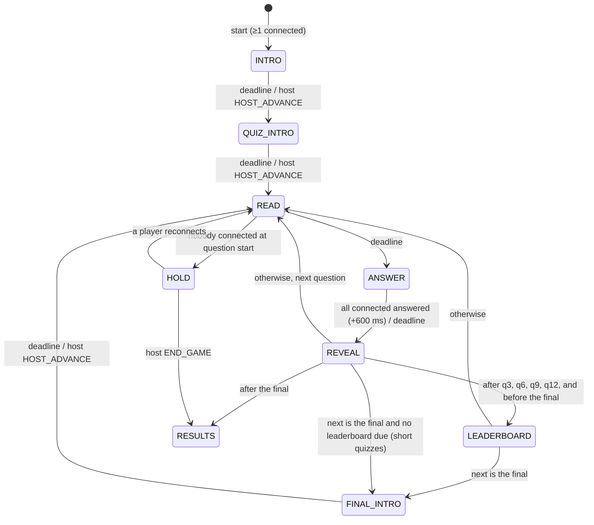

# GAME-TRIVIA — Trivia quiz (JAMAA game #4)

Status: **binding design spec**, draft 1, 2026-11-08. Game id: `trivia`. Display names: EN **Quiz Night**, FR **Soirée quiz**, AR **«سهرة أسئلة»** (`[native review]`).

Rules, state machine, timers, speed scoring with streaks, quiz metadata (stars, domain, topics), the TV quiz picker, the phone answer pad, edge cases, settings, copy, content schema and the first quiz, **Lebanon** (63 questions in EN/FR/AR). The JAMAA hub owns lobby, game picker, characters, ⓘ, entitlements, mute, reconnect and room lifetime; **the platform contract is [JAMAA-PLATFORM.md](JAMAA-PLATFORM.md): this file takes over the game rules of its §2.12 (settings, phases, timers, scoring, intents, view), while its §5.2 pack header and §5.4 metadata and vocabulary still apply.** Where the platform names a shared concept differently, the platform name wins: i18n keys written `trivia.*` here live under `game.trivia.*`; intents travel as `GAME {gameId:"trivia", i}`; late joiners are *benched* members. Conventions follow [SPEC.md](SPEC.md). `[VERIFY]` = fact or claim to check against a cited source before shipping; `[native review]` = native speaker approval.

---

## 1. The game in one paragraph

The host picks a quiz on the TV from a shelf of cards (stars for difficulty, chips for domain and topics). A question appears on the TV; a beat later four answers pop in, each with a big coloured shape. Everyone answers on their phone with one thumb. Right answers score more the faster they come, streaks add a bonus, and the last question counts double. After each question: the right answer lights up, every player's character jumps onto the answer they chose, the fastest correct player gets a lightning bolt, and points fly into the leaderboard, which reshuffles live.

Players: **1–12** (JAMAA-PLATFORM §2.12; solo works as practice). Duration: 10 questions ≈ 6–7 minutes.

---

## 2. Platform hooks used

| Hook | Value |
|---|---|
| `gameId` | `"trivia"` |
| Players | min 1, max 12 |
| Settings | 3 (§9): `quizId`, `length`, `pace` |
| How to play | 4 steps (§10.1), first time per room; ⓘ always |
| Characters | `idle`, `think`, `done`, `happy`, `cheer`, `sad`, `shock`, `smug`, `away` (platform set, JAMAA-PLATFORM §3.7). Streaks ≥ 3 add a flame **overlay** around the character (not an expression) |
| Content language | One pack per locale sharing a `family` (`lb-quiz-01-en/-fr/-ar`, same question ids), JAMAA-PLATFORM §5.4. The room plays the pack of its content language |
| Entitlement | Pack-level `tier` (platform header). The Lebanon quiz `lb-quiz-01` is `free` in full (it is Trivia's starter content); later quizzes may be Pass-only. A Pass-only quiz never reaches a free room's clients |
| Host | TV remote + VIP phone |

---

## 3. Question types

| `type` | Answers | Base | Speed bonus max | Phone pad |
|---|---|---|---|---|
| `mc4` | 4, exactly one correct | 500 | 500 | 2 × 2 grid |
| `tf` | True / False | 250 | 250 | 2 tall buttons |

`tf` scores half because a blind guess is right half the time. Later types (out of v1, schema reserves the names): `order` (put 4 items in order), `closest` (numeric slider, closest wins).

---

## 4. Structure and state machine

| Length | Questions |
|---|---|
| Short | 7 |
| **Normal** (default) | 10 |
| Long | 15 |

Capped by the quiz size. The **last question is the Final Question: points ×2** (base and speed; not the streak bonus). A LEADERBOARD interlude follows questions 3, 6, 9, 12 and precedes the final.



### 4.1 Phases and deadlines (pace `normal`; `relaxed` = ANSWER × 4/3, `fast` = ANSWER × 2/3, rounded to the second)

| Phase | Deadline kind | Duration | Ends early | Who acts |
|---|---|---|---|---|
| `INTRO` | `INTRO` | 15 000 ms | host `HOST_ADVANCE` | host |
| `QUIZ_INTRO` | `QUIZ_INTRO` | 4 000 ms (quiz card + "10 questions") | host `HOST_ADVANCE` | host |
| `READ` | `READ` | `clamp(2 500 + 40 × questionChars, 3 000, 7 000)` | — (never skippable: fairness) | nobody |
| `ANSWER` | `ANSWER` | `mc4` 15 000 ms, `tf` 10 000 ms | all connected non-`left` players answered → `deadline = now + 600` | players: `ANSWER` |
| `REVEAL` | `REVEAL` | 6 000 ms (+3 000 if the question has a `fact`) | host `HOST_ADVANCE` | host |
| `LEADERBOARD` | `LEADERBOARD` | 6 000 ms | host `HOST_ADVANCE` | host |
| `FINAL_INTRO` | `FINAL_INTRO` | 4 000 ms | host `HOST_ADVANCE` | host |
| `HOLD` | none | — | ≥ 1 player connected | host: `END_GAME` |
| `RESULTS` | none | — | — | host: platform play again / another quiz / back to hub |

READ shows the question alone so everyone reads it together; the answers (and the phone pad) appear at ANSWER. `questionChars` = graphemes of the question in the content language.

---

## 5. Answering and scoring

### 5.1 Answer rules

- One answer per question, **locked on first tap** (speed matters; no changing).
- `ANSWER{choice}`: `choice` is the **displayed position** 0..3 (A..D; for `tf` 0 = True, 1 = False). Positions are shuffled per question with the room RNG, so the index carries no information about authoring order.
- Answer time `t = clamp(receivedAt − answerOpenAt − GRACE_MS, 0, T)`, with `GRACE_MS = 300`, `T` = the ANSWER duration, `receivedAt` = DO receive time (`ctx.now`). No client clock is ever used.
- Late answers (after the deadline, `TICK` already processed) → `WRONG_PHASE`, ignored.

### 5.2 Points

```
speed      = 1 − t / T                                     // 1.0 = instant, 0.0 = last moment
mc4 points = 500 + round10(500 × speed)                    // 500..1000
tf  points = 250 + round10(250 × speed)                    // 250..500
final      = × 2 (base + speed)
streak s   = consecutive correct answers including this one
streakBonus= min(100 × (s − 1), 500)                       // 0, 100, 200, 300, 400, 500 (cap)
total      = points × finalMultiplier + streakBonus         (if correct; else 0 and s = 0)
```

`round10(x)` = round half up to the nearest 10. Wrong or no answer: 0 points, streak resets. **No negative points.**

**Why.** A correct answer is always worth at least half of the fastest one (500 vs 1000), so knowing beats tapping fast. The 300 ms grace absorbs Wi-Fi jitter between phones on the same network. Streaks reward consistency and give the "on fire" moment; the cap keeps a long streak from deciding the game alone. The ×2 final keeps a comeback possible (max 2000 + streak).

### 5.3 Ranking and ties

Order: total points ↓, then number of correct answers ↓, then total answer time of correct answers ↑ (summed `t`). Still equal → **shared place**.

### 5.4 Per-question highlights (computed in REVEAL)

- **Fastest finger:** the correct answer with the lowest `t` (≥ 2 correct answers needed; ties: all).
- **Stumped!:** nobody correct.
- **Genius!:** everyone who answered was correct (≥ 3 answers).
- **On fire:** a player's streak reaches 3, 5, 7…

---

## 6. Edge cases

| Case | Behaviour |
|---|---|
| **1–3 players** | Works unchanged; with 1 player "Fastest finger" and "Genius" are not shown |
| **12 players** | Reveal stacks up to 12 characters per answer tile (2 rows of 6 at 40 dp); leaderboard shows top 8 + "your rank" on phones; TV pages the rest in 2 s |
| **Nobody answers** | Reveal shows the answer with "Too slow, everyone!"; no points; streaks reset |
| **Disconnect in ANSWER** | No answer → 0, streak resets. Reconnect while ANSWER is open → can still answer (time counts from `answerOpenAt`, so no advantage) |
| **Disconnect in READ** | Nothing happens; the pad appears on reconnect if ANSWER has opened |
| **Player leaves** | Score frozen and shown greyed; not counted for "all answered" |
| **Late joiner** | Joins at the next READ with 0 points; "New" ribbon for one question; ranked normally |
| **Nobody connected at question start** | `HOLD` |
| **Pool smaller than length** | Length is capped to the pool; the TV setting shows "7 questions available" |
| **Question missing the content locale** | Not drawn (lint makes launch quizzes complete in all three locales) |
| **Every question already played in this room** | Draw prefers questions not in `room.usedQuestionIds` (FIFO 1 000); if the pool is exhausted, least recently used first and the quiz card shows "Rerun" |
| **Tie at the top** | Shared first place, both on the top podium step |
| **Host presses OK during READ/ANSWER** | Ignored (fairness); OK skips only reveal-type animations locally |
| **Content error found mid-game** | Host pause menu → "Void this question" in REVEAL: points of that question are removed (scores revert to `scoreBefore`, streaks restored), question id added to a `voidedQuestionIds` report sent to the server log for content review |

---

## 7. Anti-cheese

| Risk | Counter |
|---|---|
| Reading the correct answer from network traffic | `reveal.correct` is projected **only in REVEAL**; ANSWER views carry options without any correctness flag; positions are shuffled per question |
| Order giving it away (authoring has the correct answer first) | Choices shuffled with the room RNG; answer **positions** are random per question |
| Tapping at random as fast as possible | Wrong = 0 and breaks the streak; correct-but-slow (≥ 500) beats wrong-but-fast (0) |
| Two phones for one person | Platform: one seat per device, name uniqueness; host can kick |
| Searching online | READ 3–7 s + ANSWER 15 s; questions favour knowledge over lookup-friendly trivia; speed scoring makes lookup costly |
| Memorising a replayed quiz | Room-level used-question history; launch pool (63) > Long (15) × 4 games |
| Latency advantage | Server-side timing + 300 ms grace; READ phase gives everyone the question before the clock starts |
| Late joiner farming | Starts at 0 |

---

## 8. Screens

### 8.1 Secrecy

| Data | READ | ANSWER | REVEAL+ |
|---|---|---|---|
| Question text | ✓ all | ✓ all | ✓ all |
| Options (text, in displayed order) | ✗ | ✓ all | ✓ all |
| Correct choice | ✗ | ✗ | ✓ all |
| Who answered | — | `answeredIds` | ✓ + choice per player |
| A player's own choice | — | own phone (`me.myChoice`) | ✓ all |
| Points | — | — | ✓ all |

### 8.2 The answer tokens (TV and phone)

| Token | Shape | Colour | Text on |
|---|---|---|---|
| A | **Sun** (circle with 8 short rays) | amber `#FFC23D` | ink |
| B | **Wave** (two stacked waves) | azure `#478CFF` | ink |
| C | **Leaf** | jade `#1FA88A` | ink |
| D | **Spark** (4-point star) | magenta `#FF3D8B` | ink |
| True | **Check** | jade | ink |
| False | **Cross** | coral `#F0183A` | ink (+ 2 dp cream ring for contrast) |

Shapes, not colours, identify answers (CVD safety, DESIGN §2.3 rule). These are deliberately **not** the triangle/diamond/circle/square in red/blue/yellow/green used by a well-known quiz brand. Positions in the 2 × 2 grid are **the same on every device and never mirrored** (A top-left, B top-right, C bottom-left, D bottom-right): in a mixed-language room the TV and an Arabic phone must agree, and the shape is what players match, not the reading order. Text inside each tile follows its own direction (`dir="auto"` / `TextDirection.Content`). Hex values `[VERIFY]` against the JAMAA palette once the platform design pass lands.

### 8.3 Per phase

| Phase | TV | Phone |
|---|---|---|
| INTRO | How-to cards | How-to compact; VIP "Start" |
| QUIZ_INTRO | The quiz card flies to centre: title, stars, domain and topic chips, "10 questions"; studio lights sweep on | "Get ready! Quiz: Lebanon ★★" |
| READ | Question card big, top; topic chip; question counter "3 / 10"; a thin "get ready" bar fills | "Look at the TV!" + the question in small text (accessibility) |
| ANSWER | The 4 answer tiles pop in (shape + text); timer as a ring of light bulbs switching off; characters row: `think`, then `done` when answered (no hint of which answer) | **Answer pad** (§8.4) |
| REVEAL | Wrong tiles dim; the right one glows; characters jump onto the tile they picked; "Fastest finger" bolt; points fly into the side leaderboard, which re-sorts; optional fact line | Full-screen verdict: jade "Correct! +870" with streak flame "×3", or coral "Not this time" with the right answer's shape and text; own rank "You're 2nd" |
| LEADERBOARD | Full leaderboard race (§12.3) | Own rank, points, gap to the player ahead ("120 behind Maya") |
| FINAL_INTRO | "FINAL QUESTION — double points!" with a drum build | "Final question! Double points" |
| RESULTS | Podium, stats ("Fastest finger: Rami ×4", "Longest streak: Lina 6"), host buttons | Place, points, correct count, best streak; VIP buttons |

### 8.4 Phone answer pad (one thumb)

- Portrait, the pad fills the **bottom 70 %** of the viewport (thumb zone); question excerpt and timer bar above.
- `mc4`: 2 × 2 tiles, each ≥ 44 % of width × 30 % of viewport height, full colour with a large shape (40 % of tile height) and the answer text (`type.ph.body`, max 2 lines, auto-shrink to 0.85 then ellipsis; answers are linted ≤ 40 graphemes).
- `tf`: two tall tiles side by side (True left / False right, never mirrored, same rule as §8.2).
- **Tap → lock:** the chosen tile scales 0.96 and stays bright, others fade to 30 %, haptic `20`, label "Locked in! 3.2 s". No undo.
- Tap targets ignore `pointerdown` for 250 ms after the pad appears (avoids a tap meant for the previous screen).
- The pad renders in < 100 ms of the ANSWER snapshot: shapes are inline SVG in the Trivia chunk; no network fetch.

The ⓘ button sits in the phone top bar in every phase; on the TV it's in the pause menu (Back) → "Rules".

---

## 9. Settings (3)

| Setting | Values | Default | UI |
|---|---|---|---|
| `quizId` | Any quiz playable in the content language | First featured quiz (Lebanon) | **Quiz shelf** (§9.1) |
| `length` | `short` 7 · `normal` 10 · `long` 15 (capped by pool) | `normal` | 3-way selector |
| `pace` | `relaxed` (20 s) · `normal` (15 s) · `fast` (10 s) — `tf` gets 2/3 of it | `normal` | 3-way selector |

### 9.1 Quiz selection UX (TV, D-pad)

- The Trivia settings screen opens on a **shelf**: one horizontal row per domain ("Lebanon", later "World", "Arab world", "France"), Netflix-style. Up/Down moves between rows, Left/Right between cards, OK selects (a check badge), Back leaves.
- **Quiz card** (240 × 320 dp): cover illustration (flat, palette-based; no flags or political symbols), title, **difficulty stars** (1–3 filled amber stars out of 3 + the word "Easy / Medium / Hard" for accessibility), a **domain chip** (filled), up to **3 topic chips** (outlined; "+2" if more), "63 questions", and a lock badge on Pass-only quizzes in free rooms (focusing one shows the platform's Pass upsell when billing is enabled).
- Focused card: scale 1.06, `glow.primary`, the cover gently parallaxes (Compose `graphicsLayer` translation, ≤ 8 dp).
- Below the shelf: `length` and `pace` selectors, then "Start".
- With one quiz at launch the shelf shows the Lebanon card plus one non-focusable ghost card "More quizzes soon".
- The VIP phone gets the same list as vertical cards with the same chips and stars.

---

## 10. Copy

### 10.1 How to play (keys `trivia.howto.1..4`)

| # | EN | FR | AR `[native review]` |
|---|---|---|---|
| 1 | **Read the question** on the TV. | **Lisez la question** à la télé. | **اقروا السؤال** عالتلفزيون. |
| 2 | **Tap the matching shape** on your phone. First tap counts! | **Touchez la forme** qui correspond sur votre téléphone. Le premier choix compte ! | **اكبسوا عالشكل** نفسو عالتلفون. أوّل كبسة بتنحسب! |
| 3 | **Be right, then be fast:** quicker answers score more. | **Soyez juste, puis rapide :** plus c'est rapide, plus ça rapporte. | **جاوبوا صح، وبعدين بسرعة:** كل ما أسرع، نقاط أكتر. |
| 4 | **Build a streak** for bonus points. The final question counts double! | **Enchaînez les bonnes réponses** pour un bonus. La dernière question compte double ! | **كمّلوا عالصح** لتاخدوا بونص. والسؤال الأخير نقاطو دبل! |

### 10.2 ⓘ Rules sheet (keys `trivia.rules.*`)

EN:
- **Answer.** One answer per question; your first tap is final.
- **Points.** Correct: 500 to 1000 points depending on speed (true/false: 250 to 500). Wrong: 0.
- **Streaks.** Each correct answer in a row adds +100 (up to +500).
- **Final question.** Double points.
- **Ties.** Same points? More correct answers wins; then faster total time.

FR:
- **Réponse.** Une réponse par question ; le premier choix est définitif.
- **Points.** Bonne réponse : de 500 à 1000 points selon la rapidité (vrai/faux : 250 à 500). Mauvaise : 0.
- **Séries.** Chaque bonne réponse d'affilée ajoute +100 (jusqu'à +500).
- **Dernière question.** Points doublés.
- **Égalité.** Même score ? Le plus de bonnes réponses l'emporte, puis le temps total le plus court.

AR `[native review]`:
- **الجواب.** جواب واحد عكل سؤال، وأوّل كبسة نهائية.
- **النقاط.** الجواب الصح: من 500 لـ1000 نقطة حسب السرعة (صح/غلط: من 250 لـ500). الغلط: 0.
- **السلسلة.** كل جواب صح ورا بعض بيزيد ‎+100 (لحدّ ‎+500).
- **السؤال الأخير.** النقاط دبل.
- **التعادل.** نفس النقاط؟ بيربح يلّي جاوب صح أكتر، وبعدين الأسرع بالمجموع.

### 10.3 Key microcopy

| Key | EN | FR | AR `[native review]` |
|---|---|---|---|
| `trivia.read.look` | Look at the TV! | Regardez la télé ! | اطلعوا عالتلفزيون! |
| `trivia.pad.locked` | Locked in! {seconds} s | C'est validé ! {seconds} s | تثبّت! {seconds} ث |
| `trivia.reveal.correct` | Correct! +{points} | Bonne réponse ! +{points} | صح! ‎+{points} |
| `trivia.reveal.wrong` | Not this time | Pas cette fois | مش هالمرّة |
| `trivia.reveal.fastest` | Fastest finger: {name} | Le doigt le plus rapide : {name} | أسرع إصبع: {name} |
| `trivia.reveal.stumped` | Stumped! | Personne n'a trouvé ! | ولا حدا عرفها! |
| `trivia.reveal.genius` | Genius! Everyone got it. | Génial ! Tout le monde a trouvé. | عباقرة! الكل عرفها. |
| `trivia.streak` | On fire ×{count} | En feu ×{count} | نار ×{count} |
| `trivia.final.title` | Final question: double points! | Dernière question : points doublés ! | السؤال الأخير: النقاط دبل! |
| `trivia.diff.1/2/3` | Easy / Medium / Hard | Facile / Moyen / Difficile | سهل / وسط / صعب |
| `trivia.tf.true/false` | True / False | Vrai / Faux | صح / غلط |

---

## 11. Content

### 11.1 Controlled vocabulary (JAMAA-PLATFORM §5.4, `content/vocab.json`)

- **Domains** (one per quiz; it is the shelf row): `lebanon`, `middle-east`, `arab-world`, `france`, `world`, `general`.
- **Topics** (exactly one per question; a quiz's chips are its most frequent topics, top 3 shown): `culture`, `traditions`, `music`, `dance`, `football`, `sports`, `food`, `history`, `geography`, `places`, `language`, `cinema-tv`, `celebrities`, `science`, `nature`, `art`.
- Labels come from i18n `content.domain.<id>` / `content.topic.<id>` (platform-owned). Proposed labels for the values this quiz uses:

| Id | EN | FR | AR `[native review]` |
|---|---|---|---|
| `lebanon` | Lebanon | Liban | لبنان |
| `culture` | Culture | Culture | ثقافة |
| `music` | Music & songs | Musique & chansons | موسيقى وغنية |
| `dance` | Dance | Danse | رقص |
| `football` | Football | Football | فوتبول |
| `sports` | Sports | Sports | رياضة |
| `food` | Food | Cuisine | أكل |
| `history` | History | Histoire | تاريخ |
| `geography` | Geography | Géographie | جغرافيا |
| `language` | Language | Langue | لغة |
| `cinema-tv` | Cinema & TV | Cinéma & télé | سينما وتلفزيون |
| `celebrities` | Famous people | Personnalités | مشاهير |
| `nature` | Nature | Nature | طبيعة |

Adding a value is a `vocab.json` + i18n change, which keeps labels broad and the shelf tidy.

**Difficulty:** per question 1–3. A quiz declares `stars` (1–3) in the platform pack header; lint: |stars − mean(question difficulty)| ≤ 0.67 (JAMAA-PLATFORM §5.4).

### 11.2 Sensitivity rules (binding for every quiz, strict for `lebanon`)

No questions about: wars and armed conflicts, political parties and politicians, religious communities and sects, borders and disputed territory, refugees, assassinations, militia or army, current economic crisis figures. Distractors follow the same rule (no war years as wrong answers). Famous people only for arts, sport and science achievements. Holidays only if national and non-religious. A reviewer from the target community signs off each quiz (`review.status: "verified"` per question with a `source`).

### 11.3 Schema (platform `PackHeader` + Trivia items; `content/trivia/<locale>/<pack-id>.json`)

A quiz is one pack **per locale** with the JAMAA-PLATFORM §5.2 `PackHeader` (`id`, `family`, `game:"trivia"`, `version`, `locale`, `script`, `title`, `domain` (required), `topics` (non-empty), `stars` (required), `ageRating`, `tier`, `license`, `source`, `status`, `reviewedBy`) and a `questions` array. The question shape below extends the platform's (§5.2 table) with `type`; every other field keeps the platform name:

```ts
export const TriviaQuestionSchema = z.strictObject({
  id: z.string().regex(/^q\d{3,4}$/),                    // same id across the -en/-fr/-ar packs of a family
  type: z.enum(["mc4", "tf"]),
  text: z.string().min(5).max(160),
  options: z.union([
    z.tuple([z.string().max(48), z.string().max(48), z.string().max(48), z.string().max(48)]),   // mc4
    z.tuple([z.string().max(48), z.string().max(48)]),                                           // tf: [True, False] labels
  ]),
  answer: z.number().int().min(0).max(3),                 // authored index (the engine reshuffles for display)
  topic: Topic,                                           // must be in the pack's topics
  difficulty: z.union([z.literal(1), z.literal(2), z.literal(3)]),
  explain: z.string().max(200).optional(),                // the "Did you know?" line in REVEAL
  source: z.string().min(1),                              // URL or reference; never projected
});
```

Lint (platform common checks + Trivia): options unique and non-empty; for `tf`, `options` are the localized True/False labels and `answer` ∈ {0, 1}; the correct index is spread (no index used for > 40 % of a pack's `mc4` questions); every question in all three locale packs of the family with identical ids, `type`, `answer` position, `topic` and `difficulty`; the stars rule; vocabulary membership; the §11.2 banned-keyword list on every string; `status: "reviewed"` (owner + Lebanese reviewer) before release.

**Authoring note.** The drafts in §14 list the correct option first (✓) for review readability. The conversion to JSON writes options in a spread order and sets `answer` accordingly (a `tools/content-lint --fix-spread` helper may permute deterministically by id).

### 11.4 Question draw

`drawQuestions(quiz, settings, room, rng)` picks `length` questions:
1. Candidates: the quiz pack for the content locale, not in `usedQuestionIds` (fallback LRU).
2. **Difficulty curve:** first 30 % from difficulty 1 (fallback 2), middle 40 % from 2, last 30 % from 3 (fallback 2); the final question is the hardest remaining.
3. **Topic spread:** never 3 consecutive questions on the same topic; `tf` at most 1 in 4.
4. Options are shuffled per question with the RNG; the shuffled correct position stays server-side until REVEAL.

### 11.5 First content plan

| Quiz (family) | Domain | Stars | Questions | Tier | Status |
|---|---|---|---|---|---|
| `lb-quiz-01` (`-en`, `-fr`, `-ar`) — "Lebanon: the big quiz" · « Liban : le grand quiz » · «لبنان: المسابقة الكبيرة» | lebanon | ★★ (mean 1.76) | 63 (§14) | free | draft; every fact `[VERIFY]` |
| `world-easy-01` — Around the World | world | ★ | 60 planned | free | later |
| `arab-music-01` — Arab Music Legends | arab-world | ★★ | 40 planned | Pass | later |

---|---|---|---|---|---|
| `lebanon` — Lebanon · Liban · «لبنان», subtitle "A mezze of everything" · « Un mezzé de tout » · «مازة من كل شي» | lebanon | ★★ (mean 1.76) | 63 (§14) | 25 | draft; every fact `[VERIFY]` |
| `world-easy` — Around the World | world | ★ | 60 planned | 20 | later |
| `arab-music` — Arab Music Legends | arab-world | ★★ | 40 planned | 0 (Pass) | later |

---

## 12. Signature moments

Server never waits for animations; OK skips reveal-type animations locally; reduced motion per DESIGN §6.3.

### 12.1 Entering the world: "The Studio"

A TV game-show studio at night: a curved stage, a light-bulb arch, a big screen for questions, a leaderboard tower at the side; for the Lebanon quiz, the backdrop is a stylised sunset of the coast and mountains (no flags or political symbols). Transition from the hub: the tile zooms in, the screen goes dark for 150 ms, then **spotlights snap on one by one** (4 × 120 ms, each with a "clunk"), the light-bulb arch chases left to right and the characters walk on to their podium slots. ≤ 2.2 s.

### 12.2 Question and answer

- READ: the question card **slams** in from above (`ease.overshoot`, 400 ms) with a "whoosh-thud".
- ANSWER: the 4 tiles flip in one after the other (A→D, 90 ms apart, Y-axis). The timer is a ring of 20 bulbs; each goes dark in turn; the last 5 s pulse amber with `sfx.tick`.
- When a player answers, their character hits a buzzer (`done`) with a soft "bip" (no hint of the choice).

### 12.3 Reveal (6 s; + fact 3 s)

1. *Lock (0–300 ms):* "Time!" stamp; the bulbs all flash once (single flash, no strobe).
2. *Wrong out (300–900 ms):* wrong tiles dim to 30 % and shrink slightly; the correct tile glows and its shape spins once.
3. *Jump-on (900–2 400 ms):* each character jumps from the podium row onto the tile it chose (stacked 2 rows of 6 max); on the correct tile `cheer`, on wrong ones `sad`/`shock`; no-answer characters stay with a "zzz" bubble.
4. *Fastest finger (2 400–3 000 ms):* a lightning bolt strikes the fastest correct character; "Fastest finger: Rami".
5. *Points fly (3 000–4 500 ms):* from each correct character, a "+870" chip flies to the leaderboard tower; streak ≥ 3 adds a flame trail and a flame overlay around the character (expression `happy`) until the streak breaks.
6. *Tower re-sort (4 500–6 000 ms):* the side leaderboard re-orders with springs; overtakes show a little hop.
7. *Fact (optional, +3 s):* "Did you know?" card slides up with the `fact`.

Stumped: all tiles dim, the correct tile reveals with a comedic "dun-dun" and every character does `shock`. Genius: a confetti cannon.

### 12.4 Leaderboard race (6 s)

Full-screen bars grow from the previous totals to the new ones (1.2 s, odometer numbers), then re-sort with a spring; the leader gets a crown; the biggest climber since the last board gets an arrow "+3 places!".

### 12.5 Final question and podium

FINAL_INTRO: lights go red-amber, a drum build, "×2" stamps onto the screen. RESULTS: characters jump onto podium steps 3-2-1, the winner holds a trophy, confetti; stats cards (Fastest finger count, Longest streak, Most correct) drop in one by one.

### 12.6 Sounds (new; `tools/gen-sounds`)

`trivia.lightsOn` (clunk), `trivia.slam`, `trivia.tileFlip`, `trivia.buzz` (answer received), `trivia.timeUp`, `trivia.correct` (bright arpeggio), `trivia.wrong` (soft "bwomp"), `trivia.zap` (fastest finger), `trivia.flame` (streak), `sting.triviaIntro`, `sting.finalQuestion`, `sting.podium`.

### 12.7 Implementation notes

TV Compose: answer tiles are fixed-size composables (no layout passes during animation); stacks use precomputed offsets; the bulb ring is a single `Canvas` draw; ≤ 12 characters + 12 chips moving at once. Web: shapes as inline SVG symbols in the Trivia chunk; the phone pad must stay interactive at 60 fps on low-end Android (no animation on the pad during ANSWER except the press feedback).

---

## 13. Protocol, view, tests

### 13.1 Intents

| Action | Payload | Who | Phase |
|---|---|---|---|
| `ANSWER` | `{ choice: 0..3 }` (displayed position) | player | ANSWER |
| `HOST_ADVANCE` | `{}` | host | INTRO, QUIZ_INTRO, REVEAL, LEADERBOARD, FINAL_INTRO |
| `VOID_QUESTION` | `{ questionId }` | host | REVEAL |
| `END_GAME` | `{}` | host | HOLD |

Errors (platform names): `ALREADY_ANSWERED`, `ANSWER_INVALID` (out of range, or 2–3 for `tf`), `WRONG_PHASE`.

### 13.2 View (`TriviaPublic`)

`phase, quiz {id, title, stars, domain, topics[]}, index, total, isFinal, deadline, question {text, type, topic, difficulty} | null (READ+), options: string[] (ANSWER+, displayed order; position i is token A/B/C/D or True/False), answeredIds[], reveal | null, scores [{playerId, score, scoreBefore, streak, correct, rank}]` (names follow JAMAA-PLATFORM §2.12 `Pub`, extended).

`reveal = { correct: number, choices: [{id: playerId, choice: number | null, correct: boolean, timeMs: number | null, points, streakBonus}], fastestIds[], stumped, genius, explain: string | null }`.

`me = { myChoice | null, myTimeMs | null }`.

### 13.3 Invariants

1. Before REVEAL, no projection contains the correct position, any per-option correctness or another player's choice (platform forbidden keys: `answers`, `correctIndex`, `order`, `rngState`, `usedKeys`, `source`).
2. Exactly one correct choice per `mc4` question in server state; choice ids unique.
3. Each player has ≤ 1 answer per question; `timeMs ∈ [0, T]`.
4. Σ points of the question = Σ (score − scoreBefore); scores ≥ 0; voiding restores `scoreBefore` and streaks.
5. A free room never receives a Pass-only quiz.

### 13.4 Tests

- Scoring table: t = 0, T/2, T, grace boundary, tf vs mc4, final ×2, streak 1..8 with cap, wrong resets.
- Ranking tie-breaks (points → correct → time → shared).
- Draw: difficulty curve and topic spread across seeds; LRU fallback; pool capping.
- Secrecy property test: random games never project the correct position or others' choices before REVEAL.
- Flow: READ not skippable; early end with 600 ms; reconnect mid-ANSWER keeps original `answerOpenAt`; HOLD; late joiner; VOID_QUESTION restores scores and streaks.
- Sim: `pnpm sim --game trivia --players 3..12 --games 200` (random answers with random latencies).
- Quiz lint on `lebanon` (all §11.3 rules, sensitivity keyword list).
- TV: quiz shelf D-pad navigation (rows, ghost card not focusable, lock badge), answer tile positions unmirrored in AR, reveal stack layout for 12.
- Web e2e: 3 phones + `/tv`; first tap locks; verdict screen; leaderboard after q3.

---

## 14. Content draft — quiz `lebanon` (63 questions)

Authoring convention: for `mc4`, the **first** choice is correct (✓). For `tf`, the answer is given. Every row is `review.status: "draft"` with a `check` (what the verifier confirms) — **every fact must be verified against a cited source before shipping**. FR and AR `[native review]`. AR uses light Lebanese colloquial for questions, standard names for places and people. JSON ids are `q001`… in the order listed here; the draft ids (`lb-geo-001`…) are for review only. The **first topic** listed is the question's `topic`; draft names map to the platform vocabulary as `famous-people` → `celebrities`, `sport` → `sports`. The *fact* line becomes `explain`; the `check` line is for the verifier and the final `source` replaces it. The whole quiz is free.

Format: **id** · type · ★ · topics (first = `topic`)
EN · FR · AR (✓ first) · *fact* · `check`

### Geography

**lb-geo-001** · mc4 · ★ · geography
- EN: What is the capital of Lebanon? — ✓ Beirut · Tripoli · Sidon · Byblos
- FR : Quelle est la capitale du Liban ? — ✓ Beyrouth · Tripoli · Saïda · Byblos
- AR: شو عاصمة لبنان؟ — ✓ بيروت · طرابلس · صيدا · جبيل
- `check`: trivial; keep.

**lb-geo-002** · mc4 · ★★ · geography
- EN: What is Lebanon's highest peak? — ✓ Qornet es-Saouda · Mount Sannine · Jabal Barouk · Jabal Knaisseh
- FR : Quel est le plus haut sommet du Liban ? — ✓ Qornet es-Saouda · Mont Sannine · Jabal Barouk · Jabal Knaissé
- AR: شو أعلى قمّة بلبنان؟ — ✓ القرنة السودا · جبل صنّين · جبل الباروك · جبل الكنيسة
- *fact*: About 3,088 m high. · `check`: peak name and height; spellings.

**lb-geo-003** · mc4 · ★★ · geography, nature
- EN: Which is the longest river flowing entirely within Lebanon? — ✓ The Litani · Nahr Ibrahim · The Awali · Nahr el-Kalb
- FR : Quel est le plus long fleuve qui coule entièrement au Liban ? — ✓ Le Litani · Nahr Ibrahim · L'Awali · Nahr el-Kalb
- AR: شو أطول نهر بيمشي كلّو جوّا لبنان؟ — ✓ الليطاني · نهر إبراهيم · الأوّلي · نهر الكلب
- `check`: Litani is the longest river entirely within Lebanon (the Orontes is longer but flows into Syria, so excluded).

**lb-geo-004** · mc4 · ★ · geography, history
- EN: What is the Arabic name of the ancient city of Byblos? — ✓ Jbeil · Jounieh · Batroun · Amchit
- FR : Quel est le nom arabe de l'antique Byblos ? — ✓ Jbeil · Jounieh · Batroun · Amchit
- AR: شو الاسم العربي لمدينة «بيبلوس» القديمة؟ — ✓ جبيل · جونية · البترون · عمشيت
- `check`: Byblos = Jbeil.

**lb-geo-005** · mc4 · ★ · geography, nature
- EN: What is Jeita Grotto? — ✓ A system of limestone caves · A Roman temple · A cedar forest · A ski resort
- FR : Qu'est-ce que la grotte de Jeita ? — ✓ Un réseau de grottes calcaires · Un temple romain · Une forêt de cèdres · Une station de ski
- AR: شو هيّي مغارة جعيتا؟ — ✓ مغاور كلسية · معبد روماني · غابة أرز · منتجع تزلّج
- `check`: Jeita = limestone karst caves.

**lb-geo-006** · mc4 · ★ · geography
- EN: The famous Pigeon Rocks stand off which Beirut area? — ✓ Raouché · Achrafieh · Hamra · Gemmayzeh
- FR : Les célèbres rochers aux Pigeons se dressent au large de quel quartier de Beyrouth ? — ✓ Raouché · Achrafieh · Hamra · Gemmayzé
- AR: «صخرة الحمام» المشهورة قبال أيّا منطقة ببيروت؟ — ✓ الروشة · الأشرفية · الحمرا · الجمّيزة
- `check`: Pigeon Rocks off Raouché.

**lb-geo-007** · mc4 · ★★ · geography, culture
- EN: Which city is nicknamed "the Bride of the Bekaa"? — ✓ Zahlé · Baalbek · Chtaura · Hermel
- FR : Quelle ville surnomme-t-on « la fiancée de la Békaa » ? — ✓ Zahlé · Baalbek · Chtaura · Hermel
- AR: أيّا مدينة بيلقّبوها «عروس البقاع»؟ — ✓ زحلة · بعلبك · شتورة · الهرمل
- `check`: nickname attribution to Zahlé.

**lb-geo-008** · mc4 · ★★ · geography, nature
- EN: The ancient "Cedars of God" forest is near which town? — ✓ Bsharri · Zahlé · Jezzine · Tyre
- FR : La forêt des « Cèdres de Dieu » se trouve près de quelle ville ? — ✓ Bcharré · Zahlé · Jezzine · Tyr
- AR: غابة «أرز الربّ» قريبة من أيّا بلدة؟ — ✓ بشرّي · زحلة · جزّين · صور
- *fact*: It's a UNESCO World Heritage site with the Qadisha Valley. · `check`: location; UNESCO listing (Ouadi Qadisha and the Forest of the Cedars of God).

**lb-geo-009** · tf · ★ · geography
- EN: Lebanon has a coastline on the Mediterranean Sea. — True
- FR : Le Liban a une côte sur la Méditerranée. — Vrai
- AR: لبنان عندو شطّ عالبحر المتوسّط. — صح
- `check`: trivial.

**lb-geo-010** · mc4 · ★ · geography, sport
- EN: Which of these ski resorts is in Lebanon? — ✓ Mzaar Kfardebian · Courchevel · Zermatt · Cortina
- FR : Laquelle de ces stations de ski se trouve au Liban ? — ✓ Mzaar Kfardebian · Courchevel · Zermatt · Cortina
- AR: أيّا منتجع تزلّج من هودي موجود بلبنان؟ — ✓ مزار كفردبيان · كورشوفيل · زيرمات · كورتينا
- `check`: Mzaar Kfardebian in Lebanon.

### History (ancient and cultural only)

**lb-his-001** · mc4 · ★ · history
- EN: The Phoenicians are famous for spreading… — ✓ an alphabet · paper · the wheel · gunpowder
- FR : Les Phéniciens sont célèbres pour avoir diffusé… — ✓ un alphabet · le papier · la roue · la poudre
- AR: الفينيقيين مشهورين إنّن نشروا… — ✓ الأبجدية · الورق · الدولاب · البارود
- `check`: Phoenician alphabet diffusion.

**lb-his-002** · mc4 · ★★ · history, language
- EN: The word "Bible" is linked to the name of which Lebanese city? — ✓ Byblos · Tyre · Sidon · Baalbek
- FR : Le mot « Bible » est lié au nom de quelle ville libanaise ? — ✓ Byblos · Tyr · Saïda · Baalbek
- AR: كلمة «Bible» مرتبطة باسم أيّا مدينة لبنانية؟ — ✓ جبيل (بيبلوس) · صور · صيدا · بعلبك
- *fact*: In Greek, "byblos" meant papyrus, traded through the city's port. · `check`: etymology chain (city → Greek word for papyrus/book → "Bible"). Reviewer: confirm the topic is acceptable (word origin, not religion).

**lb-his-003** · mc4 · ★ · history
- EN: Lebanon's Independence Day is celebrated on… — ✓ 22 November · 10 March · 1 May · 31 August
- FR : La fête de l'indépendance du Liban a lieu le… — ✓ 22 novembre · 10 mars · 1er mai · 31 août
- AR: عيد الاستقلال بلبنان بـ… — ✓ ٢٢ تشرين التاني · ١٠ آذار · ١ أيّار · ٣١ آب
- `check`: 22 November; a Lebanese reviewer confirms no distractor date carries a political or sectarian meaning (14 February was deliberately avoided).

**lb-his-004** · mc4 · ★★ · history
- EN: In which year did Lebanon become independent? — ✓ 1943 · 1936 · 1950 · 1962
- FR : En quelle année le Liban est-il devenu indépendant ? — ✓ 1943 · 1936 · 1950 · 1962
- AR: بأيّا سنة استقلّ لبنان؟ — ✓ ١٩٤٣ · ١٩٣٦ · ١٩٥٠ · ١٩٦٢
- `check`: 1943; distractor years carry no sensitive Lebanese event (reviewer).

**lb-his-005** · mc4 · ★ · history
- EN: The great temples of Baalbek were built in the time of which empire? — ✓ Roman · Ottoman · Persian · Mongol
- FR : Les grands temples de Baalbek datent de quel empire ? — ✓ Romain · Ottoman · Perse · Mongol
- AR: معابد بعلبك الكبيرة انبنت بزمن أيّا إمبراطورية؟ — ✓ الرومانية · العثمانية · الفارسية · المغولية
- `check`: Roman period.

**lb-his-006** · mc4 · ★★★ · history
- EN: Which god's temple at Baalbek is one of the best-preserved Roman temples anywhere? — ✓ Bacchus · Mars · Neptune · Apollo
- FR : Le temple de quel dieu, à Baalbek, est l'un des temples romains les mieux conservés au monde ? — ✓ Bacchus · Mars · Neptune · Apollon
- AR: معبد أيّا إله ببعلبك من أحسن المعابد الرومانية المحفوظة بالعالم؟ — ✓ باخوس · مارس · نبتون · أبولو
- `check`: Temple of Bacchus preservation claim.

**lb-his-007** · mc4 · ★★★ · history, culture
- EN: Ancient Tyre was famous for which precious dye? — ✓ Purple · Indigo blue · Saffron yellow · Emerald green
- FR : L'antique Tyr était célèbre pour quelle teinture précieuse ? — ✓ La pourpre · Le bleu indigo · Le jaune safran · Le vert émeraude
- AR: صور القديمة كانت مشهورة بأيّا صبغة غالية؟ — ✓ الأرجوان · الأزرق النيلي · الأصفر الزعفراني · الأخضر الزمرّدي
- *fact*: It was made from sea snails. · `check`: Tyrian purple, murex snails.

**lb-his-008** · tf · ★★ · history
- EN: Byblos is considered one of the oldest continuously inhabited cities in the world. — True
- FR : Byblos est considérée comme l'une des plus anciennes villes habitées sans interruption. — Vrai
- AR: جبيل من أقدم المدن يلّي ضلّت مسكونة بلا انقطاع بالعالم. — صح
- `check`: UNESCO/encyclopedic wording "one of the oldest continuously inhabited".

### Culture and famous people

**lb-cul-001** · mc4 · ★ · culture, famous-people
- EN: Who wrote "The Prophet"? — ✓ Gibran Khalil Gibran · Mikhail Naimy · Amin Maalouf · Ameen Rihani
- FR : Qui a écrit « Le Prophète » ? — ✓ Khalil Gibran · Mikhaïl Naïmy · Amin Maalouf · Amine Rihani
- AR: مين كتب «النبي»؟ — ✓ جبران خليل جبران · ميخائيل نعيمة · أمين معلوف · أمين الريحاني
- `check`: authorship.

**lb-cul-002** · mc4 · ★★ · culture, famous-people
- EN: Gibran Khalil Gibran was born in which town? — ✓ Bsharri · Zahlé · Batroun · Deir el-Qamar
- FR : Dans quelle ville est né Khalil Gibran ? — ✓ Bcharré · Zahlé · Batroun · Deir el-Qamar
- AR: بأيّا بلدة خلق جبران خليل جبران؟ — ✓ بشرّي · زحلة · البترون · دير القمر
- `check`: birthplace.

**lb-cul-003** · mc4 · ★★★ · culture, famous-people
- EN: Amin Maalouf won France's Prix Goncourt for which novel? — ✓ The Rock of Tanios · Leo Africanus · Samarkand · The Gardens of Light
- FR : Pour quel roman Amin Maalouf a-t-il reçu le prix Goncourt ? — ✓ Le Rocher de Tanios · Léon l'Africain · Samarcande · Les Jardins de lumière
- AR: عن أيّا رواية ربح أمين معلوف جايزة غونكور؟ — ✓ صخرة طانيوس · ليون الإفريقي · سمرقند · حدائق النور
- *fact*: He won it in 1993. · `check`: novel and year.

**lb-cul-004** · mc4 · ★ · culture, language
- EN: In Lebanon, who is "Teta"? — ✓ Grandma · Aunt · The neighbour · The baby
- FR : Au Liban, qui est « Teta » ? — ✓ La grand-mère · La tante · La voisine · Le bébé
- AR: «تيتا» بلبنان مين هيّي؟ — ✓ الجدّة · العمّة · الجارة · البيبي
- `check`: meaning. (Very easy in AR; acceptable as ★.)

**lb-cul-005** · mc4 · ★ · culture
- EN: What do Lebanese people call backgammon? — ✓ Tawleh · Shatranj · Dama · Trix
- FR : Comment appelle-t-on le backgammon au Liban ? — ✓ Tawlé · Chatranj · Dama · Trix
- AR: شو بيسمّوا الباكغامون بلبنان؟ — ✓ طاولة · شطرنج · داما · تريكس
- `check`: tawleh = backgammon; shatranj = chess, dama = draughts, trix = card game.

**lb-cul-006** · tf · ★ · culture, language
- EN: A classic Lebanese greeting mixes three languages: "Hi, kifak, ça va?" — True
- FR : Un salut libanais classique mélange trois langues : « Hi, kifak, ça va ? » — Vrai
- AR: في تحية لبنانية مشهورة بتخلط تلات لغات: «Hi، كيفك، ça va؟» — صح
- `check`: widely cited phrase (keep as culture, not a statistic).

**lb-cul-007** · mc4 · ★★ · culture, music
- EN: What is Lebanese "zajal"? — ✓ Improvised sung poetry · A kind of bread · A wedding dance · A card game
- FR : Qu'est-ce que le « zajal » libanais ? — ✓ Une poésie chantée improvisée · Une sorte de pain · Une danse de mariage · Un jeu de cartes
- AR: شو هوّي «الزجل»؟ — ✓ شعر مغنّى مرتجل · نوع خبز · رقصة عرس · لعبة ورق
- *fact*: Lebanese zajal is on UNESCO's intangible heritage list. · `check`: UNESCO inscription (2014).

**lb-cul-008** · tf · ★★★ · culture, music
- EN: The Baalbek International Festival, held in the Roman temples, was founded in the 1950s. — True
- FR : Le Festival international de Baalbek, dans les temples romains, a été fondé dans les années 1950. — Vrai
- AR: مهرجانات بعلبك الدولية، بقلب المعابد الرومانية، تأسّست بالخمسينات. — صح
- `check`: founding year (1956).

**lb-cul-009** · mc4 · ★★ · cinema-tv, famous-people
- EN: Which Hollywood actor was born in Beirut? — ✓ Keanu Reeves · Brad Pitt · Tom Hanks · Johnny Depp
- FR : Quel acteur d'Hollywood est né à Beyrouth ? — ✓ Keanu Reeves · Brad Pitt · Tom Hanks · Johnny Depp
- AR: أيّا ممثّل هوليوودي خلق ببيروت؟ — ✓ كيانو ريفز · براد بيت · توم هانكس · جوني ديب
- `check`: birthplace.

### Music and songs

**lb-mus-001** · mc4 · ★★ · music, famous-people
- EN: What is Fairuz's real name? — ✓ Nouhad Haddad · Jeanette Feghali · Majida El Roumi · Samira Tawfik
- FR : Quel est le vrai nom de Fairouz ? — ✓ Nouhad Haddad · Jeanette Feghali · Majida El Roumi · Samira Tawfik
- AR: شو اسم فيروز الحقيقي؟ — ✓ نهاد حدّاد · جانيت فغالي · ماجدة الرومي · سميرة توفيق
- *fact*: Jeanette Feghali is the real name of Sabah. · `check`: both real names.

**lb-mus-002** · mc4 · ★ · music
- EN: Fairuz's most famous collaborators were… — ✓ the Rahbani brothers · the Gipsy Kings · the Jackson 5 · the Bee Gees
- FR : Les plus célèbres collaborateurs de Fairouz étaient… — ✓ les frères Rahbani · les Gipsy Kings · les Jackson Five · les Bee Gees
- AR: أشهر ناس اشتغلت معن فيروز هنّي… — ✓ الأخوين رحباني · الجيبسي كينغز · الجاكسون فايف · البي جيز
- `check`: Assi and Mansour Rahbani.

**lb-mus-003** · mc4 · ★★★ · music
- EN: Fairuz's song "Li Beirut" uses the melody of which classical piece? — ✓ Concierto de Aranjuez · Boléro · Für Elise · The Four Seasons
- FR : La chanson « Li Beirut » de Fairouz reprend la mélodie de quelle œuvre classique ? — ✓ Le Concerto d'Aranjuez · Le Boléro · La Lettre à Élise · Les Quatre Saisons
- AR: غنية فيروز «لبيروت» مأخوذ لحنها من أيّا مقطوعة كلاسيكية؟ — ✓ كونشرتو أرانخويز · بوليرو · من أجل إليز · الفصول الأربعة
- *fact*: The concerto is by Spanish composer Joaquín Rodrigo. · `check`: melody source.

**lb-mus-004** · mc4 · ★★ · music, famous-people
- EN: Which legendary singer was nicknamed "Al-Shahrourah" (the blackbird)? — ✓ Sabah · Fairuz · Nancy Ajram · Elissa
- FR : Quelle chanteuse légendaire était surnommée « Al-Chahroura » (le merle) ? — ✓ Sabah · Fairouz · Nancy Ajram · Elissa
- AR: مين المطربة يلّي كان لقبها «الشحرورة»؟ — ✓ صباح · فيروز · نانسي عجرم · إليسا
- `check`: nickname.

**lb-mus-005** · mc4 · ★★ · music, famous-people
- EN: Which instrument does Lebanese-French star Ibrahim Maalouf play? — ✓ Trumpet · Oud · Piano · Violin
- FR : De quel instrument joue Ibrahim Maalouf ? — ✓ La trompette · Le oud · Le piano · Le violon
- AR: على أيّا آلة بيعزف إبراهيم معلوف؟ — ✓ الترومبيت · العود · البيانو · الكمان
- *fact*: He plays a quarter-tone trumpet that can play Arabic scales. · `check`: instrument; quarter-tone trumpet.

**lb-mus-006** · mc4 · ★★ · music, famous-people
- EN: Which Beirut-born pop star had a hit with "Grace Kelly"? — ✓ Mika · Massari · Ragheb Alama · Wael Kfoury
- FR : Quelle pop star née à Beyrouth a chanté « Grace Kelly » ? — ✓ Mika · Massari · Ragheb Alama · Wael Kfoury
- AR: مين نجم البوب المولود ببيروت يلّي غنّى «Grace Kelly»؟ — ✓ ميكا · مساري · راغب علامة · وائل كفوري
- `check`: Mika born in Beirut; song.

**lb-mus-007** · mc4 · ★ · music
- EN: What is an oud? — ✓ A fretless stringed instrument · A drum · A flute · A dance step
- FR : Qu'est-ce qu'un oud ? — ✓ Un instrument à cordes sans frettes · Un tambour · Une flûte · Un pas de danse
- AR: شو هوّي العود؟ — ✓ آلة وترية بلا دساتين · طبلة · ناي · خطوة رقص
- `check`: fretless (reviewer: AR term «دساتين» for frets).

**lb-mus-008** · mc4 · ★★ · music, famous-people
- EN: Which of these songs was a 2000s hit for Nancy Ajram? — ✓ Ah W Noss · Tamally Maak · Ya Rayah · Didi
- FR : Laquelle de ces chansons était un tube de Nancy Ajram dans les années 2000 ? — ✓ Ah W Noss · Tamally Maak · Ya Rayah · Didi
- AR: أيّا غنية من هودي كانت ضربة لنانسي عجرم بالألفين؟ — ✓ آه ونص · تملّي معاك · يا رايح · دي دي
- `check`: "Ah W Noss" by Nancy Ajram (2004); distractors by other artists (Amr Diab; Dahmane El Harrachi/Rachid Taha; Khaled).

### Dance

**lb-dan-001** · mc4 · ★ · dance
- EN: What is dabke? — ✓ A folk line dance · A spicy dip · A board game · A type of drum
- FR : Qu'est-ce que la dabké ? — ✓ Une danse folklorique en ligne · Une sauce piquante · Un jeu de société · Un tambour
- AR: شو هيّي الدبكة؟ — ✓ رقصة شعبية بالصفّ · صلصة حارّة · لعبة طاولة · نوع طبلة
- `check`: trivial.

**lb-dan-002** · mc4 · ★★ · dance
- EN: The leader at the head of a dabke line often waves a… — ✓ handkerchief · fan · flag · sword
- FR : En tête de la dabké, le meneur agite souvent… — ✓ un mouchoir · un éventail · un drapeau · une épée
- AR: يلّي ماسك راس الدبكة غالبًا بيلوّح بـ… — ✓ محرمة · مروحة · علم · سيف
- `check`: handkerchief (mandil) as the common prop; reviewer confirms «محرمة» wording.

**lb-dan-003** · mc4 · ★★★ · dance, culture
- EN: Which Lebanese dance company is famous for mixing dabke with modern dance? — ✓ Caracalla · Bolshoi · Alvin Ailey · Riverdance
- FR : Quelle compagnie libanaise mêle la dabké à la danse moderne ? — ✓ Caracalla · Le Bolchoï · Alvin Ailey · Riverdance
- AR: أيّا فرقة رقص لبنانية مشهورة إنها بتخلط الدبكة بالرقص الحديث؟ — ✓ كركلا · البولشوي · ألفين أيلي · ريفردانس
- *fact*: Founded by Abdel-Halim Caracalla. · `check`: company and founder.

**lb-dan-004** · tf · ★ · dance
- EN: Dabke dancers stamp their feet on the ground in rhythm. — True
- FR : Les danseurs de dabké frappent le sol du pied en rythme. — Vrai
- AR: بالدبكة الراقصين بيدبكوا بإجريهن عالأرض عالإيقاع. — صح
- `check`: trivial.

### Football and sport

**lb-fbl-001** · mc4 · ★★ · football
- EN: What is the nickname of Lebanon's national football team? — ✓ The Cedars · The Falcons · The Lions · The Eagles
- FR : Quel est le surnom de l'équipe nationale de football du Liban ? — ✓ Les Cèdres · Les Faucons · Les Lions · Les Aigles
- AR: شو لقب منتخب لبنان بالفوتبول؟ — ✓ رجال الأرز · الصقور · الأسود · النسور
- `check`: nickname (AR form «رجال الأرز» vs «الأرز»).

**lb-fbl-002** · mc4 · ★★★ · football
- EN: In which year did Lebanon host the AFC Asian Cup? — ✓ 2000 · 1996 · 2004 · 2011
- FR : En quelle année le Liban a-t-il accueilli la Coupe d'Asie des nations ? — ✓ 2000 · 1996 · 2004 · 2011
- AR: بأيّا سنة استضاف لبنان كاس آسيا؟ — ✓ ٢٠٠٠ · ١٩٩٦ · ٢٠٠٤ · ٢٠١١
- `check`: host year.

**lb-fbl-003** · mc4 · ★★★ · football, famous-people
- EN: Lebanese midfielder Roda Antar played in the top league of which country? — ✓ Germany · Spain · Italy · England
- FR : Le milieu libanais Roda Antar a joué dans le championnat de quel pays ? — ✓ L'Allemagne · L'Espagne · L'Italie · L'Angleterre
- AR: لاعب الوسط اللبناني رضا عنتر لعب بدوري أيّا بلد؟ — ✓ ألمانيا · إسبانيا · إيطاليا · إنكلترا
- `check`: Bundesliga clubs (Hamburg, Freiburg, Köln).

**lb-spo-001** · mc4 · ★★ · sport
- EN: In which sport has Lebanon's national team played at several World Cups? — ✓ Basketball · Ice hockey · Baseball · Cricket
- FR : Dans quel sport l'équipe du Liban a-t-elle disputé plusieurs Coupes du monde ? — ✓ Le basket · Le hockey sur glace · Le baseball · Le cricket
- AR: بأيّا رياضة لعب منتخب لبنان بكذا كاس عالم؟ — ✓ كرة السلّة · هوكي الجليد · البيسبول · الكريكيت
- `check`: FIBA World Cup appearances (2002, 2006, 2010, 2023).

### Food

**lb-foo-101** · mc4 · ★ · food
- EN: What is the main ingredient of tabbouleh? — ✓ Parsley · Lettuce · Rice · Chickpeas
- FR : Quel est l'ingrédient principal du taboulé libanais ? — ✓ Le persil · La laitue · Le riz · Les pois chiches
- AR: شو المكوّن الأساسي بالتبّولة؟ — ✓ البقدونس · الخسّ · الرزّ · الحمّص
- `check`: parsley-based Lebanese tabbouleh. (FR note: in France « taboulé » often means a semolina salad; the question says *libanais* on purpose.)

**lb-foo-102** · mc4 · ★ · food
- EN: What is toum? — ✓ A garlic sauce · A sesame biscuit · A lentil soup · A yoghurt drink
- FR : Qu'est-ce que le toum ? — ✓ Une sauce à l'ail · Un biscuit au sésame · Une soupe de lentilles · Une boisson au yaourt
- AR: شو هوّي الطوم؟ — ✓ صلصة توم · كعكة سمسم · شوربة عدس · لبن عيران
- `check`: trivial (AR: question may be too easy; acceptable as ★).

**lb-foo-103** · mc4 · ★★ · food
- EN: What gives sfouf cake its yellow colour? — ✓ Turmeric · Saffron · Egg yolks · Lemon zest
- FR : Qu'est-ce qui donne sa couleur jaune au gâteau sfouf ? — ✓ Le curcuma · Le safran · Les jaunes d'œufs · Le zeste de citron
- AR: شو بيعطي الصفوف لونو الأصفر؟ — ✓ العقدة الصفرا (الكركم) · الزعفران · صفار البيض · قشر الليمون
- `check`: turmeric; AR common name «عقدة صفرا».

**lb-foo-104** · mc4 · ★★ · food
- EN: How is kibbeh nayyeh served? — ✓ Raw · Fried · Grilled · Baked
- FR : Comment se sert la kebbé nayyé ? — ✓ Crue · Frite · Grillée · Au four
- AR: الكبّة النيّة بتنعمل من… — ✓ لحمة نيّة وبرغل · دجاج مشوي وبرغل · سمك مقلي ورز · عدس وبصل
- `check`: raw meat (the AR wording differs on purpose: the Arabic name already says "raw").

**lb-foo-105** · mc4 · ★ · food
- EN: Which salad is topped with crunchy toasted or fried bread? — ✓ Fattoush · Tabbouleh · Moutabbal · Hummus
- FR : Quelle salade est garnie de pain grillé ou frit croustillant ? — ✓ Le fattouche · Le taboulé · Le moutabbal · Le houmous
- AR: أيّا سلطة منحطّ عليها خبز محمّص أو مقلي؟ — ✓ الفتّوش · التبّولة · المتبّل · الحمّص
- `check`: trivial.

**lb-foo-106** · mc4 · ★★ · food, geography
- EN: Which Lebanese city is especially famous for its traditional sweets? — ✓ Tripoli · Byblos · Zahlé · Baalbek
- FR : Quelle ville libanaise est particulièrement réputée pour ses pâtisseries orientales ? — ✓ Tripoli · Byblos · Zahlé · Baalbek
- AR: أيّا مدينة لبنانية مشهورة بالحلويات العربية؟ — ✓ طرابلس · جبيل · زحلة · بعلبك
- `check`: reputation claim (Tripoli sweets); reviewer confirms it's uncontroversial.

**lb-foo-107** · mc4 · ★★ · food
- EN: What is mouhalabieh? — ✓ A milk pudding · A meat pie · Pickled turnips · A herb salad
- FR : Qu'est-ce que la mouhallabié ? — ✓ Un flan au lait · Un chausson à la viande · Des navets marinés · Une salade d'herbes
- AR: شو هيّي المهلّبية؟ — ✓ حلو بالحليب · فطيرة لحمة · لفت مكبوس · سلطة أعشاب
- `check`: trivial.

### Cinema and TV

**lb-cin-001** · mc4 · ★★ · cinema-tv, famous-people
- EN: Who directed the films "Caramel" and "Capernaum"? — ✓ Nadine Labaki · Ziad Doueiri · Maroun Baghdadi · Philippe Aractingi
- FR : Qui a réalisé « Caramel » et « Capharnaüm » ? — ✓ Nadine Labaki · Ziad Doueiri · Maroun Bagdadi · Philippe Aractingi
- AR: مين أخرجت فيلمَي «سكّر بنات» و«كفرناحوم»؟ — ✓ نادين لبكي · زياد دويري · مارون بغدادي · فيليب عرقتنجي
- `check`: director; AR titles.

**lb-cin-002** · mc4 · ★★★ · cinema-tv
- EN: Which award did "Capernaum" win at the 2018 Cannes Film Festival? — ✓ The Jury Prize · The Palme d'Or · Best Actor · The Caméra d'Or
- FR : Quel prix « Capharnaüm » a-t-il remporté à Cannes en 2018 ? — ✓ Le prix du jury · La Palme d'or · Le prix d'interprétation · La Caméra d'or
- AR: شو الجايزة يلّي ربحها «كفرناحوم» بمهرجان كان ٢٠١٨؟ — ✓ جايزة لجنة التحكيم · السعفة الذهبية · أفضل ممثّل · الكاميرا الذهبية
- `check`: Jury Prize 2018.

**lb-cin-003** · mc4 · ★ · cinema-tv, famous-people
- EN: Which Hollywood star has a Lebanese father? — ✓ Salma Hayek · Penélope Cruz · Eva Mendes · Jennifer Lopez
- FR : Quelle star d'Hollywood a un père d'origine libanaise ? — ✓ Salma Hayek · Penélope Cruz · Eva Mendes · Jennifer Lopez
- AR: أيّا نجمة هوليوودية بيّها من أصل لبناني؟ — ✓ سلمى حايك · بينيلوبي كروز · إيفا منديز · جينيفر لوبيز
- `check`: father's Lebanese descent.

**lb-cin-004** · mc4 · ★★ · cinema-tv, music
- EN: What was "Studio El Fan"? — ✓ A TV talent show · A Hollywood studio · A comedy play · A newspaper
- FR : Qu'était « Studio El Fan » ? — ✓ Une émission télé de talents · Un studio d'Hollywood · Une pièce comique · Un journal
- AR: شو كان «ستوديو الفنّ»؟ — ✓ برنامج مواهب عالتلفزيون · ستوديو بهوليوود · مسرحية كوميدية · جريدة
- *fact*: Many famous Lebanese singers started there. · `check`: show description and launch decade.

**lb-cin-005** · tf · ★ · famous-people, music
- EN: Shakira has Lebanese roots on her father's side. — True
- FR : Shakira a des origines libanaises du côté de son père. — Vrai
- AR: شاكيرا أصلها لبناني من جهة بيّها. — صح
- `check`: paternal ancestry.

### More (to reach the pool)

**lb-geo-011** · mc4 · ★★ · geography, history
- EN: Which coastal city was known in ancient times as Sidon? — ✓ Saida · Tyre · Batroun · Jounieh
- FR : Quelle ville côtière s'appelait Sidon dans l'Antiquité ? — ✓ Saïda · Tyr · Batroun · Jounieh
- AR: أيّا مدينة عالساحل كان اسمها «سيدون» زمان؟ — ✓ صيدا · صور · البترون · جونية
- `check`: Sidon = Saida.

**lb-geo-012** · mc4 · ★★ · geography, history
- EN: The Sea Castle is a landmark of which city? — ✓ Saida · Tripoli · Beirut · Jounieh
- FR : Le château de la Mer est un monument de quelle ville ? — ✓ Saïda · Tripoli · Beyrouth · Jounieh
- AR: قلعة البحر من معالم أيّا مدينة؟ — ✓ صيدا · طرابلس · بيروت · جونية
- `check`: Sidon Sea Castle.

**lb-cul-010** · mc4 · ★ · culture, language
- EN: What does "yalla" mean? — ✓ Let's go · Thank you · Good night · Be careful
- FR : Que veut dire « yalla » ? — ✓ Allez, on y va · Merci · Bonne nuit · Fais attention
- AR: شو يعني «يلّا»؟ — ✓ يلّا نمشي · شكرًا · تصبح على خير · انتبه
- `check`: trivial; deliberately a "gift" question in AR rooms (v1 schema requires all locales).

**lb-cul-011** · mc4 · ★★ · culture
- EN: What is read in the leftover grounds of a Turkish-style coffee cup? — ✓ Your fortune · The weather · The time · The price
- FR : Que lit-on dans le marc d'une tasse de café turc ? — ✓ L'avenir · La météo · L'heure · Le prix
- AR: شو بيقروا بفنجان القهوة بعد ما يخلص؟ — ✓ البخت · الطقس · الساعة · الحساب
- `check`: tradition description; reviewer confirms it's light/folk, not religious.

**lb-foo-108** · mc4 · ★ · food
- EN: Za'atar on a man'oushe is mainly a blend of thyme, sumac and… — ✓ sesame · cinnamon · cocoa · coconut
- FR : Le zaatar d'une man'ouché mélange surtout thym, sumac et… — ✓ sésame · cannelle · cacao · noix de coco
- AR: زعتر المنقوشة خلطة زعتر وسمّاق و… — ✓ سمسم · قرفة · كاكاو · جوز هند
- `check`: typical blend.

**lb-mus-009** · mc4 · ★★ · music
- EN: What is a darbuka? — ✓ A goblet-shaped drum · A string instrument · A flute · A tambourine dance
- FR : Qu'est-ce qu'une darbouka ? — ✓ Un tambour en forme de calice · Un instrument à cordes · Une flûte · Une danse au tambourin
- AR: شو هيّي الدربكّة؟ — ✓ طبلة شكلها متل الكاس · آلة وترية · ناي · رقصة بالدفّ
- `check`: goblet drum.

**lb-cin-006** · mc4 · ★★★ · cinema-tv
- EN: "Capernaum" was nominated for which Oscar? — ✓ Best Foreign Language Film · Best Picture · Best Director · Best Original Song
- FR : Pour quel Oscar « Capharnaüm » a-t-il été nommé ? — ✓ Meilleur film en langue étrangère · Meilleur film · Meilleure réalisation · Meilleure chanson
- AR: لأيّا أوسكار ترشّح «كفرناحوم»؟ — ✓ أفضل فيلم بلغة أجنبية · أفضل فيلم · أفضل إخراج · أفضل غنية
- `check`: 91st Academy Awards nomination.

**lb-nat-001** · mc4 · ★ · nature, geography
- EN: What tree is in the centre of the Lebanese flag? — ✓ A cedar · An olive tree · A palm tree · An oak
- FR : Quel arbre figure au centre du drapeau libanais ? — ✓ Un cèdre · Un olivier · Un palmier · Un chêne
- AR: شو الشجرة يلّي بنصّ العلم اللبناني؟ — ✓ أرزة · زيتونة · نخلة · سنديانة
- `check`: trivial; national symbol (non-partisan).

Counts by id prefix: geography 12, culture and famous people 11, music 9, history 8, food 8, cinema-TV 6, dance 4, football 3, sport 1, nature 1 = **63 questions** (57 `mc4`, 6 `tf`). Mean difficulty 1.76 → declared **stars 2** (|2 − 1.76| ≤ 0.67). Topics with ≥ 4 questions: geography, culture, music, history, food, cinema-tv, dance (platform §5.4 requires ≥ 5 such topics).

---

## 15. Open items

- `[VERIFY]` every `check` in §14 with a cited source (encyclopedia, UNESCO, official festival/federation sites); replace the lb-his-003 distractor as noted.
- `[native review]` all FR and AR; Lebanese reviewer signs off sensitivity (§11.2).
- Answer token colours: align with the JAMAA palette (platform design pass).
- Schema v1.1: `exclusiveWith` (mutually exclusive questions) and per-locale skips for questions that are trivial in one language.
