# JAMAA-PLATFORM — turning Mish Ana! into the JAMAA multi-game platform

Status: **binding**. Written 2026-11-08 from the owner decisions of the same day. It covers the rename to **JAMAA**, the multi-game platform (hub, game registry, protocol v2), the **JAMAA Pass**, the content system, and games #2–#4.

**Precedence.**
- Where this file differs from [SPEC.md](SPEC.md), [DESIGN.md](DESIGN.md), [PAYMENTS-SPEC.md](PAYMENTS-SPEC.md) or [PLAN.md](PLAN.md) on the brand, the room and session model, the wire protocol, billing products, content packs or the hub, **this file wins**.
- Everything else in those files stays binding. That includes the Mish Ana! engine rules (rules v2: the Mole by default, the Undercover optional), the secrecy rules (SPEC §5.4), **the Blank never speaks first**, the remote-only TV, room lifetimes (SPEC §7.5), logging rules, the `BILLING_ENABLED` switch, admin grants and fake billing guards.
- PAYMENTS-SPEC revision 3 (lifetime `premium`, no subscription) is **superseded** by §4 here. Lane A writes PAYMENTS-SPEC revision 4 during milestone P (§6).
- **Game design docs.** [GAME-BLUFF.md](GAME-BLUFF.md), [GAME-LIKELY.md](GAME-LIKELY.md) and `GAME-TRIVIA.md` (once it exists) are binding for their game's rules: phases, timers, scoring, settings, item schema, copy and signature moments. This file is binding for everything they plug into: the `GameDefinition` contract, the room, protocol envelope, access model, i18n layout, characters, choreography, budgets and tests. Where a game doc names a shared concept differently (for example the i18n prefix `bluff.*` or an expression name), the name here wins and the game doc's value maps onto it.

**Rules for implementers.** Nobody commits to git. Each lane writes only the paths it owns (§6.1). Never invent an API or a version: check the npm registry, Maven Central or official docs, and mark anything you cannot confirm as **[VERIFY]**. Google Maven (`dl.google.com`) is blocked in the authoring container, so AndroidX facts stay [VERIFY] until a Gradle build runs. If this file is silent on something, choose the most conservative option, write `// JAMAA-GAP: <text>` at the site, and list it in your final report.

**What was verified on 2026-11-08** (commands run in the authoring container):
- `rg` greps over the repo at `8c4a442`, with the hit counts quoted in §1.
- npm registry (`npm view`): `gsap@3.15.1` (license field: "Standard 'no charge' license"), `motion@14.10.1` (MIT; React is an *optional* peer), `three@0.187.0` (MIT), `lottie-web@5.13.0` (MIT, published 2025-05-21), `@lottiefiles/dotlottie-web@0.82.1` (MIT), `@rive-app/canvas-lite@2.49.4` (MIT), `preact@11.2.0`.
- Bundle sizes: measured by bundling one import with `esbuild 0.25.12 --bundle --minify --format=esm`, then `gzip -9` (§3.8 table).
- Maven Central: `com.airbnb.android:lottie-compose:6.7.1` and `lottie:6.7.1` (Apache-2.0, AAR 433 503 bytes, last updated 2025-10-31); `app.rive:rive-android:11.16.2` (AAR 13 075 877 bytes).
- wrangler 4.147.0 `config-schema.json`: `rules`, `find_additional_modules` and `base_dir` exist (used in §5.6).
- Git history: the subscription implementation that §4 restores is at `78e9a01^` (server and shared), `20c5988^` (TV) and `adfd142^` (`/tv` mock).
- GSAP licence: the npm README says "100% FREE … even for commercial use" (Webflow), with the terms at `https://gsap.com/standard-license`. That page could not be fetched here, so its exact restrictions are **[VERIFY]**.

---

## 0. Decisions in one page

| Topic | Decision |
|---|---|
| Platform name | **JAMAA**: Latin "JAMAA", Arabic «جماعة», meaning "the gathering, the group". Launcher label, banners, icon, wordmark, phone page, browser TV, store listings and site. |
| Game #1 | Keeps its name **Mish Ana!** («مش أنا!»), game id `mishana`. Its rules and engine are unchanged. |
| Package / application id | `app.jamaa.tv` (namespace, applicationId, Kotlin package and `PLAY_PACKAGE_NAME`). It was never uploaded to Play, so the change is free. |
| npm scope | `@jamaa/*`. The root package is `jamaa`. |
| Workers | The names stay `play` (game server) and `www` (site). Only the account's workers.dev subdomain changes, `mishana` → `jamaa` (owner step, §1.6). |
| Platform model | One **room** per TV session. Inside it: a **hub** (pick a game), a **setup** (how to play, players, a few settings) and **one active game** at a time. Players, characters, the host (VIP) and session scores belong to the room, not to a game. |
| Games | `mishana` (G1, exists), `bluff` (G2, "Bluff the Answer"), `likely` (G3, "Who's Most Likely To…"), `trivia` (G4, quizzes; starts with one Lebanon quiz). They are registered in a shared `GameDefinition` registry (§2.2). |
| Settings | At most **4 basic rows** per game on the TV. Mish Ana!'s current extra settings move under an "Advanced" row; protocol fields are unchanged (§3.5). |
| Rules access | A first-time **How to play** for each game, per device. An **ⓘ rules** sheet that can always be reached: on the TV through the top-bar ⓘ (hub, setup, results), Back → pause menu → Rules (in game), and the remote's INFO key when it has one; on the phone through an ⓘ in the top bar on every screen. The sheet is local and never pauses or blocks the game (§3.6). |
| Characters | The 12 existing colour+shape avatars become **characters** with a face and 9 expressions. They are reused across all games. The protocol field stays `color` (§3.7). |
| Session scores | Each game keeps its own points. Across games, a session cup ("Tonight's cup") gives **placement stars** (3/2/1) at the end of every game, so games with different point scales compare fairly (§2.4). |
| Protocol | `PROTOCOL_VERSION = 2`, a clean break: nothing has shipped, and the phone page is served by the same Worker. A v1 hello is closed with 4002 (§2.5). |
| Pass | **JAMAA Pass** subscription `jamaa_pass` (base plans `monthly` and `yearly`, offer `trial-7d` on each). It unlocks every pack of every game plus the premium settings. Packs stay one-time `pack_<family>`. Every game is free to play with starter content. Billing stays behind `BILLING_ENABLED` (§4). |
| Content | `word-packs/` becomes `content/` (`@jamaa/content`) with one schema per game. Trivia quizzes carry `stars` (1–3), a `domain` and `topics[]` from a controlled vocabulary, and a locale (§5). |
| Animation stack | **TV app:** Compose animation APIs (already used) plus a code-drawn character renderer; `lottie-compose` 6.7.1 is approved for celebration set-pieces only. **Phone:** CSS + WAAPI, optionally `motion/mini` (3.3 KB gz). **`/tv` browser TV:** `motion` (MIT) and `lottie-web` light, lazy-loaded. **Rejected:** Three.js, Rive, GSAP and Framer Motion for the product surfaces (§3.8). |
| Rollout switch | A new Worker var `GAMES_ENABLED` (default `"mishana"`) lists the live games, so the platform ships before G2–G4 are done. |

---

## 1. Rename inventory

### 1.1 Method and raw counts

The greps were run at commit `8c4a442` with `rg --hidden -g '!.git' -g '!pnpm-lock.yaml'`. The lockfile is regenerated by `pnpm install`, not edited by hand.

| Pattern | Hits | Files | Where |
|---|---|---|---|
| `@mishana/` | 314 | 119 | every `package.json`, imports in `server/src` (51), `web-client/src` (105), `tools/*`, tests, SPEC/DEV/README/PAYMENTS docs |
| `app\.mishana\.tv` / `app/mishana/tv` | 936 / 16 | 154 / 8 | Kotlin package declarations and imports in `tv-app/app/src/{main,test,debug,release}` (≈880), `build.gradle.kts`, `proguard-rules.pro`, `compose-stability.conf`, `wrangler.jsonc` `PLAY_PACKAGE_NAME`, `tools/gen-android-strings` (I18nKeys output path and package), fixtures, the site (Play URL) and marketing |
| `mishana.workers.dev` / `mish-ana.example…` | 149 total | 69 | `play.mishana.workers.dev` ×90, `www.mishana.workers.dev` ×2 and `mish-ana.example.workers.dev` ×44: TV `gradle.properties`, `build.gradle.kts` placeholder, TV unit tests, fixtures, `shared/scripts/gen-fixtures.ts`, site, marketing, video, BILLING-LAUNCH, DEV, TV, SPEC |
| `Mish Ana` / `MISH ANA` / `مش أنا` | 406 / 17 / 101 | 102 / 8 / 36 | growth/site (262), growth/marketing (128), assets/brand (17), i18n (8), DESIGN/SPEC/PAYMENTS/MONETIZATION/PLAN/RESEARCH, `web-client/index.html`, the `/tv` mock titles and alts, `Brand.kt`, `BrandPaths.kt`, `gen_brand.py`, `play-products.mjs` |
| `mish-ana` (slug) | 74 | 41 | `BRAND.slug`, `ENTITLEMENT_ISSUER = "mish-ana"`, `/healthz` `app`, `rootProject.name = "mish-ana-tv"`, GCP project `mish-ana-billing` in docs and tests |
| prefix identifiers `mishana:` / `mishana_` / `__mishana*` / `mishana.prodServerUrl` / `~/.mishana-keys` | ≈140 | ≈50 | web localStorage keys (`BRAND.storagePrefix`), TV SharedPreferences files `mishana_billing`, `mishana_prefs`, `mishana_debug`, Gradle property, keystore dir, site globals `__mishanaAngle/Device/I18n`, Analytics Engine dataset `mishana_site_events`, `growth/video` package `mishana-video`, `growth/marketing/tools/mishana-bots.mjs` |

### 1.2 Classification rules

Every hit falls into exactly one class:

| Class | Becomes | Examples |
|---|---|---|
| **PLATFORM** | JAMAA / جماعة / `jamaa` | app and launcher name, banners, icon, wordmarks, `<title>`, "… is closed", splash, store listing title, site brand, Worker URLs, Play URL, `BRAND.*`, healthz, entitlement issuer |
| **GAME1** | stays "Mish Ana!" / «مش أنا!», and moves under the game namespace | the game's title, slogan and tagline, how-to-play copy, SEO pages *about the game*, the game's logo (the "shared bang" wordmark) |
| **INTERNAL** | renamed identifier (§1.4) | npm scope, Kotlin package, Gradle names, storage keys, dataset names, script names |
| **ARCHIVE** | not edited; gets a one-line header note | historical reviews and research: `growth/marketing/review-v2/**`, `growth/marketing/review-v3/**`, `docs/research/**`, `docs/RESEARCH.md` §naming, `growth/site/{CRO-AUDIT,GEO-PLAN,NOTES-FOR-SEO,SEO-REPORT}.md` |
| **DELETE** | removed by the owner after the first JAMAA build | `growth/marketing/release/mishana-tv-0.1.0-vc1.{aab,apk}` (built with the old package id) |

The header note for ARCHIVE files, placed after the first heading, is exactly: `> Historical document (before 2026-11-08). The platform is now JAMAA; "Mish Ana!" is its game #1. See docs/JAMAA-PLATFORM.md.`

### 1.3 Inventory by area

| Area | Hits → class and action |
|---|---|
| `shared/src/brand.ts` | PLATFORM. `BRAND = { name: "JAMAA", nameAr: "جماعة", slug: "jamaa", storagePrefix: "jamaa", androidAppId: "app.jamaa.tv" }`. Add `GAME1 = { id: "mishana", name: "Mish Ana!", nameAr: "مش أنا!" }` in `shared/src/games/mishana/meta.ts`. |
| `shared/i18n/{en,fr,ar,es}.json` | `brand.appName` → PLATFORM: `"JAMAA"` in en/fr/es and `"جماعة"` in ar, following the existing pattern where ar shows the Arabic name (`app_name` is generated from it). `brand.tagline` → PLATFORM, new copy: en "Party games for your TV", fr "Jeux de soirée sur ta télé", ar «ألعاب سهرة عالتلفزيون», es "Juegos de fiesta en tu tele" (AR is a draft for owner review). `brand.slogan` → GAME1, moved to `game.mishana.slogan`. `tv.appClosed` → PLATFORM ("JAMAA is closed"). `howto.*` → GAME1, moved to `game.mishana.howto.*` (§5.7). |
| `shared/fixtures/*.json` (18 files) | INTERNAL. Regenerated by `pnpm fixtures` as v2 fixtures under `shared/fixtures/v2/` with `https://play.example.workers.dev/KXRT`-style URLs (no brand in test URLs). The v1 fixtures are deleted. |
| `shared/scripts/gen-fixtures.ts` | INTERNAL: the URL constant becomes `play.example.workers.dev`. |
| `server/wrangler.jsonc` | `name: "play"` is kept. `PLAY_PACKAGE_NAME: "app.jamaa.tv"`. New var `GAMES_ENABLED: "mishana"`. Comments `play.<your-subdomain>` are kept. |
| `server/src/billing/token.ts` | PLATFORM: `ENTITLEMENT_ISSUER = "jamaa"`, `iss: "jamaa"`. Tokens with `"mish-ana"` are rejected as INVALID, and the TV refreshes on INVALID (PAYMENTS-SPEC §2.4). Nothing was sold, so no dual-issuer window is needed. |
| `server/src/http.ts` healthz | PLATFORM: `{"ok":true,"app":"jamaa","protocol":2}`. |
| `server/scripts/play-products.mjs` | PLATFORM: product titles "JAMAA Pass" and "JAMAA – <pack title>" (§4.1). |
| `server/test/**` (24 files) | INTERNAL: URLs `mish-ana.test` → `jamaa.test`; GCP project strings → `jamaa-billing`. |
| `web-client/index.html`, the `/tv` mock (`TvMock.tsx` title, `tvLobby.tsx`/`tvStatus.tsx` wordmark alts) | PLATFORM: `<title>JAMAA</title>`, `"JAMAA · TV"`, alt "JAMAA جماعة". The lobby wordmark becomes the JAMAA wordmark; Mish Ana!'s wordmark appears only on the game's setup screen. |
| `web-client/src/lib/storage.ts`, `tv-mock/billing/controller.ts`, `tv-mock/sound/player.ts` | INTERNAL: prefix `jamaa:`, plus a one-time migration (§1.5). |
| `web-client/public/brand/*` | PLATFORM: replaced by the regenerated JAMAA assets. The current Mish Ana! files move to `web-client/public/games/mishana/` (GAME1 logo). |
| `web-client/{test,e2e}` | INTERNAL: `jamaa:` keys. |
| `tv-app/settings.gradle.kts` | INTERNAL: `rootProject.name = "jamaa-tv"`. |
| `tv-app/app/build.gradle.kts` | INTERNAL: `namespace` and `applicationId` = `"app.jamaa.tv"`; property `jamaa.prodServerUrl`; placeholder `https://play.example.workers.dev`; keystore default `~/.jamaa-keys/keystore.properties`; log line "JAMAA release server URL". |
| `tv-app/gradle.properties` | INTERNAL: `jamaa.prodServerUrl=https://play.jamaa.workers.dev` (after owner step O1, §1.6). |
| `tv-app/app/src/**/java/app/mishana/tv/**` (≈130 files) | INTERNAL: move the directory to `app/jamaa/tv/` and rewrite `package`/`import` lines. Also `proguard-rules.pro`, `compose-stability.conf`, `src/debug`, `src/release`. |
| `Brand.kt` | PLATFORM: `NAME = "JAMAA"`, `NAME_AR = "جماعة"`. The game title comes from i18n `game.mishana.title`. |
| `BrandPaths.kt`, `ui/components/Brand.kt` | PLATFORM: regenerated from `gen_brand.py` (JAMAA wordmark). The Mish Ana! paths move to `games/mishana/MishanaLogoPaths.kt` (GAME1). |
| `res/drawable/banner.xml`, `drawable-ar/banner.xml`, `ic_launcher_*`, `ic_mark.xml` | PLATFORM: regenerated JAMAA banner (320×180 dp, name included as Play requires) and icon. |
| `res/xml/{backup_rules,data_extraction_rules}.xml`; `EntitlementStore`, `SoundPrefs`, `DebugPrefs`, `InstallId` | INTERNAL: prefs files `jamaa_billing`, `jamaa_prefs`, `jamaa_debug`. No migration: the new applicationId installs as a new app with empty data. |
| `assets/brand/**` | PLATFORM. `gen_brand.py` gets the strings `"JAMAA"` / `"جماعة"` and a new mark (§3.9). The current Mish Ana! outputs move to `assets/games/mishana/` (GAME1). `README.md` is rewritten. |
| `tools/gen-android-strings` | INTERNAL: output path `app/jamaa/tv/i18n/I18nKeys.kt` and package; tests expect `app_name` "JAMAA". It also merges the per-game i18n files (§5.7). |
| `tools/{dev.mjs,sim,pack-lint,gen-sounds}` | INTERNAL: scope. `pack-lint` becomes `content-lint` (§5.5). |
| `package.json` (root) | INTERNAL: `"name": "jamaa"`; every `--filter @mishana/…` becomes `@jamaa/…`. |
| `README.md`, `docs/{DEV,TV,BILLING-LAUNCH,MONETIZATION,PAYMENTS-SPEC,PLAN,SPEC,DESIGN}.md`, `THIRD_PARTY.md` | Brand → PLATFORM. Game rules → GAME1. SPEC.md is retitled "SPEC — Mish Ana! (game #1 of JAMAA) engine contract" and gets a banner pointing here for the room, protocol v2 and hub. `adb … app.mishana.tv/.MainActivity` → `app.jamaa.tv/.MainActivity`. |
| `growth/site/**` | The site becomes the **JAMAA** site with Mish Ana! as the flagship game. Brand, nav, footer, OG, JSON-LD `Organization`/`SoftwareApplication` name, `site.webmanifest`, `favicon.svg`, privacy policy controller name → PLATFORM. Pages about the game (`how-to-play`, `mr-white-game-on-tv`, `jeu-mr-white-tele`, `comment-jouer`, `games-like-spyfall-undercover`, `lebanese-game-night` en/ar) → GAME1 copy, framed as "Mish Ana!, on JAMAA". `site.config.json`: `origin` `https://www.jamaa.workers.dev`, `playUrl` `…?id=app.jamaa.tv`, `browserUrl` `https://play.jamaa.workers.dev/tv`. `wrangler.jsonc`: name `www` is kept, dataset `jamaa_site_events`. `assets/js/*`: `window.__jamaaAngle`, `__jamaaDevice`, `__jamaaI18n`. Slugs are kept (they rank on the game). |
| `growth/marketing/play-store/**` | `LISTING.md` → PLATFORM title (≤ 30 chars [VERIFY current Play limit]: "JAMAA: Party Games for TV"), description leading with the hub and then each game. `DATA-SAFETY.md` and `PRIVACY-POLICY.md` → PLATFORM, adding the subscription. `GRAPHICS-SPEC.md` and `src/{tv-banner,feature-graphic}.html`, `src/brand/*` → regenerated. `RELEASE-CHECKLIST.md` → package id and the new Play app (§1.6 O4). |
| `growth/marketing/{ads,launch}/**` | Brand mentions → PLATFORM. Game-specific scripts stay GAME1 ("Mish Ana! on JAMAA"). End cards: "Search JAMAA on your TV". |
| `growth/marketing/tools/mishana-bots.mjs`, `capture-tv.sh` | INTERNAL: rename to `jamaa-bots.mjs`, default server `https://play.jamaa.workers.dev`. |
| `growth/video/**` | INTERNAL `package.json` name `jamaa-video` (and regenerate its own `package-lock.json` with `npm install`). `src/brand.ts`, `parts.tsx` mark and wordmark → PLATFORM. `Film.tsx`, `ads/*`: URL `play.jamaa.workers.dev`; game scenes stay GAME1. `public/mark.svg` regenerated. |
| `growth/studio/**`, `growth/README.md` | Brand → PLATFORM. |

### 1.4 Internal identifiers (decided)

| Old | New | Notes |
|---|---|---|
| `@mishana/shared`, `server`, `web-client`, `word-packs`, `sim`, `gen-android-strings`, `gen-sounds`, `pack-lint` | `@jamaa/shared`, `server`, `web-client`, `content`, `sim`, `gen-android-strings`, `gen-sounds`, `content-lint`, plus the new `@jamaa/gen-characters` | `word-packs/` is moved to `content/` with `git mv` (§5.1). `tools/pack-lint/` becomes `tools/content-lint/`. |
| Kotlin `app.mishana.tv` | `app.jamaa.tv` | also `namespace`, `applicationId`, `BuildConfig` package |
| `rootProject.name "mish-ana-tv"` | `"jamaa-tv"` | |
| Gradle property `mishana.prodServerUrl` | `jamaa.prodServerUrl` | |
| `~/.mishana-keys/` | `~/.jamaa-keys/` | The owner moves the folder, or passes `-PsigningProps=` |
| `BRAND.storagePrefix "mishana"` | `"jamaa"` | web migration in §1.5 |
| SharedPreferences `mishana_*` | `jamaa_*` | no migration (new app id) |
| `ENTITLEMENT_ISSUER "mish-ana"` | `"jamaa"` | |
| healthz `app` | `"jamaa"` | |
| Analytics Engine dataset `mishana_site_events` | `jamaa_site_events` | A new dataset is created on first write [VERIFY]; the old data stays queryable under the old name |
| Worker names `play`, `www` | **unchanged** | They hold no brand. Renaming a Worker would create new Durable Object namespaces and lose the Billing DO data (none today, but there is no reason to take the risk) |
| GCP project `mish-ana-billing` (docs and tests only) | `jamaa-billing` | If the owner already created `mish-ana-billing`, keep it: project ids are immutable and never shown to users |
| Game #1 internal id | `mishana` | used in `games/mishana/`, i18n `game.mishana.*` and `GameId` |
| Root `package.json` name `mishana` | `jamaa` | |

### 1.5 Storage migration (web only)

`web-client/src/lib/storage.ts` gets `migrateLegacyKeys()`, which runs once at boot, before any read, inside try/catch:
- For each of `locale`, `name`, `color` and `tvSound`: if `mishana:<k>` exists and `jamaa:<k>` does not, copy the value, then remove the old key.
- Remove every `mishana:resume:*` key without copying it. Rooms are short-lived, and v1 resume tokens cannot join a v2 room anyway.
- Remove the billing keys under the `mishana:` prefix written by `tv-mock/billing/controller.ts` without copying them (fake billing only).
- Test (`web-client/test/storage.test.ts`): old keys are migrated once and idempotently, a blocked storage does not throw, and new keys win over old ones.

The TV app needs no migration. `app.jamaa.tv` is a different application, so developers run `adb uninstall app.mishana.tv` on their test TVs (documented in TV.md).

### 1.6 Owner-side steps (exact)

| # | Step | Where | Notes |
|---|---|---|---|
| O1 | Change the workers.dev subdomain from `mishana` to `jamaa` | Cloudflare dashboard → Workers & Pages → Overview → *Subdomain* (right column) → Change [VERIFY the label in the current dashboard] | It applies to every Worker on the account: `play.jamaa.workers.dev` and `www.jamaa.workers.dev`. Old `*.mishana.workers.dev` URLs stop resolving [VERIFY: no redirect]. If `jamaa` is taken, pick another subdomain and change only the 4 config points in step O3. |
| O2 | (Recommended) buy a custom domain and attach it to `play` and `www` | Cloudflare → Workers → *play* → Settings → Domains & Routes → Add custom domain | Then set `JOIN_BASE_URL` in `server/wrangler.jsonc` (no trailing slash) and the site's `origin`. Shorter QR URLs scan better. |
| O3 | Point the config at the new origins | `tv-app/gradle.properties` `jamaa.prodServerUrl`; `growth/site/site.config.json` `origin` and `browserUrl`; `server/wrangler.jsonc` `JOIN_BASE_URL` (only with a custom domain); `RTDN_AUDIENCE` | Lane A or E makes the edit; the owner supplies the values. |
| O4 | Create the Play app **JAMAA**, package `app.jamaa.tv` | Play Console → Create app (Android TV form factor; then Release → Setup → Advanced settings → Form factors → add Android TV [VERIFY path]) | Any draft for `app.mishana.tv` is left unpublished or deleted [VERIFY that a never-published draft can be deleted]. Play App Signing is enrolled fresh. Products (O5), license testers, service-account access (PAYMENTS-SPEC §8.B) and RTDN (§8.C) are all set up again **for the new app**, because they are per app. |
| O5 | Create the products | Play Console → Monetize → Subscriptions: `jamaa_pass` with base plans `monthly` and `yearly`, and offer `trial-7d` on each (§4.1). One-time products: the CSV from `pnpm --filter @jamaa/server billing:products` | If a lifetime `premium` product was ever created on the old app, it stays there; nothing on the new app. |
| O6 | Redeploy | `pnpm run deploy` (play) and `cd growth/site && npx wrangler deploy` (www) | `check-deploy.mjs` now also checks `PLAY_PACKAGE_NAME === "app.jamaa.tv"` and that `GAMES_ENABLED` lists only known ids. |
| O7 | Delete the obsolete release builds and rebuild | remove `growth/marketing/release/mishana-tv-0.1.0-vc1.*`; `./gradlew :app:bundleRelease` | |
| O8 | (Optional) rename the GitHub repo `bubble-graph` → `jamaa` | GitHub → Settings | Still pending from PLAN §8.8. |
| O9 | Name clearance for "JAMAA" | Play search, EUIPO/INPI and USPTO searches for classes 9 and 41 | Not done by us; it was a PLAN §7 risk. |

### 1.7 Rename acceptance (gate for P0)

1. `pnpm i && pnpm lint && pnpm typecheck && pnpm test && pnpm build && pnpm sim --games 50 && pnpm e2e` are green. The TV JVM tests pass in the pure-Kotlin harness (and `./gradlew :app:testDebugUnitTest` wherever Gradle can run).
2. `rg --hidden -g '!.git' -n '@mishana/|app\.mishana|app/mishana|mishana\.workers\.dev|mish-ana|mishana_|mishana\.prodServerUrl|__mishana|\.mishana-keys'` returns hits **only** in the ARCHIVE files (§1.2) and in `storage.ts` `migrateLegacyKeys` with its test.
3. `rg -n 'Mish Ana|MISH ANA|مش أنا'` returns hits only in GAME1 contexts: `shared/src/games/mishana/**`, `game.mishana.*` keys, `assets/games/mishana/**`, `web-client/public/games/mishana/**`, `tv-app/**/games/mishana/**`, the GAME1 site pages, the ARCHIVE files, and docs describing game #1.
4. The launcher label is "JAMAA" (en/fr/es) / «جماعة» (ar), and the banner and splash show the JAMAA wordmark.

---

## 2. Architecture

### 2.1 Layers

```
shared/src/
  brand.ts constants.ts                      platform constants (PROTOCOL_VERSION = 2, MAX_PLAYERS 12, seat holds…)
  room/            NEW  platform engine (pure): RoomState, reduceRoom, members, host, hub/setup, session cup, nextWakeAt
  games/
    types.ts       NEW  GameDefinition, GameAction, GameOutcome, SettingField (zod-free)
    registry.ts    NEW  GAMES: Record<GameId, GameDefinition>; GAME_IDS; isGameId
    protocol.ts    NEW  zod: GameIntentSchema, GameEnvelopeSchema, per-game settings patch schemas (union over GAME_IDS)
    mishana/       the current engine/ + projection/ code moved here unchanged, plus adapter.ts (§2.7), meta.ts, protocol.ts
    bluff/ likely/ trivia/   NEW (P creates stubs with enabled:false; G2–G4 lanes fill them in)
  characters/      NEW  geometry + expressions (zod-free; consumed by web, and by gen-characters for Kotlin)
  content/         NEW  content pack schemas (zod), ContentCatalog, playable filters (the old packs/ and billing/access.ts)
  billing/         products.ts (jamaa_pass + pack_<family>), entitlement.ts (subscription states restored), http.ts
  protocol/        envelope messages v2, RoomView, errors (+ new codes), http
  projection/      projectRoomForTv / projectRoomForPlayer (composes the room view and the active game's views)
  testing/         room harness, generic leak checker, per-game bots
```

Re-exports keep Mish Ana!'s churn small. `shared/src/engine/index.ts` and `shared/src/projection/index.ts` become thin re-export shims of `games/mishana/engine` and `games/mishana/projection` for one milestone, so imports keep working. They are deleted at the end of P, when every import has been updated.

**Purity rules (unchanged from SPEC §4).** Game engines and `room/` do no I/O and never call `Date.now()` or `Math.random()`. Time comes from `ctx.now`. Randomness is mulberry32 with its state stored inside the state (`rngState`). `reduce*` never mutates its input and returns the **same object** when nothing changed.

### 2.2 `GameDefinition` (`shared/src/games/types.ts`, exact)

```ts
export const GAME_IDS = ["mishana", "bluff", "likely", "trivia"] as const;
export type GameId = (typeof GAME_IDS)[number];

export type GameActor = { kind: "tv" } | { kind: "player"; playerId: string };
export interface RosterEntry { id: string; seat: number; locale: Locale; connected: boolean; carryScore: number }

/** What the platform sends into a game. Intents are already zod-validated against the game's intent schema. */
export type GameAction<I> =
  | { type: "INTENT"; intent: I; by: GameActor }
  | { type: "TICK" }
  | { type: "PLAYER_AWAY"; playerId: string }    // socket closed; the seat is held for the rest of the game
  | { type: "PLAYER_BACK"; playerId: string }
  | { type: "PLAYER_GONE"; playerId: string };   // LEAVE or KICK: never dealt back into this game instance

export interface GameCtx<C> { now: number; content: C; isHost: (actor: GameActor) => boolean }
export type GameReduceResult<S> = { ok: true; state: S } | { ok: false; error: ErrorCode; state: S };

export interface GameOutcome {
  points: Record<string, number>;        // this game instance's native points per roster id (0 for left players)
  ranking: string[][];                   // groups of tied player ids, best first; left players are excluded
  memory: GameMemory;                    // carried to the next instance of the same game in this room
}
export interface GameMemory { usedKeys: string[] }   // e.g. "packId:itemId"; capped at MEMORY_MAX_KEYS = 600 (oldest dropped)

export type SettingField =
  | { key: string; kind: "stepper"; labelKey: string; bounds: { min: number; max: number; step: number; off?: 0 }; unitKey?: string }
  | { key: string; kind: "choice"; labelKey: string; options: readonly { value: string | number; labelKey: string }[] }
  | { key: string; kind: "toggle"; labelKey: string }
  | { key: string; kind: "packs"; labelKey: string; single: boolean };    // multi-select packs, or one quiz

export interface GameRules {
  titleKey: string; taglineKey: string;            // "game.<id>.title", "game.<id>.tagline"
  howToKeys: readonly string[];                    // 3–4 short intro cards: "game.<id>.howto.1"…
  ruleSections: readonly { id: string; titleKey: string; bodyKey: string; phases: readonly string[] }[]; // ⓘ sheet
  durationMinutes: readonly [number, number];      // shown on the hub card, e.g. [10, 20]
  world: WorldId;                                  // §3.4
}

export interface GameDefinition<S, Settings, Intent, Pub, Me, C> {
  id: GameId;
  enabled: boolean;                                // false = stub; the server also intersects with GAMES_ENABLED
  minPlayers: number; maxPlayers: number;          // within the room's 1..MAX_PLAYERS
  phases: readonly string[];
  rules: GameRules;
  settings: {
    defaults: Settings;                            // minimal; key order fixed (fixtures)
    basic: readonly SettingField[];                // ≤ 4 rows shown by default (TV + VIP phone)
    advanced: readonly SettingField[];             // collapsed "Advanced" row; [] for G2–G4
    premiumKeys: readonly (keyof Settings)[];      // only a Pass room may move these off the defaults
    apply(s: Settings, patch: Partial<Settings>, content: C, locale: Locale): Settings | null; // null = INVALID_SETTINGS
    packIds(s: Settings): readonly string[];       // the content filter, for access checks
  };
  /** Builds the first in-game state, or fails (NOT_ENOUGH_PLAYERS, NO_CONTENT_AVAILABLE…). `seed` comes from the room rng. */
  start(a: { roster: readonly RosterEntry[]; settings: Settings; locale: Locale; memory: GameMemory; seed: number; now: number; content: C }): GameReduceResult<S>;
  reduce(s: S, a: GameAction<Intent>, ctx: GameCtx<C>): GameReduceResult<S>;
  nextWakeAt(s: S): number | null;
  outcome(s: S): GameOutcome | null;               // non-null once the game sits in its final RESULTS phase
  join?(s: S, entry: RosterEntry): GameReduceResult<S>;  // optional: a member who joined while PLAYING enters this instance (Bluff)
  startBlocker(roster: readonly RosterEntry[], s: Settings, content: C, locale: Locale): ErrorCode | null;
  projectPublic(s: S, content: C): Pub;            // what the TV and every phone may see
  projectMe(s: S, playerId: string, content: C): Me | null;   // that player's private part; null for benched/unknown
  assertInvariants(s: S): void;                    // throws InvariantError
  /** Leak oracle for tests and sim: strings that the TV view (viewer null) or that player's view must not contain right now. */
  secretsFor(s: S, viewer: string | null): readonly string[];
  forbiddenKeys: readonly string[];                // state-only keys that never appear in any view
}
```

`registry.ts` exports `GAMES` as a `{ [K in GameId]: GameDefinition<…> }` object. P adds all four entries at once; G2–G4 lanes only edit their own `games/<id>/` folder. The `content` type parameter `C` is that game's playable catalog (§5.3).

**Error codes.**
- P adds the platform codes to `protocol/errors.ts`, each with an i18n `error.*` key: `UNKNOWN_GAME`, `GAME_DISABLED`, `GAME_UNAVAILABLE` (no content in the room language), `WRONG_GAME`, `NOT_IN_GAME`, `GAME_FULL` (more active members than the game's `maxPlayers`), `NO_CONTENT_AVAILABLE`, `REACTION_TOO_FAST`. The existing codes keep their meaning.
- **Per-game codes** live in `games/<id>/errors.ts` (`export const ERRORS = ["LIE_TOO_CLOSE", …] as const`, plus `ERROR_INFO` close-code `null`, never fatal). `ErrorCodeSchema` is built in `protocol/errors.ts` as the union of the platform list and every registered game's list, through imports P sets up once. A duplicate code across games is a test failure. The `messageKey` is `error.` + lowerCamel, and per-game keys live in that game's i18n file.
- Kotlin reads `code` as a `String` and resolves the key the same way; an unknown code falls back to `error.generic`.
- G4 Trivia's codes are `ANSWER_INVALID` and `ALREADY_ANSWERED`.

### 2.3 Room state (`shared/src/room/types.ts`, exact)

```ts
export const ROOM_PHASES = ["HUB", "SETUP", "PLAYING"] as const;
export type RoomPhase = (typeof ROOM_PHASES)[number];
export const REACTIONS = ["laugh", "wow", "clap", "love", "think", "facepalm"] as const;
export type ReactionKind = (typeof REACTIONS)[number];

export interface Member {
  id: string; name: string; color: ColorId;      // color = the character (§3.7)
  locale: Locale; seat: number; joinedAt: number;
  connected: boolean; disconnectedAt: number | null;
  left: boolean;                                  // LEAVE/KICK while PLAYING; removed when the game ends
  benched: boolean;                               // joined while PLAYING: watches, and is dealt into the next game
  reaction: { kind: ReactionKind; at: number; n: number } | null;   // last reaction; n increments per reaction
}

export interface SessionCup {
  stars: Record<string, number>;                  // member id → stars this session (§2.4)
  games: { gameId: GameId; n: number; ranking: string[][]; points: Record<string, number>; endedAt: number }[]; // last 20
  matchScores: Partial<Record<GameId, Record<string, number>>>;   // native points per game, across replays
}

export interface RoomState {
  schema: 2;
  roomCode: string; joinUrl: string;
  version: number;                                // +1 on every change; becomes the frame `seq` base
  phase: RoomPhase;
  focusedGameId: GameId;                          // HUB: the TV's carousel focus (phones follow)
  setupGameId: GameId | null;                     // SETUP and PLAYING
  contentLocale: Locale;                          // the content language for every game (was settings.wordLocale)
  members: Member[];                              // sorted by seat
  hostPlayerId: string | null;                    // the VIP phone (SPEC §4.8 rules, unchanged)
  gameSettings: { [K in GameId]: SettingsOf<K> }; // every game's current settings (defaults at creation)
  game: { id: GameId; n: number; state: unknown } | null;  // the active instance (PLAYING only)
  memory: Partial<Record<GameId, GameMemory>>;
  cup: SessionCup;
  rngState: number;                               // uint32; seeds each game instance
}
```

**Membership.** This is SPEC §4.8 moved up one level; the rules stay the same.
- **Joins** are allowed in every phase. In HUB and SETUP the new member is active. While PLAYING the new member is `benched: true`: they see the game's public view (no `me`), and they are dealt in at the next `START_GAME` or `REPLAY`. If the active game defines `join`, the room calls it at once and clears `benched` when it succeeds; the game decides when the newcomer actually plays. The limit is still `MAX_PLAYERS = 12` members in all, benched ones included.
- **Seat holds.** In HUB and SETUP a disconnected seat is held for `SEAT_HOLD_MS` (120 s); after that, the system TICK removes it. While PLAYING, seats are held until the game ends, and the game receives `PLAYER_AWAY` / `PLAYER_BACK` events.
- **Leaving.** LEAVE and KICK while PLAYING mark the member `left: true` and send `PLAYER_GONE` to the game. Left members are removed when the game ends (on REPLAY, BACK_TO_SETUP, BACK_TO_HUB or ABORT_GAME).
- **Host.** The host (VIP) rules are SPEC §4.8, unchanged: the first joiner, with reassignment on leave or on seat expiry.

### 2.4 Session cup (scores across games)

- Each game shows its **native points**, for example Mish Ana! 2/10/10 and Bluff's +1000/+500 (GAME-BLUFF §6.3). These accumulate in `cup.matchScores[gameId]` across REPLAYs of the same game, and every new instance receives them as `carryScore`. This keeps Mish Ana!'s current "scores kept on play again" behaviour.
- When an instance reaches its outcome, the room awards **stars** by placement: 1st place +3, 2nd +2, 3rd +1, ties share the place, and only roster members who did not leave count. With fewer than 3 players, only 1st place scores. The stars feed `cup.stars`, the session-long "Tonight's cup" shown on the hub and on every results screen.
- `cup.games` keeps the last 20 entries. Stars are never reset during the room's life. Kicked or left members drop out of the cup when they are removed.

### 2.5 Wire protocol v2 (`shared/src/protocol/**`)

**Envelope.** The envelope is unchanged except that `v` is 2: `{v:2, t, …}`. `PING_FRAME = '{"v":2,"t":"ping"}'` and `PONG_FRAME = '{"v":2,"t":"pong"}'` (byte-exact; DO auto-response). `hello`, `join`, `entitlement`, `storeOpen`, `welcome`, `error` and `pong` keep their shapes. A frame with `v` other than 2 → `error UNSUPPORTED_VERSION` and close 4002, as today.

**Client intents** (`action.a`; zod `z.strictObject`; discriminated on `type`):

| Intent | Who | Phase | Effect |
|---|---|---|---|
| `HUB_FOCUS {gameId}` | TV | HUB | Sets `focusedGameId`. The TV debounces this to at most one message per 300 ms of carousel rest. |
| `OPEN_GAME {gameId}` | TV, VIP | HUB | → SETUP. Fails with `UNKNOWN_GAME`, `GAME_DISABLED` or `GAME_UNAVAILABLE`. |
| `CLOSE_GAME` | TV, VIP | SETUP | → HUB |
| `SET_CONTENT_LOCALE {locale}` | TV, VIP | HUB, SETUP | Sets the content language. Each game resets pack filters that do not fit the new locale to its defaults (the same rule as SPEC §4.4 `wordLocale`). |
| `UPDATE_GAME_SETTINGS {gameId, patch}` | TV, VIP | SETUP (`gameId` = `setupGameId`) | `patch` is validated by that game's patch schema (strict). Then `apply()` runs, then the access pre-checks (§4.4). |
| `START_GAME` | TV, VIP | SETUP | `startBlocker` must be null. Benched members are dealt in → PLAYING. Fails with `TV_BUSY` from a VIP while the Store is open (PAYMENTS-SPEC rule). |
| `GAME {gameId, i}` | TV, players | PLAYING | `i` is validated by `GameIntentSchema[gameId]` and forwarded as `INTENT`. A `gameId` other than the active game → `WRONG_GAME`; outside PLAYING → `NOT_IN_GAME`. |
| `REPLAY` | TV, VIP | PLAYING with `outcome ≠ null` | A new instance of the same game with the same settings and the updated roster. |
| `BACK_TO_SETUP` | TV, VIP | PLAYING with outcome | → SETUP |
| `BACK_TO_HUB` | TV, VIP | SETUP, or PLAYING with outcome | → HUB |
| `ABORT_GAME` | TV, VIP | PLAYING without outcome | → SETUP. No stars; `matchScores` are unchanged; memory is kept. The TV asks for confirmation first (dialog, initial focus on "Keep playing"). |
| `REACT {kind}` | player | any | Sets `member.reaction` (`n` + 1). At most 1 per `REACTION_MIN_GAP_MS = 1500` per member, else `REACTION_TOO_FAST`. |
| `KICK {playerId}` | TV, VIP (VIP: only disconnected players, as today) | any | |
| `LEAVE` | player | any | |

Removed from the top level: Mish Ana!'s `UPDATE_SETTINGS`, `START`, `PLAY_AGAIN`, `BACK_TO_LOBBY`, and the in-game intents. The in-game intents now travel inside `GAME`: `{type:"GAME", gameId:"mishana", i:{type:"CAST_VOTE", targetId}}`. `GameIntentSchema.mishana` is exactly the current union minus `UPDATE_SETTINGS`, `START`, `PLAY_AGAIN`, `BACK_TO_LOBBY`, `KICK` and `LEAVE`, so it keeps `READY`, `CLUE_DONE`, `CAST_VOTE`, `SUBMIT_GUESS`, `HOST_OVERRIDE_GUESS` and `HOST_ADVANCE`. The settings patch schema for `mishana` is the current `SettingsPatchSchema` minus `wordLocale`.

**Server → client `state`**: `{v:2, t:"state", seq, serverNow, view: RoomView}`.

```ts
RoomView = { kind: "tv" | "player"; room: RoomPublic; game: GameEnvelope | null; me: RoomMe | null }   // me: player kind only

RoomPublic = {
  roomCode, joinUrl, phase: RoomPhase, focusedGameId, setupGameId: GameId | null, contentLocale,
  members: { id, name, color, seat, connected, left, benched, isHost, reaction: {kind, n} | null }[],
  hostPlayerId,
  games: { id, enabled, minPlayers, maxPlayers, available: boolean /* content exists in contentLocale */,
           lockedPackCount: number, durationMinutes: [n, n] }[],          // GAME_IDS order, enabled games only
  setup: null | { gameId, settings /* that game's settings */, canStart: boolean, startBlocker: ErrorCode | null,
                  availablePacks: PackInfo[], lockedPacks: LockedPackInfo[] },   // SETUP only (PLAYING: null)
  cup: { stars: Record<id, number>, last: { gameId, n, ranking: string[][], points: Record<id, number> } | null },
  premium: boolean, tvBusy: boolean, contentLocales: Locale[],             // contentLocales = the old wordLocales
}
GameEnvelope = { gameId: GameId; n: number; public: <that game's Pub>; me: <that game's Me> | null; over: boolean }
RoomMe = { id: string; benched: boolean }
```

- The zod `GameEnvelopeSchema` is `z.discriminatedUnion("gameId", […])` over the four games, and P adds stub schemas for G2–G4.
- **Kotlin** decodes `game` as `GameEnvelope(gameId: String, n: Int, public: JsonObject, me: JsonObject?, over: Boolean)`. Each game package then decodes its own `public` and `me` (`GameDecoders.kt` maps gameId → decoder). This avoids one sealed class spanning packages: Kotlin requires sealed subclasses to live in the same package and module.
- `PackInfo` and `LockedPackInfo` gain `gameId`, `family`, `stars: 1|2|3|null`, `domain: string|null` and `topics: string[]` (§5).

**Mish Ana! `Pub` and `Me`.** These are today's `PublicView` minus the room-level keys (`roomCode`, `joinUrl`, `hostPlayerId`, `canStart`, `startBlocker`, `availablePacks`, `premium`, `lockedPacks`, `tvBusy`, `wordLocales`). The players list keeps only the game fields: `{id, alive, left, ready, spoke, hasVoted, revealedRole, score}`. Names, colours, seats, `connected` and `isHost` come from `room.members`. `Me` is unchanged (`{id, word, isBlank, role, myVote}`). Every other key keeps the same name, type and order, so the existing phone and TV Mish Ana! screens port with a mechanical change of their data source.

**HTTP.**
- `POST /api/rooms` is unchanged.
- `GET /healthz` → `{ok:true, app:"jamaa", protocol:2}`.
- `GET /api/config` → `{billing: boolean, games: GameId[]}`, where `games` is `GAMES_ENABLED` ∩ registry `enabled`.

**Fixtures.** `shared/fixtures/v2/` holds the platform fixtures from lane A in P (hello, join, every room intent, `state` in HUB, SETUP, PLAYING-mishana and benched views, errors, healthz, config) and `shared/fixtures/v2/games/<id>/*.json` per game (lane A of that G milestone). Both TS and Kotlin test against them, as today.

### 2.6 Server changes (`server/src/**`)

| File | Change |
|---|---|
| `room-core.ts` | `#state: RoomState`. Every `reduce(...)` becomes `reduceRoom(state, action, ctx)` with `ctx = { now, content: playableContent }` (§4.4). `#broadcast` uses `projectRoomForTv` / `projectRoomForPlayer`. `#accessPrecheck` becomes generic (§4.4). `nextWakeAt = min(room seat expiries, active game's nextWakeAt)`. KICK/LEAVE handling, sessions, tvBusy, metaBroadcast and `viewRev` are unchanged. |
| `access.ts` | `playableContent(full, access)` per game (§4.4). `restrictionFor` runs over `gameSettings[setupGameId]` in SETUP and over **all** games' settings in HUB. |
| `room-store.ts` | The `state` key now holds `RoomState`. On `load()`, any stored `state` without `schema: 2` → the room is treated as expired (`deleteAll`, close 4010 `ROOM_EXPIRED`). Rooms live at most 12 h, so a deploy invalidates at most the rooms of that evening. Test: `room-store.test.ts` "schema-1 state expires the room". |
| `room.ts` | Content is read from the `@jamaa/content` text modules (§5.6) and parsed lazily per game, once per isolate. |
| `config.ts` / `env.ts` | `GAMES_ENABLED` (comma list, default `"mishana"`; unknown ids → the Worker throws at the first request and `check-deploy` fails). |
| `http.ts` | healthz and config as above. |
| `billing/**` | §4. |

**Size.** A serialized `RoomState` at 12 members with any game active plus full memory must stay ≤ 32 KiB. A test (`room/size.test.ts`) checks the worst case for each game; the Durable Object KV value limit is 128 KiB [VERIFY current limit]. Memory is capped by `MEMORY_MAX_KEYS`.

### 2.7 How Mish Ana! plugs in (`games/mishana/adapter.ts`)

The engine (`reduce`, `GameState`, rules, scoring, normalisation, invariants) **does not change**. The adapter wraps it:
- **`start`:**
  1. `createInitialState({roomCode:"", joinUrl:"", seed, wordLocale: locale})`.
  2. For every roster entry, in seat order, a system `JOIN` with that member's id, a placeholder name `"p<seat>"` (names stay in the room; the engine only needs them unique) and the colour `COLORS[i].id` for the i-th roster entry (unique by construction; the real character comes from `room.members`). Then `score = carryScore` is set through a new engine-internal helper `seedScores`, the only engine addition, with a unit test.
  3. One `UPDATE_SETTINGS` from the TV carrying the room's Mish Ana! settings plus `wordLocale = locale` (the room has already applied any access restriction, so `RESTRICT_SETTINGS` is never needed here). The used pair keys come from `memory.usedKeys`.
  4. `START` by the TV. Errors pass through (`NOT_ENOUGH_PLAYERS`, `INVALID_ROLE_CONFIG`, `NO_WORDS_AVAILABLE`).
- **`reduce`:**
  - `INTENT` → the engine action with `by`.
  - `TICK` → `TICK`; `PLAYER_AWAY` → `DISCONNECT`; `PLAYER_BACK` → `RECONNECT`.
  - `PLAYER_GONE` → `LEAVE` by that player. For a kick, the room has already checked permission; the adapter then uses `KICK` by the TV.
- **`outcome`:** when the engine phase is `RESULTS`: points come from `result.pointsAwarded`; the ranking comes from the engine scores this instance; memory is `{usedKeys: state.usedPairKeys}`.
- **REPLAY** runs `start` again with the new roster, `carryScore` and memory, exactly like PLAY_AGAIN today, which kept scores and the no-repeat list.
- **Invariant (room level):** while PLAYING with `mishana`, the engine phase is never `LOBBY`.
- **Kept engine tests:** every existing `shared/test/**` engine and projection test, the leak test over 1 000 seeded games, the **"the Blank never speaks first"** property test, and the win and score matrix. They move to `shared/test/games/mishana/` and are otherwise untouched.
- **Projection:** `projectPublic` and `projectMe` call the existing `projectForTv` / `projectForPlayer` with full access and strip the room-level keys (§2.5).

### 2.8 Tests (all lanes; required for each milestone's "done")

**Room (lane A).**
- A unit test for every room intent × phase × actor in the permission matrix.
- Membership: join while PLAYING → benched → dealt in at REPLAY. Seat hold in HUB/SETUP versus PLAYING. Host reassignment. Removal of left members at game end.
- Cup: stars, ties, < 3 players, `matchScores` across REPLAY, ABORT gives no stars.
- `REACT` rate limit. `contentLocale` resets.
- **Property (fast-check):** random sequences of room intents interleaved with random game intents from each enabled game's bot over random rosters (1–12). Every step keeps `assertRoomInvariants`. Every game ends. **Determinism:** the same seed and the same actions give a JSON-equal state.
- **Leak:** after every step, the TV view and every player's view contain none of `game.secretsFor(state, viewer)` and none of the game's `forbiddenKeys`. Benched members get the TV-equivalent game view.
- Size: §2.6.

**Each game (the lane A of its G milestone).**
- A unit test for every phase transition and intent error.
- Scoring tables.
- Content selection with no repeats (memory) and with family and pack filters.
- Property tests over 3–12 players with timers on and off, plus random AWAY/BACK/GONE events: termination, invariants after every reduce, determinism, and no leaks in any phase.
- Golden snapshot of one seeded game.

**Server (A).**
- `RoomCore` with fakes: a v1 hello closes 4002; schema-1 storage expires; `GAMES_ENABLED`; `WRONG_GAME`; access pre-checks per game; benched join over the socket.
- One full session over the real protocol: hub → mishana → replay → hub → bluff.

**Web (B) and TV (C).** Per §6 acceptance.

### 2.9 Simulator (`tools/sim`)

`pnpm sim [--game mishana|bluff|likely|trivia|all] [--players 1..12|N] [--games N] [--seed N] [--access premium|free] [--session] [--ws URL] [--verbose]`.
- Each game has a bot in `shared/src/testing/bots/<id>.ts` with random but legal intents; Bluff bots write random 2–4 word bluffs and sometimes the truth.
- The sim checks invariants, termination, leaks and, with `--access free`, that no locked pack is ever picked.
- `--session` plays a room through hub → random game → replay or back to hub, about 10 games per room, and checks the cup arithmetic.
- `--ws` drives the same flow over the real protocol.
- The defaults stay as today for `--game mishana`, so `pnpm sim` keeps its current meaning plus `--game all` in CI.

### 2.10 G2 — Bluff the Answer (`games/bluff/`, id `bluff`): platform hooks

The rules are in [GAME-BLUFF.md](GAME-BLUFF.md). It is the Fibbage-style game: players invent fake endings or meanings for proverbs, rare words and expressions, and vote for the real one. Points go to whoever finds the truth, and more points go to whoever fools others; there are round multipliers, likes and awards. The owner's "points per click" question is answered there (§6.3). This section fixes only how Bluff plugs into the platform:

- **`GameDefinition`:**
  - `minPlayers 3`, `maxPlayers 12`;
  - `phases` and `settings.basic` exactly as in GAME-BLUFF (3 rows: `packIds`, `length`, `pace`; ≤ 4 holds), with `advanced: []` and `premiumKeys: []`;
  - `rules.howToKeys` = `game.bluff.howto.1..4`, `rules.ruleSections` from GAME-BLUFF §10.2, `world: "hakawati-cafe"`.
- **Intents** travel as `GAME {gameId:"bluff", i}`, with the shapes in GAME-BLUFF §13.1. Host-only intents (`HIDE_OPTION`, skip, `END_GAME`) are accepted from the TV and the VIP (`ctx.isHost`).
- **Membership:**
  - late joiners are the room's **benched** members (§2.3), dealt in by the engine at the next writing phase per GAME-BLUFF §7;
  - the game receives the joiner through a `PLAYER_BACK` for an id not in its roster plus `ctx` roster data, using an optional `onJoin(roster)` hook the platform calls while PLAYING (added to `GameDefinition` as `join?(s, entry): GameReduceResult<S>`);
  - games without `join` keep the member benched until the next instance.
- **Leak oracle (`secretsFor`)** must cover at least the following, for the TV and every other phone:
  - before VOTING: the truth (all locales), its accepted alternatives, house lies, and every lie text except the viewer's own;
  - before REVEAL: lie authorship, truth and house flags, likes and votes;
  - always: items of a tier the room may not play.
  
  The forbidden keys are the state-only keys listed in GAME-BLUFF §8.1/§13.
- **Property tests (in addition to §2.8):** option order and option ids are independent of submission order and of player ids; points add up with the reveal script.
- **Content** uses the GAME-BLUFF §11.3 pack schema through the platform content adapter (§5.2). Free rooms get only `tier:"free"` items.
- **i18n:** GAME-BLUFF keys `bluff.*` live as `game.bluff.*` in `shared/i18n/games/bluff/<locale>.json`. Its error codes (`LIE_EMPTY`, `LIE_TOO_LONG`, `LIE_TOO_CLOSE`, `LIE_BLOCKED_WORD`, `TOO_MANY_EDITS`, `CANNOT_HIDE`, …) live in `games/bluff/errors.ts` (§2.2 per-game error codes).

### 2.11 G3 — Who's Most Likely To… (`games/likely/`, id `likely`): platform hooks

The rules are in [GAME-LIKELY.md](GAME-LIKELY.md): one tap per card, self-votes allowed, "Read the Room" points for voting with the group, awards for being picked, and a public or anonymous reveal mode. Platform hooks:

- **`GameDefinition`:** `minPlayers 3`, `maxPlayers 12`; 3 basic settings as in GAME-LIKELY §9; `premiumKeys: []`; `world: "rooftop"`; how-to and rules from GAME-LIKELY §10.
- **Leak oracle:**
  - before REVEAL: who voted for whom (always); in anonymous mode, at every phase;
  - only what GAME-LIKELY §8.1 marks public may appear;
  - a self-vote must never be inferable in anonymous mode (property test: two states that differ only in the voter→target mapping but have equal tallies project to identical TV and other-phone views);
  - items of a tier the room may not play never appear.
- **i18n** under `game.likely.*`; error codes in `games/likely/errors.ts`.

### 2.12 G4 — Trivia (`games/trivia/`, id `trivia`)

This section is binding for Trivia until a `docs/GAME-TRIVIA.md` is written; once it exists, it takes over the game rules as the other game docs do, and this section's platform hooks and metadata (§5.4) still apply.

| | |
|---|---|
| Players | 1–12 |
| Titles | en "Trivia", fr "Quiz", ar «مسابقة», es "Trivia" |
| Settings (basic) | `quizId` (packs, single; default: the first available free quiz in the locale); `questionCount` stepper {min 5, max 30, step 5}, default **10** (capped at the quiz size); `secondsPerQuestion` stepper {min 10, max 30, step 5}, default **20** (no "off", because the speed bonus needs a clock) |
| Phases | `INTRO → QUESTION → REVEAL → (LEADERBOARD every 5 questions) → … → RESULTS` |

**Intents.** `ANSWER {choice: 0..3}` (one per question; a second one → `ALREADY_ANSWERED`), `HOST_ADVANCE`.

**Rules.**
- `INTRO` lasts 5 s and shows the quiz card: title, ★ stars, domain and topic chips.
- Questions are drawn at `start` with no repeat (memory) until the quiz is exhausted; when it is exhausted, its used keys are cleared.
- The option order is shuffled per question with the rng; the shuffled correct index stays server-side.
- `QUESTION` ends at the deadline or when every connected player has answered.
- `REVEAL` lasts 5 s; `LEADERBOARD` lasts 5 s.
- **Points:** a correct answer is **10 + round(5 × remainingMs / durationMs)**, where `remainingMs = deadline.at − ctx.now` when the server receives the ANSWER (so the server clock is authoritative, never the client's). The last question counts ×2. Wrong or no answer: 0.

**Projection.**
- `Pub`: `{phase, index, total, deadline, quiz: {id, title, stars, domain, topics}, question: {text, options: string[], topic, difficulty} (QUESTION+), answeredIds, reveal: {correct: number, choices: {id, choice|null, correct, points}[]} (REVEAL), scores, result}`.
- `Me`: `{myChoice}`.

**Secrets:** the correct index before REVEAL, and other players' choices before REVEAL. Forbidden keys: `answers`, `correctIndex`, `order`, `rngState`, `usedKeys`, `source`.

**Signature moment.** A quiz-show set. The four options are colour-and-shape coded (the same shapes on the phone buttons, for colour-blind safety). At REVEAL the wrong options drop away, the right one pulses, and correct players' characters cheer as their "+12"-style points fly to the scoreboard.

---

## 3. Hub UX (TV + phone)

DESIGN.md stays the visual system: tokens, type, focus, RTL, accessibility and the Mish Ana! screens. This section adds the platform screens and the motion system. Screen ids: `HUB-xx` (TV) and `PHH-xx` (phone).

### 3.1 Flow

```mermaid
stateDiagram-v2
  [*] --> Splash: app launch
  Splash --> Hub: POST /api/rooms ok (room exists from launch; join strip visible)
  Hub --> Setup: OK on a game card (OPEN_GAME) — portal transition
  Setup --> Hub: Back (CLOSE_GAME) — reverse portal
  Setup --> InGame: Start (START_GAME) — world entrance
  InGame --> Results: game outcome
  InGame --> Setup: pause menu → Quit game (ABORT_GAME, confirm)
  Results --> InGame: Play again (REPLAY) [initial focus]
  Results --> Setup: Change settings (BACK_TO_SETUP)
  Results --> Hub: Other games (BACK_TO_HUB)
```



The room is created at launch, as today. Players can join from the hub onward, so the party gathers while the host browses. **Phones follow the TV**: their screen is driven by `room.phase`, `focusedGameId`, `setupGameId` and `game`.

### 3.2 TV screens

**HUB-01 Splash.** The JAMAA wordmark builds in (≤ 1.2 s): the 12 characters roll in from the edges into a ring and form the mark. Then → HUB-02. The "creating / failed" states are as in TV-01.

**HUB-02 Hub** (initial focus on the last played game, else `mishana`).
- **Top bar:** JAMAA wordmark, "Tonight's cup" chip (the top 3 characters with their stars; hidden until the first game ends), **ⓘ** (how JAMAA works: 3 cards), the Pass button (only when `billing` is on and not `premium`), and Settings (sound, interface language).
- **Centre:** a horizontal **carousel of game posters** (300 × 400 dp, gap 32 dp). The focused poster scales to 1.08 and its **world** wakes up: the background crossfades to that world's palette and an ambient loop starts (§3.4). Below it: the title, the tagline, "3–12 players · 10–20 min", and chips for the content languages available. A "New" badge marks games added in the last 30 days (registry constant).
- Games never show a lock. Packs may be locked; the game never is.
- If a game has no content in `contentLocale`, the poster is dimmed and says "Not available in {language} yet". OK opens a small dialog to switch the content language.
- **Bottom strip:** a compact join ticket (QR 120 dp, code, "Join on your phone"), with the joined members' characters waving (idle animation) beside it.
- D-pad Left/Right moves through the carousel (it wraps). Down goes to the join strip and the members. Up goes to the top bar. Every focus move sends a debounced `HUB_FOCUS`.

**HUB-03 Setup (game detail).** The **portal transition** (§3.10 A) zooms the poster to full screen.
- **Start pane (40 %):** **How to play**, 3–4 illustrated cards (`howToKeys`). The first time on this TV (`intro_seen_<gameId>` pref missing), the pane opens **expanded to full screen**: the cards auto-advance every 4 s, OK goes to the next card, Back skips, and the last card shows "Got it" (initial focus). Then the pane collapses to a looping card strip.
- **Middle:** the players, as characters on a stage with a free slot per missing player and "Need {n} more" when below `minPlayers`. The QR grows to 200 dp while below `minPlayers`, else it stays compact.
- **End pane:** at most **4 settings rows** (`settings.basic`). Left/Right steps a value, as today. Then an "Advanced" row (only when `advanced` is non-empty), then a big **Start** button.
- **Initial focus:** Start when `canStart`, else the first settings row. Back → hub. `startBlocker` shows as one line above Start ("Need 3 players", "No content in this language").

**HUB-04 World entrance** (on START_GAME, ≤ 2.5 s, OK skips): §3.10 B. Then the game's first screen.

**HUB-05 Results (platform part).** Every game ends on its own results screen. The platform then adds a **cup panel**: placement stars fly from the podium to the cup chip, and the cup leaderboard reorders with FLIP animations. Buttons, in order: **Play again** (initial focus), **Change settings**, **Other games**.

**HUB-06 Pause menu** (Back in game): Resume (initial focus), **Rules ⓘ**, Sound on/off, Quit game (confirm dialog, initial focus on "Keep playing"). It keeps the current "The game keeps running" note (no pause in the protocol).

**HUB-07 Rules sheet** (§3.6).

**HUB-08 Pass store.** This is the current Store screen, reworked for the Pass (§4.5).

### 3.3 Phone screens

**PHH-01 Join.** As PH-02, but the colour picker becomes a **character picker**: 12 faces in a 4 × 3 grid, already taken ones greyed out, and the selected one makes a happy face.

**PHH-02 Hub follow** (`phase = HUB`).
- A big card for `focusedGameId` slides left or right as the TV focus moves (direction from the registry order; reversed in RTL), showing the title, tagline and player range, with the line "{host} is picking a game on the TV". The ⓘ in the top bar opens *that* game's rules.
- The **VIP** sees an "Open this game" button (`OPEN_GAME`), and can swipe through the games locally (no `HUB_FOCUS` from phones).
- Bottom: the members' characters, and a reactions bar (6 buttons → `REACT`).

**PHH-03 Setup follow** (`SETUP`). The game's title art in the world palette.
- The first time this game is opened on this phone (`jamaa:introSeen:<gameId>` missing), the how-to cards appear as a swipeable sheet with **Skip**.
- Then a "Waiting for the host to start" screen with the settings summary, read-only (VIP: the same rows, editable; ≤ 4 plus Advanced). The VIP gets a Start button.

**PHH-04 In game.** That game's phone screens are lazy-loaded (§3.8).
- First round only: one-line **coach marks** at the top (`game.<id>.coach.<phase>`), e.g. "Write a fake ending that sounds real". They disappear after the first round on that phone (`jamaa:coached:<gameId>`).
- Benched members see "You'll join the next game" plus the public game state (a TV-like mini view) and the reactions bar.

**PHH-05 Results.** The game results, then "Tonight's cup" with this player's stars animating in. The VIP has the same three buttons as the TV.

The **ⓘ button** is in the top-end corner of **every** phone screen (44 × 44 px target), next to the menu.

### 3.4 Worlds

Each game has a world: a palette layered on the DESIGN tokens, a background, an ambient loop and an entrance. Worlds are **code-drawn** (Compose `Canvas` and Brush on the TV, CSS gradients and SVG on the web). No bitmaps and no video are needed in v1.

| World id | Game | Mood | Palette (accent / deep / glow) | Ambient loop (≤ 12 moving elements) |
|---|---|---|---|---|
| `night-market` | Mish Ana! | the current magenta and amber noir | `#FF3D8B` / `#120A1F` / `#FFC23D` (the existing tokens) | slow drifting bang marks |
| `hakawati-cafe` | Bluff | an old Beirut café; the storyteller (*hakawati*) | `#E9A23B` / `#1C1209` / `#FFE3A3` | rising steam curls, lantern flicker (opacity only) |
| `rooftop` | Most Likely | a summer rooftop party | `#29D3C2` / `#071A24` / `#B8FFF6` | string lights twinkling, a slow skyline parallax |
| `quiz-studio` | Trivia | a TV quiz show | `#5B7CFF` / `#0A0F2E` / `#FFD84D` | sweeping spotlights (2 cones), marquee bulbs |

Each palette must pass the DESIGN §2.4 contrast checks for text on `deep` (≥ 4.5:1 body, ≥ 3:1 large). Lane D adds the values to `docs/DESIGN.md` §2 and to `tools/color-check` (if present), else to a unit test in web and TV.

### 3.5 Minimal settings

- At most 4 basic rows per game (§2.10–2.12).
- Mish Ana! basic rows:
  - **Impostors**: Auto (the default table) or Custom. Custom opens two steppers inline, for the Moles and the Undercovers.
  - **Timers**: a preset choice that maps onto the four existing seconds. *Relaxed* = clue 60 / vote 120 / reveal 45 / guess 60; *Normal* = 45 / 90 / 30 / 45 (the default, same as today); *Fast* = 30 / 60 / 20 / 30; *Off* = 0 / 0 / 0 / 0. When the stored values match none of these, the row shows "Custom".
  - **Word packs.**
  - **Advanced**: win rule, beginner mode (revealRoles), tie break, Mole guess, family filter, swap sides, difficulties, points (premium).
- These are UI mappings only. The protocol and engine settings are unchanged.
- Content language is not a game setting. It is a room setting shown once on HUB-03 above the settings ("Content: English ▾"), and on the VIP phone.

### 3.6 ⓘ rules overlay (binding behaviour)

- **Content:** `rules.ruleSections` of the current game (or of the focused game in the hub; on the hub's own ⓘ, the "How JAMAA works" cards). Sections whose `phases` include the current game phase are **highlighted** and scrolled into view first ("You are here: Voting").
- **TV:**
  - A side sheet on the **end** side, following the layout direction (the right in LTR, the left in RTL). It is 420 dp wide, with a scrim of 30 % only behind the sheet. The game stays visible, and its timers and animations keep running.
  - Open it with: the top-bar ⓘ (HUB, SETUP, RESULTS); Back → HUB-06 → Rules; or `KeyEvent.KEYCODE_INFO` in any screen when the remote sends it (the `/tv` mock maps the `i` key).
  - Close it with Back or OK on "Close" (initial focus).
  - The sheet is **local** and sends nothing. It closes by itself when the TV must act (a host dialog such as Mish Ana!'s guess override, or a confirm), and focus moves to that dialog.
  - D-pad Up/Down scrolls, in 1/3-screen steps.
- **Phone:**
  - A bottom sheet up to 85 % of the height, swipe down or ✕ to close. The game keeps running underneath.
  - If the phone needs this player's action while the sheet is open (it's your turn, a vote is open, an answer is due), a sticky banner at the top of the sheet says "Your turn! ✕ to go back", with a haptic tick. The sheet is never closed by force, so nothing is lost mid-read.
- Rules text lives in the per-game i18n files (§5.7). On the phone it loads lazily with the game chunk; in the hub it loads when the sheet opens.

### 3.7 Characters

- **Identity:** the 12 colour+shape pairs of SPEC §3 `COLORS` (DESIGN §5.2). The protocol field stays `color`, and the UI calls it the *character*. No names are added: the player's name is always shown.
- **Face:** two eyes and a mouth, with optional brows and cheeks, placed in a per-shape **face box** (`characters/geometry.ts`: shape → body path in a 24-unit viewBox, face box `{x, y, w, h}`, eye spacing). The colour contrast between face and body uses the existing `glyph` ink/cream rule.
- **Expressions** (`characters/expressions.ts`; feature paths in a 24 × 24 face space):

| Expression | Eyes | Mouth / body | Used for |
|---|---|---|---|
| `idle` | open, blink every 3–6 s (random per client) | soft smile | default |
| `think` | look up to the side | flat, small | writing, voting, waiting for others |
| `done` | closed arcs; one nod | small smile + a check badge pop | submitted or voted |
| `happy` | arcs ^ ^ | open smile | joined, correct, scored |
| `laugh` | squeezed | wide open, 2 bounces | `REACT laugh`, a funny reveal |
| `smug` | half-lidded, one brow up | side smirk | fooled others, survived as the Mole |
| `shock` | wide circles | O | got fooled, eliminated, "the house got you" |
| `sad` | droop | frown | wrong answer, lost |
| `facepalm` | closed | flat; a body-coloured "hand" disc covers the eyes | fell for an obvious lie, `REACT facepalm` |
| `shy` | look down, cheeks on | tiny smile | picked as "most likely" |
| `point` | look at the target | open; the body leans toward the target (`pointSelf` = lean back with the eyes on the camera) | votes, accusations |
| `cheer` | stars | wide open; body hops | winner, crown, podium |
| `away` | closed lines + "z" | small | disconnected |

Game docs that use other names map onto this set: `shocked` → `shock`, `sleep` → `away`, `pointSelf` → `point` with the self variant.

- **Look direction:** eyes may offset by up to 1.2 units toward a target (the speaker, a vote target, the score panel). This is driven client-side from the view.
- **Reactions:** `REACT` shows that expression for 1.5 s plus a small icon burst above the character (TV and phones), keyed by `reaction.n` so repeats replay.
- **Rendering:**
  - **Web:** inline SVG from the shared geometry. Expression changes morph by crossfading the feature groups (120 ms); body squash and stretch use CSS transforms.
  - **TV:** Compose `Canvas` drawing `Path`s produced by `androidx.compose.ui.graphics.vector.PathParser().parsePathString(d).toPath()` [VERIFY the exact API in the BOM in use], cached per shape and expression. `tools/gen-characters` (lane D) generates `CharacterPaths.kt` from `shared/src/characters`, and a fixture test (`shared/fixtures/v2/characters.json`) keeps both sides identical.
- **Sizes:** the DESIGN §5.2 avatar sizes stay. Faces are drawn only at ≥ 40 dp/px; smaller sizes show the plain glyph. The away, ready, host and eliminated badges of DESIGN §5.2 still apply on top.

### 3.8 Animation stack (evaluated, binding)

**Measured** on 2026-11-08: one import bundled with esbuild 0.25.12 `--minify --format=esm`, then `gzip -9`.

| Library (version, licence) | What we measured | gz size | Runs on the real TV? | Verdict |
|---|---|---|---|---|
| GSAP 3.15.1 (proprietary "Standard no-charge" licence, free for commercial use since the Webflow acquisition; full terms [VERIFY], gsap.com unreachable here) | `gsap` core | **27.7 KB** | No (JS only) | **Not used on product surfaces.** Too heavy for the phone budget, no TV equivalent, and a non-OSI licence. It may be used in `growth/site` or `growth/video` if lane E wants it, with an entry in THIRD_PARTY.md. |
| Motion 14.x (MIT; React is an optional peer; `framer-motion` is the same codebase) | `animate` from `motion` | 26.4 KB | No | **`/tv` browser TV only**, pinned to `motion@14.6.0` (latest release ≥ 2 weeks old on 2026-11-08; re-measure at pin), lazy-loaded in the TV-mock chunks. Gives spring physics and timeline sequences for the portal and score moments. |
| Motion mini (same package) | `animate` from `motion/mini` (WAAPI) | **3.3 KB** | No | **Allowed on the phone** for sequences that CSS cannot express. Prefer plain CSS transitions/keyframes and the Web Animations API first. |
| Framer Motion (React components) | — | — | No | **Rejected.** The phone is Preact; the React component layer brings in `react`/compat. |
| Three.js 0.187.0 (MIT) | renderer + scene + camera + box mesh | **132 KB** | No | **Rejected.** About 2× the whole phone budget, WebGL cost on low-end TV SoCs and phones, and nothing to share with Compose. The "entering a world" feeling comes from 2D parallax, scale and light (§3.10). |
| Rive (`@rive-app/canvas-lite` 2.49.4 MIT; `rive-android` 11.16.2) | JS 62 KB gz + WASM 349 KB gz; Android AAR 13 MB (native libraries) | 411 KB (web) | Yes, but 13 MB | **Rejected for v1**: APK weight and native code on low-end TVs, and the web payload. Reconsider when a designer joins (its state machines suit characters). |
| Lottie: `lottie-compose` 6.7.1 (Apache-2.0, Maven Central, AAR 433 KB) / `lottie-web` 5.13.0 light build (MIT) / `@lottiefiles/dotlottie-web` 0.82.1 (MIT, WASM 491 KB gz) | lottie_light player | 48.8 KB (light) | Yes | **Approved, optional, for set-pieces only:** the confetti, the cup and the title stingers, once an original or licensed `.json` exists in `assets/motion/`. TV: `lottie-compose` (its deps are AndroidX on Google Maven → [VERIFY] it resolves with our Compose BOM). `/tv` mock: `lottie-web/build/player/lottie_light`, lazy. Phone: **no Lottie**. dotLottie: rejected (WASM size). Lottie files must avoid expressions, images and text layers so both players render them the same; ≤ 80 KB raw each. |
| Compose animation (`animate*AsState`, `Animatable`, `updateTransition`, `AnimatedContent`, `spring`, `tween`; already used in `MishMotion.kt`) | — | 0 | Yes | **Primary on the TV.** Every hub, portal, character and score animation is written with these. |

**Shared choreography.** `shared/src/motion/choreo.ts` (zod-free, lane A) holds the timings, staggers and easing ids of every platform moment: portal, entrance, points flight, counter tick, cup reorder and reactions. They reuse the DESIGN §6.1 tokens. `tools/gen-characters` also emits `Choreo.kt`, so the TV and web timings cannot drift. A fixture test compares them.

**Budgets.**
- **Phone (`web-client/scripts/check-size.mjs`, rewritten):** the *core* (every chunk except TV-mock, locale and `game-*` chunks) + the **largest** `game-*` chunk + the **largest** locale chunk (core strings) + the **largest** per-game locale chunk must be **≤ 60 KB gz**. Each `game-<id>` chunk must be **≤ 14 KB gz**. Moving today's Mish Ana! screens into `game-mishana` frees core room for the hub. P must report the before and after numbers.
- **`/tv` mock:** excluded from the phone budget; a soft cap of 220 KB gz for its chunks, reported but not failing.
- **TV app:** the release APK grows by ≤ 1.5 MB over the current build (Lottie included if added).
- **Frame time:** ≥ 50 fps during the portal, entrance and points moments on the reference low-end device (an Android TV with 2 GB RAM or less, e.g. a Chromecast with Google TV HD or the owner's TCL), measured with `adb shell dumpsys gfxinfo app.jamaa.tv framestats` (procedure in TV.md).

**Lite motion (TV)** turns on automatically when `ActivityManager.isLowRamDevice()` is true or `ActivityManager.memoryClass < 192` [VERIFY threshold on the TCL], and from a hidden debug toggle. In lite motion:
- ambient loops are limited to 4 elements at 30 fps-equivalent steps;
- no blur or `RenderEffect`;
- at most one Lottie at a time (none if absent);
- particle counts are halved.
Reduced motion (DESIGN §6.3, and `ANIMATOR_DURATION_SCALE == 0`) still wins over everything.

### 3.9 Brand assets (JAMAA)

- **Wordmark:** "JAMAA" set in Cairo Black, converted to outlines by `assets/brand/scripts/gen_brand.py`, with «جماعة» as the Arabic wordmark. The bilingual lockup stacks them, Latin on top.
- **Mark:** the **ring**, five character silhouettes (circle, square, star, triangle, arch) in a tight circle, touching, read as "people gathered". It is drawn in the brand gradient on `#120A1F`.
- **Icon:** the mark centred. **Banner:** mark + wordmark, localised (`drawable-ar` uses the Arabic wordmark).
- Mish Ana!'s "shared bang" wordmark becomes **game art** (`assets/games/mishana/`), shown on its poster and setup screen.
- Each new game gets a poster title lockup in its world palette, generated the same way (`assets/games/<id>/`) by lane C (TV) and reused by lane B.

### 3.10 Signature platform moments

**A. Portal (hub → setup), 700 ms, skippable with OK.**
1. The focused poster scales up to cover the screen (`motion.slow` + `ease.decel`), with its world background revealed through it. The parallax is in two layers: the background moves at 0.6× the foreground.
2. The other posters slide out sideways (`ease.accel`, 240 ms).
3. The title lockup lands with `ease.overshoot`.
4. The panes stagger in (60 ms each).

Back plays it in reverse. Reduced motion: a 150 ms crossfade.

**B. World entrance (setup → game), ≤ 2.5 s, skippable.**
1. The stage darkens (300 ms).
2. The game's signature light sweeps (spotlight cones, lantern glow or string lights; 800 ms).
3. The players' characters run in from the sides to their seats, with a 40 ms stagger and spring landing.
4. A stinger: the game title, scale 1.2 → 1, held for 400 ms.

The phones do a matching 600 ms flood in the world accent. The server never waits for this: the first game phase's deadline already includes `ENTRANCE_GRACE_MS = 2_500`, which each game adds to its first deadline.

**C. Points flight (all games).** For each award:
1. Coins (circles in the scorer's colour, 10 dp) leave the source (a fooling vote, a correct answer, a crown) along a quadratic Bézier, the same geometry as DESIGN §6.2 B arrows. Each flight lasts 450 ms, flights are staggered by 70 ms, and at most 24 coins are on screen.
2. On arrival, the target score badge pops (scale 1.15, `ease.overshoot`) and its counter **ticks up** over 600 ms (`ease.decel`, integer display, so it works for Mish Ana!'s 2s and Bluff's 500s alike), with at most 10 tick sounds per award.
3. The scorer's character turns `happy`/`smug`, and fooled characters turn `shock`.
4. A ranking change triggers a FLIP reorder (400 ms).

Reduced motion: the final numbers appear at once and the ranks swap with a crossfade.

**D. Cup.** Stars fly from the podium to "Tonight's cup", and the cup leader's character gets a tiny crown that persists on the hub.

### 3.11 Sounds

`tools/gen-sounds` (lane D) adds synthesised cues: `hub_move`, `portal_open`, `portal_close`, `world_<id>_sting` (×4), `coin_fly`, `coin_land`, `counter_tick`, `crown_drop`, `cup_star`, `reaction_pop`, `answer_lock`, `truth_reveal`, `house_got_you`, `quiz_correct` and `quiz_wrong`. They play only on the TV and the `/tv` mock, with the one global mute (DESIGN §6.4).

### 3.12 Accessibility, RTL and i18n

- Every new screen exists in en, fr, ar (RTL) and es. Spanish is already a full UI language, so new keys are added in es too, where the i18n completeness tests require them.
- The carousel order reverses in RTL, and the "next" direction follows the layout.
- Character faces are never the only signal: names, badges and text verdicts stay.
- Trivia answers are colour + shape + letter on the TV and the phone.
- Focus is always visible (DESIGN §4.6). Every screen has a defined initial focus (the HUB-xx text above).
- AR screenshot tests cover HUB-02, HUB-03, the rules sheet and each game's results.

---

## 4. JAMAA Pass and billing

### 4.1 Products (Play Console, owner step O5)

| Product id | Type | Plans / options | Grants |
|---|---|---|---|
| `jamaa_pass` | Subscription | Base plans `monthly` (auto-renewing, P1M) and `yearly` (auto-renewing, P1Y). Offer `trial-7d` on **each** base plan: one free-trial phase of 7 days, eligibility "new customer acquisition: never had this subscription". Grace period and account hold stay at their defaults. Pause is disabled. Resubscribe is allowed. | Every premium pack of **every game**, current and future, plus every game's `premiumKeys` settings |
| `pack_<family>` | One-time, non-consumable (never consumed) | purchase option `buy` | That content family (all its locales) forever |

- Prices live in Play Console only. The previous revision-2 recommendation (about US$4.99/month and US$29.99/year, roughly 40 % lower in LB and the Middle East; MONETIZATION.md) is the starting point, and the owner decides.
- The TV shows `ProductDetails` prices and offer phases. The "7 days free" badge appears only when the `trial-7d` offer is present for the user (an eligible offer token).
- Id format, verified in PAYMENTS-SPEC rev 2 against the Play discovery doc: subscription and one-time ids `[a-z0-9_.]` up to 40 characters; base plans and offers `[a-z0-9-]` up to 63.
- `PASS_PRODUCT_ID = "jamaa_pass"` replaces `PREMIUM_PRODUCT_ID = "premium"`. `PACK_PRODUCT_PREFIX = "pack_"` stays, and `packProductId(family)` replaces hyphens with `_`. `PREMIUM_PACK_ID_MAX = 35` now applies to **families**.

### 4.2 Entitlement mapping

- The entitlement token keeps its claims (PAYMENTS-SPEC §2.3, with `iss: "jamaa"`):
  - `pu` (premiumUntil, ms) = the Pass expiry from `subscriptionsv2.get` (`lineItems[].expiryTime`), mapped through the restored subscription states: ACTIVE, IN_GRACE_PERIOD and CANCELED-before-expiry grant access; ON_HOLD, PAUSED, EXPIRED and PENDING do not.
  - `packs[]` = the owned **families**.
- The internal boolean stays named `premium` in code and protocol (`RoomPublic.premium`, `EntitlementBody.premium`, `RoomAccess.premium`), which keeps the churn small. The UI always says "JAMAA Pass".
- **Restore, don't rewrite:** lane A restores the subscription path from `git show 78e9a01^:<file>`:
  - `server/src/billing/{billing-core,google,google-types,normalize,rtdn,cron,fake,routes}.ts` and `shared/src/billing/entitlement.ts`, with their tests;
  - the `subscriptionNotification` RTDN handling, acknowledge rules, stale-subscription cron and fake-store subscription states;
  - then the product id is renamed and pack keys move to families.
  
  Lane C restores the TV plans, trial, manage-subscription and fix-payment flows from `20c5988^`. Lane B restores the `/tv` mock's plan purchase and the "Expire Pass now" test control from `adfd142^`. **Lifetime `premium` is removed everywhere.**
- `isSellableProductId` accepts `jamaa_pass` and well-formed `pack_*` ids.
- **Admin grants** (PAYMENTS-SPEC §3.12) are unchanged: `premium: true` grants the Pass, and `packs[]` now holds families.
- **Owner/free access** is unchanged.

### 4.3 Free starter content (every game is free to play)

| Game | Free (tier `free`) | Release gate (`content-lint --release`) |
|---|---|---|
| Mish Ana! | `en-everyday-01`, `fr-everyday-01`, `ar-everyday-01`, `es-everyday-01` (= `DEFAULT_PACK_IDS` plus es) | ≥ 40 pairs per free starter pack (unchanged; it currently fails on purpose) |
| Bluff | `tier:"free"` items, per GAME-BLUFF §11 (item-level tiers, ≥ 30 % of each pack free) | the GAME-BLUFF §11.3 lint rules; enough free items in every playable locale for one Normal-length game with margin |
| Most Likely | the `tier:"free"` cards of the Family pack (GAME-LIKELY §2, §11) | the GAME-LIKELY §11 lint rules |
| Trivia | the Lebanon quiz family `lb-quiz-01` (en, fr, ar) is **free**: it is the only quiz at launch, and every game must be playable for free. Later quizzes are premium. | ≥ 30 questions per locale, every question with a `source`, `status: "reviewed"` |

`premiumKeys`: Mish Ana! `["points"]` (unchanged); none for G2–G4. **With `BILLING_ENABLED` off**, every room plays the whole catalog, the Pass UI is hidden, and `GET /api/config` returns `billing:false` (unchanged behaviour).

### 4.4 Room access per game (`server/src/access.ts`, `shared/src/content/access.ts`)

- `playableContent(full: ContentCatalog, a: RoomAccess): ContentCatalog`: for each game, apply that game's `ContentAdapter.playable` to every pack (§5.2). For whole-pack tiers this keeps `tier === "free"` packs, every pack when `a.premium`, and owned families. For item-level tiers it drops `pass` items unless `a.premium` or the family is owned. Memoised per (catalog, premium, owned families), as today.
- **Only the playable content** ever reaches `reduceRoom`, `nextWakeAt` and projections. Locked packs reach clients as `LockedPackInfo` metadata only, in SETUP.
- **Pre-checks** on `UPDATE_GAME_SETTINGS {gameId, patch}`:
  - `PACK_LOCKED` if any id in `def.settings.packIds(patch-applied settings)` is known but not playable;
  - `PREMIUM_REQUIRED` if a non-Pass room changes a `premiumKeys` value.
  - `TV_BUSY` for a VIP `START_GAME` while the Store is open.
- `restrictionFor` resets locked pack filters and premium settings of the **setup game** in SETUP, and of all games in HUB, in the same write (PAYMENTS-SPEC §3.11 pattern, generalised).
- Mid-game expiry keeps the current rule: the running game finishes with what it started, and the restriction applies when the room returns to SETUP or HUB.
- Trivia: `quizId` locked → `PACK_LOCKED`; the hub card shows `lockedPackCount`.

### 4.5 TV store (HUB-08) and paywall entry points (remote only)

- **Hub top bar:** "JAMAA Pass" button (when billing is on and the room is not premium).
- **Setup:** a locked pack row → "Unlock with JAMAA Pass" or "Buy this pack {price}".
- **Results:** at most one soft line, "Love it? JAMAA Pass unlocks every pack", only after the 2nd finished game of the session and never during play.
- **Store layout:** a Pass hero with two plan cards (Monthly / Yearly, showing "Save {n}%" computed from the two `ProductDetails` prices, and the trial badge when eligible), then per-game pack rows grouped by game with the world accent, then Restore, Manage subscription (a deep link to Play subscriptions) and Help. Initial focus: the Yearly card.
- **Phones** still never show a price or a buy button; they say "Unlock on the TV".

### 4.6 Migration from existing ids

Nothing has been sold and the package id changes, so there is no customer migration.
- **Code:** remove `premium` (lifetime). `pack_<id>` for the existing word packs stays **identical**, because a word pack's `family` defaults to its `id`. Mish Ana! premium packs keep their product ids (`pack_en_food_01` …).
- **Fixtures:** regenerate `billing.products.json` and the `http.billing.*` fixtures.
- **Docs:** PAYMENTS-SPEC rev 4 (lane A), BILLING-LAUNCH (product list and the new Play app), MONETIZATION (the "v1 model" row: JAMAA Pass + packs), DATA-SAFETY and PRIVACY-POLICY (subscription, no new data).

---

## 5. Content system

### 5.1 Package and layout

`word-packs/` → **`content/`** (`@jamaa/content`), moved with `git mv` so history is kept:

```
content/
  package.json index.ts                 # CONTENT: { mishana: unknown[], bluff: unknown[], likely: unknown[], trivia: unknown[] }
  mishana/{en,fr,ar,es}/*.json          # the current word packs, unchanged files and ids
  bluff/*.json                          # multi-locale packs (GAME-BLUFF §11.3: sourceLocale + playableIn)
  likely/*.json                         # multi-locale packs (GAME-LIKELY §11.2)
  trivia/{en,fr,ar}/*.json
  vocab.json                            # controlled vocabulary (§5.4)
  test/**
```

`index.ts` keeps its sorted, explicit imports per game (lint warns on unlisted files). The server reads the built text modules (§5.6).

### 5.2 Common pack header (`shared/src/content/schema.ts`, zod strict)

```ts
const PackHeader = {
  id: z.string().max(PACK_ID_MAX).regex(/^[a-z0-9]+(-[a-z0-9]+)*$/),  // globally unique across games
  family: z.string().max(35).regex(/^[a-z0-9]+(-[a-z0-9]+)*$/).optional(), // translations of one product share it; default = id
  game: z.enum(GAME_IDS),
  version: z.number().int().min(1),
  locale: z.enum(["en", "fr", "ar", "ar-LB", "es"]),
  script: z.enum(["Latn", "Arab"]),
  title: z.strictObject({ en: z.string().min(1), fr: z.string().min(1), ar: z.string().min(1), es: z.string().min(1).optional() }),
  description: z.strictObject({ en: z.string().max(140), fr: z.string().max(140), ar: z.string().max(140), es: z.string().max(140).optional() }).optional(),
  domain: z.enum(DOMAINS).nullable().default(null),     // §5.4
  topics: z.array(z.enum(TOPICS)).max(8).default([]),   // §5.4
  stars: z.union([z.literal(1), z.literal(2), z.literal(3)]).nullable().default(null), // required for trivia
  ageRating: z.enum(AGE_RATINGS),                       // "all" | "teen" | "adult" (adult never served)
  tier: z.enum(PACK_TIERS).default("premium"),
  license: z.string().min(1), source: z.string().min(1),
  status: z.enum(["draft", "reviewed"]),
  reviewedBy: z.array(z.string()).default([]),
};
```

Per-game item schemas:

| Game | Items key | Item schema | Min items |
|---|---|---|---|
| `mishana` | `pairs` | unchanged `PairSchema` (civilian/undercover words, difficulty 1–3) | 10 |
| `bluff` | `items` | the **GAME-BLUFF §11.3** schema: multi-locale items, item-level `tier: "free"\|"pass"`, its own pack header with `sourceLocale` and `playableIn` | per GAME-BLUFF |
| `likely` | per **GAME-LIKELY §11.2** | the same pattern: multi-locale cards with item-level tiers | per GAME-LIKELY |
| `trivia` | `questions` | `{ id: /^q\d{3,4}$/, text: string ≤ 160, options: [string, string, string, string] (≤ 48 each, unique) or 2 for true/false, answer: 0..3, topic: Topic (one of the pack's topics), difficulty: 1\|2\|3, explain?: string ≤ 200, source: string (URL or bibliographic reference; never projected) }` | 20 |

**Content adapter (binding for every game).** The platform never reads a game's pack format directly. Each game exports `content: ContentAdapter<Pack>` from `games/<id>/content.ts`:

```ts
export interface PackMeta {
  id: string; family: string; gameId: GameId;
  languages: Locale[];                       // mishana/trivia: [language of `locale`]; bluff/likely: `playableIn`
  title: LocalizedTitle; ageRating: AgeRating;
  tier: "free" | "premium" | "mixed";        // mixed = item-level tiers (bluff, likely)
  itemCount: number; freeItemCount: number;
  stars: 1 | 2 | 3 | null; domain: Domain | null; topics: Topic[];
}
export interface ContentAdapter<P> {
  parse(raw: unknown): P;                    // zod; throws on invalid
  meta(p: P): PackMeta;
  /** Access filter: null if the room may not play anything of it; else the pack with locked items removed. */
  playable(p: P, a: { premium: boolean; ownedFamilies: ReadonlySet<string> }): P | null;
}
```

- `playableContent` (§4.4) calls `playable` for every pack, so `pass` items never reach `reduce`, `nextWakeAt` or projections in a free room.
- An item-level-tier pack is unlocked whole by the Pass, and also by a one-time `pack_<family>` purchase if the owner ever sells it.
- `PackInfo` and `LockedPackInfo` are built from `PackMeta` (a "mixed" pack shows `freeItemCount / itemCount` and a lock badge in free rooms).
- The `PackHeader` above is the schema for `mishana` and `trivia` packs. Bluff and Likely keep their own headers, and only `PackMeta` must be derivable.

- The existing `WordPackSchema` becomes `PackHeader` plus `pairs` with `game: "mishana"`. During P, a codemod adds `"game": "mishana"` to the 23 existing pack files.
- The old `tags` field maps to `topics` where it matches the vocabulary, or is dropped (the content-lint report lists them).

### 5.3 Catalogs

`ContentCatalog = { mishana: Catalog; bluff: BluffCatalog; likely: LikelyCatalog; trivia: TriviaCatalog }`. Each catalog is `{ packs: (Header & items & { language: Locale })[] }`, built by `loadContent(CONTENT)` with schema validation (the server, sim and tests).
- `Catalog` (Mish Ana!) is the existing type, so its engine is untouched.
- Selection helpers live per game.
- Shared helpers: `packAllowedByAge`, `eligiblePacks(catalog, locale, packIds, familyFilter)`, and `familyOf(pack) = pack.family ?? pack.id`.
- A game is **available** in a locale when its playable-or-locked catalog has ≥ 1 pack whose `PackMeta.languages` includes it. Packs in `ar-LB` count as `ar`.

### 5.4 Trivia metadata and controlled vocabulary (`content/vocab.json`, mirrored as TS enums by lane A)

- **Domains** (where the knowledge comes from): `lebanon`, `middle-east`, `arab-world`, `france`, `world`, `general`.
- **Topics** (what it is about, broad on purpose): `culture`, `traditions`, `music`, `dance`, `football`, `sports`, `food`, `history`, `geography`, `places`, `language`, `cinema-tv`, `celebrities`, `science`, `nature`, `art`.
- Labels come from i18n `content.domain.<id>` and `content.topic.<id>` in all locales.
- New values need an edit to `vocab.json` and to the i18n files, which keeps labels from becoming too narrow.

**Trivia rules:**
- `domain` is required and `topics` must be non-empty. Every question's `topic` must be in the pack's `topics`.
- `stars` is required: the declared quiz difficulty. Lint: |stars − mean(question.difficulty)| ≤ 0.67.
- Display: ★★☆ plus a domain chip and up to 3 topic chips (the most frequent topics first), on the setup quiz picker and the INTRO card.

**First quiz.** `lb-quiz-01` (family) is shipped as `lb-quiz-01-en`, `lb-quiz-01-fr` and `lb-quiz-01-ar`:
- domain `lebanon`, topics `["culture", "music", "dance", "football", "food", "history", "geography"]`, stars 2, `ageRating: "all"`, tier `free`;
- ≥ 40 questions per locale, covering at least 5 of the topics with ≥ 4 questions each;
- the same question ids across locales (translations), each with a `source`;
- `status: "draft"` until the owner reviews it; the release gate needs `reviewed`;
- titles: en "Lebanon: the big quiz", fr "Liban : le grand quiz", ar «لبنان: المسابقة الكبيرة».

### 5.5 Lint (`tools/content-lint`, was `pack-lint`; `pnpm lint:content`)

- **Common checks:** schema (through each game's `ContentAdapter.parse`); unique pack ids across all games; `family` consistency for per-locale families (same game, same `tier`, same item ids across locales); file name = id; listed in `index.ts`; language/script match; no duplicate normalized items within a pack; free starter thresholds with `--release` (§4.3); `status: "draft"` → warning (an error for `tier: "free"` with `--release`).
- **Bluff / Likely:** the lint rules in GAME-BLUFF §11.3 and GAME-LIKELY §11, implemented in `tools/content-lint/src/games/<id>.ts` (owned by lane D of that G milestone).
- **Trivia:** options unique and non-empty; correct answers spread across options (no index used for > 40 % of a pack's 4-option questions); a `source` on every question; the stars rule; vocabulary membership.
- **i18n completeness:** every `game.<id>.*` key exists in en, fr, ar and es.
- The existing `pnpm lint:packs` stays as an alias for one milestone.

### 5.6 Shipping content in the Worker

- The Worker script budget (`server/scripts/check-size.mjs`, 400 KB minified) currently includes the 23 word packs (≈ 215 KB of minified JSON, measured 2026-11-08) compiled as JS object literals.
- From P on, `tools/content-lint --emit` writes each validated pack as minified JSON to `server/content-dist/<game>/<id>.txt`. The `.txt` extension is a default wrangler **Text** module rule [VERIFY the default rules list in wrangler 4.147.0 docs; otherwise add `rules: [{ "type": "Text", "globs": ["content-dist/**/*.txt"], "fallthrough": false }]`, a schema-checked key].
- `server/src/content.ts` imports them as strings and `JSON.parse`s each game's packs **on first use** in an isolate.
- `check-size.mjs` then checks:
  - JS ≤ 400 KB minified (code only);
  - content text modules ≤ 2 MB raw in all;
  - the whole upload under the Workers plan limit [VERIFY current limits: Free 3 MB / Paid 10 MB gzip were documented in 2025].
- Content never goes to static assets: premium items must not be downloadable.

### 5.7 i18n split

- `shared/i18n/<locale>.json` keeps the platform keys plus `brand.*`, `error.*`, `content.*` and `hub.*`.
- Each game owns `shared/i18n/games/<id>/<locale>.json` with only `game.<id>.*` keys:
  - `title`, `tagline`, `howto.1..4`, `rules.<section>.title|body`, `coach.<phase>`, `settings.*`, plus the game's screen strings;
  - Mish Ana!'s current game keys (`lobby.*`, `reveal.*`, `clues.*`, `vote.*`, `elim.*`, `guess.*`, `results.*`, `role*`, `winner.*`, `tie.*`, `history.*`, `howto.*`, `settings.*` game rows) **keep their names** and move into `games/mishana/<locale>.json`, so existing call sites don't change.
- Loaders (`shared/src/i18n`, the web `t()` and `tools/gen-android-strings`) merge the root and game files. A duplicate key is a build error.
- **Web:** the per-game files become lazy chunks loaded with the game, except `title` and `tagline`, which are copied into core for the hub.
- **Android:** a single generated `strings_generated.xml` per locale (the generator merges), so Kotlin keeps one `I18nKeys`.
- **New platform keys (P):** `hub.*`, `setup.*`, `rules.*` (sheet chrome), `cup.*`, `react.*`, `pass.*` (restored subscription strings renamed from `store.*`), `content.domain.*`, `content.topic.*`, `character.*` (accessibility names for the 12 characters, e.g. "Coral circle").

---

## 6. Milestones, ownership and build order

### 6.1 Lanes (write access)

| Lane | Owns in milestone P | Owns in each G milestone (`<id>` = bluff, likely or trivia) |
|---|---|---|
| **A — shared + server** | root config (`/package.json`, `/pnpm-workspace.yaml`, `/tsconfig.base.json`, `/eslint.config.js`, `/vitest.config.ts`, `/.env.example`), `shared/**` except `shared/i18n/**`, `server/**`, `tools/sim/**`, `tools/dev.mjs`, `docs/DEV.md`, `docs/PAYMENTS-SPEC.md` (rev 4), `docs/SPEC.md` (retitle and banner only), `docs/BILLING-LAUNCH.md` | `shared/src/games/<id>/**`, `shared/src/testing/bots/<id>.ts`, `shared/test/games/<id>/**`, `shared/fixtures/v2/games/<id>/**`, `server/test/games/<id>.test.ts`, `tools/sim/src/games/<id>.ts` |
| **B — web** | `web-client/**` | `web-client/src/games/<id>/**`, `web-client/test/games/<id>/**`, `web-client/e2e/games/<id>.spec.ts` |
| **C — TV** | `tv-app/**` except the generated files, `docs/TV.md`, `assets/brand/**`, `assets/games/mishana/**` | `tv-app/app/src/main/java/app/jamaa/tv/games/<id>/**`, `tv-app/app/src/test/java/app/jamaa/tv/games/<id>/**`, `assets/games/<id>/**` |
| **D — content, i18n, generators** | `content/**` (incl. the `git mv` from `word-packs/`), `shared/i18n/**`, `tools/{gen-android-strings,gen-sounds,gen-characters,content-lint}/**` (incl. the move from `pack-lint`), the generated TV files (`strings_generated.xml` ×4, `I18nKeys.kt`, `CharacterPaths.kt`, `Choreo.kt`, `res/raw/*.ogg`), `web-client/public/sounds/**`, `THIRD_PARTY.md`, `docs/DESIGN.md` (rename and world palettes) | `content/<id>/**`, `shared/i18n/games/<id>/**`, `tools/content-lint/src/games/<id>.ts`, `tools/gen-sounds/cues/<id>.mjs` |
| **E — growth + top-level docs** | `growth/**`, `README.md`, `docs/{MONETIZATION,PLAN,RESEARCH}.md` (rename and ARCHIVE notes), `docs/research/**` (ARCHIVE note only) | listing and site copy for the game, when the owner turns it on |

**Seams fixed by this file:** the `GameDefinition` interface (§2.2), room types and intents (§2.3, §2.5), error codes (§2.2), the view envelope (§2.5), content schemas (§5.2), the i18n layout and key prefixes (§5.7), the character geometry module (§3.7), the choreography module (§3.8), product ids (§4.1) and the fixture paths.
- **Shared files are touched only in P:** `registry.ts`, `games/protocol.ts`, `errors.ts`, `GameDecoders.kt`, the web game loader map, `content/index.ts` per-game arrays, and the i18n loaders. P creates them with **stub entries for all four games** (`enabled: false`, `z.never()`-based intent schemas, `{}` views, empty content arrays).
- Each G lane then replaces only the stub module files inside its own `games/<id>/` folders. `content/index.ts` imports `content/<id>/index.ts`, owned by D-in-G.

### 6.2 Build order

```
P0 rename (A+B+C+D+E, mechanical, 1 short pass)
 → P1 contracts (A first: room types, protocol v2, GameDefinition, stubs, fixtures v2;
                 D first: i18n split + platform keys + content move; then B and C start)
 → P2 platform (A, B, C, D in parallel)              ── platform release possible with GAMES_ENABLED="mishana"
 → G2 Bluff ∥ G3 Most Likely ∥ G4 Trivia (each A→fixtures first, then B, C, D in parallel)
 → each game ships by adding its id to GAMES_ENABLED (owner order: bluff, likely, trivia)
```

The rule from SPEC §0.4 still holds: D's i18n keys and content stubs exist before A, B and C need them. In P1 and in each G, lane A publishes the fixtures first, and B and C code against those fixtures.

### 6.3 Milestone P0 — Rename

- **Scope:** §1, everything mechanical. No behaviour change. Protocol v1 is still in place.
- **Acceptance:** §1.7 items 1–4. The web storage migration test passes. `docs/TV.md` documents `adb uninstall app.mishana.tv` and the new `adb shell am start -n app.jamaa.tv/.MainActivity`.

### 6.4 Milestone P — Platform (P1 + P2)

**A (shared + server)**
1. `room/` engine with `reduceRoom`, membership, host, cup, REACT, `nextWakeAt`, invariants; `games/types.ts`, `registry.ts`, `protocol.ts` with the four entries (mishana live, three stubs); the `games/mishana/` move and adapter (§2.7); protocol v2, views and fixtures v2; `projectRoomFor*`.
2. Content schemas, `loadContent`, `playableContent`, the text-module shipping (§5.6) and the size checks.
3. `RoomCore` on `RoomState`, schema-1 expiry, `GAMES_ENABLED`, `/api/config.games`, healthz v2.
4. Billing: the subscription restore (§4.2), `jamaa_pass`, family keys, PAYMENTS-SPEC rev 4, `play-products.mjs` rows (`jamaa_pass` + packs; titles §1.3).
5. Sim `--game`, `--session` and `--ws` over v2. `shared/src/characters/**` and `shared/src/motion/choreo.ts`.

**B (web)**
- Phone: PHH-01..05, the ⓘ sheet, characters (SVG) with expressions and reactions, coach marks, the lazy game loader, and the Mish Ana! screens moved into `games/mishana/` and fed from `game.public` / `game.me` / `room.members`.
- `/tv` mock: HUB-01..08 including the portal, entrance, points flight, cup, rules side sheet (key `i` = INFO), pause menu and Pass store with the fake subscription.
- The `check-size.mjs` rewrite (§3.8).

**C (TV)**
- The same HUB-01..08 in Compose for TV, with D-pad flows and initial focus as specified.
- `GameEnvelope` decoding plus `GameDecoders`; the `CharacterRenderer` (Canvas) with the generated paths.
- Choreography from `Choreo.kt`; lite motion; KEYCODE_INFO; the per-device `intro_seen_<gameId>` prefs.
- The Pass store with restored subscription flows; the JAMAA banner, icon and wordmark.
- Mish Ana! screens re-pointed to the envelope.

**D (content, i18n, generators)**
- `content/` move and codemod (`game: "mishana"`), `content-lint`, vocab.
- i18n split and the platform keys in en/fr/ar/es; generator merge; `gen-characters`; the new sounds; world palettes in DESIGN.

**E (growth)**
- §1.3 growth rows: the JAMAA site with Mish Ana! as flagship, listings, the video end cards.

**Acceptance (P):**
1. `pnpm lint typecheck test build` are green.
2. `pnpm sim --game mishana --games 200` gives 0 invariant, termination and leak failures, including `--access free`. `pnpm sim --session --games 50` is green, and so is `--ws` against `wrangler dev`.
3. Room property tests (§2.8): ≥ 2 000 runs, 0 failures. Determinism is checked.
4. The phone budget passes under the new rule, and the before/after sizes are reported. The Worker size checks pass.
5. Playwright, with the TV mock driven by **keyboard D-pad, OK, Back and `i` only**:
   - launch → hub → focus moves are mirrored on 2 phones;
   - open Mish Ana! → first-time how-to → Start → full game → results → Play again → Other games → hub;
   - the ⓘ sheet on the TV and phone mid-game does not stop the timers;
   - join while PLAYING → benched → dealt in at replay;
   - ABORT confirm;
   - the AR (RTL) run of the same;
   - payments with fake billing: Pass monthly purchase with trial, expiry mid-game (the game finishes, then the restriction applies), a pack unlock.
   
   No secret (word, role, vote) appears in any TV frame or in other phones' frames (the existing WS-frame checks, extended).
6. TV: the JVM tests pass in the pure-Kotlin harness against the v2 fixtures (envelope decoding, hub focus debounce, rules-sheet auto-close on host dialog, intro prefs, trial badge logic, lite-motion decision); the UI type-checks. On a device, the `assembleDebug`, frame-time and RTL screenshot checks are listed as pending if Gradle or Google Maven are still unavailable (as in M3).
7. With `BILLING_ENABLED=0`: no Pass UI anywhere, and the whole catalog plays.
8. "The Blank never speaks first" and every existing Mish Ana! rule test still pass, unmodified apart from imports.

### 6.5 Milestone G2 — Bluff the Answer (rules: GAME-BLUFF.md)

- **A:** the engine per GAME-BLUFF §4–§7 behind the `GameDefinition` (§2.10), with the optional `join` hook. Also: protocol (intent and view schemas from GAME-BLUFF §13, replacing the stubs), `games/bluff/errors.ts`, `content.ts` adapter, fixtures, bot, sim, and tests (§2.8, plus GAME-BLUFF §13.4 and the §2.10 properties).
- **B:** the phone and `/tv` screens of GAME-BLUFF §8 and §12 (reveal with the platform points flight, §3.10 C), in `web-client/src/games/bluff/`.
- **C:** the same TV screens in Compose. The reveal runs on the TV against the snapshot: OK skips to the end state locally, and the server timer runs regardless.
- **D:** packs per GAME-BLUFF §11.5 and §14 (Lebanese proverbs for owner review), `game.bluff.*` i18n in 4 locales (es may copy en until translated, if the completeness test allows a draft marker; otherwise translate), lint rules, sounds (GAME-BLUFF §12.6).
- **Acceptance:**
  - `pnpm sim --game bluff --players 3..12 --games 300` gives 0 failures.
  - Leak tests per §2.10, for the TV and every phone, in every phase.
  - The e2e plays 2 full games with 4 phones (EN and AR) through the hub, remote-only, including a "too close" submission and a house-lie round (seeded) and one late joiner.
  - An engine golden test matches GAME-BLUFF §6.3 points.
  - Phone `game-bluff` chunk ≤ 14 KB gz.

### 6.6 Milestone G3 — Who's Most Likely To… (rules: GAME-LIKELY.md)

- **A:** the engine per GAME-LIKELY §4–§7, protocol (§13), errors, content adapter, fixtures, bot, sim, tests (GAME-LIKELY §13.4 plus the §2.11 anonymity property).
- **B:** the phone and `/tv` screens of GAME-LIKELY §8 and §12.
- **C:** the TV screens.
- **D:** the Family pack (68 drafted cards, GAME-LIKELY §14) and later packs, i18n, lint rules, sounds.
- **Acceptance:** sim 300 games × 3–12 players with 0 failures; the anonymity property; e2e 1 game EN + 1 AR (public and anonymous modes) through the hub; chunk ≤ 14 KB gz.

### 6.7 Milestone G4 — Trivia

- **A:** engine §2.12, protocol, fixtures, bot, sim, tests. A speed-bonus test checks that receipt time comes from `ctx.now` and that client time is ignored (the intent carries none).
- **B:** phone: 4 big colour + shape + letter buttons with the option text, a locked state, reveal (correct/wrong, my points), leaderboard, results. `/tv` mock: quiz-studio world, INTRO card (stars, domain, topic chips), question with timer, reveal, leaderboard.
- **C:** TV screens and the setup quiz picker (single select: stars + domain + topics).
- **D:** the `lb-quiz-01` family (en, fr, ar; ≥ 40 questions each; sources; owner review → `reviewed`); vocabulary labels in 4 locales; sounds.
- **Acceptance:** sim 300 games × 1–12 players with 0 failures; leak tests (correct index, others' choices); content-lint `--release` passes for `lb-quiz-01` once reviewed; e2e 1 game EN + 1 AR; chunk ≤ 14 KB gz.

### 6.8 Definition of done (every lane, every milestone)

- Tests and builds are green, and the lane's final report lists every `JAMAA-GAP`, `[VERIFY]` and size number.
- Nothing is committed. Nobody edits a file outside their lane.
- Docs: P updates README (layout, scripts, status table: M6 "JAMAA platform" plus G2–G4 rows), DEV.md and TV.md. Each G adds its game to README and to the site copy only when the owner enables it.

---

## 7. Open items and [VERIFY] list

| Item | Owner | Blocking? |
|---|---|---|
| `jamaa` workers.dev subdomain availability; custom domain choice | owner (O1, O2) | Blocks release, not development |
| GSAP standard licence text (only relevant if growth uses it) | E | No |
| `lottie-compose` 6.7.1 resolving with Compose BOM 2026.09.00 (its POM pins BOM 2024.02.01; Gradle resolves to the newer BOM [VERIFY]) | C | No (Lottie is optional) |
| `PathParser().parsePathString().toPath()` in the BOM in use | C | No (fallback: hand-built `Path` from the generated coordinates) |
| `memoryClass` threshold for lite motion on the TCL | C, on device | No |
| wrangler default Text module rule for `.txt` | A | No (an explicit `rules` entry works either way) |
| Workers script size limits on the owner's plan; DO KV value limit | A | No (the budgets are well below) |
| Play title length limit and Android TV form-factor path in Play Console | E, owner | Release |
| AR/FR/ES game titles and the Lebanese proverb, expression and quiz content | owner review | Release of each game |
| "JAMAA" trademark searches | owner (O9) | Release |
